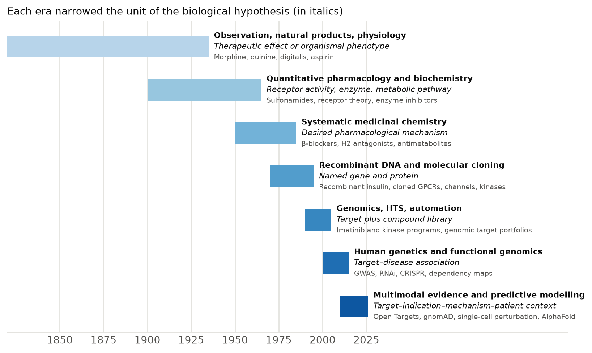
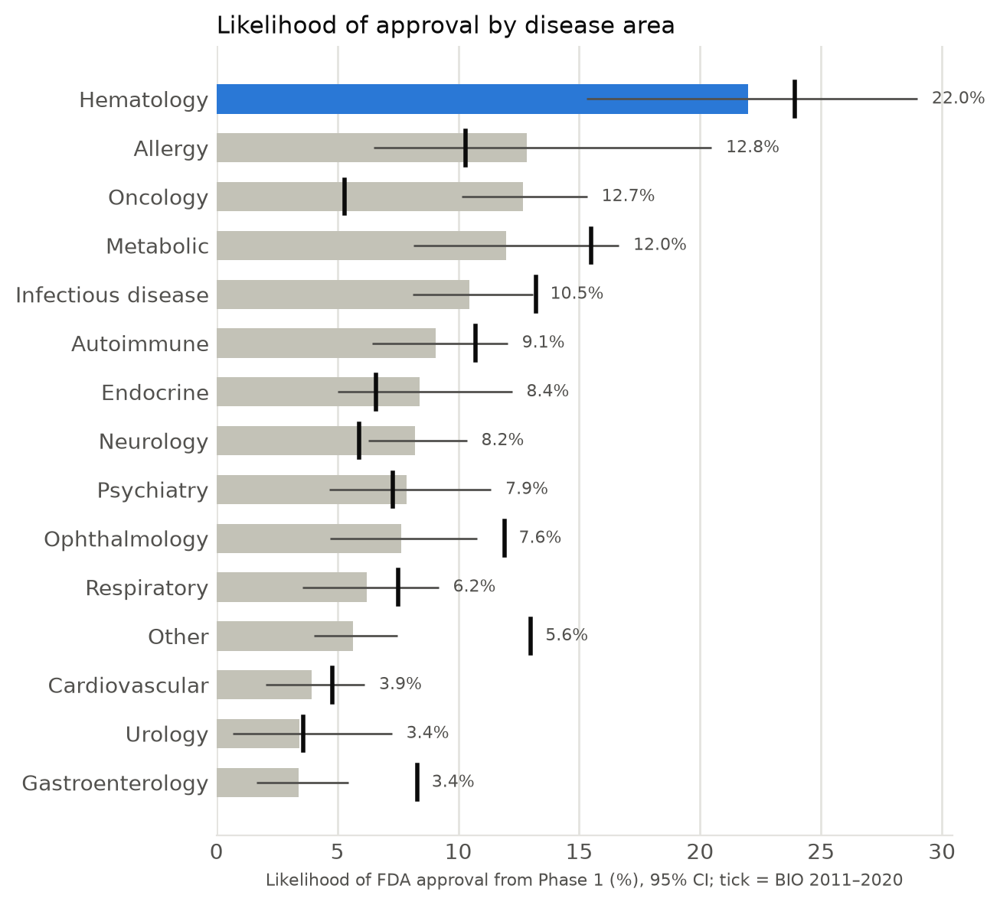
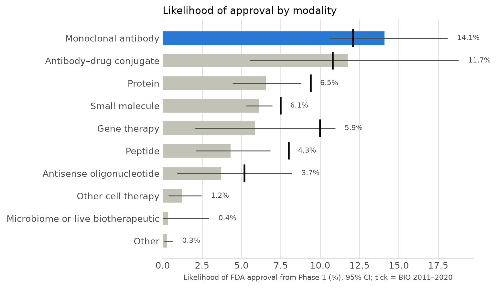
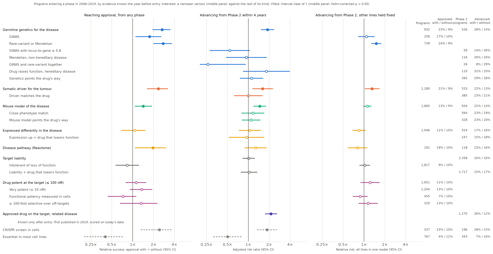
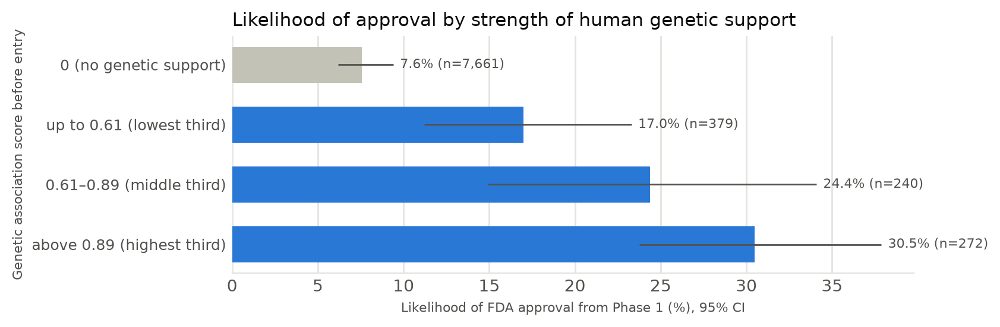
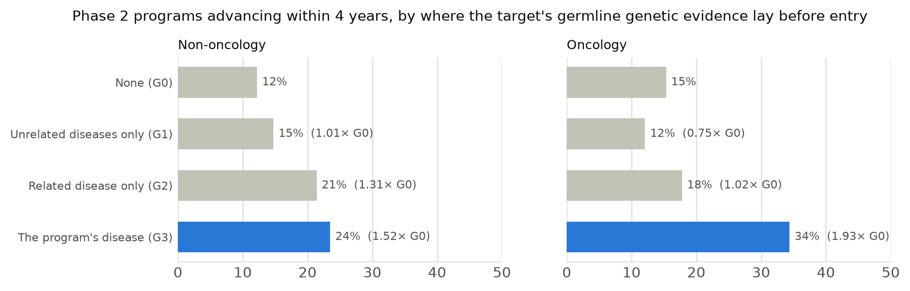
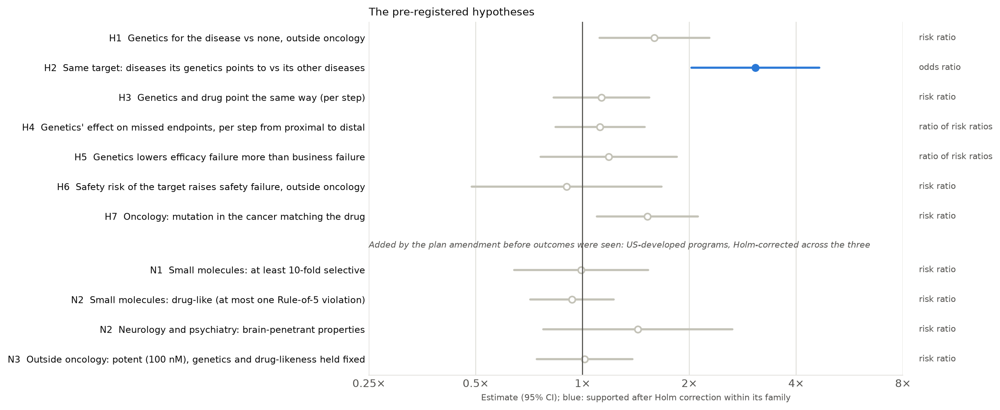
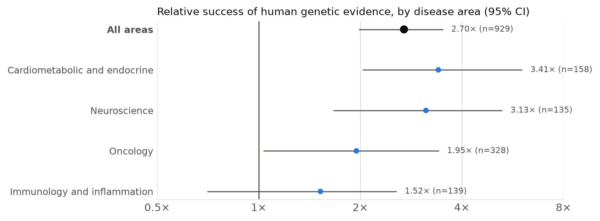
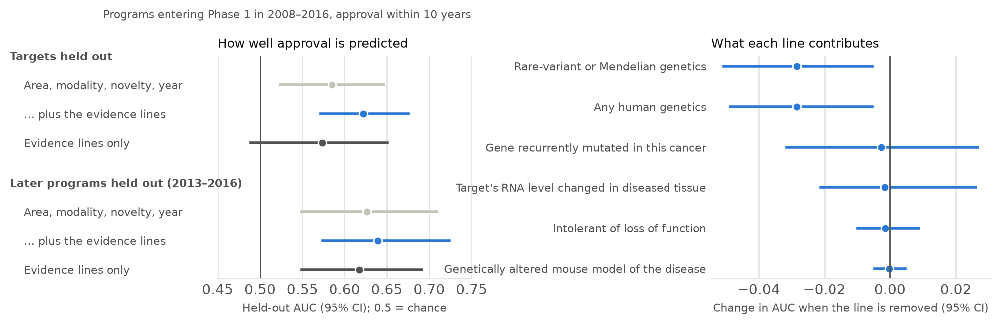
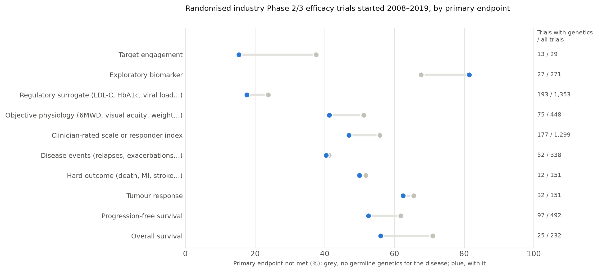

# Predictive Validity in Drug Development

<!-- Rendered by `python -m report` from report/output/*/numbers.json into REPORT.md, the doc's main tab.
     Every number in braces comes from the generated outputs; edit prose here, never the numbers. -->

## Introduction

The number of new drugs approved per billion dollars of R&D spending halved roughly every nine years from 1950 to 2010 ([Scannell et al. 2012](https://doi.org/10.1038/nrd3681)), and has flattened since ([Ringel et al. 2020](https://doi.org/10.1038/d41573-020-00059-3)). Only 7.9% of programs that enter Phase 1 reach FDA approval ([Thomas et al. 2021, BIO](https://go.bio.org/rs/490-EHZ-999/images/ClinicalDevelopmentSuccessRates2011_2020.pdf)), and we can see little of why the rest fail.

Scannell and colleagues called the decline Eroom's Law and blamed, among other causes, an overestimate of how much molecular biology and high-throughput screening raise the chance that a molecule works in patients. [Scannell and Bosley (2016)](https://doi.org/10.1371/journal.pone.0147215) then showed that a model's *predictive validity*, how well its output tracks the clinical outcome, matters far more than its throughput. Some evidence types have been measured: genetic support makes a target–indication pair about 2.6 times as likely to go from Phase 1 to launch ([Minikel et al. 2024](https://doi.org/10.1038/s41586-024-07316-0); [Nelson et al. 2015](https://doi.org/10.1038/ng.3314)), and AstraZeneca's "5Rs" review of its own pipeline raised its success rate from 4% to 19% ([Cook et al. 2014](https://doi.org/10.1038/nrd4309); [Morgan et al. 2018](https://doi.org/10.1038/nrd.2017.244)). Most of the evidence that drug programs rest on has never been scored this way.

This report scores it from primary records. Every interventional drug, biological, genetic or combination-product study on ClinicalTrials.gov (227,130 studies, snapshot of 2026-11-02) was resolved to the molecular entities it tests and the MONDO diseases it treats, and joined to every FDA approval we could document (Drugs@FDA, 6,739 approved uses read from approval letters, labels, and 229 CBER biologics applications). The unit is a *development program*: one molecular entity developed for one indication. Every program that entered a phase in 2008–2019 is counted.

1. **Industry failure modes:** how often programs advance at each phase and why they stop.
2. **Predictive power of preclinical evidence:** which evidence known before a phase predicts approval and Phase 2 success, whether stronger or more specific evidence does better, and where it holds.

Every classification was made by an LLM reading the source record, and the main labels were checked against an independent re-derivation of a seeded sample (Appendix).

## A history of drug development

Over the past century, drug development moved from natural observation and phenotypic screening to target-based and genetically grounded hypotheses. Each era narrowed the unit of the biological hypothesis, from a whole-organism effect to a target in a specific patient context.

## Industry failure modes

For development programs that entered a phase in 2008–2019 and were developed in the US, the likelihood of FDA approval from Phase 1 is 10.8% (95% CI 9.7%–12.0%), against BIO's 7.9% for 2011–2020 (6.8% for novel drugs). Across all industry programs registered on ClinicalTrials.gov, including those run only outside the US, it is 7.5%. Once each stop is traced to its cause, efficacy or exposure explains 48% of Phase 2 and 3 stops and sponsor decisions 21%.

### How programs are counted

12,539 programs of 7,005 individual drugs entered at least one phase in 2008–2019. Entries end in 2019 so that every program has had at least six years to advance or stop before the snapshot; registration of industry trials became mandatory in the US in late 2007, so the window starts in 2008. A program is one molecular entity developed for one indication; it enters a phase when its first industry trial of that phase starts, and *advances* when a later-phase trial in the disease starts or the FDA approves it for the disease. A program the registry shows as stopped but that tracing found had gone on counts as advancing when a later-phase trial started elsewhere, and as still running when its development went on recently. As in BIO's report, each phase's success rate is advanced ÷ (advanced + stopped), and LOA is their product. The full counting rules are in the appendix.

### Why programs stop

For 2,952 of the 5,428 Phase 2 and 3 stops among 2008–2019 entries, the registry gives no usable reason: none at all, only "sponsor decision", an unspecified "other" reason, a mixed primary endpoint, or an efficacy reason that the reading of efficacy failures below found wrong. An LLM traced each of these through the program's trials and a web search of company releases, filings and news. It found a sourced cause for 72% and a likely cause for 98%. How it works, and how well it does on stops whose reason is known, is in the appendix.

**Some recorded stops were not stops.** Tracing found that 347 Phase 2 and 3 programs the registry shows as stopped had carried on: under another registry, region, name or combination, or through FDA approval for the disease. Another 68 were never development programs: academic studies using an approved drug as a research tool, or drug-interaction and dosing studies. The cause shares in this section leave all of them out, and the success rates above count what tracing found: a later phase as advancing, development still under way as still running, and non-programs not at all. Read from ClinicalTrials.gov alone, counting them all as stops, the likelihood of approval would be 6.5% across all programs rather than 7.5%, and 10.0% for programs developed in the US rather than 10.8%.

**Efficacy is the main reason programs stop in Phases 2 and 3.** Counting sourced and likely causes, efficacy or exposure ended 48% of Phase 2 stops and 48% of Phase 3 stops, against 29% of Phase 2 and 3 stops as the registry records them. Sponsor decisions are the next largest cause in Phase 2 (25%) and the largest in Phase 1 (47%). In Phase 3, 30% of stops followed a positive readout. Safety is rare once only stops whose sponsor gives a safety reason count: 4% in Phase 2 and 4% in Phase 3.

**What each cause breaks down into.** Shares are of Phase 2 and 3 stops whose cause is sourced.

* **Sponsor decisions**: a source names the decision for 59% of these stops; the other 41% are the likely cause where no source gives one, and have no subcause. Where a source gives it, by subcause:
    * Other programs put first: 34%
    * Sponsor ran out of money or closed: 20%
    * Partner left: 11%
    * Commercial or competitive reasons: 10%
    * Only "business reasons" given: 11%
* **Positive readouts that went no further**, by subcause:
    * Sponsor's own reasons: 60% in all, chiefly other programs put first (27%)
    * Approved outside the US: 22%
    * Regulator declined it: 3%
    * No reason given: 12%
    * 40% have a likely rather than a sourced reason
* **Safety stops**, by subcause:
    * Harms in patients, mechanism not stated: 73%
    * Off-target toxicity: 14%
    * Animal toxicology findings: 7%
    * On-target toxicity: 5%
* **Operational stops**, by subcause:
    * Slow enrollment: 73%
    * COVID-19: 9%
    * Trials redesigned or replaced: 6%
* **Efficacy failures**, by what the evidence shows about target engagement (shares of all Phase 2 and 3 programs that stopped for efficacy or exposure):
    * Engaged its target, but the disease did not respond: 47%
    * No human evidence of engagement either way: 35%
    * Never engaged its target or reached adequate exposure: 11%
    * Trial design, population or endpoint: 7%
    * Toxicity offset any efficacy: 1%

    Where engagement is known, 19% (17%–22%) were never engaged, as often in Phase 3 (18%) as in Phase 2 (20%); in 118 of them this is inferred because another drug on the same target worked. The first kind points to a gap in models of the disease, the third to a gap in models of dose and engagement.
* **Stops no source explains**, by signal:
    * Sponsor started no later trial: 35%
    * Drug dropped while its sponsor carried on: 35%

![Top: Phase 1, 2 and 3 stops by cause, phase entries 2008–2019, leaving out programs that did not actually stop or were not development programs; where no source states the cause, the likely cause is counted. Below: each cause broken down by subcause, one panel per phase. Solid: the stop's own text or a source states the subcause; pale: the search found it likely but no source says it; "not stated": the sources say no more than the cause; "cause likely, not sourced": the cause itself is only likely, so it has no subcause. For efficacy, the panels show what the evidence says about target engagement; programs whose efficacy failure was not attributed are those without an efficacy label](report/output/figures/stop_causes_by_phase.png)

**Over time.** Counting sourced and likely causes, and leaving out records that were not stops, efficacy or exposure was the cause of 51% of stops among programs entering in 2008–2011, 48% in 2012–2015 and 46% in 2016–2019; sponsor decisions 19%, 22% and 24%, and a positive readout not yet advanced 18%, 20% and 18%. Among entries from 2015 to 2025 (3,836 stops, many later programs still running), the shares are 42% efficacy or exposure, 27% sponsor decision and 19% positive readouts.

Safety counts only stops whose sponsor states a safety reason, and the classifier, tested on stops whose reason is known, often read safety stops as efficacy. Safety is therefore under-counted and the efficacy share is an upper estimate.

### By disease area and modality

Disease areas rank differently from BIO's: the rank correlation with BIO's LOA across the 15 areas is 0.44 for all programs and 0.42 for US-developed ones. Across all programs, hematology programs reach approval most often (24.7%), then allergy, oncology and metabolic programs (11.9%, 12.8% and 12.0%), and cardiovascular, gastroenterology and urology programs least (3.9%, 3.4% and 3.4%). Among US-developed programs, endocrine (14.9%) and oncology programs (15.0%) come out far above BIO's 6.6% and 5.3%; for oncology, the window takes in the wave of immunotherapy and antibody–drug conjugate approvals, and an approval in a cancer subtype counts for the program's cancer. Ophthalmology (8.0%) falls well below BIO's 11.9%. Among modalities, monoclonal antibodies and antibody–drug conjugates reach approval most often across all programs (14.8% and 12.0%), and among the classes BIO also reports, antisense oligonucleotides (4.0%), peptides (5.0%) and gene therapies (6.8%) least. RNA interference and CAR-T, near the top of BIO's ordering, have too few entities resolved in Phase 3 here (most of their approvals came straight from Phase 2) to estimate. Across the 7 classes both estimate, the modality ordering agrees with BIO's (rank correlation 0.82).

## Predictive power of preclinical evidence

Human genetic evidence linking a program's target to its disease is the clearest preclinical signal of success. Programs whose target had it before entering the phase reached approval 2.80 times as often (24% against 9%), and Phase 2 programs with it advanced 1.94 times as often, more so the stronger the evidence and the closer it lies to the program's own disease. Genes recurrently mutated in the cancer and mouse genetics (mice with the target gene knocked out or mutated, not drugs tested in mice) also predict, though mouse genetics mostly rides along with human genetic support; the drug's own potency, selectivity and drug-likeness add little, no sharper version of any evidence picks better programs, and an approved drug on the target for a related disease predicts as strongly as genetics. Most programs enter on evidence that does not predict success, chiefly published animal studies of the drug and approvals on the target for unrelated diseases, and only 37% have any evidence that does, so it sorts individual programs only modestly (held-out AUC 0.593 without it, 0.633 with it).

### Evidence and design

Evidence is grouped by the experimental system that produced it: **human genetics**, **tumour genetics**, **human diseased tissue**, **animal studies**, **cell studies**, **the molecule itself** and **early human pharmacology**. Two more kinds are kept apart because neither says the drug will work: the target's **safety risk**, and **clinical precedent**, what earlier drugs on the target did, which serves as the benchmark. Each program is scored for the evidence known **for its disease, as of the year before it entered the phase**. 10% of Phase 1 entrants had human genetic evidence for their disease.

Two outcomes are measured on programs entering a phase in 2008–2019. *Relative success* is the likelihood of approval with the evidence divided by that without it (Nelson et al. 2015; Minikel et al. 2024). The second is whether a Phase 2 program advanced to Phase 3 or approval within four years: Phase 2 is the first test of efficacy in patients, so it is where the evidence's claim about the disease is first put to the test. The category chart and its figures cover the 8,422 programs developed in the US (9,958 phase entries); the analyses that follow it cover all 8,582 programs, of which 4,550 entered Phase 2 and 16% advanced. The Phase 2 hypotheses, and the lines and hypotheses the categories added, were registered before their outcomes were examined. Dating, matching, models and robustness checks are in the appendix.

### Which evidence predicts

*How often US-developed programs that entered a phase in 2008–2019 went on to FDA approval when the evidence was known the year before they entered, relative to programs without it: 2× means twice as often. n: programs with the evidence. Bold: an area of evidence, each answering one question; indented: groups of its programs that do not overlap, so each program with the evidence sits in exactly one. Filled dot: the whole 95% range sits on one side of 1×, so the difference is unlikely to be chance. Arrowhead: the range runs past the edge of the chart. †: scored only for 2011–2019 entries, so it is not part of its area. The registered categories, every line tried and the counts are in the appendix.*

**Human genetics predicts at every step.** US-developed programs whose target had inherited variants linked to the disease before entry reached approval 2.55 times as often (1.93–3.35; 29% against 12%), advanced from Phase 2 1.82 times as often, and stopped for efficacy less often (0.65×). Rare-variant and Mendelian evidence carries it (2.63× to approval, 1.95× at Phase 2), as Minikel et al. (2024) found; GWAS evidence goes with approval (1.62×) but not with advancing from Phase 2 (1.01×). Across all programs, rare-variant evidence keeps an independent effect with every other line held fixed (1.55×). Curated disease mechanisms (Reactome) sit mostly on targets that already have genetic support and add nothing clear (1.89×, 0.93–2.80).

**Tumour genetics predicts in oncology; mouse genetics predicts less.** A gene recurrently mutated in the cancer went with approval 2.02 times as often (1.14–3.53) and with advancing from Phase 2 (1.56×); requiring the mutation to match the drug adds nothing (1.76×). Mouse genetics, a mouse with the target gene knocked out or mutated whose phenotype resembles the disease, gives 1.44× (1.07–1.87), but across all programs it adds little once genetics is known (1.14×): such mice mostly exist for targets with human genetic support.

**Diseased tissue and the target's safety risk carry nothing.** A change in the target's RNA level in diseased tissue does not go with approval (0.89×, 0.58–1.26). A target that does not tolerate loss of function, or whose knockout mouse dies, was no more likely to stop for safety (1.02×, 0.54–1.94).

**What earlier drugs on the target did predicts as strongly as genetics, in both directions.** An approved drug on the target for a related disease, the benchmark, goes with approval 1.96 times as often and with advancing from Phase 2 1.85 times as often. An approved drug on the target only for unrelated diseases goes with less success (0.74× to approval, 0.71× at Phase 2); the comparison includes the related-disease programs above, so a distant approval is at least no advantage. An earlier failed trial of another drug on the target in a related disease went with *more* success (1.57×, 1.49× at Phase 2): such failures mark targets under heavy development, not targets known to be wrong.

Patient selection does not explain the results: holding biomarker-selected enrolment fixed leaves human genetics at 1.78× at Phase 2.

**Known only after entry.** Genome-wide CRISPR screens beyond cancer cell lines (Project Score's priority targets, neuronal screens) and DepMap's essential-gene list were first published in 2019, too late for any program in the window. With hindsight, screen hits go with success (1.96× to approval), mostly on oncology targets already validated, and essential targets with failure (0.43×), much of it from targets found essential after their programs had failed. The genetics result itself is not hindsight: across all programs, counting evidence known by 2026 instead of before entry weakens it to 2.02×.

**Published studies of the drug (exploratory).** Programs whose drug had already been studied in animals in the published literature reached approval less often, not more: 0.79× as often for any published animal study, and 0.74× for a study in an animal model of the disease. In Phase 2 the gap remains when disease area, modality, era, novelty and precedent are held equal (0.83×, 0.71–0.99). A published study showing the drug acting on its target in people made no clear difference (1.04×). Publication is more likely a marker of who develops a drug than a cause of failure: companies rarely publish their own animal work before a trial, so a drug with a published animal record is more often one studied by academic groups, which these data cannot test directly. The searches found about three in four of the animal-model studies a blind hand search found, and fewer of the others (appendix).

### What programs enter on

Only 37% of the 9,958 US-developed phase entries had any of the evidence that predicts approval: genetic support, a gene recurrently mutated in the cancer, mouse genetics resembling the disease, or a drug on the target approved for a related disease. Most of the rest still had evidence of a kind the field relies on.

| What the program had before entering the phase | Share of entries |
| :---- | :---- |
| Evidence that predicts approval (any of the four above) | 37% |
| A published study of the drug itself (an animal model of the disease, healthy animals, or target engagement in people) | 70% |
| A drug on the same target approved, for any disease | 43% |
| Binding to its target measured at 100 nM or better | 14% |

Of the entries with no predictive evidence, 69% had a published study of the drug, which in these data goes with less success, not more, and 25% were on a target approved only for unrelated diseases, which also goes with less success (0.74×). 24% had none of the evidence measured here; they rest on the sponsor's unpublished data or reasoning from mechanism. Entering a trial requires evidence of safety, not of efficacy, and the decision to advance from Phase 2 rests on the sponsor's own trial results, which no public source shows. A line counts here only where it is known to be present.

### Does stronger or more specific evidence help?

Approval rises with the strength of genetic support, from 9% with none to 33% in the top third. It also depends on how close the evidence lies to the program's disease: outside oncology, Phase 2 programs advanced at 12% with no germline genetics on the target, 15% with evidence only for unrelated diseases, 21% for a related disease and 24% for the disease itself, and the same target does better in the diseases its genetics points to (odds ratio 3.07).

Beyond that, sharper versions do not help. Among programs with germline genetics, strong GWAS evidence (0.54), Mendelian evidence (0.92) and genetics pointing the drug's way (1.10) did no better than the rest; nor did a close phenotype match (1.19) or mouse genetics pointing the drug's way (1.11) among programs with mouse genetics, or a driver matching the drug among oncology programs with a driver (0.98). Direction could not be tested properly: of the Phase 2 programs with genetic support, 270 acted in the direction the genetics favoured and only 10 against it, because sponsors almost never develop against an established mechanism.

### Biology or sponsor commitment?

![A: the risk ratio of advancing from Phase 2 within four years for programs with genetic evidence for their disease, as reported, with sponsor size, with each large sponsor compared with itself, and within sponsor-size tiers. B: for each large sponsor with at least three programs of each kind, the share of its genetically supported Phase 2 programs that advanced against the share of its other programs. C: at the first randomised Phase 2 efficacy trial, the risk ratio of meeting the primary endpoint and of advancing after a met or a missed endpoint](report/output/figures/sponsor_confound.png)

Advancing from Phase 2 is partly a sponsor's decision, so genetically supported programs might do better because sponsors back them harder, not because their biology is right. Two checks point mostly to the biology.

**It is not who runs them.** Genetically supported programs are about as common at the largest sponsors as at the smallest (11% of Phase 2 programs at the 20 largest, 12% at sponsors outside the top 100). Adding sponsor size to the model leaves the risk ratio of advancing at 1.93 (1.94 as reported), and comparing each of the 24 largest sponsors only with itself leaves it at 1.92. The advantage holds in each size tier, from 1.75× at the 20 largest to 1.99× at the smallest. At 21 of the 36 large sponsors with at least three programs of each kind, genetically supported programs advanced more often than the sponsor's others (30% against 19% on average).

**Most of the advantage shows at the readout, which the sponsor does not choose.** For the 1,430 programs whose first randomised Phase 2 efficacy trial has a readable result, genetically supported programs met the primary endpoint more often (43% against 28%; 1.43×, 1.13–1.81). Given the readout, they advanced only somewhat more often, after a met endpoint (47% against 36%; 1.32×, 0.93–1.87) and after a missed one (16% against 11%), neither clearly. Some extra backing cannot be ruled out: genetic support lowered stops for sponsor decisions about as much as stops for lack of efficacy (ratio of the two effects 1.19, 0.76–1.85). Approval, which needs the FDA to accept the Phase 3 data, shows the advantage too (2.80×).

### Confirmatory hypotheses

One of the seven registered hypotheses holds after correction for multiple testing: genetics for the disease predicts advancing within a target, across the 72 targets developed in several diseases (odds ratio 3.07, 2.03–4.65), so the signal is not only that some targets are better than others. Outside oncology, genetics for the disease goes with advancing (risk ratio 1.59, 1.12–2.28; only evidence for the disease itself, not a related or unrelated one, differs from none) but does not survive the correction (Holm p = 0.06).

The other five are not supported. Open Targets' direction-of-effect fields could not test direction (they mislabel gain-of-function genes such as PCSK9 and MYH7; the appendix gives the replacement analysis). Genetic support lowered efficacy stops (0.64) but business stops by about as much. Its effect did not clearly weaken from proximal to distal endpoints. The target's safety risk did not predict safety stops, which are under 2% of programs. A gene recurrently mutated in the cancer whose mutation matches the drug went with advancing (1.52) but not beyond chance across seven tests.

Three hypotheses about the drug itself were added before any of their outcomes were examined, and tested on US-developed programs; none holds. At least 10-fold selectivity over measured off-targets did not raise the chance of advancing from Phase 2 (N1, 0.99, 0.64–1.53); nor did drug-like properties (0.93) or, in neurology and psychiatry, brain-penetrant properties (1.43, 0.78–2.64) (N2); nor, outside oncology, did potency of 100 nM or better once human genetics and drug-likeness were held fixed (N3, 1.01, 0.74–1.38). Holm-corrected across the three, the smallest p is 1.00.

### By disease area

Human genetic evidence goes with approval in every area group with enough programs to measure it, clearly so in all but immunology and inflammation, and its effect does not differ measurably between them (p = 0.62 for the difference at Phase 2). It is largest in cardiometabolic and endocrine diseases (3.37×, 23% against 7%) and neuroscience (3.16×), smaller in oncology (2.00×), and least clear in immunology and inflammation (1.47×, 0.69–2.42), where much of the evidence is GWAS. Hematology and the other areas have too few genetically supported programs to estimate. Leaving out any one group keeps the pooled relative success between 2.56 and 3.25.

A gene recurrently mutated in the cancer gives 1.98× in oncology. Mouse genetics goes with approval in neuroscience (1.77×), leans the same way in cardiometabolic disease (1.54×) and immunology (1.61×), and does not in oncology (1.00×). A change in the target's RNA level in diseased tissue is the one line whose effect differs between groups (p = 0.01), going the wrong way in immunology (0.37×); with several lines and groups tested, this is a lead, not a finding.

### The drug's own pharmacology

The drug's own laboratory pharmacology is measured for small molecules only: the bioactivity database holds no potency measurements for antibodies, and the affinities published for them are almost all 100 nM or better, so a threshold would not separate them. Of 6,091 US-developed small-molecule entries, 1,390 had a published potency of 100 nM or better at the primary target before entry. They reached approval 1.57 times as often (1.14–2.08; 1.96× at 10 nM or better), but did not advance from Phase 2 more often with disease area, modality, novelty and precedent held fixed (1.08×, 0.82–1.43), and outside oncology potency adds nothing once human genetics and drug-likeness are known (1.01×). At least 10-fold selectivity over the off-targets measured (1.27×), drug-like properties (0.99×) and, in neurology and psychiatry, properties that let a molecule cross into the brain (0.86×) show no association with approval.

The fair reading is that a drug well short of 100 nM at its target rarely succeeds, not that more potency helps; and because promising drugs attract more papers, a measurement is partly a marker of a well-studied program. The category as a whole, among small molecules whose structure is known, shows nothing (0.95×): nearly all of them are drug-like, so the category is mostly drug-likeness.

### What this means

* **Disease-specific human genetics carries over.** It fades as the evidence moves away from the disease, holds within a target, does not come from hindsight, and roughly doubles the chance of reaching Phase 3. It holds at sponsors of every size and within the same sponsor, and shows mostly as more Phase 2 trials meeting their primary endpoint, which the sponsor does not choose.
* **It is a filter, not a forecast.** Nearly three in four genetically supported Phase 2 programs still did not advance, most programs that advanced had no such evidence, and sharper versions of the evidence did not pick better programs. Added to disease area, modality, novelty and entry year, the evidence raises the held-out AUC for predicting approval only from 0.59 to 0.63 (appendix).
* **No kind of endpoint shows it clearly.** Genetically supported trials missed regulatory surrogates less often in trials with posted results, but the interval spans no effect; on clinical scales, events and survival the difference is small or not demonstrable.
* **Other preclinical evidence adds less.** Tumour genetics helps in oncology; mouse genetics helps mostly by riding along with human genetics; RNA changes in diseased tissue, curated disease mechanisms and the drug's own potency, selectivity and drug-likeness add nothing reliable.
* **Some questions cannot be answered from what sponsors ran.** Almost no program went against an established genetic mechanism, and registries rarely record safety as the reason a program stopped.

## Historical case studies

The cases below each looked strong on mechanism, cell and animal evidence, and failed in humans.

| Drug (indication) | Evidence that looked strong | Why it failed |
| :---- | :---- | :---- |
| BACE1 inhibitors: verubecestat, lanabecestat, atabecestat (Alzheimer's disease) | Crystal structures; Aβ lowering in cells and animals; a protective human *APP* variant (A673T) that reduces BACE1 cleavage; CSF Aβ down 50–90% in Phase 1 | No slowing of decline. In the verubecestat (prodromal) and atabecestat (preclinical) trials cognition worsened early, with a dose-related effect that reversed after stopping, consistent with BACE1's other neuronal substrates. Reducing Aβ production did not help people who already had plaques; antibodies that clear plaque (lecanemab, donanemab) later slowed decline modestly. ([Egan 2018](https://doi.org/10.1056/NEJMoa1706441); [Egan 2019](https://doi.org/10.1056/NEJMoa1812840); [Sperling 2021](https://doi.org/10.1001/jamaneurol.2020.4857)) |
| Torcetrapib and later CETP inhibitors (cardiovascular disease) | Raised HDL in people with CETP deficiency; HDL up 60–70% as predicted; less atherosclerosis in rabbits | Torcetrapib increased deaths by 58% (93 vs 59) and major cardiovascular events by 25%, probably through an off-target rise in aldosterone and blood pressure. Dalcetrapib and evacetrapib raised HDL without cutting events. Anacetrapib cut major coronary events by 9%, in line with its modest non-HDL-cholesterol lowering, and was not filed. ([Barter 2007](https://doi.org/10.1056/NEJMoa0706628); [Schwartz 2012](https://doi.org/10.1056/NEJMoa1206797); [Lincoff 2017](https://doi.org/10.1056/NEJMoa1609581); [HPS3/TIMI55–REVEAL 2017](https://doi.org/10.1056/NEJMoa1706444)) |
| Semagacestat (Alzheimer's disease) | Aβ lowering in cells and mice; dose-dependent 47–84% cut in CNS Aβ production in a small human kinetic study | Did not slow decline. At the higher dose, daily function worsened significantly faster than on placebo and cognition trended worse. Patients had more skin cancers, infections and weight loss, consistent with blocking γ-secretase substrates such as Notch. ([Doody 2013](https://doi.org/10.1056/NEJMoa1210951)) |
| Solanezumab, bapineuzumab (Alzheimer's disease) | Aβ binding; plaque prevention in transgenic mice; peripheral Aβ engagement (solanezumab) and partial plaque lowering on PET in APOE4 carriers (bapineuzumab) | No cognitive benefit across several Phase 3 trials. Solanezumab binds soluble Aβ and did not remove plaque; bapineuzumab's dose was capped by brain swelling (ARIA). Antibodies that cleared plaque more deeply later slowed decline modestly, so these failures look more like insufficient target engagement than a misleading mouse model. ([Doody 2014](https://doi.org/10.1056/NEJMoa1312889); [Salloway 2014](https://doi.org/10.1056/NEJMoa1304839)) |
| TGN1412 (B-cell leukemia, rheumatoid arthritis) | Cynomolgus monkeys tolerated 500 times the human starting dose | All six volunteers who received the drug developed a cytokine storm within 90 minutes. Unlike in the monkeys used for toxicology, human CD4+ effector memory T cells carry CD28. The starting dose already occupied most CD28 receptors; human-cell assays and dosing from the minimal anticipated biological effect level would have flagged the risk. ([Suntharalingam 2006](https://doi.org/10.1056/NEJMoa063842); [Eastwood 2010](https://doi.org/10.1111/j.1476-5381.2010.00922.x); [Stebbings 2007](https://doi.org/10.4049/jimmunol.179.5.3325)) |
| Fialuridine (hepatitis B) | Clean toxicology in mice, rats, dogs and monkeys | Seven of 15 patients developed liver failure with lactic acidosis: five died and two needed transplants. Human ENT1, unlike the rodent transporter, is targeted to mitochondria and carries the drug into them. ([McKenzie 1995](https://doi.org/10.1056/NEJM199510263331702); [Lee 2006](https://doi.org/10.1074/jbc.M513825200)) |

## Appendix

### Data

| Source | What it gives | Version |
| :---- | :---- | :---- |
| ClinicalTrials.gov API v2 | Every interventional drug, biological, genetic or combination-product study: phases, status, dates, sponsor, arms, interventions, conditions, sites, why stopped, posted results | Snapshot 2026-11-02 (227,130 studies) |
| PubMed | Results papers linked to completed trials without posted results (registry RESULT/DERIVED references and the NCT secondary identifier) | Retrieved 2026-11-02 |
| Drugs@FDA, FDA approval letters, openFDA labels | NDA/BLA applications, submissions and action dates; 6,739 approved uses read from 2008–2026 approval letters; current Indications and Usage text | Retrieved October 2026 |
| CBER yearly approval pages, product pages and letters | 229 biologics applications (vaccines, blood products, cell and gene therapies) and their 2015–2025 approval actions, verified by an independent second enumeration | Retrieved October 2026 |
| FDA Global Substance Registration System | UNII substance identifiers and every registered name (official, common, code, brand) | 2026-08-04 |
| MONDO | Disease ontology and hierarchy | 2026-10-06 |
| Open Targets Platform | Target–disease associations by data source, with yearly score series | 26.09 |
| Open Targets Platform evidence | Every evidence row behind those associations for drug targets, with its date, direction of effect, confidence and source detail; mouse-model phenotypes | 26.09 |
| Mammalian Phenotype ontology | Mouse phenotype hierarchy (knockouts lethal before weaning) | Retrieved October 2026 |
| gnomAD | Loss-of-function constraint (LOEUF) | v4.1 |
| DepMap | Common-essential genes from CRISPR (Chronos) screens | Public 19Q4 to 24Q4, the last release of each year |
| HGNC | Approved human gene symbols with previous symbols and aliases | 2026-10-16 |
| ChEMBL | Drug mechanisms of action, as hints for target assignment | 37 |
| ChEMBL bioactivities | Potency, affinity and selectivity measurements of each entity's molecules, dated by the year of the paper, patent or dataset that reported them | 37 (137,580 measurements) |

Per-source detail (who compiles each source, what this analysis takes from it, raw response shape and a sample record) and the tables behind the main tab's figures are in the Appendix detail tab.

### How programs are counted

* **Trial:** a registered interventional study listing Early Phase 1 to Phase 3. A Phase 1/2 trial counts as Phase 2 and a Phase 2/3 trial as Phase 3. Withdrawn trials never enrolled and are left out.
* **Molecular entity:** the active substance, whatever its brand, sponsor code, dose or salt, resolved to its FDA UNII substance where one exists. Biosimilars fold into their reference entity.
* **Disease:** the MONDO term for the condition the trial treats, without line, stage, biomarker or age qualifiers.
* **Program:** one entity developed for one indication. An indication groups the entity's MONDO diseases the way a sponsor runs them as programs (prostate cancer with castration-resistant and metastatic prostate carcinoma; diffuse large B-cell and follicular lymphoma kept apart), decided by an LLM for each entity. An entity belongs to a program only in trials where it is the investigational agent, not a comparator or background therapy. Each industry trial's purpose is classified first: bioequivalence, formulation, food-effect, interaction and other product-support studies (10,652 trials) belong to no program; a first-in-human study or a basket across several diseases counts as Phase 1 only for the program the sponsor pursued next.
* **Phase entry and outcome:** a program enters a phase when its first industry-sponsored trial of that phase starts. It *advanced* when a later-phase trial in its disease started (any sponsor) or the FDA approved the entity for the disease. A trial that has not started, because it is still not yet recruiting or its record went silent before its estimated start date, marks neither entry nor advancement. A program is *suspended* when none of its trials, nor the trial that marked its Phase 1 entry, has been active within 24 months of the snapshot (2026-11-02); otherwise it is still running and *censored*. A suspended program that stop tracing found had gone on (appendix on stops) instead advanced, if a later-phase trial started anywhere by the snapshot, or is censored, if its development went on within 24 months of it; one that was never a development program, but an academic study using an approved drug as a research tool or a drug-interaction or dosing study, is left out. Programs whose entity was already approved for the disease are lifecycle programs and are left out; an approval dated only as before 2008 (the first approval letters read) is placed at the entity's first FDA approval, the earliest it could have happened. As in BIO's report, a phase a program skipped (Phase 1 straight to Phase 3, or approval from Phase 2) counts as a success in that phase, each phase's success rate is advanced ÷ (advanced + suspended), and LOA is their product. *US-developed* programs are those with a US-sited industry trial in the phase; a cohort with fewer than ten entities resolved in a phase gets no LOA.
* **Approval:** FDA approval of the entity for the program's disease, a subtype or population of it, or a broader approved class that includes it, judged from the dated approval letters, original-approval dates and labels of every application of the entity (CDER and CBER).

### How LOA moves with each definition

| Cohort or definition | Phase 1 → 2 | Phase 2 → 3 | Phase 3 → approval | LOA (95% CI) |
| :---- | :---- | :---- | :---- | :---- |
| All programs | 57.8% | 31.0% | 41.7% | 7.5% (6.7–8.3) |
| Programs with a US-sited industry trial in the phase | 58.9% | 33.1% | 55.6% | 10.8% (9.7–12.0) |
| Entity not yet FDA-approved at phase entry | 57.0% | 29.3% | 42.1% | 7.0% (6.4–7.8) |
| Entity already FDA-approved for another disease | 61.6% | 42.3% | 40.7% | 10.6% (8.4–13.7) |
| Suspension lag 12 months | 56.7% | 30.1% | 40.6% | 6.9% (6.2–7.7) |
| Suspension lag 18 months | 57.0% | 30.5% | 41.2% | 7.2% (6.4–8.0) |
| Suspension lag 36 months | 59.1% | 31.7% | 43.1% | 8.1% (7.3–9.0) |
| Uncertain approvals counted as approved | 57.8% | 30.9% | 41.7% | 7.5% (6.7–8.3) |
| Shared trials mark entry for every program of the entity | 74.6% | 43.8% | 44.6% | 14.6% (12.6–16.7) |
| Including vaccines | 56.2% | 30.5% | 40.8% | 7.0% (6.3–7.7) |
| Phase entry 2015-2025 (many programs still running) | 58.6% | 37.9% | 43.7% | 9.7% (8.7–10.7) |
| Phase entry 2015-2025, developed in the US | 57.1% | 37.3% | 57.3% | 12.2% (10.9–13.6) |
| Registry only: stops tracing found had not stopped counted as stops | 54.8% | 29.3% | 40.7% | 6.5% (5.9–7.3) |
| Registry only, developed in the US | 56.6% | 32.2% | 54.7% | 10.0% (8.9–11.1) |

### Change over time

Success rose across the window. Programs that entered a phase in 2008–2011 reached approval from Phase 1 5.9% of the time; those that entered in 2016–2019, 9.6% (9.4% and 12.3% for US-developed programs). The gain came in the later phases: Phase 2 success rose from 27.4% to 34.7% and Phase 3 from 36.0% to 49.0% (52.5% to 60.3% for US-developed programs), while Phase 1 success fell slightly, from 59.6% to 56.4%.

| Phase entry | Entities | Phase 1 → 2 | Phase 2 → 3 | Phase 3 → approval | LOA (95% CI) | US-developed: Phase 3 → approval | US-developed: LOA (95% CI) |
| :---- | :---- | :---- | :---- | :---- | :---- | :---- | :---- |
| 2008–2011 | 2,697 | 59.6% | 27.4% | 36.0% | 5.9% (4.9–6.8) | 52.5% | 9.4% (7.8–10.9) |
| 2012–2015 | 2,808 | 57.7% | 30.6% | 39.3% | 6.9% (5.8–8.2) | 52.5% | 10.7% (8.9–12.8) |
| 2016–2019 | 3,582 | 56.4% | 34.7% | 49.0% | 9.6% (8.4–10.9) | 60.3% | 12.3% (10.5–14.3) |

Two features of the registry bear on these trends.

* **Phase 1 registration grew more complete.** US law has required registration of Phase 2 and 3 trials since late 2007 but exempts Phase 1, and journals require it only for trials that are published. Industry Phase 1 registrations grew through the window, partly because more programs were run and partly because more were registered. Programs that fail in an unregistered Phase 1 never enter the count, so the earlier Phase 1 rates may be the more flattering, and the slight fall in Phase 1 success may reflect registration rather than development.
* **Later entrants have had less time.** A program that entered a phase in 2008 has had eighteen years to resolve; one that entered in 2019, about seven. The share of programs still running rises in the latest years, most in Phase 3 (in parentheses below), so those years' rates rest on the programs that resolved first.

| Phase entry year | Phase 1 → 2 (share still running) | Phase 2 → 3 (share still running) | Phase 3 → approval (share still running) |
| :---- | :---- | :---- | :---- |
| 2008 | 59% (4%) | 25% (3%) | 34% (11%) |
| 2009 | 59% (1%) | 27% (3%) | 40% (6%) |
| 2010 | 61% (5%) | 27% (5%) | 31% (12%) |
| 2011 | 59% (4%) | 30% (4%) | 39% (11%) |
| 2012 | 56% (6%) | 27% (5%) | 35% (11%) |
| 2013 | 55% (6%) | 29% (6%) | 37% (14%) |
| 2014 | 60% (3%) | 32% (7%) | 43% (13%) |
| 2015 | 58% (7%) | 35% (9%) | 42% (15%) |
| 2016 | 55% (8%) | 35% (12%) | 52% (14%) |
| 2017 | 64% (9%) | 35% (14%) | 49% (27%) |
| 2018 | 53% (12%) | 31% (20%) | 44% (30%) |
| 2019 | 54% (16%) | 37% (21%) | 51% (36%) |

The table below shows what keeps a program counted as running, among programs that entered a phase in 2008–2019 and are still running at the snapshot. A program with no US approval keeps running as long as any trial in its disease is under way, so an extension or long-term study can hold it there after its development has in effect ended; such programs stay out of the success rates rather than counting as stops. They are 29% of still-running Phase 3 programs; counting them as stopped instead would move the Phase 3 success rate from 41.7% to 39.2%, and the Phase 2 rate from 31.0% to 30.7%.

| Phase entered | Still running | A trial of the phase or a later one is under way | Only an extension, long-term or earlier-phase study is under way | Its last trial ended within the past 24 months | The registry shows it stopped, but tracing found development going on |
| :---- | :---- | :---- | :---- | :---- | :---- |
| Phase 1 | 490 (7% of entrants) | 173 (35%) | 23 (5%) | 273 (56%) | 21 (4%) |
| Phase 2 | 643 (10% of entrants) | 330 (51%) | 51 (8%) | 209 (33%) | 53 (8%) |
| Phase 3 | 428 (19% of entrants) | 205 (48%) | 122 (29%) | 82 (19%) | 19 (4%) |

### How each label was made, and how good it is

Every judgement in this analysis is an LLM call (Claude) that reads the source record and returns a structured answer, stored with its prompt, input, model and code version. Disease mapping, entity resolution, trial purpose and roles, approvals, stop reasons, trial outcomes, modality, disease area and targets were all made this way, not with keyword rules. For each high-stakes label, a seeded random sample was re-derived independently by agents working from the primary sources (registry records, PubMed, Drugs@FDA, DailyMed, CBER pages) before they saw the stored answer. Agreement counts answers judged correct or defensibly different under the same rules.

| Label | Audited | Agreement (95% CI) | Wrong |
| :---- | :---- | :---- | :---- |
| Condition → MONDO disease | 100 | 99% (95%–100%) | 1 |
| Intervention name → molecular entities | 100 | 94% (88%–97%) | 6 |
| FDA application → molecular entities | 100 | 95% (89%–98%) | 5 |
| Approval letter → approved uses | 60 | 100% (94%–100%) | 0 |
| Supplement label or review → approved uses (no letter) | 20 | 95% (76%–99%) | 1 |
| Trial stop reason | 30 | 97% (83%–99%) | 1 |
| Primary endpoint met / not met (posted results) | 60 | 100% (94%–100%) | 0 |
| Primary endpoint met / not met (results papers) | 30 | 100% (89%–100%) | 0 |
| Approval (sampled as approved, dated from 2008) | 25 | 100% (87%–100%) | 0 |
| Approval date (sampled as approved, dated from 2008) | 25 | 100% (87%–100%) | 0 |
| Approval (sampled as approved before 2008) | 15 | 100% (80%–100%) | 0 |
| Approval (sampled as not approved, Phase 2+ programs) | 31 | 100% (89%–100%) | 0 |
| Approval (sampled as uncertain) | 12 | 75% (47%–91%) | 3 |

Each error pattern these audits found was fixed at its source and the affected labels re-derived, not patched by hand. The latest round was a full rebuild: trials whose only interventions are combination products or genetic agents were added; each condition is mapped with its trials' titles and start years, so that it is read as its sponsors meant it (SARS wording in trials from 2020 on is COVID-19); a condition mapped only to a broader term no longer starts a program of its own; development codes resolve to the parent substance rather than a salt, hydrate or formulation; FDA products link only their principal active ingredients; efficacy supplements with no FDA letter are read from their label or review; approval judgements see each program's trial eligibility criteria and the disease's full ancestry; publication-based outcomes are judged against the registered primary outcomes; and endpoint classes are decided knowing the drug's targets. The figures above come from fresh samples drawn after that rebuild. The remaining entity errors are mostly development codes whose nonproprietary name is too recent for the FDA substance registry to list the code, and a few nutrients and excipients registered only as an unspecified form. Programs whose approval is judged "uncertain" (13 of 21,931 judgements) count as not approved; counting them as approved instead moves no rate by more than a tenth of a percentage point (sensitivity table). The approval audit's strata are those of the judgements it sampled.

Three labels were also compared with the decisions their revised prompts replaced. Trial purposes and roles agree with the earlier decisions on 98% and 97% of trials, and disease mapping chose the same MONDO term for 91% of conditions. ClinicalTrials.gov's own MeSH indexing is no substitute: its terms belong to a study rather than a condition, so only 43% of condition strings can be given one, and where both routes name a disease, MeSH carried to MONDO agrees with the mapping for 60% (24% broader, 11% another disease) and gives a disease to 520 conditions that are not diseases, such as healthy volunteers; a hand review of 20 disagreements favoured the mapping 6 times to MeSH's 1. Modality, disease area and targets were not audited. The Phase 2 endpoint classes were audited on a seeded sample of trials, and the mechanism and mouse-model labels were spot-checked (Phase 2 analysis).

### How stops were traced and efficacy failures classified

**Tracing the stops the registry does not explain.** Every Phase 1, 2 and 3 program that entered from 2008 to 2025 and stopped was traced (6,997 Phase 2 and 3 programs, 3,916 Phase 1); the report's figures use the 2008–2019 entries. Where the registry gives no usable reason, a model read the program's trials (records, posted results, linked papers) and signals of what happened next: whether the drug went on in other diseases, whether its sponsor started any trial afterwards, and whether drugs on the same target stopped at the same time. It then searched the web for company releases, SEC filings, pipeline updates, conference reports and trade news, with ClinicalTrials.gov excluded. It named a cause only where a source supported it, citing only pages its own searches returned, and separately gave a *likely* cause, its best inference from context, where no source says.

**How well the tracing does.** The same procedure was run on 150 stops whose registry does state a reason, drawn at random across causes, with the reason removed and ClinicalTrials.gov blocked. It named a sourced cause for 78% of them, and that cause matched the registry's for 69% (κ = 0.60); the likely cause matched for 63% (κ = 0.53). Accuracy differs by cause. Efficacy or exposure stops were recognised 74% of the time, and only 80% of the stops it called efficacy or exposure were such stops in the registry: safety stops were often read as efficacy (companies announce both as an unfavourable benefit–risk), and sponsor decisions and operational stops were confused with each other (68% and 40% recognised). The efficacy share after tracing is therefore an upper estimate, and safety is likely under-counted. The registry's stated reason is itself an imperfect reference, since a stated business reason can hide a failed readout. Stops with a stated reason are probably also easier to trace, so accuracy on the unexplained stops is likely lower. One independent check holds: of programs traced to an acquisition, merger, lost funding or closure, 61% had a sponsor that started no trial afterwards, against 25% of those traced to efficacy.

**Subcauses.** Each cause has one list of subcauses, ordered so that where more than one applies the first listed wins, with "other" for a specific reason no listed subcause covers and "not stated" where the sources say no more than the cause. A first pass, without web search, read each safety, sponsor-decision, operational and positive-readout stop's stated reason or traced source, named the subcause it states or directly implies, and named the cause the text itself gives. Where that differs, the stop moves to the text's cause: to efficacy, safety or a positive readout; from operational to a sponsor decision when the money ran out; to "did not actually stop" when development went on or the FDA approved the drug; and, for a positive readout, to "not a development program" when no one was developing the drug for the disease. A safety stop never becomes a positive readout. A second pass searched the web for every stop the first left without a subcause, chose from the same list and checked the cause the same way; it marks a subcause *stated* where a source says it and *likely* where the sources make it probable without saying so. Two independent runs of the first pass over a seeded sample of 150 stops agreed on 85% or more of each cause's stops (Cohen's κ 0.67 to 0.92). A stop with no traced cause is described by what happened next, from the registry: whether its sponsor started any later trial, and whether the drug was approved or continued in another disease.

**Stops that did not stop.** For every stop moved to "did not actually stop", a further pass with web search, ClinicalTrials.gov included, found the furthest the program got afterwards: FDA approval for the disease, a later-phase trial started anywhere, development still under way in the same phase (a trial, a licensing deal or a filing), or no evidence that it went on, each with its date and sources. Section 1's rates count a program whose later-phase trial started by the snapshot as advancing, one whose development went on within 24 months of the snapshot as still running, and one with no such evidence as stopped; programs that were never development programs leave the cohort. Approvals this pass reports count only as development going on: a review of all 23 found device approvals, approvals of another drug and approvals for a different indication among them, so approvals come only from the audited approval judgement. Of the 2008–2019 phase entries this moves 189 to advancing and 93 to still running, and removes 125.

**Classifying efficacy failures.** The cohort is every Phase 2 and 3 program that entered in 2008–2019 and stopped for efficacy or for PK, dose or formulation: as the registry records it (1,532 efficacy, 18 PK), or as traced with a source from the stops the registry does not explain (645 efficacy, 23 PK). An exposure failure is the same biology as a failure to engage, so PK stops are broken down here rather than counted apart. For each of the 2,218 programs the model would label (0 more, mostly gene and cell therapies and live biotherapeutics, were refused), an LLM read an evidence bundle: the failed trial's record, posted results and papers, the drug's other trials and their outcomes, results posted by its Phase 1 trials, its FDA approvals, other drugs on the same target in the same or a related disease, and PubMed abstracts on the drug's human pharmacology and on the drug in that disease. It judged, for humans and at the doses tested, the three pillars of [Morgan et al. 2012](https://doi.org/10.1016/j.drudis.2011.12.020): exposure at the site of action, binding or engagement of the target, and the expected pathway effect. Engagement could also be inferred when the drug worked in another disease through the same target and tissue compartment at a comparable dose. It then said why efficacy failed, using only the bundle and citing the sources it used. The categories and checks were fixed before any program was labelled. Where the bundle held no human evidence of engagement (39% of programs), a second pass, added after the first results, gave the same model the same bundle and the web: it searched full-text papers, conference reports, FDA and EMA reviews and company releases for human pharmacology, and could cite only pages its own searches returned. It decided 198 of the 870 programs it searched; the figures below use those labels.

**What the labels show.** Outside oncology, 19% of Phase 2 and 3 efficacy failures where engagement is known were not engaged. Another 46 programs recorded as efficacy stops were not failed efficacy tests (a met endpoint, a missed non-inferiority margin, a business stop, or off-target toxicity); they are counted under their traced cause and left out of the breakdown. Examples of the two kinds:

* *Engaged, no benefit.* Venglustat cut glucosylceramide in the cerebrospinal fluid of people with *GBA1* Parkinson's disease by about 73% at the top dose ([Peterschmitt 2022](https://doi.org/10.3233/JPD-212714)), and over a year their motor scores worsened by 7.3 points on drug against 4.7 on placebo ([MOVES-PD](https://doi.org/10.1016/S1474-4422(23)00205-3)). CSL112, plasma-derived apolipoprotein A1 that raises cholesterol efflux capacity, did not reduce myocardial infarction, stroke or cardiovascular death at 90 days in 18,219 patients after myocardial infarction (hazard ratio 0.93, 0.81–1.05; [AEGIS-II](https://doi.org/10.1056/NEJMoa2400969)).
* *Not engaged.* PF-06687234, an IL-10 fusion protein added to infliximab for ulcerative colitis, was stopped for futility, and was detected, at low concentration, in only one colon tissue sample: the drug may never have reached the inflamed mucosa at a useful level ([Ther Adv Gastroenterol 2026](https://doi.org/10.1177/17562848251410784)).

**Phase 1.** Phase 1 trials mostly test safety, dose and exposure, often in healthy volunteers, so an efficacy or exposure stop there is usually an early patient cohort or a dose-finding readout. The same labels were applied to the 395 Phase 1 programs entering 2008–2019 that stopped for efficacy or exposure. Where engagement is known (244 programs), 37% (30%–44%) were not engaged; 37% have no engagement evidence either way.

Variants of the not-engaged share:

| Variant | Programs | Mechanism tested | Not engaged, of tested (95% CI) | No engagement data |
| :---- | :---- | :---- | :---- | :---- |
| All (Phase 2 and 3) | 2,218 | 1,285 | 19% (17–22) | 35% |
| Phase 2 | 1,734 | 994 | 20% (17–23) | 36% |
| Phase 3 | 484 | 291 | 18% (13–22) | 30% |
| Efficacy recorded in the registry | 1,532 | 946 | 18% (15–21) | 30% |
| Traced from unexplained stops | 668 | 327 | 22% (18–27) | 45% |
| Outside oncology | 1,650 | 897 | 19% (16–22) | 38% |
| Oncology | 568 | 388 | 21% (17–26) | 26% |
| Sponsor-stated efficacy reason | 364 | 250 | 21% (16–27) | 29% |
| Primary endpoint missed | 1,168 | 696 | 17% (14–20) | 31% |
| Direct pillar evidence only (inferred engagement counted as unknown) | 2,218 | 961 | 26% (23–29) | 49% |
| Engaged only if shown before the index trial | 2,218 | 803 | 31% (27–35) | 58% |
| One program per entity | 1,649 | 897 | 21% (19–24) | 38% |
| High or medium confidence | 1,403 | 931 | 14% (11–16) | 26% |
| Bundle only (before the web search) | 2,218 | 1,047 | 20% (18–23) | 39% |
| Entries 2015-2025 | 1,357 | 761 | 17% (14–20) | 35% |
| All traced entries 2008-2025 | 2,678 | 1,528 | 18% (16–21) | 35% |

**Checks.** A second model, given the same bundles and asked the pillar questions one at a time before choosing a category, relabelled a seeded random sample of 150 programs (140 with a validated label from both): it agreed on the not-engaged / engaged / other split for 76% (κ = 0.59) and on whether the target was engaged for 84%. Separately, agents with web access researched a seeded random sample of 66 programs from scratch (publications, conference reports, company releases), without seeing our labels (61 also have one of ours): they agreed on the three-way split for 77% (κ = 0.59) and on the group for 78% of the programs our labelling decided; they never called engaged a program our labelling called not engaged, or the reverse (0 contradictions). Of the 16 adjudicated programs whose bundle held no engagement data, the web search and the outside researchers both decided 3 and agreed on 33% of them; the search never decided one the researchers could not, and the researchers decided 3 that the search left open (1 of them not engaged). On their own, they found 4 failures to engage among 33 programs whose mechanism they could judge (12%). The pre-registered construct checks, on data the labels do not use, point one way or nowhere. Programs whose exposure or engagement was shown too low had germline genetic support for the disease more often than those engaged without benefit (15% against 7%, p = 0.00, 130 programs shown not engaged), as expected if engaged failures more often test a target the disease does not depend on. The two groups did not differ in whether other drugs on their target failed (60% against 55%) or advanced (52% against 47%) in the disease. A check added after the plan asked whether drugs that failed to engage were simply weaker, using the drug's potency at its primary target from laboratory assays published by the year before phase entry (ChEMBL; Section 2 describes the measurements). The data do not show it: 15% of programs shown not engaged and 23% of those engaged without benefit had such a measurement; among them the median best potency was 7.96 against 8.32 on the negative-log scale (p = 0.39, Mann–Whitney), and 88% against 88% reached 100 nM or better (p = 1.00). Only 17 not-engaged programs had a measurement, so a modest difference could be missed; but most of the drugs with a measurement that failed to engage in patients had been potent in the assay, which points to exposure, dose or tissue access rather than a weak molecule.

**What the registry records.** Each suspended program takes one reason from the industry trials of the phase it stopped in, in this order: an efficacy reason stated by the sponsor, a primary endpoint missed in posted or published results, a safety reason stated by the sponsor, a pharmacokinetic or formulation problem, an explicit business or strategic reason, a bare "sponsor decision", an enrollment, operational or regulatory reason, a primary endpoint met (or early success stated) without advancement, another stated reason, a mixed primary endpoint with no stated reason, posted results with no stated reason or readable endpoint, and finally neither a reason nor a result. An excess of adverse events in posted results does not make a stop a safety stop: it is not the reason the sponsor gave, and a stop with no stated reason is traced instead (above).

| Reason | Phase 1 | Phase 2 | Phase 3 |
| :---- | :---- | :---- | :---- |
| PK, dose or formulation | 1% (37) | 0% (18) | 0% (1) |
| business or strategic (explicit) | 9% (247) | 5% (223) | 4% (47) |
| completed, no results posted, no reason stated | 56% (1,582) | 27% (1,147) | 21% (247) |
| efficacy: primary endpoint not met | 0% (9) | 22% (943) | 22% (261) |
| efficacy: stated | 2% (63) | 5% (232) | 12% (134) |
| enrollment, operational or regulatory | 2% (68) | 5% (223) | 5% (60) |
| other stated reason | 0% (13) | 0% (21) | 1% (7) |
| positive readout, not advanced | 0% (11) | 7% (311) | 18% (206) |
| results posted, mixed primary endpoint | 0% (0) | 3% (108) | 2% (22) |
| results posted, no reason stated, endpoint not assessable | 13% (377) | 12% (506) | 4% (42) |
| safety | 2% (66) | 1% (51) | 1% (17) |
| sponsor decision, unspecified | 3% (82) | 3% (113) | 2% (18) |
| stopped, no reason stated | 9% (259) | 9% (370) | 9% (100) |

The registry rarely says why a program stopped. In Phase 1, 65% of stopped programs left neither a stated reason nor a result, which is expected: Phase 1 trials seldom post results and companies seldom explain pausing early assets. In Phase 2 and Phase 3 the share without a reason falls to 36% and 30%. Efficacy is the recorded reason for 28% of programs that stopped in Phase 2 and 34% of those that stopped in Phase 3: the sponsor said so, or the posted or published primary endpoint was missed. Safety accounts for 1% and 1%: among Phase 2 and Phase 3 stops with an efficacy or safety reason, safety is 4% and 4%, against about 32% in Harrison (2016), whose 2013–2015 failures with a disclosed reason were 24% safety and 52% efficacy. Either registry records under-report safety stops, or company disclosures over-represent them.

At the level of individual trials, the 4,431 industry trials started in 2008–2019 that stopped early or were withdrawn with a reason give: an explicit business, portfolio or competitive reason 27%, a bare "sponsor decision" 13%, efficacy 18%, enrollment or operations 19% and safety 7%. A "sponsor decision" with no reason may or may not hide an efficacy result, and the record cannot tell. No study has measured how often a stated business reason hides an efficacy or safety failure. Where a registry gives a reason it mostly agrees with the trial's publication (53 of 57 in [Alturki et al. 2017](https://doi.org/10.1016/j.jclinepi.2016.08.011)); the usual gap is a missing reason. Analysts who also read company filings, press releases and regulator records attribute 57% of drug failures in pivotal trials to efficacy, 17% to safety and 22% to commercial reasons ([Hwang et al. 2016](https://doi.org/10.1001/jamainternmed.2016.6008)), so the efficacy and safety shares here are a floor.

Finally, 18% of Phase 3 programs that stopped short of FDA approval had met their primary endpoint. In a sample we read, most of them were approved outside the US (Japan, China, Korea, Russia) or received a complete response letter from the FDA: a positive Phase 3 readout is necessary but not sufficient for US approval.

### How the evidence is scored and modelled

**Evidence.** Each program's primary targets are resolved by an LLM from the entity's mechanism records and trial descriptions. Each program is scored for the evidence its targets had **for the program's disease** in Open Targets Platform 26.09, **as of the year before the program entered the phase**. A target–disease association counts for the program's disease when the evidence disease is the same MONDO term, a subtype of it, or similar to it (Lin similarity ≥ 0.8, the criterion Minikel et al. used). Each association's score is rebuilt year by year from its evidence items, each dated by when it became known (ClinVar records by their creation rather than their latest review, IMPC knockouts by their first data release, Project Score screens by the first Open Targets release that listed them), so evidence is taken as it stood before phase entry, not as it stands today.

Evidence lines:

* **Human germline genetics:** GWAS credible sets (with locus-to-gene scores), gene burden tests, ClinVar, Genomics England PanelApp, Orphanet, Gene2Phenotype, ClinGen and UniProt; split into GWAS and rare-variant/Mendelian sources.
* **Tumour genetics** (genes recurrently mutated in the cancer): COSMIC Cancer Gene Census, IntOGen and ClinVar somatic.
* **Mouse genetics:** Open Targets' mouse evidence, mice with the target gene knocked out or mutated, both IMPC high-throughput knockouts and literature-curated MGI lines, matched to the disease by phenotype (PhenoDigm). It records the gene's effect in mice, not any drug tested in them. The Phase 2 analysis uses the same evidence, split into those two sources. **Human diseased tissue:** the target's RNA level in diseased against normal tissue (Expression Atlas). **Curated disease mechanisms:** Reactome.
* **Cell dependency before entry** (oncology entries from 2015): genome-wide RNAi (DEMETER2: Achilles, Project DRIVE, Marcotte) and CRISPR (Avana) screens of cancer cell lines, each line dated by its first public release; the target counts when the tumour type's lines depend on it (Evidence categories, below).
* **Cell screens:** genome-wide CRISPR screens, which switch off (or, in neurons, also switch on) each gene in turn in cultured human cells and record whether the cells grow or change. They are functional genomics, not compound assays: they show the cells depend on the gene, not that any molecule works. *Cancer cell lines* come from Project Score (Wellcome Sanger Institute; 324 lines in [Behan et al. 2019](https://doi.org/10.1038/s41586-019-1103-9), extended in [Pacini et al. 2024](https://pubmed.ncbi.nlm.nih.gov/38215750/)), which names a gene a priority target for a cancer type when knocking it out stops the growth of that type's lines, scoring it higher when the dependency is strong, shared across the type's lines and tied to a genomic marker. *Neurons* come from CRISPRbrain, screens in neurons and microglia made from human stem cells that record survival or a cell phenotype.
* **Safety risk of the target**, properties of the target rather than evidence for the disease: essential in most cell lines (on the latest yearly DepMap common-essential list from before phase entry; DepMap first published such a list in 2019, so earlier entrants are never flagged) and intolerant of loss of function (gnomAD v4.1 LOEUF < 0.35, from the current release).
* **The molecule**, assays of the drug itself rather than evidence for the disease, from ChEMBL, EMBL-EBI's database of bioactivity measurements that curators extract from journal papers and patents, plus screening datasets deposited directly. Each measurement is a concentration at which the drug has half its maximal effect (IC50 when it inhibits, EC50 when it activates, AC50 or "potency" in screens) or an affinity constant (Ki, Kd, Kb), converted to pChEMBL, the negative log of the molar value (7 is 100 nM, 8 is 10 nM, higher is more potent). A *binding* assay measures how tightly the drug holds its target; a *functional* assay measures what it does to the target's activity. A *biochemical* assay uses purified protein or membranes; a *cell-based* assay measures the drug acting on its target in living cells, such as a calcium or cAMP readout for a receptor. Every form of the drug (salts and the parent compound) is pooled, values ChEMBL flags as doubtful or as repeat citations are dropped, and each measurement counts from the year of the paper, patent or dataset that reported it, so only measurements published by the year before phase entry are used. A target's potency is the median of its measurements of one kind (Ki, IC50, ...), and the drug's best potency is the highest of these medians at its primary targets (a protein complex or family containing a primary target counts). The lines: any measurement at a primary target; best potency 100 nM or better; 10 nM or better; functional potency measured in cells; and at least 100-fold selectivity, the best potency at a primary target at least 2 log units above the best at any other single human protein measured (programs with no off-target measurement do not count as selective). These describe the molecule, not whether the target matters in the disease, and programs of drugs already approved or long studied carry many more published measurements, so the joint model's adjustment for novelty matters here.

Each entity is matched to its ChEMBL molecules by the first of three routes that succeeds: the ChEMBL id recorded for one of its intervention names; the standard InChIKey of its UNII substance equal to a ChEMBL compound's; or an official, common or code name registered for its UNII equal, ignoring case and punctuation, to the preferred name or a synonym of exactly one ChEMBL molecule (a name two molecules share is not used). 7,378 of the 17,739 entities with a development program matched. A hand check of 12 randomly chosen name matches against ChEMBL's records found 12 correct (for example agatolimod sodium to agatolimod, ergoloid mesylates to ergoloid). Matched antibodies and proteins still carry almost no potency measurements at their targets: ChEMBL curates potency mostly from small-molecule chemistry.

| Modality | Entities | By a ChEMBL id of one of its names | By its UNII structure (InChIKey) | By a registered UNII name | Not matched |
| :---- | :---- | :---- | :---- | :---- | :---- |
| Small molecule | 8,822 | 2,309 | 2,457 | 216 | 3,840 |
| Vaccine | 1,726 | 37 | 0 | 60 | 1,629 |
| Monoclonal antibody | 1,713 | 543 | 0 | 294 | 876 |
| Protein | 868 | 234 | 1 | 193 | 440 |
| Other cell therapy | 713 | 7 | 0 | 56 | 650 |
| Peptide | 576 | 113 | 58 | 104 | 301 |
| Multispecific antibody | 566 | 41 | 0 | 105 | 420 |
| Other | 557 | 9 | 4 | 80 | 464 |
| Antibody–drug conjugate | 555 | 71 | 0 | 76 | 408 |
| Gene therapy | 452 | 15 | 0 | 67 | 370 |
| CAR-T | 416 | 7 | 0 | 23 | 386 |
| siRNA / RNAi | 193 | 16 | 0 | 20 | 157 |
| Antisense oligonucleotide | 177 | 33 | 0 | 43 | 101 |
| Radioligand | 166 | 15 | 8 | 22 | 121 |
| Microbiome or live biotherapeutic | 129 | 1 | 0 | 5 | 123 |
| Other oligonucleotide | 70 | 15 | 0 | 17 | 38 |
| mRNA (non-vaccine) | 40 | 0 | 0 | 3 | 37 |

Sources that encode clinical outcomes or literature co-mention (ChEMBL clinical precedence, Europe PMC) are not used.

**Relative success.** The 95% intervals resample primary-target sets (an entity's primary targets taken together), since programs on the same targets are not independent.

**By disease area.** The 15 disease areas are pooled into six groups so that each holds enough programs with an evidence line: oncology; immunology and inflammation (autoimmune, allergy, respiratory, gastroenterology); neuroscience (neurology, psychiatry); cardiometabolic and endocrine (cardiovascular, metabolic, endocrine); hematology; and every other area. Relative success within a group is estimated as for all programs, and left blank where fewer than 100 programs in the group carry the line. Whether a line's effect differs between groups is a joint Wald test of its interaction with the group in a modified Poisson model of advancing from Phase 2, adjusted for modality, novelty and entry period, with standard errors clustered by primary-target set; groups with fewer than 20 resolved Phase 2 programs carrying the line are left out of that test.

**Adjusted relative risks.** The joint table comes from one modified Poisson model per phase containing every evidence line together with disease area, modality, entity novelty and entry period, with standard errors clustered by primary-target set.

**Prediction.** Programs entering Phase 1 in 2008–2016 were followed for ten years, the one analysis outside the report's 2008–2019 window, since approval often takes longer than the six years every 2008–2019 entrant has had, with the Open Targets evidence lines and novelty taken as of entry (loss-of-function constraint comes from the current gnomAD release). Logistic models were fitted on disease area, modality, novelty and entry year alone, and with the evidence lines added. Performance is measured on held-out primary-target sets (out-of-fold predictions averaged over 20 repetitions of 5-fold cross-validation grouped by primary-target set and stratified by outcome; a single split moves the AUC by several points) and on a temporal split (trained on 2008–2012 entries, tested on later ones). Following 2008–2019 entrants for six years instead (4,421 programs, only 103 approved within the horizon) gives a held-out AUC of 0.556 without the evidence lines and 0.629 with them: a larger but still modest gain, carried by human genetics. In the line-removal table, human genetics means GWAS and rare-variant evidence removed together; lines carried by fewer than 100 programs are not modelled; intervals are a paired bootstrap over target sets.

### Can the evidence pick individual programs?

Programs that entered Phase 1 in 2008–2016 were followed for ten years (3,000 programs, 181 approved), and models were tested on targets they had not seen.

Disease area, modality, novelty and entry year alone give a held-out AUC of 0.593; adding the evidence lines raises it to 0.633 (0.584–0.688), and a split by entry year agrees. Human genetics carries the gain (removing it costs 0.029). This is consistent with the relative success: genetic support more than doubles the chance of approval for the 10% of programs that have it, but says nothing about the rest.

### Design of the Phase 2 analysis

* **Cohort and outcome.** Programs on a human protein target that entered Phase 2 from 2008-01-01 to 2019-12-31 (4,550 programs on 1,210 primary-target sets). Each has at least four years of follow-up before the 24-month inactivity cutoff, so the outcome needs no inferred suspension: a program *advanced* if a Phase 3 trial of its own started, or the FDA approved it for the disease, within four years of entering Phase 2 (15.5% did). The same is done for Phase 1 entrants (a negative control: genetics should matter little for safety and dosing studies) and Phase 3 entrants (approval within four years).
* **Evidence.** Every Open Targets 26.09 evidence row for the program's primary targets, each dated by the year it became known (ClinVar records by their creation, IMPC knockouts by their first data release, otherwise the row's own publication), frozen at the year before entry and matched to the program's disease on MONDO: the same term, a subtype, or Lin similarity ≥ 0.8 (*genetics for the disease*); a disease at Lin 0.5–0.8 only (*genetics for a related disease*); germline evidence only for unrelated diseases; or none. Evidence is split by family and strength (the best GWAS locus-to-gene score, ≥ 0.8, 0.5–0.8 or below; ClinVar pathogenic with multiple submitters or expert review, ClinGen or Gene2Phenotype definitive or strong, PanelApp green; mouse phenotype match in the top quartile), and mouse genetics is split into IMPC high-throughput knockouts and literature-curated MGI lines.
* **Regimes.** Oncology; *hereditary* (the disease is a MONDO hereditary disease and the target has curated Mendelian evidence for it); and every other disease (*non-oncology*, the regime of the headline hypothesis).
* **Models.** Modified Poisson regression (risk ratios) with standard errors clustered by primary-target set, adjusted for disease area, modality, entity novelty, entry period and target precedent (an FDA-approved entity on the target before entry). The seven confirmatory hypotheses are Holm-corrected together.
* **Trials.** Randomised industry Phase 2/3 trials started in 2008–2019 whose governing primary endpoint measures efficacy and whose result is readable (5,590 trials; an LLM classified each trial's governing primary endpoint from its registry entry and the drug's targets, without the drug's name). Outcome: primary endpoint not met (a mixed result counts as not met).

**Registered rule screen.** The plan tested fifteen rules on their own, each against all other programs, with a split of target sets in place of a correction for multiple testing. Because the rules overlap and the split halves the data, the body of the report groups them by kind of evidence instead (a change from the plan). The registered screen, as run: target sets were split 60/40 at random; a rule counts as *particularly predictive* when, on the discovery targets, its risk ratio's 90% bootstrap lower bound is above 1.3, and, on the held-out targets, its risk ratio is at least 1.2 with a one-sided 95% lower bound above 1, and it stays at least 1.2 without its most influential target.

| Rule applied at Phase 2 entry | Regime | Programs (targets) | Advanced | Share of all that advanced | Adjusted risk ratio (95% CI) | Risk ratio, discovery targets (90% CI) | Risk ratio, held-out targets (90% CI) | Meets the bar |
| :---- | :---- | :---- | :---- | :---- | :---- | :---- | :---- | :---- |
| Broken copies of the gene protect, and the drug blocks it | All | 0 (0) | – | 0% | – | – | – | not testable |
| Single-gene disease, and the drug restores the gene | Hereditary | 112 (53) | 31% | 76% | 1.89 (0.89–4.04) | 1.70 (1.00–4.07) | 1.50 (0.65–4.05) | no |
| Single-gene evidence for a common disease | Non-oncology | 119 (68) | 26% | 8% | 1.54 (1.12–2.14) | 2.45 (1.69–3.09) | 0.96 (0.43–1.67) | no |
| Common variants strongly linked to the gene | All | 60 (38) | 13% | 1% | 0.81 (0.43–1.53) | 0.91 (0.28–1.55) | 0.80 (0.25–1.49) | no |
| Both common and rare variants for the same disease | All | 27 (17) | 7% | 0% | 0.41 (0.11–1.52) | 0.55 (0.00–1.15) | 0.41 (0.00–1.18) | no |
| Mutation matches the drug, and the drug blocks the target | Oncology | 385 (88) | 22% | 33% | 1.55 (1.11–2.15) | 1.49 (0.92–2.68) | 1.66 (1.10–2.55) | no |
| Mouse knockout closely matching the disease | All | 17 (8) | 18% | 0% | – | 1.33 (0.00–2.39) | – | no |
| Mutant mice from published studies show the disease | All | 939 (427) | 21% | 28% | 1.49 (1.22–1.82) | 1.63 (1.30–2.10) | 1.41 (1.05–1.85) | no |
| Target more active in disease, and the drug blocks it | All | 250 (131) | 15% | 5% | 0.95 (0.64–1.42) | 0.58 (0.31–0.93) | 1.36 (0.86–1.91) | no |
| A curated pathway shows a disease mutation disrupting the target | All | 122 (44) | 22% | 4% | 1.29 (0.90–1.83) | 1.97 (1.41–2.61) | 0.81 (0.44–1.38) | no |
| Safety risk of the target, and the drug blocks it | All | 1,721 (429) | 15% | 37% | 1.03 (0.84–1.28) | 0.72 (0.56–0.92) | 1.31 (1.02–1.63) | no |
| A drug on the target already approved for a related disease | All | 1,278 (368) | 25% | 46% | 2.15 (1.77–2.61) | 2.42 (2.04–2.81) | 1.87 (1.48–2.27) | **predictive** |
| Broken copies of the gene protect, and the drug blocks it (added after the plan) | All | 48 (22) | 15% | 1% | 0.87 (0.43–1.79) | 1.27 (0.33–2.37) | 0.68 (0.17–1.57) | no |
| Genetics agrees with the drug's direction (added after the plan) | All | 270 (131) | 28% | 11% | 1.90 (1.40–2.58) | 2.18 (1.68–2.76) | 1.64 (0.95–2.44) | no |
| Mouse genetics agrees with the drug's direction (added after the plan) | All | 334 (159) | 23% | 11% | 1.51 (1.18–1.94) | 1.88 (1.40–2.43) | 1.14 (0.77–1.58) | no |

Of the registered rules only the benchmark met the bar (held-out risk ratio 1.87); a germline mechanism concordant with the drug, added after the plan, also met it (held-out 1.64). Literature-curated mouse genetics came closest among the registered rules, missing only on its discovery lower bound (1.30); Mendelian evidence for a non-hereditary disease had a higher held-out ratio (0.96) but a discovery lower bound of 1.69.

**Case studies.** An earlier version of this analysis, on 2015–2020 Phase 2 entries, checked 75 cases on 62 programs picked for the best-performing rules against registry records, filings, papers and FDA documents, one agent establishing the outcome without seeing the evidence and another checking the evidence without seeing the outcome. The recorded outcome was right for 58 of 62 programs (each error a program recorded as stopped that had advanced, through a Phase 3 registered under another condition, run only in China, or not linked to the program); the evidence claim held for 49 of 75 cases and partly for 19; and of the 30 programs that did not advance, 16 failed for reasons that test the evidence's biology. The report's case studies are now the historical cases in the main text.

**Checks on the genetics result.** Swapping each program's disease for another program's in the same disease area, 200 times, gives a median risk ratio for genetics for the disease of 1.34 against the observed 1.59 (95th percentile 1.63; p = 0.070). Much of the contrast with targets that have no germline genetics therefore reflects whether a target has been studied genetically at all; matching the disease adds to it, though the observed value sits at the edge of what shuffled diseases give. At Phase 1, where efficacy is rarely tested, the same contrast is 1.17 (1.00–1.37). Against all other programs rather than those with no germline genetics on the target, genetic support gives 1.49 outside oncology, and 1.38 (1.05–1.82) after adjusting for an approved drug on the target for a related disease; on targets with no approved drug at all, genetic support gives 1.73 (1.26–2.39, all disease areas). Leaving out the most influential target set (IL23A) gives 1.51. Leaving out each of the 5 largest target classes in turn gives 1.36 to 1.66; the lowest, without the "other protein" class, has an interval of 0.81–2.27, so the estimate leans on that class.

**Who is in the cohort.** The cohort is Phase 2 programs with a disease and a single resolved human protein target. Left out are 393 programs with no disease (healthy-volunteer, basket or symptom trials; 8% advanced) and 1,286 without a single human protein target (9%), so the cohort's base rate is higher than it would be with them included.

**Each evidence family.**

* **Human genetics.** Mendelian and ClinVar evidence for the disease (2.03; top-tier curation 2.32) carries the signal; GWAS (1.23) points the same way but not clearly. Within GWAS, the locus-to-gene score did not grade it: the best score at 0.8 or above gives 0.81, 0.5–0.8 gives 1.02 and below 0.5 gives 1.93, each from a few dozen programs. Most GWAS rows in Open Targets are on measurement traits (LDL cholesterol, blood pressure, body-mass index) with no MONDO disease; they count as germline evidence on the target but cannot match a disease, so genetics for the disease is undercounted when it was found through a trait. Gene burden results start in 2019, too late for these cohorts.
* **Tumour genetics.** In oncology, a gene recurrently mutated in the cancer raised the chance of advancing (1.60, 1.15–2.22); requiring the mutation to match the drug did not sharpen it (1.52). Germline genetics for the tumour type was the stronger signal (2.31), carried by well-validated targets such as EGFR, ERBB2 and ESR1.
* **Mouse genetics.** Literature-curated (MGI) mutant mice resembling the disease gave 1.49 (1.22–1.82), and a top-quartile phenotype match 1.54. Each MGI model is dated by its first paper, and each knockout from the IMPC consortia by the first IMPC data release with calls for it (2015 at the earliest).
* **Human diseased tissue and curated mechanisms.** A change in the target's RNA level in diseased tissue carried nothing (1.06; outside oncology 0.56). A curated disease mechanism (Reactome) gave 1.29 from 122 programs, most of them in hereditary diseases, which Reactome curates.
* **Clinical precedent.** An FDA-approved drug on the target for a related disease (Lin similarity ≥ 0.5) was stronger than any broad kind of preclinical evidence (2.15) and was present for 46% of the programs that advanced.
* **Safety risk of the target.** Loss-of-function intolerance (0.98) and lethality of the mouse knockout (1.00) made no difference. Essentiality across cell lines could not be known before entry for any program in the window (above).

**What the evidence leaves out.** Of the 707 Phase 2 programs that advanced, 21% had germline genetics for the disease, 46% had any of the disease-specific evidence families, and 34% had neither such evidence nor an approved drug on the target for a related disease.

**Direction of effect.** A drug that lowers its target's function should help when loss of function protects against the disease or gain of function causes it, and harm or do nothing when loss of function causes it. Open Targets' direction fields cannot test this: they label each variant from its predicted consequence, so the few truncating ClinVar variants listed for PCSK9 in hypercholesterolaemia, MYH7 in hypertrophic cardiomyopathy or TTR in amyloidosis make these gain-of-function diseases read as loss of function; their many pathogenic missense variants carry no direction at all. We therefore had an LLM state, for every target and disease with germline evidence, without being told any drug, whether disease-causing variants lower or raise the gene's function, whether protective variants are known, and the year each was first shown for that disease. Where Gene2Phenotype records an absent gene product, the label was loss of function in 63 of 66 pairs and gain of function in 0. A spot check of an earlier version of the labels found somatic cancer mutations counted as germline and some years taken from another disease; the final prompt rules out both. Sponsors almost never develop against an established mechanism. Of the Phase 2 programs with genetic support, 270 acted in the direction the genetics favoured, 10 against it, and 165 had genetics without an established direction by entry. Concordant programs advanced at 28% and undirected ones at 27%: once there is genetic support, knowing its direction did not pick winners among the programs sponsors chose to run, and the discordant group is too small to show whether going against the genetics fails. Protective loss of function plus a drug that lowers function, the PCSK9 pattern, covered 48 Phase 2 programs on 22 targets, which advanced as often as others (0.87, 0.43–1.79). Mouse genetics was treated the same way: for each mutant mouse line, without the drug, whether it lowers or raises the gene's function and whether its phenotypes resemble the disease or its opposite. A model pointing the drug's way (a knockout protected from the disease, for an inhibitor) gave 1.55 (1.21–2.00) against programs with no oriented model, a model pointing the other way 1.23, and nothing once genetic support is accounted for (1.21). Among Phase 3 programs a concordant model went with approval within four years (1.53, 1.03–2.29), one of many comparisons made after the plan.

**Endpoints at the program level.** At the program level, classifying each Phase 2 program by the endpoint of its first randomised Phase 2 efficacy trial (started within a year of entry and before it advanced), genetic support gives 2.19 (1.45–3.28; 638 programs) where that endpoint was proximal and 1.20 (0.72–2.00; 1,233) where it was intermediate; distal-endpoint and oncology programs had too few genetically supported targets to estimate. The endpoint classifier read each trial's registered primary outcomes and the targets of its investigational drug, but not the drug's name. In an audit of 43 trials stratified by class, it picked the governing outcome correctly in 43 and the class in 43. Knowing the targets, it counts target engagement only for the drug's own target; not knowing the drug, it cannot apply rules that depend on its class, such as FEV1 counting as a regulatory surrogate only for bronchodilators. Trials still in follow-up that have posted results have no outcome label yet and are not counted (90, against 5,590 in the analysis).

**Sponsor and readout.** A program's sponsor is the lead sponsor of its first industry Phase 2 trial, resolved by an LLM to the company it names and that company's corporate parent in the years its Phase 2 trials started, so a subsidiary counts with its parent and a later acquisition does not reach back (0.3% of programs unresolved). Sponsor size is the number of programs the company took into Phase 2 in 2008–2019, in three tiers: the 20 largest, the next 80 and the rest. "Compared with itself" gives each of the 24 sponsors with at least 30 Phase 2 programs (41% of programs) its own baseline and pools the rest by tier. A program's readout is the primary result (a mixed result counts as missed) of its first randomised industry Phase 2 efficacy trial that started within a year of entry and before the program advanced, the same trial as the endpoint analysis; 31% of Phase 2 programs have one. Models are otherwise this analysis's: modified Poisson, errors clustered by primary-target set, adjusted for disease area, modality, period, novelty and precedent.

### By endpoint

Across 5,590 randomised industry efficacy trials, 47% missed their governing primary endpoint. Regulatory surrogates were missed least (22%); outside oncology, exploratory biomarkers (69%) and clinician-rated scales (55%) were missed most, and oncology's response and survival endpoints as often.

Genetic support for the disease did not measurably change the chance of missing any class of endpoint. For regulatory surrogates the risk ratio is 0.58 (0.28–1.23) in trials with registry-posted results since FDAAA and 1.07 (0.71–1.60) across all readable trials, including those read from papers; clinician-rated scales (0.83), objective physiology (0.98), disease events (0.90) and oncology's response and progression endpoints all have intervals spanning 1. So these trials cannot tie the advantage genetically supported programs show in advancing to any one kind of endpoint.

### Evidence categories

**Cohort.** Phase entries in 2008–2019 with an industry trial sited in the US in that phase: 9,958 entries of 8,422 programs, 7,435 of them with a single resolved human protein target and a disease. Every line is frozen at the year before entry.

**Categories.** The plan was amended on 2026-11-03, before any line below was compared with an outcome, to group efficacy evidence by the experimental system that produced it:

* **Human genetics:** germline evidence for the disease, split into rare-variant or Mendelian and GWAS, both together, genetics pointing the same way as the drug, and curated disease mechanisms (Reactome).
* **Tumour genetics** (oncology only): a gene recurrently mutated in the cancer, and a mutation that matches the drug.
* **Human diseased tissue:** the target's RNA level changed by at least 2.1-fold in diseased tissue against normal tissue, and the same with a drug that lowers the target's function.
* **Animal studies:** mouse genetics, mice with the target gene knocked out or mutated whose phenotype resembles the disease (literature-curated and systematic knockout screens, a close phenotype match, a model pointing the same way as the drug). Studies of the drug itself in animals are described below.
* **Cell studies** (oncology entries from 2015): the target is a dependency in cancer cell lines of the program's tumour type (gene effect −0.5 or lower in at least two lines and 20% of the type's screened lines, genes on that year's common-essential list excluded), in genome-wide RNAi screens (Achilles, Project DRIVE, Marcotte breast lines; DEMETER2 scores) and CRISPR screens (Avana; CERES scores), each line dated by the paper or release that first made it public (2014–2018). The scores are 2018–19 reprocessings of those screens: the screen data existed before entry, but these exact scores were computed later. Project Score's CRISPR priority targets, first published in 2019, are scored only on today's data, as hindsight.
* **The molecule** (small molecules): best potency at the primary target of 100 nM or better, from assays published before entry (the plan first read 10 nM, a typo corrected on 2026-11-04 before any outcome was tested); at least 10-fold selectivity over the best off-target, among drugs measured on both; drug-like properties (at most one Rule-of-5 violation); and, for neurology and psychiatry programs, brain-penetrant properties (polar surface area under 90 Ų, molecular weight under 450, at most three hydrogen-bond donors). Properties are PubChem's computed values, or ChEMBL's for molecules PubChem does not list; a structure does not change, so they hold at any entry. Biologics have no potency line: ChEMBL holds no potency measurement at a human target for any antibody, bispecific antibody or antibody–drug conjugate with a Phase 2 or later program, and a probe of 40 antibody and protein programs found that the affinities published before entry are almost all 100 nM or better (16 of 17), so a line at that threshold would mark only whether a value had been published.
* **Early human pharmacology:** target engagement measured in people before entry (described below).
* **Safety risk**, kept apart: the target does not tolerate loss of function, its knockout mouse dies before weaning, or it is essential in most cell lines (hindsight only).
* **Clinical precedent**, the benchmark: an approved drug on the target for a related disease (Lin similarity ≥ 0.5); for unrelated diseases only; and an earlier Phase 2 or 3 trial of another drug on the target in a related disease that missed its primary endpoint or stopped for futility within the three years before entry. The last is scored for 2011–2019 entries only, because trial results are sparse before 2008 and a lookback reaching before them would make the line rise with entry year.

**The chart's areas.** The evidence chart regroups these categories into areas that each answer one question, with groups of programs that do not overlap (for human genetics: rare variants only, common variants only, both). The grouping was chosen on 2026-11-05, after the category results were seen, so it is exploratory; the categories in the table below remain the analysis the plan registered. Cancer-cell dependency is left off the chart: it can be scored only on cancer programs entering from 2015, when the cell-line screens began, and its range is too wide to say whether it helps or hurts: a target the tumour type's cell lines depend on went with approval 0.55× (0.16–1.38; 237 of 1,782 entries) and with advancing from Phase 2 0.56×.

**Lines tried but not measured.** The chart draws only lines with an estimate. The table below also lists the ones we tried and could not measure: a line held by too few programs to estimate (both common and rare variants for the same disease, and the large-scale mouse knockout screen); and a line whose data first appeared in 2019, after every program in the window had started (CRISPR screens and the list of genes most cell types need, which the table also shows with hindsight). The three lines read from the published literature are drawn but marked exploratory, because their searches missed part of the studies that exist (below).

**How a category is formed.** An entry has a category when it has any of the category's subcategories, and lacks it when it has none of them. Only subcategories scored on all of the category's entries count, so brain-penetrant properties and the earlier failed trial are reported on their own: the clinical-precedent category is an approved drug on the target for any disease. The molecule category covers small molecules whose computed properties are known. An entry on which none of a category's subcategories is known has no value. The first build treated unknown as absent: for the molecule category, 582 of the small molecules counted as lacking it had no known structure and no measurement. That build was corrected on 2026-11-04, before the category results were published.

**Estimates.** For each line, among the entries it applies to: relative success to approval (skipped phases count as passed and carry the features of the entry that skipped them; intervals resample primary-target sets); the risk ratio of advancing within four years of Phase 2 entry, from the modified Poisson model of the Phase 2 analysis (adjusted for disease area, modality, entry period, novelty and target precedent, errors clustered by primary-target set; an entry with no resolved target is its own cluster); and, for efficacy categories, the risk ratio of an efficacy stop among Phase 2 and 3 entries, or for safety risk of a safety stop among Phase 1–3 entries. A line with fewer than 100 exposed entries or 15 distinct target sets is described, not estimated. As a sensitivity, each Phase 2 model also holds fixed whether the trials that opened the phase enrolled patients by a molecular biomarker, which an LLM read from their eligibility criteria (19% of entries). Lines already reported before the amendment (human genetics, tumour genetics, diseased tissue, mouse genetics, safety risk, potency) were regrouped knowing their results, so their category estimates are not new confirmations.

**Hypotheses added.** N1 (selectivity), N2 (drug-likeness, and brain-penetrant properties in neurology and psychiatry, tested together by taking the larger p) and N3 (potency outside oncology, with human genetics and drug-likeness held fixed) are Holm-corrected as a family of three. N3 first tested the whole molecule category; on 2026-11-04, before any outcome was tested, it was narrowed to potency, because drug-likeness alone covered most small molecules and would have dominated the category.

**Literature lines.** Whether the drug itself had been tested in an animal model of the disease, its pharmacology in healthy animals, and target engagement measured in people were to come from published abstracts, screened by an LLM. The plan admitted them only if, on a seeded pilot, retrieval found at least 80% of the qualifying studies that agents with web access listed blind, a second model agreed with the screen (κ ≥ 0.60), and at least 8% of Phase 2 entries carried the line. Screening was accurate, but retrieval was not: a search by drug and disease found 22%, 22% and 25% of the reference studies of the three kinds. One second version, fixed in advance and scored on a fresh reference set, searched by every name of the drug alone and found 48%, 29% and 59% of the reference studies indexed in PubMed. Neither version passed. At the user's direction the plan was amended to allow a third attempt, with no cap on abstracts per drug and with Firecrawl's research index, scored on a third blind reference set. It found 74% of the reference studies of the drug in an animal model of the disease (83% of those indexed in PubMed), 67% of those in healthy animals and 39% of those measuring target engagement in people, so none passes as registered. At the user's direction the three lines are reported as exploratory: the chart draws them, marked, and no conclusion of the report rests on them. Studies missed at random would pull each estimate toward no difference; they would not reverse it. Papers name animal models by their assay rather than the disease, and well-studied drugs have more abstracts than any search can keep; much of this evidence also sits in conference abstracts and company filings that no search of abstracts reaches.

### Limitations

* **Registry programs are not Biomedtracker programs.** BIO counts transitions that analysts record for programs companies disclose; this report counts programs from registered trials. Trials registered only outside ClinicalTrials.gov (ChiCTR, EU CTR, CTIS) are missing, so programs developed there look suspended. Restricting to programs with a US site removes most of the difference.
* **Suspension is inferred from inactivity.** A program counts as suspended when none of its trials has been active within 24 months. The rates move with that window (sensitivity table); BIO dates suspensions from company disclosures instead.
* **Section 1 stops at 2019 entries.** Programs that entered a phase in 2020–2025 are largely still running, and the success rate counts only resolved programs, so the headline takes entries from 2008–2019, each with at least six years to resolve. Entries from 2015–2025 are shown as a sensitivity.
* **Older entrants are recorded less completely.** Phase 1 trials need not be registered, and registration grew more complete over the window. CBER approvals (vaccines, blood products, cell and gene therapies) are read from letters only from 2015, and earlier ones are dated from current labels.
* **Outcome is FDA approval only.** Approvals elsewhere count as no approval.
* **Symptom and procedure indications without a MONDO term** (pain, cough, contraception; about 3% of trials) are grouped in each entity's disease-unspecified program, followed through Phase 2 but not to approval.
* **Most stopped programs give no reason.** Reasons come from the registry's why-stopped field, posted results and abstracts of results papers. Published results favour positive findings, and a missing reason is reported as such, not inferred. A vague reason ("sponsor decision", "business reasons") may hide an efficacy or safety result. Where the registry gives no usable reason, the cause was traced from company releases, filings and news (appendix on stops); the efficacy share after tracing is an upper estimate, and safety is likely under-counted.
* **The model declines some products.** Claude declines to classify some products derived from pathogens, toxins or live bacterial and viral vectors (botulinum and plague vaccines, oncolytic viruses, engineered bacteria) on every attempt: 0 entities have no resolved target and 0 no modality, so they fall out of the evidence analysis and the modality strata.
* **Constraint is current; essentiality starts in 2019.** gnomAD v4.1 constraint comes from that release, not as of phase entry. The common-essential flag uses the last DepMap release of each year from 2019, when DepMap first published the list; programs that entered a phase before 2020 are never flagged, so the flag is a lower bound for them.
* **Evidence as of phase entry undercounts.** The yearly series count only dated evidence. Cancer Gene Census, Orphanet, UniProt, Reactome and PanelApp entries without a publication, and IMPC knockouts first released after 2024, have no date; a sensitivity uses the 2026 scores instead.
* **The Phase 2 analysis rests on labels made for it.** The trial endpoint class, the germline mechanism of each target in each disease and the orientation of each mouse model were classified by an LLM without the drug's name. The endpoint classifier was audited on 43 trials (43 classes and 43 governing outcomes right); the mechanism and mouse labels were spot-checked, and the errors found there led to a revised prompt rather than hand corrections.
* **Some evidence is dated approximately.** Open Targets dates ClinVar records by their latest review; here each record takes the year it was created, read off its accession number, so a variant first submitted as uncertain and reclassified pathogenic later counts from its first submission. IMPC knockouts take the year of the first IMPC data release with calls for the allele (none before 2015) and MGI models the year of their first paper. Open Targets dates every Project Score row 2024, from the re-analysis that now supplies it; here each target–cancer pair takes the year of the first Open Targets release that listed it (71 pairs from 2019, 174 from 2024). Gene-burden results start in 2019, and GWAS on measurement traits cannot be matched to a disease, so these lines are undercounted in the Phase 2 analysis.
* **The Phase 2 analysis's post-hoc checks are exploratory.** The direction analyses and the three direction rules were added after the plan was committed, once their labels existed; their intervals are not corrected for the number of comparisons.

## Sources

* Cook D et al. (2014). [Lessons learned from the fate of AstraZeneca's drug pipeline: a five-dimensional framework](https://doi.org/10.1038/nrd4309). *Nature Reviews Drug Discovery* 13, 419–431.
* Harrison RK (2016). [Phase II and phase III failures: 2013–2015](https://doi.org/10.1038/nrd.2016.184). *Nature Reviews Drug Discovery* 15, 817–818.
* Minikel EV et al. (2024). [Refining the impact of genetic evidence on clinical success](https://doi.org/10.1038/s41586-024-07316-0). *Nature* 629, 624–629.
* Morgan P et al. (2018). [Impact of a five-dimensional framework on R&D productivity at AstraZeneca](https://doi.org/10.1038/nrd.2017.244). *Nature Reviews Drug Discovery* 17, 167–181.
* Nelson MR et al. (2015). [The support of human genetic evidence for approved drug indications](https://doi.org/10.1038/ng.3314). *Nature Genetics* 47, 856–860.
* Ringel MS, Scannell JW, Baedeker M, Schulze U (2020). [Breaking Eroom's Law](https://doi.org/10.1038/d41573-020-00059-3). *Nature Reviews Drug Discovery* 19, 833–834.
* Scannell JW et al. (2012). [Diagnosing the decline in pharmaceutical R&D efficiency](https://doi.org/10.1038/nrd3681). *Nature Reviews Drug Discovery* 11, 191–200.
* Scannell JW, Bosley J (2016). [When quality beats quantity: decision theory, drug discovery, and the reproducibility crisis](https://doi.org/10.1371/journal.pone.0147215). *PLoS ONE* 11, e0147215.
* Thomas D et al. (2021). [Clinical Development Success Rates and Contributing Factors 2011–2020](https://go.bio.org/rs/490-EHZ-999/images/ClinicalDevelopmentSuccessRates2011_2020.pdf). BIO, Informa Pharma Intelligence and QLS Advisors.
* Case-study primary sources are linked in the table.
