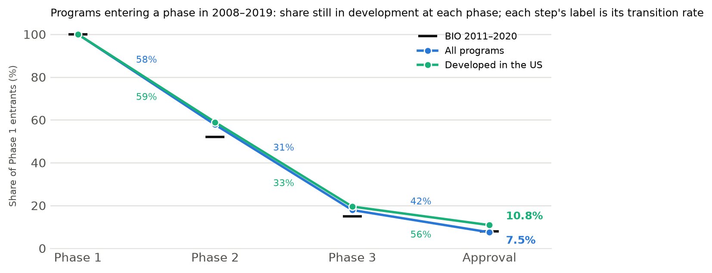

# Predictive Validity in Drug Development

<!-- Rendered by `python -m report` from report/output/*/numbers.json into REPORT.md, the doc's main tab.
     Every number in braces comes from the generated outputs; edit prose here, never the numbers. -->

## Introduction

The number of new drugs approved per billion dollars of R&D spending halved roughly every nine years from 1950 to 2010 ([Scannell et al. 2012](https://doi.org/10.1038/nrd3681)), and has flattened since ([Ringel et al. 2020](https://doi.org/10.1038/d41573-020-00059-3)). Only 7.9% of programs that enter Phase 1 reach FDA approval ([Thomas et al. 2021, BIO](https://go.bio.org/rs/490-EHZ-999/images/ClinicalDevelopmentSuccessRates2011_2020.pdf)), and we can see little of why the rest fail.

Scannell and colleagues called the decline Eroom's Law and blamed, among other causes, an overestimate of how much molecular biology and high-throughput screening raise the chance that a molecule works in patients. [Scannell and Bosley (2016)](https://doi.org/10.1371/journal.pone.0147215) then showed that a model's *predictive validity*, how well its output tracks the clinical outcome, matters far more than its throughput. Some evidence types have been measured: genetic support makes a target–indication pair about 2.6 times as likely to go from Phase 1 to launch ([Minikel et al. 2024](https://doi.org/10.1038/s41586-024-07316-0); [Nelson et al. 2015](https://doi.org/10.1038/ng.3314)), and AstraZeneca's "5Rs" review of its own pipeline raised its success rate from 4% to 19% ([Cook et al. 2014](https://doi.org/10.1038/nrd4309); [Morgan et al. 2018](https://doi.org/10.1038/nrd.2017.244)). Most of the evidence that drug programs rest on has never been scored this way.

This report scores it from primary records. Every interventional drug or biological study on ClinicalTrials.gov (227,130 studies, snapshot of 2026-10-20) was resolved to the molecular entities it tests and the MONDO diseases it treats, and joined to every FDA approval we could document (Drugs@FDA, 6,569 approved uses read from approval letters, labels, and 177 CBER biologics applications). The unit is a *development program*: one molecular entity developed for one indication. Every program that entered a phase in 2008–2019 is counted.

1. **Industry failure modes:** how often programs advance at each phase and why they stop.
2. **Predictive power of preclinical evidence:** which evidence known before a phase predicts approval and Phase 2 success, whether stronger or more specific evidence does better, and where it holds.

Every classification was made by an LLM reading the source record, and the main labels were checked against an independent re-derivation of a seeded sample (Appendix).

## A history of drug development

Over the past century, drug development moved from natural observation and phenotypic screening to target-based and genetically grounded hypotheses. Each era narrowed the unit of the biological hypothesis, from a whole-organism effect to a target in a specific patient context.

## Industry failure modes

For development programs that entered a phase in 2008–2019 and were developed in the US, the likelihood of FDA approval from Phase 1 is 9.0% (95% CI 8.0%–10.1%), against BIO's 7.9% for 2011–2020 (6.8% for novel drugs). Across all industry programs registered on ClinicalTrials.gov, including those run only outside the US, it is 5.5%. Once each stop is traced to its cause, efficacy or exposure explains 44% of Phase 2 and 3 stops and sponsor decisions 21%.

### How programs are counted

12,739 programs of 6,830 individual drugs entered at least one phase in 2008–2019. Entries end in 2019 so that every program has had at least six years to advance or stop before the snapshot; registration of industry trials became mandatory in the US in late 2007, so the window starts in 2008. A program is one molecular entity developed for one indication; it enters a phase when its first industry trial of that phase starts, and *advances* when a later-phase trial in the disease starts or the FDA approves it for the disease. As in BIO's report, each phase's success rate is advanced ÷ (advanced + stopped), and LOA is their product. The full counting rules are in the appendix.

### Why programs stop

For 3,109 of the 5,894 Phase 2 and 3 stops among 2008–2019 entries, the registry gives no usable reason: none at all, only "sponsor decision", an unspecified "other" reason, or an efficacy reason that the reading of efficacy failures below found wrong. We classified each of these with an LLM that read the program's trials and searched the web for company releases, filings and news. It named a cause only where a source stated or showed it, and otherwise gave its best guess, the *likely* cause. The method and how well it does on stops whose reason is known are in the appendix.

A sourced cause was found for 71% of the traced programs (2,202), and a likely cause for 98%. The biggest changes from the registry's picture:

* **Many quiet stops were not failures.** A positive readout that was not taken further in the disease (approval outside the US, a stalled partnership, a move to another formulation) was the sourced cause for 596 traced programs, and 214 had not stopped at all: development continued under another registry, region, name or combination. Section 1's suspension rule, which reads only ClinicalTrials.gov, counts these as stops, so its failure rates are somewhat high.
* **Efficacy is under-recorded.** Efficacy or exposure was the sourced cause of 737 traced programs, usually from published results or a company statement the registry never carried, raising efficacy or exposure from 28% of all Phase 2/3 stops as registered to 39% sourced (44% counting likely causes).
* **Sponsor decisions are the rest.** Portfolio, commercial and partner decisions, acquisitions, mergers, lost funding and closures account for 21% of all stops counting likely causes. Safety stays rare (3%).

**Within each cause.** Where the sponsor decided, the sources most often name portfolio prioritisation (25%) or the company running out of money or closing (16%); 33% say no more than "business reasons". Operational stops are mostly slow enrollment (71%). 26% of safety stops do not say what the harm was. Most positive readouts that went no further give no reason (79%); otherwise the drug was approved outside the US (10%) or the sponsor chose not to go on, for the same reasons as other sponsor decisions (9%), each as a share of all positive readouts. Of the stops no source explains, 35% had a sponsor that started no later trial, and in 35% the drug was dropped while its sponsor carried on.

**Over time.** Counting sourced and likely causes, and leaving out programs that turned out not to have stopped, efficacy or exposure was the cause of 48% of stops among programs entering in 2008–2011, 44% in 2012–2015 and 43% in 2016–2019; sponsor decisions 20%, 23% and 23%, and a positive readout not yet advanced 20%, 23% and 21%. Among entries from 2015 to 2025 (4,110 stops, many later programs still running), the shares are 40% efficacy or exposure, 26% sponsor decision and 22% positive readouts.

**Phase 1.** Phase 1 stops were classified the same way (2,969 programs entering 2008–2019). As registered, 83% give no usable reason, since Phase 1 trials seldom post results and companies seldom explain pausing early assets. Tracing found a sourced cause for 59% of those and a likely cause for 95%. Counting both, efficacy or exposure was the cause of 20% of Phase 1 stops, safety 9%, sponsor decisions 46%, operational 6% and a positive readout not yet advanced 12%; 5% stay unknown.

Tested on stops whose reason is known, the classifier often read safety stops as efficacy, so the efficacy share after tracing is an upper estimate and safety is likely under-counted.

### Why efficacy failed: the target was not engaged, or it was the wrong target

Efficacy fails in one of two ways: the drug never engaged its target in patients, so the hypothesis went untested, or it engaged and the disease did not respond. For every program entering Phase 1, 2 or 3 in 2008–2019 that stopped for efficacy or exposure (PK, dose or formulation), 367 in Phase 1 and 2,099 in Phase 2 or 3, an LLM read the trials, results, papers and, where those were silent, the web, and judged whether the drug reached and engaged its target in humans at the doses tested. The method and its checks are in the appendix.

![Top: Phase 1, 2 and 3 stops by cause, phase entries 2008–2019, excluding programs whose development continued; where no source states the cause, the model's likely cause is counted. Safety is a floor: sponsors rarely state it, a missed endpoint takes precedence over a safety signal, and the tracing recognised fewer than half of known safety stops. Sponsor decision is the least reliable cause. Positive readouts include programs whose primary endpoints were only partly met. Bottom: the programs of each phase stopped for efficacy or exposure with a sourced cause (likely-only causes are not broken down), by what the evidence shows about target engagement. Phase 1 trials rarely test efficacy, so its efficacy stops are mostly early patient cohorts and dose-finding readouts](report/output/figures/efficacy_attribution.png)

Where the record shows whether the mechanism was tested, the drug had engaged its target in 971 of 1,188 programs and the disease did not respond; **18%** (16%–21%) failed without adequate engagement or exposure, or with another drug on the same target succeeding in the disease. The second kind is the larger and is inferred rather than measured: 111 of the 217 not-engaged programs failed where a drug on the same target worked, 90 of them with no human engagement data of their own; the rest had exposure or engagement measured and found inadequate. Failures to engage are about as common in Phase 3 (19%) as in Phase 2 (18%): no regulation requires engagement to be shown, and good practice places it in Phase 1 or 2a, yet engagement was often still unverified when confirmatory trials started. Outside oncology the share is 18%. Trial design, population or endpoint account for 7% of efficacy failures, and toxicity that offset efficacy for 9 programs. Another 48 programs recorded as efficacy stops were not failed efficacy tests (a met endpoint, a missed non-inferiority margin, a business stop, or off-target toxicity); they are counted under their traced cause above and left out here.

* *Engaged, no benefit.* Venglustat cut glucosylceramide in the cerebrospinal fluid of people with *GBA1* Parkinson's disease by about 73% at the top dose ([Peterschmitt 2022](https://doi.org/10.3233/JPD-212714)), and over a year their motor scores worsened by 7.3 points on drug against 4.7 on placebo ([MOVES-PD](https://doi.org/10.1016/S1474-4422(23)00205-3)). CSL112, plasma-derived apolipoprotein A1 that raises cholesterol efflux capacity, did not reduce myocardial infarction, stroke or cardiovascular death at 90 days in 18,219 patients after myocardial infarction (hazard ratio 0.93, 0.81–1.05; [AEGIS-II](https://doi.org/10.1056/NEJMoa2400969)).
* *Not engaged.* PF-06687234, an IL-10 fusion protein added to infliximab for ulcerative colitis, was stopped for futility, and was detected, at low concentration, in only one colon tissue sample: the drug may never have reached the inflamed mucosa at a useful level ([Ther Adv Gastroenterol 2026](https://doi.org/10.1177/17562848251410784)).

**Over time.** Among efficacy failures of programs entering in 2008–2011, 2012–2015 and 2016–2019, the share not engaged where engagement is known was 19%, 20% and 16%, and the share with no engagement evidence 38%, 34% and 35%. For entries from 2015 to 2025 the not-engaged share is 16% (13%–19%, 1,298 programs).

**Phase 1.** Phase 1 trials mostly test safety, dose and exposure, often in healthy volunteers, so an efficacy or exposure stop there is usually an early patient cohort or a dose-finding readout. The same labels were applied to the 367 Phase 1 programs entering 2008–2019 that stopped for efficacy or exposure. Where engagement is known (226 programs), 34% (27%–41%) were not engaged; 38% have no engagement evidence either way.

**The large caveat is what the public record does not say.** For 36% of efficacy failures there is still no human evidence of engagement either way, after the web search, so a drug that never engaged and a target that does not matter cannot be told apart. Engagement was shown in patients with the program's disease for only 30% of the programs where it was shown at all, and was public or registered before the failed trial started for 52%. The gap need not be neutral: a drug that never engaged its target leaves less to publish, and engagement inferred from success in another disease can only add to the engaged side. Among the programs the web search could decide, this shows a little: 30 of the 144 it found tested were not engaged (21%), against 19% among the programs the bundle alone decided. If every program still indeterminate were a failure to engage, the ceiling is 50%. Counting only directly measured engagement, and the other variants in the appendix, gives the same direction.

The answer to "was the target wrong, or was it never hit?" is therefore: where anyone can tell, the target was usually hit. Among efficacy failures whose mechanism was tested, 18% failed to engage (13% to 30% across the variants above); in the rest the drug engaged its target and the disease did not move. For 36% of failures the public record, searched, cannot say.

### By disease area and modality

Disease areas rank differently from BIO's: the rank correlation with BIO's LOA across the 15 areas is 0.48 for all programs and 0.51 for US-developed ones. Across all programs, hematology, metabolic and oncology programs reach approval most often (19.0%, 11.4% and 10.2%), and cardiovascular, gastroenterology and urology programs least (2.7%, 2.7% and 3.9%). Among US-developed programs, endocrine (11.9%) and oncology programs (12.6%) come out far above BIO's 6.6% and 5.3%; for oncology, the window takes in the wave of immunotherapy and antibody–drug conjugate approvals, and an approval in a cancer subtype counts for the program's cancer. Ophthalmology (6.9%) falls well below BIO's 11.9%. Among modalities, monoclonal antibodies and antibody–drug conjugates reach approval most often across all programs (12.6% and 8.9%), and among the classes BIO also reports, antisense oligonucleotides (4.5%), peptides (4.3%) and gene therapies (5.1%) least. RNA interference and CAR-T, near the top of BIO's ordering, have too few entities resolved in Phase 3 here (most of their approvals came straight from Phase 2) to estimate. Across the 7 classes both estimate, the modality ordering agrees with BIO's (rank correlation 0.75).

## Predictive power of preclinical evidence

Human genetic evidence linking a program's target to its disease is the clearest preclinical signal of success. Programs whose target had it before entering the phase reached approval 3.09 times as often (23% against 8%), and Phase 2 programs with it advanced 1.97 times as often, more so the stronger the evidence and the closer it lies to the program's own disease. Somatic drivers in oncology and animal models also predict, though animal models mostly ride along with genetic support; no sharper version of any evidence picks better programs, and an approved drug on the target for a related disease predicts more strongly than any preclinical evidence. Because most programs have none of this evidence, it sorts individual programs only modestly (held-out AUC 0.591 without it, 0.628 with it).

### Evidence and design

Each program on a human protein target is scored for the evidence its targets had **for the program's disease, as of the year before it entered the phase**: human germline genetics (GWAS and rare-variant), somatic cancer drivers, mouse models, expression in the disease, pathways and CRISPR screens (from Open Targets); two properties of the target itself (essential in most cells, intolerant of loss of function); and the drug's own potency and selectivity in laboratory assays (ChEMBL). 9% of Phase 1 entrants had human genetic evidence for their disease.

Two outcomes are measured on programs entering a phase in 2008–2019. *Relative success* is the likelihood of approval with the evidence divided by that without it, across all 8,489 programs (Nelson et al. 2015; Minikel et al. 2024). The second is whether a Phase 2 program advanced to Phase 3 or approval within four years (15% of 4,372 did): Phase 2 is the first test of efficacy in patients, so it is where the evidence's claim about the disease is first put to the test. The Phase 2 analysis was registered before any outcome was examined; it named 2015–2020 entries and was widened to the report's window. Dating, matching, models and robustness checks are in the appendix.

### Which evidence predicts

**Human genetics predicts at every step.** Programs with genetic evidence for their disease reached approval 3.09 times as often (2.36–3.99), rare-variant and Mendelian evidence (3.24×) more than GWAS (1.93×), as Minikel et al. (2024) found. At Phase 2 it is the strongest preclinical predictor (1.97×; Holm-corrected p < 0.001), and rare-variant evidence keeps an independent effect with every other line held fixed (1.50×). The effect sits where efficacy is tested: genetics adds little at Phase 1 and about 1.5-fold at Phase 2 and Phase 3 (appendix).

**Other evidence predicts less, and partly through genetics.** Somatic drivers (2.57× to approval; 1.63× at Phase 2 in oncology) keep an effect with the other lines held fixed (1.34×). Animal models pass the Phase 2 test (1.46×) but add little once genetics is known (1.15×): they mostly sit on genetically supported targets. Reactome pathways go with approval (2.56×, 166 programs) but not reliably at Phase 2; expression in the disease and target liabilities carry nothing. An approved drug on the target for a related disease, the benchmark, predicts more strongly than any preclinical kind (2.28× at Phase 2).

**Known only after entry.** CRISPR screens and DepMap's essential-gene list were first published in 2019, too late for any program in the window. With hindsight, screen hits go with success (2.88× to approval), mostly on oncology targets already validated, and essential targets with failure (0.34×), much of it from targets found essential after their programs had failed. The genetics result itself is not hindsight: counting evidence known by 2026 instead of before entry weakens it to 2.21×.

### Does stronger or more specific evidence help?

Approval rises with the strength of genetic support, from 8% with none to 30% in the top third. It also depends on how close the evidence lies to the program's disease: outside oncology, Phase 2 programs advanced at 11% with no germline genetics on the target, 14% with evidence only for unrelated diseases, 19% for a related disease and 24% for the disease itself, and the same target does better in the diseases its genetics points to (odds ratio 3.37).

Beyond that, sharper versions do not help. Among programs with germline genetics, strong GWAS evidence (0.73), Mendelian evidence (1.08) and genetics pointing the drug's way (1.11) did no better than the rest; nor did a close phenotype match (1.07) or a mouse model pointing the drug's way (1.02) among programs with an animal model, or a driver matching the drug among oncology programs with a driver (1.06). Direction could not be tested properly: of the Phase 2 programs with genetic support, 235 acted in the direction the genetics favoured and only 8 against it, because sponsors almost never develop against an established mechanism.

### Confirmatory hypotheses

Two of the seven registered hypotheses hold after correction for multiple testing: genetics for the disease predicts advancing outside oncology (risk ratio 1.82, 1.25–2.66; only evidence for the disease itself, not a related or unrelated one, differs from none), and it does so within a target, across the 65 targets developed in several diseases (odds ratio 3.37, 2.20–5.16), so the signal is not only that some targets are better than others.

The other five are not supported. Open Targets' direction-of-effect fields could not test direction (they mislabel gain-of-function genes such as PCSK9 and MYH7; the appendix gives the replacement analysis). Genetic support lowered efficacy stops (0.66) but business stops by about as much. Its effect did not clearly weaken from proximal to distal endpoints. Target liabilities did not predict safety stops, which are under 2% of programs. A somatic driver matching the drug went with advancing (1.50) but not beyond chance across seven tests.

### By disease area

Human genetic evidence predicts approval in every area group with enough programs to measure it, and its effect does not differ measurably between them (p = 0.32 for the difference at Phase 2). It is largest in cardiometabolic and endocrine diseases (4.41×, 26% against 6%), about 2.5-fold in oncology (2.61×) and neuroscience (2.69×), and least clear in immunology and inflammation (1.79×, 0.79–2.98), where much of the evidence is GWAS. Hematology and the other areas have too few genetically supported programs to estimate. Leaving out any one group keeps the pooled relative success between 2.91 and 3.35.

Somatic drivers give 2.44× in oncology. Mouse models help in cardiometabolic disease (1.71×) and immunology (1.89×) but not in oncology (1.19×). Expression in the disease is the one line whose effect differs between groups (p = 0.05), going the wrong way in immunology (0.53×); with three groups tested and a borderline p, this is a lead, not a finding.

### By endpoint

Across 5,179 randomised industry efficacy trials, 47% missed their governing primary endpoint. Regulatory surrogates were missed least (23%); outside oncology, exploratory biomarkers (68%) and hard outcomes (51%) were missed most, and oncology's response and survival endpoints as often.

Genetic support for the disease lowered the chance of missing a regulatory surrogate most clearly in trials with registry-posted results since FDAAA (risk ratio 0.32, 0.14–0.73); across all readable trials, including those read from papers, the effect is smaller (0.77, 0.55–1.07). Clinician-rated scales (0.85), objective physiology (0.86) and disease events (0.93) point the same way with intervals reaching 1, and oncology's response and progression endpoints show no benefit. Genetic support predicts most reliably on the measures nearest its biology, often the trait through which the genetics was found (LDL cholesterol, glycaemia), and less clearly on what patients feel or how often events happen.

### The drug's own pharmacology

The drug's laboratory potency, functional activity in cells and selectivity were measured before entry for 24% of programs, nearly all small molecules (37% of them); ChEMBL holds almost no measurements for antibodies or other proteins. Measured drugs were usually potent (84% at 100 nM or better).

Among measured drugs, those at 100 nM or better reached approval 2.91 times as often as the 328 weaker ones (1.60–5.91), and potency still helps at Phase 3 once the disease evidence is held fixed (1.61×). Selectivity shows no association (1.02×), and a functional readout in cells, if anything, goes with worse odds (0.73×). The fair reading is that a drug well short of 100 nM at its target rarely succeeds, not that more potency helps; and because promising drugs attract more papers, a measurement is partly a marker of a well-studied program.

### Can the evidence pick individual programs?

Programs that entered Phase 1 in 2008–2016 were followed for ten years (2,947 programs, 157 approved), and models were tested on targets they had not seen.

Disease area, modality, novelty and entry year alone give a held-out AUC of 0.591; adding the evidence lines raises it to 0.628 (0.562–0.693), and a split by entry year agrees. Human genetics carries the gain (removing it costs 0.027). This is consistent with the relative success: genetic support roughly triples the chance of approval for the 9% of programs that have it, but says nothing about the rest.

### What this means

* **Disease-specific human genetics carries over.** It fades as the evidence moves away from the disease, holds within a target, does not come from hindsight, and roughly doubles the chance of reaching Phase 3.
* **It is a filter, not a forecast.** Nearly three in four genetically supported Phase 2 programs still did not advance, most programs that advanced had no such evidence, and sharper versions of the evidence did not pick better programs.
* **It shows most on measures close to the biology.** Genetically supported trials missed regulatory surrogates less often, clearly so in trials with posted results; on clinical scales, events and survival the advantage is small or not demonstrable.
* **Other preclinical evidence adds less.** Somatic drivers help in oncology; animal models help mostly by riding along with genetics; expression and pathways add nothing reliable.
* **Some questions cannot be answered from what sponsors ran.** Almost no program went against an established genetic mechanism, and registries rarely record safety as the reason a program stopped.

## Historical case studies

The cases below each looked strong on mechanism, cell and animal evidence, and failed in humans.

| Drug (indication) | Evidence that looked strong | Why it failed |
| :---- | :---- | :---- |
| BACE1 inhibitors: verubecestat, lanabecestat, atabecestat (Alzheimer's disease) | Crystal structures; Aβ lowering in cells and animals; a protective human *APP* variant (A673T) that reduces BACE1 cleavage; CSF Aβ down 50–90% in Phase 1 | No slowing of decline. In the verubecestat (prodromal) and atabecestat (preclinical) trials cognition worsened early, with a dose-related effect that reversed after stopping, consistent with BACE1's other neuronal substrates. Reducing Aβ production did not help people who already had plaques; antibodies that clear plaque (lecanemab, donanemab) later slowed decline modestly. ([Egan 2018](https://doi.org/10.1056/NEJMoa1706441); [Egan 2019](https://doi.org/10.1056/NEJMoa1812840); [Sperling 2021](https://doi.org/10.1001/jamaneurol.2020.4857)) |
| Torcetrapib and later CETP inhibitors (cardiovascular disease) | Raised HDL in people with CETP deficiency; HDL up 60–70% as predicted; less atherosclerosis in rabbits | Torcetrapib increased deaths by 58% (93 vs 59) and major cardiovascular events by 25%, probably through an off-target rise in aldosterone and blood pressure. Dalcetrapib and evacetrapib raised HDL without cutting events. Anacetrapib cut major coronary events by 9%, in line with its modest non-HDL-cholesterol lowering, and was not filed. ([Barter 2007](https://doi.org/10.1056/NEJMoa0706628); [Schwartz 2012](https://doi.org/10.1056/NEJMoa1206797); [Lincoff 2017](https://doi.org/10.1056/NEJMoa1609581); [HPS3/TIMI55–REVEAL 2017](https://doi.org/10.1056/NEJMoa1706444)) |
| Semagacestat (Alzheimer's disease) | Aβ lowering in cells and mice; dose-dependent 47–84% cut in CNS Aβ production in a small human kinetic study | Did not slow decline. At the higher dose, daily function worsened significantly faster than on placebo and cognition trended worse. Patients had more skin cancers, infections and weight loss, consistent with blocking γ-secretase substrates such as Notch. ([Doody 2013](https://doi.org/10.1056/NEJMoa1210951)) |
| Solanezumab, bapineuzumab (Alzheimer's disease) | Aβ binding; plaque prevention in transgenic mice; peripheral Aβ engagement (solanezumab) and partial plaque lowering on PET in APOE4 carriers (bapineuzumab) | No cognitive benefit across several Phase 3 trials. Solanezumab binds soluble Aβ and did not remove plaque; bapineuzumab's dose was capped by brain swelling (ARIA). Antibodies that cleared plaque more deeply later slowed decline modestly, so these failures look more like insufficient target engagement than a misleading mouse model. ([Doody 2014](https://doi.org/10.1056/NEJMoa1312889); [Salloway 2014](https://doi.org/10.1056/NEJMoa1304839)) |
| TGN1412 (B-cell leukemia, rheumatoid arthritis) | Cynomolgus monkeys tolerated 500 times the human starting dose | All six volunteers who received the drug developed a cytokine storm within 90 minutes. Unlike in the monkeys used for toxicology, human CD4+ effector memory T cells carry CD28. The starting dose already occupied most CD28 receptors; human-cell assays and dosing from the minimal anticipated biological effect level would have flagged the risk. ([Suntharalingam 2006](https://doi.org/10.1056/NEJMoa063842); [Eastwood 2010](https://doi.org/10.1111/j.1476-5381.2010.00922.x); [Stebbings 2007](https://doi.org/10.4049/jimmunol.179.5.3325)) |
| Fialuridine (hepatitis B) | Clean toxicology in mice, rats, dogs and monkeys | Seven of 15 patients developed liver failure with lactic acidosis: five died and two needed transplants. Human ENT1, unlike the rodent transporter, is targeted to mitochondria and carries the drug into them. ([McKenzie 1995](https://doi.org/10.1056/NEJM199510263331702); [Lee 2006](https://doi.org/10.1074/jbc.M513825200)) |

## Appendix

### Data

| Source | What it gives | Version |
| :---- | :---- | :---- |
| ClinicalTrials.gov API v2 | Every interventional drug or biological study: phases, status, dates, sponsor, arms, interventions, conditions, sites, why stopped, posted results | Snapshot 2026-10-20 (227,130 studies) |
| PubMed | Results papers linked to completed trials without posted results (registry RESULT/DERIVED references and the NCT secondary identifier) | Retrieved 2026-10-20 |
| Drugs@FDA, FDA approval letters, openFDA labels | NDA/BLA applications, submissions and action dates; 6,569 approved uses read from 2008–2026 approval letters; current Indications and Usage text | Retrieved October 2026 |
| CBER yearly approval pages, product pages and letters | 177 biologics applications (vaccines, blood products, cell and gene therapies) and their 2015–2025 approval actions, verified by an independent second enumeration | Retrieved October 2026 |
| FDA Global Substance Registration System | UNII substance identifiers and every registered name (official, common, code, brand) | 2026-08-04 |
| MONDO | Disease ontology and hierarchy | 2026-10-06 |
| Open Targets Platform | Target–disease associations by data source, with yearly score series | 26.09 |
| Open Targets Platform evidence | Every evidence row behind those associations for drug targets, with its date, direction of effect, confidence and source detail; mouse-model phenotypes | 26.09 |
| Mammalian Phenotype ontology | Mouse phenotype hierarchy (knockouts lethal before weaning) | Retrieved October 2026 |
| gnomAD | Loss-of-function constraint (LOEUF) | v4.1 |
| DepMap | Common-essential genes from CRISPR (Chronos) screens | Public 19Q4 to 24Q4, the last release of each year |
| HGNC | Approved human gene symbols with previous symbols and aliases | 2026-10-16 |
| ChEMBL | Drug mechanisms of action, as hints for target assignment | 37 |
| ChEMBL bioactivities | Potency, affinity and selectivity measurements of each entity's molecules, dated by the year of the paper, patent or dataset that reported them | 37 (138,229 measurements) |

Per-source detail (who compiles each source, what this analysis takes from it, raw response shape and a sample record) and the tables behind the main tab's figures are in the Appendix detail tab.

### How programs are counted

* **Trial:** a registered interventional study listing Early Phase 1 to Phase 3. A Phase 1/2 trial counts as Phase 2 and a Phase 2/3 trial as Phase 3. Withdrawn trials never enrolled and are left out.
* **Molecular entity:** the active substance, whatever its brand, sponsor code, dose or salt, resolved to its FDA UNII substance where one exists. Biosimilars fold into their reference entity.
* **Disease:** the MONDO term for the condition the trial treats, without line, stage, biomarker or age qualifiers.
* **Program:** one entity developed for one indication. An indication groups the entity's MONDO diseases the way a sponsor runs them as programs (prostate cancer with castration-resistant and metastatic prostate carcinoma; diffuse large B-cell and follicular lymphoma kept apart), decided by an LLM for each entity. An entity belongs to a program only in trials where it is the investigational agent, not a comparator or background therapy. Each industry trial's purpose is classified first: bioequivalence, formulation, food-effect, interaction and other product-support studies (10,770 trials) belong to no program; a first-in-human study or a basket across several diseases counts as Phase 1 only for the program the sponsor pursued next.
* **Phase entry and outcome:** a program enters a phase when its first industry-sponsored trial of that phase starts. It *advanced* when a later-phase trial in its disease started (any sponsor) or the FDA approved the entity for the disease. A trial that has not started, because it is still not yet recruiting or its record went silent before its estimated start date, marks neither entry nor advancement. A program is *suspended* when none of its trials, nor the trial that marked its Phase 1 entry, has been active within 24 months of the snapshot (2026-10-20); otherwise it is still running and *censored*. Programs whose entity was already approved for the disease are lifecycle programs and are left out; an approval dated only as before 2008 (the first approval letters read) is placed at the entity's first FDA approval, the earliest it could have happened. As in BIO's report, a phase a program skipped (Phase 1 straight to Phase 3, or approval from Phase 2) counts as a success in that phase, each phase's success rate is advanced ÷ (advanced + suspended), and LOA is their product. *US-developed* programs are those with a US-sited industry trial in the phase; a cohort with fewer than ten entities resolved in a phase gets no LOA.
* **Approval:** FDA approval of the entity for the program's disease, a subtype or population of it, or a broader approved class that includes it, judged from the dated approval letters, original-approval dates and labels of every application of the entity (CDER and CBER).

### Phase transitions

### How LOA moves with each definition

| Cohort or definition | Phase 1 → 2 | Phase 2 → 3 | Phase 3 → approval | LOA (95% CI) |
| :---- | :---- | :---- | :---- | :---- |
| All programs | 54.6% | 28.2% | 35.8% | 5.5% (4.9–6.1) |
| Programs with a US-sited industry trial in the phase | 56.8% | 31.2% | 50.6% | 9.0% (8.0–10.1) |
| Entity not yet FDA-approved at phase entry | 54.2% | 26.9% | 37.1% | 5.4% (4.8–6.1) |
| Entity already FDA-approved for another disease | 56.2% | 37.8% | 31.9% | 6.8% (5.2–8.7) |
| Suspension lag 12 months | 53.7% | 27.6% | 35.0% | 5.2% (4.6–5.8) |
| Suspension lag 18 months | 53.9% | 27.8% | 35.4% | 5.3% (4.7–5.9) |
| Suspension lag 36 months | 55.8% | 29.0% | 37.0% | 6.0% (5.4–6.7) |
| Uncertain approvals counted as approved | 54.6% | 28.3% | 35.8% | 5.5% (4.9–6.1) |
| Shared trials mark entry for every program of the entity | 74.0% | 44.8% | 33.8% | 11.2% (9.7–12.9) |
| Including vaccines | 53.0% | 27.6% | 33.7% | 4.9% (4.4–5.5) |
| Phase entry 2015-2025 (many programs still running) | 54.4% | 33.6% | 39.1% | 7.2% (6.3–8.0) |
| Phase entry 2015-2025, developed in the US | 54.3% | 33.8% | 54.6% | 10.0% (8.9–11.3) |

### Change over time

Success rose across the window. Programs that entered a phase in 2008–2011 reached approval from Phase 1 4.2% of the time; those that entered in 2016–2019, 7.1% (7.2% and 10.4% for US-developed programs). The gain came in the later phases: Phase 2 success rose from 24.9% to 30.5% and Phase 3 from 29.0% to 44.2% (44.0% to 58.0% for US-developed programs), while Phase 1 success fell slightly, from 57.6% to 52.8%.

| Phase entry | Entities | Phase 1 → 2 | Phase 2 → 3 | Phase 3 → approval | LOA (95% CI) | US-developed: Phase 3 → approval | US-developed: LOA (95% CI) |
| :---- | :---- | :---- | :---- | :---- | :---- | :---- | :---- |
| 2008–2011 | 2,601 | 57.6% | 24.9% | 29.0% | 4.2% (3.5–5.0) | 44.0% | 7.2% (5.9–8.5) |
| 2012–2015 | 2,751 | 54.1% | 29.4% | 33.4% | 5.3% (4.4–6.4) | 47.7% | 9.2% (7.5–11.0) |
| 2016–2019 | 3,493 | 52.8% | 30.5% | 44.2% | 7.1% (6.0–8.2) | 58.0% | 10.4% (8.8–12.0) |

Two features of the registry bear on these trends.

* **Phase 1 registration grew more complete.** US law has required registration of Phase 2 and 3 trials since late 2007 but exempts Phase 1, and journals require it only for trials that are published. Industry Phase 1 registrations grew through the window, partly because more programs were run and partly because more were registered. Programs that fail in an unregistered Phase 1 never enter the count, so the earlier Phase 1 rates may be the more flattering, and the slight fall in Phase 1 success may reflect registration rather than development.
* **Later entrants have had less time.** A program that entered a phase in 2008 has had eighteen years to resolve; one that entered in 2019, under seven. The share of programs still running rises in the latest years, most in Phase 3 (in parentheses below), so those years' rates rest on the programs that resolved first.

| Phase entry year | Phase 1 → 2 (share still running) | Phase 2 → 3 (share still running) | Phase 3 → approval (share still running) |
| :---- | :---- | :---- | :---- |
| 2008 | 57% (3%) | 23% (3%) | 25% (10%) |
| 2009 | 62% (4%) | 26% (2%) | 34% (7%) |
| 2010 | 58% (4%) | 25% (5%) | 26% (11%) |
| 2011 | 53% (6%) | 25% (3%) | 31% (10%) |
| 2012 | 51% (6%) | 27% (7%) | 35% (9%) |
| 2013 | 53% (5%) | 28% (6%) | 25% (11%) |
| 2014 | 58% (3%) | 32% (6%) | 37% (9%) |
| 2015 | 54% (9%) | 30% (9%) | 37% (14%) |
| 2016 | 52% (9%) | 29% (10%) | 47% (15%) |
| 2017 | 59% (8%) | 32% (13%) | 43% (21%) |
| 2018 | 49% (12%) | 28% (18%) | 40% (31%) |
| 2019 | 51% (16%) | 33% (18%) | 46% (31%) |

### How each label was made, and how good it is

Every judgement in this analysis is an LLM call (Claude) that reads the source record and returns a structured answer, stored with its prompt, input, model and code version. Disease mapping, entity resolution, trial purpose and roles, approvals, stop reasons, trial outcomes, modality, disease area and targets were all made this way, not with keyword rules. For each high-stakes label, a seeded random sample was re-derived independently by agents working from the primary sources (registry records, PubMed, Drugs@FDA, DailyMed, CBER pages) before they saw the stored answer. Agreement counts answers judged correct or defensibly different under the same rules.

| Label | Audited | Agreement (95% CI) | Wrong |
| :---- | :---- | :---- | :---- |
| Condition → MONDO disease | 100 | 99% (95%–100%) | 1 |
| Intervention name → molecular entities | 100 | 92% (85%–96%) | 8 |
| FDA application → molecular entities | 100 | 98% (93%–99%) | 2 |
| Approval letter → approved uses | 60 | 100% (94%–100%) | 0 |
| Trial stop reason | 30 | 97% (83%–99%) | 1 |
| Primary endpoint met / not met (posted results) | 60 | 100% (94%–100%) | 0 |
| Primary endpoint met / not met (results papers) | 30 | 97% (83%–99%) | 1 |
| Approval (sampled as approved, dated 2015 or later) | 25 | 100% (87%–100%) | 0 |
| Approval date (sampled as approved, dated 2015 or later) | 24 | 96% (80%–99%) | 1 |
| Approval (sampled as approved before 2015) | 15 | 100% (80%–100%) | 0 |
| Approval (sampled as not approved, Phase 2+ programs) | 31 | 100% (89%–100%) | 0 |
| Approval (sampled as uncertain) | 14 | 64% (39%–84%) | 5 |

Each error pattern these audits found was fixed at its source and the affected labels re-derived, not patched by hand: diseases MONDO has no exact term for now map to their nearest broader term; development codes resolve to UNII substances, and the same substance under two names is merged; scanned FDA letters are read by OCR; labelling-only supplements no longer count as approvals; stop reasons stated only in a trial's summary are read; publication-based outcomes use only the abstracts given; and approval dates account for older applications of the same drug. The disease-mapping, entity and approval figures above come from fresh samples drawn after those fixes; before them, disease mapping agreed 94% of the time, entity resolution 95%, and 8 of 25 dated first approvals were wrong. Remaining entity errors are scattered (a development code resolved to the wrong substance, a salt chosen over its parent) rather than systematic. Programs whose approval is judged "uncertain" (102 of 22,641 judgements) count as not approved; counting them as approved instead moves no rate by more than a tenth of a percentage point (sensitivity table). The approval audit's strata are those of the judgements it sampled; it was re-scored after the final rebuild against the auditors' own answers, and programs that are no longer development programs left the sample.

Two labels were also re-decided rather than re-derived. Trial purposes and roles, re-decided under a second prompt version, agree with the first on 98% and 79% of trials. Disease mapping, decided twice, chose the same MONDO term for 92% of conditions. ClinicalTrials.gov's own MeSH indexing is no substitute: its terms belong to a study rather than a condition, so only 43% of condition strings can be given one, and where both routes name a disease, MeSH carried to MONDO agrees with the mapping for 60% (24% broader, 11% another disease) and gives a disease to 520 conditions that are not diseases, such as healthy volunteers; a hand review of 20 disagreements favoured the mapping 6 times to MeSH's 1. Modality, disease area and targets were not audited. The Phase 2 endpoint classes were audited on a seeded sample of trials, and the mechanism and mouse-model labels were spot-checked (Phase 2 analysis).

### How stops were traced and efficacy failures classified

**Tracing the stops the registry does not explain.** Every Phase 1, 2 and 3 program that entered from 2008 to 2025 and stopped was traced (7,565 Phase 2 and 3 programs, 4,075 Phase 1); the report's figures use the 2008–2019 entries. Where the registry gives no usable reason, a model read the program's trials (records, posted results, linked papers) and signals of what happened next: whether the drug went on in other diseases, whether its sponsor started any trial afterwards, and whether drugs on the same target stopped at the same time. It then searched the web for company releases, SEC filings, pipeline updates, conference reports and trade news, with ClinicalTrials.gov excluded. It named a cause only where a source supported it, citing only pages its own searches returned, and separately gave a *likely* cause, its best inference from context, where no source says.

**How well the tracing does.** The same procedure was run on 130 stops whose registry does state a reason, drawn at random across causes, with the reason removed and ClinicalTrials.gov blocked. It named a sourced cause for 77% of them, and that cause matched the registry's for 68% (κ = 0.59); the likely cause matched for 61% (κ = 0.51). Accuracy differs by cause. Efficacy or exposure stops were recognised 62% of the time, and only 83% of the stops it called efficacy or exposure were such stops in the registry: safety stops were often read as efficacy (companies announce both as an unfavourable benefit–risk), and sponsor decisions and operational stops were confused with each other (75% and 42% recognised). The efficacy share after tracing is therefore an upper estimate, and safety is likely under-counted. The registry's stated reason is itself an imperfect reference, since a stated business reason can hide a failed readout. Stops with a stated reason are probably also easier to trace, so accuracy on the unexplained stops is likely lower. One independent check holds: of programs traced to an acquisition, merger, lost funding or closure, 65% had a sponsor that started no trial afterwards, against 26% of those traced to efficacy.

**Subcauses.** A second pass, without web search, read each safety, sponsor-decision, operational and positive-readout stop's stated reason or traced source and named the subcause it states or directly implies, or "not stated" where it says no more than the cause. A stop with no traced cause is described by what happened next, from the registry: whether its sponsor started any later trial, and whether the drug was approved or continued in another disease.

**Classifying efficacy failures.** The cohort is every Phase 2 and 3 program that entered in 2008–2019 and stopped for efficacy or for PK, dose or formulation: as the registry records it (1,508 efficacy, 15 PK), or as traced with a source from the stops the registry does not explain (555 efficacy, 21 PK). An exposure failure is the same biology as a failure to engage, so PK stops are broken down here rather than counted apart. For each of the 2,099 programs the model would label (100 more, mostly gene and cell therapies and live biotherapeutics, were refused), an LLM read an evidence bundle: the failed trial's record, posted results and papers, the drug's other trials and their outcomes, results posted by its Phase 1 trials, its FDA approvals, other drugs on the same target in the same or a related disease, and PubMed abstracts on the drug's human pharmacology and on the drug in that disease. It judged, for humans and at the doses tested, the three pillars of [Morgan et al. 2012](https://doi.org/10.1016/j.drudis.2011.12.020): exposure at the site of action, binding or engagement of the target, and the expected pathway effect. Engagement could also be inferred when the drug worked in another disease through the same target and tissue compartment at a comparable dose. It then said why efficacy failed, using only the bundle and citing the sources it used. The categories and checks were fixed before any program was labelled. Where the bundle held no human evidence of engagement (40% of programs), a second pass, added after the first results, gave the same model the same bundle and the web: it searched full-text papers, conference reports, FDA and EMA reviews and company releases for human pharmacology, and could cite only pages its own searches returned. It decided 176 of the 822 programs it searched; the figures below use those labels.

Variants of the not-engaged share:

| Variant | Programs | Mechanism tested | Not engaged, of tested (95% CI) | No engagement data |
| :---- | :---- | :---- | :---- | :---- |
| All (Phase 2 and 3) | 2,099 | 1,188 | 18% (16–21) | 36% |
| Phase 2 | 1,618 | 896 | 18% (15–21) | 38% |
| Phase 3 | 481 | 292 | 19% (15–24) | 29% |
| Efficacy recorded in the registry | 1,508 | 921 | 17% (14–19) | 31% |
| Traced from unexplained stops | 576 | 258 | 23% (17–28) | 49% |
| Outside oncology | 1,560 | 835 | 18% (15–20) | 38% |
| Oncology | 539 | 353 | 20% (15–25) | 29% |
| Sponsor-stated efficacy reason | 355 | 244 | 20% (15–26) | 29% |
| Primary endpoint missed | 1,153 | 677 | 15% (12–18) | 31% |
| Direct pillar evidence only (inferred engagement counted as unknown) | 2,099 | 864 | 25% (22–29) | 51% |
| Engaged only if shown before the index trial | 2,099 | 731 | 30% (26–33) | 59% |
| One program per entity | 1,516 | 807 | 19% (16–22) | 39% |
| High or medium confidence | 1,311 | 862 | 13% (11–16) | 27% |
| Bundle only (before the web search) | 2,099 | 962 | 19% (16–22) | 40% |
| Entries 2015-2025 | 1,298 | 718 | 16% (13–19) | 36% |
| All traced entries 2008-2025 | 2,542 | 1,421 | 17% (15–19) | 36% |

**Checks.** A second model, given the same bundles and asked the pillar questions one at a time before choosing a category, relabelled a seeded random sample of 150 programs (37 with a validated label from both): it agreed on the not-engaged / engaged / other split for 76% (κ = 0.62) and on whether the target was engaged for 84%. Separately, agents with web access researched a seeded random sample of 66 programs from scratch (publications, conference reports, company releases), without seeing our labels (63 also have one of ours): they agreed on the three-way split for 81% (κ = 0.66) and on the group for 86% of the programs our labelling decided; they never called engaged a program our labelling called not engaged, or the reverse (0 contradictions). Of the 16 adjudicated programs whose bundle held no engagement data, the web search and the outside researchers both decided 4 and agreed on 75% of them; the search never decided one the researchers could not, and the researchers decided 2 that the search left open (1 of them not engaged). On their own, they found 5 failures to engage among 34 programs whose mechanism they could judge (15%). The pre-registered construct checks, on data the labels do not use, point one way or nowhere. Programs whose exposure or engagement was shown too low had germline genetic support for the disease more often than those engaged without benefit (13% against 7%, p = 0.03, 106 programs shown not engaged), as expected if engaged failures more often test a target the disease does not depend on. The two groups did not differ in whether other drugs on their target failed (53% against 54%) or advanced (48% against 49%) in the disease. A check added after the plan asked whether drugs that failed to engage were simply weaker, using the drug's potency at its primary target from laboratory assays published by the year before phase entry (ChEMBL; Section 2 describes the measurements). The data do not show it: 19% of programs shown not engaged and 23% of those engaged without benefit had such a measurement; among them the median best potency was 8.02 against 8.30 on the negative-log scale (p = 0.16, Mann–Whitney), and 94% against 87% reached 100 nM or better (p = 0.70). Only 17 not-engaged programs had a measurement, so a modest difference could be missed; but most drugs that failed to engage in patients had been potent in the assay, which points to exposure, dose or tissue access rather than a weak molecule.

**What the registry records.** Each suspended program takes one reason from the industry trials of the phase it stopped in, in this order: an efficacy reason stated by the sponsor, a primary endpoint missed in posted or published results, a safety signal, a pharmacokinetic or formulation problem, an explicit business or strategic reason, a bare "sponsor decision", an enrollment, operational or regulatory reason, a positive primary readout without advancement, another stated reason, posted results with no stated reason or readable endpoint, and finally neither a reason nor a result.

| Reason | Phase 1 | Phase 2 | Phase 3 |
| :---- | :---- | :---- | :---- |
| PK, dose or formulation | 1% (36) | 0% (16) | 0% (1) |
| business or strategic (explicit) | 8% (231) | 5% (215) | 3% (39) |
| completed, no results posted, no reason stated | 57% (1,592) | 27% (1,161) | 22% (292) |
| efficacy: primary endpoint not met | 0% (10) | 22% (925) | 21% (278) |
| efficacy: stated | 2% (67) | 5% (231) | 10% (129) |
| enrollment, operational or regulatory | 2% (66) | 5% (220) | 4% (46) |
| other stated reason | 0% (14) | 0% (14) | 1% (12) |
| positive readout, not advanced | 0% (11) | 10% (421) | 20% (256) |
| results posted, no reason stated, endpoint not assessable | 13% (359) | 11% (476) | 5% (62) |
| safety | 3% (75) | 3% (110) | 4% (49) |
| sponsor decision, unspecified | 3% (82) | 2% (98) | 1% (17) |
| stopped, no reason stated | 10% (268) | 9% (384) | 10% (127) |

The registry rarely says why a program stopped. In Phase 1, 66% of stopped programs left neither a stated reason nor a result, which is expected: Phase 1 trials seldom post results and companies seldom explain pausing early assets. In Phase 2 and Phase 3 the share without a reason falls to 36% and 32%. Efficacy is the recorded reason for 27% of programs that stopped in Phase 2 and 31% of those that stopped in Phase 3: the sponsor said so, or the posted or published primary endpoint was missed. Safety accounts for 3% and 4%: among Phase 2 and Phase 3 stops with an efficacy or safety reason, safety is 9% and 11%, against about 32% in Harrison (2016), whose 2013–2015 failures with a disclosed reason were 24% safety and 52% efficacy. Either registry records under-report safety stops, or company disclosures over-represent them.

At the level of individual trials, the 4,390 industry trials started in 2008–2019 that stopped early or were withdrawn with a reason give: an explicit business, portfolio or competitive reason 27%, a bare "sponsor decision" 13%, efficacy 18%, enrollment or operations 19% and safety 7%. The draft's single 44% "commercial or strategic" category mixed these two kinds of statement; a "sponsor decision" with no reason may or may not hide an efficacy result, and the record cannot tell. No study has measured how often a stated business reason hides an efficacy or safety failure. Where a registry gives a reason it mostly agrees with the trial's publication (53 of 57 in [Alturki et al. 2017](https://doi.org/10.1016/j.jclinepi.2016.08.011)); the usual gap is a missing reason. Analysts who also read company filings, press releases and regulator records attribute 57% of drug failures in pivotal trials to efficacy, 17% to safety and 22% to commercial reasons ([Hwang et al. 2016](https://doi.org/10.1001/jamainternmed.2016.6008)), so the efficacy and safety shares here are a floor.

Finally, 20% of Phase 3 programs that stopped short of FDA approval had met their primary endpoint. In a sample we read, most of them were approved outside the US (Japan, China, Korea, Russia) or received a complete response letter from the FDA: a positive Phase 3 readout is necessary but not sufficient for US approval.

### How the evidence is scored and modelled

**Evidence.** Each program's primary targets are resolved by an LLM from the entity's mechanism records and trial descriptions. Each program is scored for the evidence its targets had **for the program's disease** in Open Targets Platform 26.09, **as of the year before the program entered the phase**. A target–disease association counts for the program's disease when the evidence disease is the same MONDO term, a subtype of it, or similar to it (Lin similarity ≥ 0.8, the criterion Minikel et al. used). Each association's score is rebuilt year by year from its evidence items, each dated by when it became known (ClinVar records by their creation rather than their latest review, IMPC knockouts by their first data release, Project Score screens by the first Open Targets release that listed them), so evidence is taken as it stood before phase entry, not as it stands today.

Evidence lines:

* **Human germline genetics:** GWAS credible sets (with locus-to-gene scores), gene burden tests, ClinVar, Genomics England PanelApp, Orphanet, Gene2Phenotype, ClinGen and UniProt; split into GWAS and rare-variant/Mendelian sources.
* **Somatic drivers:** COSMIC Cancer Gene Census, IntOGen and ClinVar somatic.
* **Mouse models:** IMPC phenotypes. **Expression:** differential expression in the disease (Expression Atlas). **Pathways:** Reactome.
* **Cell screens:** genome-wide CRISPR screens, which switch off (or, in neurons, also switch on) each gene in turn in cultured human cells and record whether the cells grow or change. They are functional genomics, not compound assays: they show the cells depend on the gene, not that any molecule works. *Cancer cell lines* come from Project Score (Wellcome Sanger Institute; 324 lines in [Behan et al. 2019](https://doi.org/10.1038/s41586-019-1103-9), extended in [Pacini et al. 2024](https://pubmed.ncbi.nlm.nih.gov/38215750/)), which names a gene a priority target for a cancer type when knocking it out stops the growth of that type's lines, scoring it higher when the dependency is strong, shared across the type's lines and tied to a genomic marker. *Neurons* come from CRISPRbrain, screens in neurons and microglia made from human stem cells that record survival or a cell phenotype.
* **Target liabilities**, properties of the target rather than evidence for the disease: essential in most cell lines (on the latest yearly DepMap common-essential list from before phase entry; DepMap first published such a list in 2019, so earlier entrants are never flagged) and intolerant of loss of function (gnomAD v4.1 LOEUF < 0.35, from the current release).
* **Drug pharmacology**, assays of the drug itself rather than evidence for the disease, from ChEMBL, EMBL-EBI's database of bioactivity measurements that curators extract from journal papers and patents, plus screening datasets deposited directly. Each measurement is a concentration at which the drug has half its maximal effect (IC50 when it inhibits, EC50 when it activates, AC50 or "potency" in screens) or an affinity constant (Ki, Kd, Kb), converted to pChEMBL, the negative log of the molar value (7 is 100 nM, 8 is 10 nM, higher is more potent). A *binding* assay measures how tightly the drug holds its target; a *functional* assay measures what it does to the target's activity. A *biochemical* assay uses purified protein or membranes; a *cell-based* assay measures the drug acting on its target in living cells, such as a calcium or cAMP readout for a receptor. Every form of the drug (salts and the parent compound) is pooled, values ChEMBL flags as doubtful or as repeat citations are dropped, and each measurement counts from the year of the paper, patent or dataset that reported it, so only measurements published by the year before phase entry are used. A target's potency is the median of its measurements of one kind (Ki, IC50, ...), and the drug's best potency is the highest of these medians at its primary targets (a protein complex or family containing a primary target counts). The lines: any measurement at a primary target; best potency 100 nM or better; 10 nM or better; functional potency measured in cells; and at least 100-fold selectivity, the best potency at a primary target at least 2 log units above the best at any other single human protein measured (programs with no off-target measurement do not count as selective). These describe the molecule, not whether the target matters in the disease, and programs of drugs already approved or long studied carry many more published measurements, so the joint model's adjustment for novelty matters here.

Each entity is matched to its ChEMBL molecules by the first of three routes that succeeds: the ChEMBL id recorded for one of its intervention names; the standard InChIKey of its UNII substance equal to a ChEMBL compound's; or an official, common or code name registered for its UNII equal, ignoring case and punctuation, to the preferred name or a synonym of exactly one ChEMBL molecule (a name two molecules share is not used). 6,972 of the 17,147 entities with a development program matched. A hand check of 12 randomly chosen name matches against ChEMBL's records found 12 correct (for example agatolimod sodium to agatolimod, ergoloid mesylates to ergoloid). Matched antibodies and proteins still carry almost no potency measurements at their targets: ChEMBL curates potency mostly from small-molecule chemistry.

| Modality | Entities | By a ChEMBL id of one of its names | By its UNII structure (InChIKey) | By a registered UNII name | Not matched |
| :---- | :---- | :---- | :---- | :---- | :---- |
| Small molecule | 8,611 | 2,234 | 2,303 | 211 | 3,863 |
| Monoclonal antibody | 1,690 | 534 | 0 | 262 | 894 |
| Vaccine | 1,624 | 29 | 1 | 51 | 1,543 |
| Protein | 837 | 219 | 1 | 169 | 448 |
| Other cell therapy | 674 | 2 | 0 | 47 | 625 |
| Other | 557 | 9 | 4 | 74 | 470 |
| Multispecific antibody | 555 | 39 | 0 | 99 | 417 |
| Peptide | 555 | 107 | 51 | 102 | 295 |
| Antibody–drug conjugate | 545 | 72 | 0 | 71 | 402 |
| CAR-T | 402 | 7 | 0 | 23 | 372 |
| Gene therapy | 310 | 14 | 0 | 47 | 249 |
| siRNA / RNAi | 192 | 16 | 0 | 20 | 156 |
| Antisense oligonucleotide | 174 | 33 | 0 | 42 | 99 |
| Radioligand | 158 | 11 | 9 | 18 | 120 |
| Microbiome or live biotherapeutic | 120 | 0 | 0 | 4 | 116 |
| Other oligonucleotide | 70 | 15 | 0 | 18 | 37 |
| mRNA (non-vaccine) | 40 | 0 | 0 | 3 | 37 |
| Unknown | 33 | 0 | 0 | 1 | 32 |

Sources that encode clinical outcomes or literature co-mention (ChEMBL clinical precedence, Europe PMC) are not used.

**Relative success.** The 95% intervals resample primary-target sets (an entity's primary targets taken together), since programs on the same targets are not independent.

**By disease area.** The 15 disease areas are pooled into six groups so that each holds enough programs with an evidence line: oncology; immunology and inflammation (autoimmune, allergy, respiratory, gastroenterology); neuroscience (neurology, psychiatry); cardiometabolic and endocrine (cardiovascular, metabolic, endocrine); hematology; and every other area. Relative success within a group is estimated as for all programs, and left blank where fewer than 100 programs in the group carry the line. Whether a line's effect differs between groups is a joint Wald test of its interaction with the group in a modified Poisson model of advancing from Phase 2, adjusted for modality, novelty and entry period, with standard errors clustered by primary-target set; groups with fewer than 20 resolved Phase 2 programs carrying the line are left out of that test.

**Adjusted relative risks.** The joint table comes from one modified Poisson model per phase containing every evidence line together with disease area, modality, entity novelty and entry period, with standard errors clustered by primary-target set.

**Prediction.** Programs entering Phase 1 in 2008–2016 were followed for ten years, the one analysis outside the report's 2008–2019 window, since approval often takes longer than the six years every 2008–2019 entrant has had, with the Open Targets evidence lines and novelty taken as of entry (loss-of-function constraint comes from the current gnomAD release). Logistic models were fitted on disease area, modality, novelty and entry year alone, and with the evidence lines added. Performance is measured on held-out primary-target sets (out-of-fold predictions averaged over 20 repetitions of 5-fold cross-validation grouped by primary-target set and stratified by outcome; a single split moves the AUC by several points) and on a temporal split (trained on 2008–2012 entries, tested on later ones). Following 2008–2019 entrants for six years instead (4,366 programs, only 78 approved within the horizon) gives a held-out AUC of 0.518 without the evidence lines and 0.610 with them: the same modest gain, carried by human genetics. In the line-removal table, human genetics means GWAS and rare-variant evidence removed together; lines carried by fewer than 100 programs are not modelled; intervals are a paired bootstrap over target sets.

### Design of the Phase 2 analysis

* **Cohort and outcome.** Programs on a human protein target that entered Phase 2 from 2008-01-01 to 2019-12-31 (4,372 programs on 1,120 primary-target sets). Each has at least four years of follow-up before the 24-month inactivity cutoff, so the outcome needs no inferred suspension: a program *advanced* if a Phase 3 trial of its own started, or the FDA approved it for the disease, within four years of entering Phase 2 (15.1% did). The same is done for Phase 1 entrants (a negative control: genetics should matter little for safety and dosing studies) and Phase 3 entrants (approval within four years).
* **Evidence.** Every Open Targets 26.09 evidence row for the program's primary targets, each dated by the year it became known (ClinVar records by their creation, IMPC knockouts by their first data release, otherwise the row's own publication), frozen at the year before entry and matched to the program's disease on MONDO: the same term, a subtype, or Lin similarity ≥ 0.8 (*genetics for the disease*); a disease at Lin 0.5–0.8 only (*genetics for a related disease*); germline evidence only for unrelated diseases; or none. Evidence is split by family and strength (the best GWAS locus-to-gene score, ≥ 0.8, 0.5–0.8 or below; ClinVar pathogenic with multiple submitters or expert review, ClinGen or Gene2Phenotype definitive or strong, PanelApp green; mouse phenotype match in the top quartile), and mouse models are split into IMPC high-throughput knockouts and literature-curated MGI models.
* **Regimes.** Oncology; *hereditary* (the disease is a MONDO hereditary disease and the target has curated Mendelian evidence for it); and every other disease (*non-oncology*, the regime of the headline hypothesis).
* **Models.** Modified Poisson regression (risk ratios) with standard errors clustered by primary-target set, adjusted for disease area, modality, entity novelty, entry period and target precedent (an FDA-approved entity on the target before entry). The seven confirmatory hypotheses are Holm-corrected together.
* **Trials.** Randomised industry Phase 2/3 trials started in 2008–2019 whose governing primary endpoint measures efficacy and whose result is readable (5,179 trials; an LLM classified each trial's governing primary endpoint from its registry entry, without the drug's name). Outcome: primary endpoint not met (a mixed result counts as not met).

**Registered rule screen.** The plan tested fifteen rules on their own, each against all other programs, with a split of target sets in place of a correction for multiple testing. Because the rules overlap and the split halves the data, the body of the report groups them by kind of evidence instead (a change from the plan). The registered screen, as run: target sets were split 60/40 at random; a rule counts as *particularly predictive* when, on the discovery targets, its risk ratio's 90% bootstrap lower bound is above 1.3, and, on the held-out targets, its risk ratio is at least 1.2 with a one-sided 95% lower bound above 1, and it stays at least 1.2 without its most influential target.

| Rule applied at Phase 2 entry | Regime | Programs (targets) | Advanced | Share of all that advanced | Adjusted risk ratio (95% CI) | Risk ratio, discovery targets (90% CI) | Risk ratio, held-out targets (90% CI) | Meets the bar |
| :---- | :---- | :---- | :---- | :---- | :---- | :---- | :---- | :---- |
| Protective loss-of-function burden + drug that lowers function | All | 0 (0) | – | 0% | – | – | – | not testable |
| Mendelian evidence + drug that raises function or replaces the gene | Hereditary | 92 (48) | 33% | 77% | 2.18 (1.15–4.12) | 2.88 (1.62–9.51) | 1.03 (0.48–2.11) | no |
| Mendelian evidence for a non-hereditary disease | Non-oncology | 105 (60) | 26% | 7% | 1.65 (1.19–2.27) | 1.09 (0.45–1.75) | 2.59 (1.69–3.50) | no |
| GWAS, locus-to-gene ≥ 0.8 | All | 55 (33) | 18% | 2% | 1.11 (0.62–1.97) | 1.45 (0.74–2.19) | 0.87 (0.00–1.67) | no |
| GWAS and rare-variant evidence for the same disease | All | 25 (15) | 12% | 0% | 0.70 (0.29–1.70) | 0.39 (0.00–0.91) | 1.68 (0.00–3.51) | no |
| Somatic driver matching the drug + drug that lowers function | Oncology | 379 (85) | 23% | 36% | 1.53 (1.08–2.17) | 2.04 (1.30–3.60) | 1.20 (0.67–2.13) | no |
| IMPC knockout matching the disease, top quartile | All | 15 (6) | 20% | 0% | – | – | 1.55 (0.00–2.37) | no |
| Literature mouse model of the disease | All | 890 (396) | 20% | 28% | 1.46 (1.19–1.80) | 1.46 (1.12–1.84) | 1.53 (1.19–1.93) | no |
| Expression up in disease + drug that lowers function | All | 239 (126) | 15% | 5% | 0.92 (0.61–1.38) | 1.08 (0.69–1.54) | 0.65 (0.20–1.15) | no |
| Reactome pathway | All | 97 (37) | 24% | 3% | 1.46 (0.97–2.19) | 1.47 (0.84–2.39) | 1.79 (0.98–2.64) | no |
| Target liability + drug that lowers function | All | 1,732 (409) | 15% | 39% | 1.01 (0.81–1.25) | 0.92 (0.71–1.19) | 1.08 (0.80–1.37) | no |
| Approved drug on the target, related disease (Lin ≥ 0.5) | All | 1,154 (326) | 26% | 45% | 2.28 (1.84–2.81) | 2.24 (1.87–2.66) | 2.35 (1.90–3.00) | **predictive** |
| Protective loss of function + drug that lowers function (added after the plan) | All | 46 (19) | 20% | 1% | 1.18 (0.69–2.03) | 1.47 (0.71–2.85) | 1.20 (0.40–2.05) | no |
| Germline mechanism concordant with the drug (added after the plan) | All | 235 (113) | 29% | 10% | 2.02 (1.47–2.77) | 2.08 (1.33–2.86) | 1.94 (1.34–2.53) | **predictive** |
| Mouse model direction concordant with the drug (added after the plan) | All | 314 (145) | 22% | 10% | 1.43 (1.11–1.85) | 1.51 (1.09–2.01) | 1.52 (1.04–2.04) | no |

Of the registered rules only the benchmark met the bar (held-out risk ratio 2.35); a germline mechanism concordant with the drug, added after the plan, also met it (held-out 1.94). Mendelian evidence for a non-hereditary disease came closest among the registered rules (held-out 2.59, discovery lower bound 0.45).

**Case studies.** An earlier version of this analysis, on 2015–2020 Phase 2 entries, checked 75 cases on 62 programs picked for the best-performing rules against registry records, filings, papers and FDA documents, one agent establishing the outcome without seeing the evidence and another checking the evidence without seeing the outcome. The recorded outcome was right for 58 of 62 programs (each error a program recorded as stopped that had advanced, through a Phase 3 registered under another condition, run only in China, or not linked to the program); the evidence claim held for 49 of 75 cases and partly for 19; and of the 30 programs that did not advance, 16 failed for reasons that test the evidence's biology. The report's case studies are now the historical cases in the main text.

**Checks on the genetics result.** Swapping each program's disease for another program's in the same disease area, 200 times, gives a median risk ratio for genetics for the disease of 1.45 against the observed 1.82 (95th percentile 1.79; p = 0.040). Much of the contrast with targets that have no germline genetics therefore reflects whether a target has been studied genetically at all; matching the disease adds to it, though the observed value sits at the edge of what shuffled diseases give. At Phase 1, where efficacy is rarely tested, the same contrast is 1.13 (0.96–1.33). Against all other programs rather than those with no germline genetics on the target, genetic support gives 1.61 outside oncology, and 1.46 (1.09–1.98) after adjusting for an approved drug on the target for a related disease; on targets with no approved drug at all, genetic support gives 1.58 (1.10–2.27, all disease areas). Leaving out the most influential target set (IL23A) gives 1.72. Leaving out each of the 5 largest target classes in turn gives 1.69 to 1.88; the lowest, without the "other protein" class, has an interval of 1.01–2.83, so the estimate leans on that class.

**Who is in the cohort.** The cohort is Phase 2 programs with a disease and a single resolved human protein target. Left out are 380 programs with no disease (healthy-volunteer, basket or symptom trials; 6% advanced) and 1,367 without a single human protein target (9%), so the cohort's base rate is higher than Section 1's.

**Each evidence family.**

* **Human genetics.** Mendelian and ClinVar evidence for the disease (2.02; top-tier curation 2.31) and GWAS (1.38) both carry the signal. Within GWAS, the locus-to-gene score did not grade it: the best score at 0.8 or above gives 1.11, 0.5–0.8 gives 1.04 and below 0.5 gives 1.96, each from a few dozen programs. Most GWAS rows in Open Targets are on measurement traits (LDL cholesterol, blood pressure, body-mass index) with no MONDO disease; they count as germline evidence on the target but cannot match a disease, so genetics for the disease is undercounted when it was found through a trait. Gene burden results start in 2019, too late for these cohorts.
* **Somatic drivers.** In oncology, a somatic driver for the tumour raised the chance of advancing (1.63, 1.16–2.28); requiring the driver's direction to match the drug's did not sharpen it (1.50). Germline genetics for the tumour type was the stronger signal (2.16), carried by well-validated targets such as EGFR, ERBB2 and ESR1.
* **Mouse models.** Literature-curated (MGI) mouse models of the disease gave 1.46 (1.19–1.80), and a top-quartile phenotype match 1.43. Each MGI model is dated by its first paper, and each knockout from the IMPC consortia by the first IMPC data release with calls for it (2015 at the earliest).
* **Expression and pathways.** Differential expression in the disease carried nothing (1.04; outside oncology 0.55). Reactome pathway evidence gave 1.46 from 97 programs, most of them in hereditary diseases, which Reactome curates.
* **Clinical precedent.** An FDA-approved drug on the target for a related disease (Lin similarity ≥ 0.5) was the strongest single predictor (2.28) and was present for 45% of the programs that advanced.
* **Target liabilities.** Loss-of-function intolerance (1.01) and lethality of the mouse knockout (0.98) made no difference. Essentiality across cell lines could not be known before entry for any program in the window (above).

**What the evidence leaves out.** Of the 660 Phase 2 programs that advanced, 21% had germline genetics for the disease, 46% had any of the disease-specific evidence families, and 35% had neither such evidence nor an approved drug on the target for a related disease.

**Direction of effect.** A drug that lowers its target's function should help when loss of function protects against the disease or gain of function causes it, and harm or do nothing when loss of function causes it. Open Targets' direction fields cannot test this: they label each variant from its predicted consequence, so the few truncating ClinVar variants listed for PCSK9 in hypercholesterolaemia, MYH7 in hypertrophic cardiomyopathy or TTR in amyloidosis make these gain-of-function diseases read as loss of function; their many pathogenic missense variants carry no direction at all. We therefore had an LLM state, for every target and disease with germline evidence, without being told any drug, whether disease-causing variants lower or raise the gene's function, whether protective variants are known, and the year each was first shown for that disease. Where Gene2Phenotype records an absent gene product, the label was loss of function in 55 of 58 pairs and gain of function in 0. A spot check of an earlier version of the labels found somatic cancer mutations counted as germline and some years taken from another disease; the final prompt rules out both. Sponsors almost never develop against an established mechanism. Of the Phase 2 programs with genetic support, 235 acted in the direction the genetics favoured, 8 against it, and 163 had genetics without an established direction by entry. Concordant programs advanced at 29% and undirected ones at 27%: once there is genetic support, knowing its direction did not pick winners among the programs sponsors chose to run, and the discordant group is too small to show whether going against the genetics fails. Protective loss of function plus a drug that lowers function, the PCSK9 pattern, covered 46 Phase 2 programs on 19 targets, which advanced as often as others (1.18, 0.69–2.03). Mouse models were treated the same way: for each model, without the drug, whether it lowers or raises the gene's function and whether its phenotypes resemble the disease or its opposite. A model pointing the drug's way (a knockout protected from the disease, for an inhibitor) gave 1.46 (1.12–1.91) against programs with no oriented model, a model pointing the other way 1.34, and nothing once genetic support is accounted for (1.13). Among Phase 3 programs a concordant model went with approval within four years (1.83, 1.26–2.68), one of many comparisons made after the plan.

**Endpoints at the program level.** At the program level, classifying each Phase 2 program by the endpoint of its first randomised Phase 2 efficacy trial (started within a year of entry and before it advanced), genetic support gives 2.24 (1.47–3.40; 649 programs) where that endpoint was proximal and 1.46 (0.87–2.45; 1,207) where it was intermediate; distal-endpoint and oncology programs had too few genetically supported targets to estimate. The endpoint classifier read each trial's registered primary outcomes without the drug. In an audit of 40 trials stratified by class, it picked the governing outcome correctly in 40 and the class in 39. Not knowing the drug, it cannot apply the codebook's drug-specific rules: FEV1 is a regulatory surrogate only for bronchodilators, and target engagement means the drug's own target. Trials still in follow-up that have posted results have no outcome label yet and are not counted (78, against 5,179 in the analysis).

### Limitations

* **Registry programs are not Biomedtracker programs.** BIO counts transitions that analysts record for programs companies disclose; this report counts programs from registered trials. Trials registered only outside ClinicalTrials.gov (ChiCTR, EU CTR, CTIS) are missing, so programs developed there look suspended. Restricting to programs with a US site removes most of the difference.
* **Suspension is inferred from inactivity.** A program counts as suspended when none of its trials has been active within 24 months. The rates move with that window (sensitivity table); BIO dates suspensions from company disclosures instead.
* **Section 1 stops at 2019 entries.** Programs that entered a phase in 2020–2025 are largely still running, and the success rate counts only resolved programs, so the headline takes entries from 2008–2019, each with at least six years to resolve. Entries from 2015–2025 are shown as a sensitivity.
* **Older entrants are recorded less completely.** Phase 1 trials need not be registered, and registration grew more complete over the window. CBER approvals (vaccines, blood products, cell and gene therapies) are read from letters only from 2015, and earlier ones are dated from current labels.
* **Outcome is FDA approval only.** Approvals elsewhere count as no approval.
* **Symptom and procedure indications without a MONDO term** (pain, cough, contraception; about 3% of trials) are grouped in each entity's disease-unspecified program, followed through Phase 2 but not to approval.
* **Most stopped programs give no reason.** Reasons come from the registry's why-stopped field, posted results and abstracts of results papers. Published results favour positive findings, and a missing reason is reported as such, not inferred. A vague reason ("sponsor decision", "business reasons") may hide an efficacy or safety result; reasons were not filled in from press releases, company filings or pipeline updates, so efficacy and safety shares are lower bounds.
* **The model declines some products.** Claude declines to classify some products derived from pathogens, toxins or live bacterial and viral vectors (botulinum and plague vaccines, oncolytic viruses, engineered bacteria) on every attempt: 142 entities have no resolved target and 37 no modality, so they fall out of the evidence analysis and the modality strata.
* **Constraint is current; essentiality starts in 2019.** gnomAD v4.1 constraint comes from that release, not as of phase entry. The common-essential flag uses the last DepMap release of each year from 2019, when DepMap first published the list; programs that entered a phase before 2020 are never flagged, so the flag is a lower bound for them.
* **Evidence as of phase entry undercounts.** The yearly series count only dated evidence. Cancer Gene Census, Orphanet, UniProt, Reactome and PanelApp entries without a publication, and IMPC knockouts first released after 2024, have no date; a sensitivity uses the 2026 scores instead.
* **The Phase 2 analysis rests on labels made for it.** The trial endpoint class, the germline mechanism of each target in each disease and the orientation of each mouse model were classified by an LLM without the drug's name. The endpoint classifier was audited on 40 trials (39 classes and 40 governing outcomes right); the mechanism and mouse labels were spot-checked, and the errors found there led to a revised prompt rather than hand corrections.
* **Some evidence is dated approximately.** Open Targets dates ClinVar records by their latest review; here each record takes the year it was created, read off its accession number, so a variant first submitted as uncertain and reclassified pathogenic later counts from its first submission. IMPC knockouts take the year of the first IMPC data release with calls for the allele (none before 2015) and MGI models the year of their first paper. Open Targets dates every Project Score row 2024, from the re-analysis that now supplies it; here each target–cancer pair takes the year of the first Open Targets release that listed it (72 pairs from 2019, 175 from 2024). Gene-burden results start in 2019, and GWAS on measurement traits cannot be matched to a disease, so these lines are undercounted in the Phase 2 analysis.
* **The Phase 2 analysis's post-hoc checks are exploratory.** The direction analyses and the three direction rules were added after the plan was committed, once their labels existed; their intervals are not corrected for the number of comparisons.

## Sources

* Cook D et al. (2014). [Lessons learned from the fate of AstraZeneca's drug pipeline: a five-dimensional framework](https://doi.org/10.1038/nrd4309). *Nature Reviews Drug Discovery* 13, 419–431.
* Harrison RK (2016). [Phase II and phase III failures: 2013–2015](https://doi.org/10.1038/nrd.2016.184). *Nature Reviews Drug Discovery* 15, 817–818.
* Minikel EV et al. (2024). [Refining the impact of genetic evidence on clinical success](https://doi.org/10.1038/s41586-024-07316-0). *Nature* 629, 624–629.
* Morgan P et al. (2018). [Impact of a five-dimensional framework on R&D productivity at AstraZeneca](https://doi.org/10.1038/nrd.2017.244). *Nature Reviews Drug Discovery* 17, 167–181.
* Nelson MR et al. (2015). [The support of human genetic evidence for approved drug indications](https://doi.org/10.1038/ng.3314). *Nature Genetics* 47, 856–860.
* Ringel MS, Scannell JW, Baedeker M, Schulze U (2020). [Breaking Eroom's Law](https://doi.org/10.1038/d41573-020-00059-3). *Nature Reviews Drug Discovery* 19, 833–834.
* Scannell JW et al. (2012). [Diagnosing the decline in pharmaceutical R&D efficiency](https://doi.org/10.1038/nrd3681). *Nature Reviews Drug Discovery* 11, 191–200.
* Scannell JW, Bosley J (2016). [When quality beats quantity: decision theory, drug discovery, and the reproducibility crisis](https://doi.org/10.1371/journal.pone.0147215). *PLoS ONE* 11, e0147215.
* Thomas D et al. (2021). [Clinical Development Success Rates and Contributing Factors 2011–2020](https://go.bio.org/rs/490-EHZ-999/images/ClinicalDevelopmentSuccessRates2011_2020.pdf). BIO, Informa Pharma Intelligence and QLS Advisors.
* Case-study primary sources are linked in the table.
