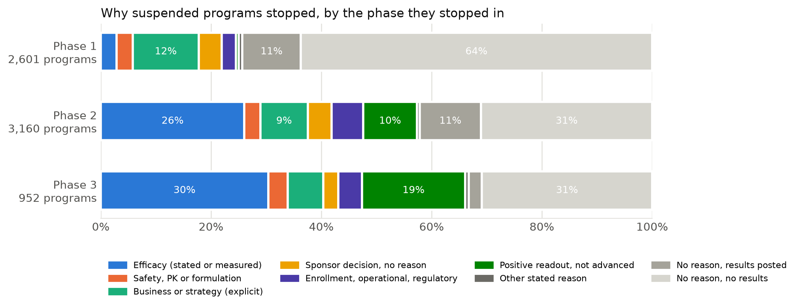
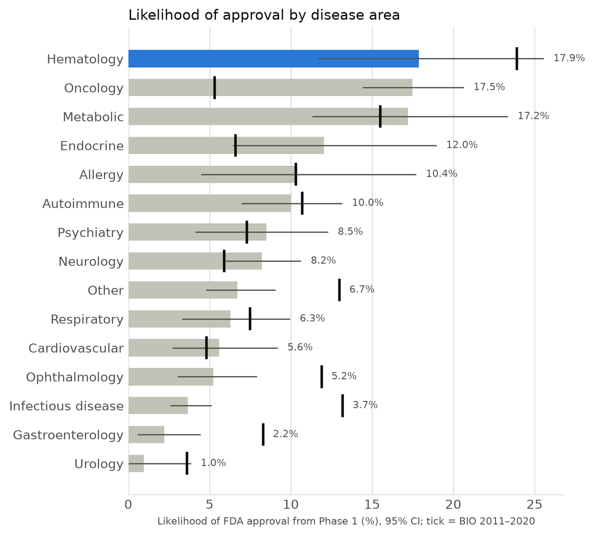
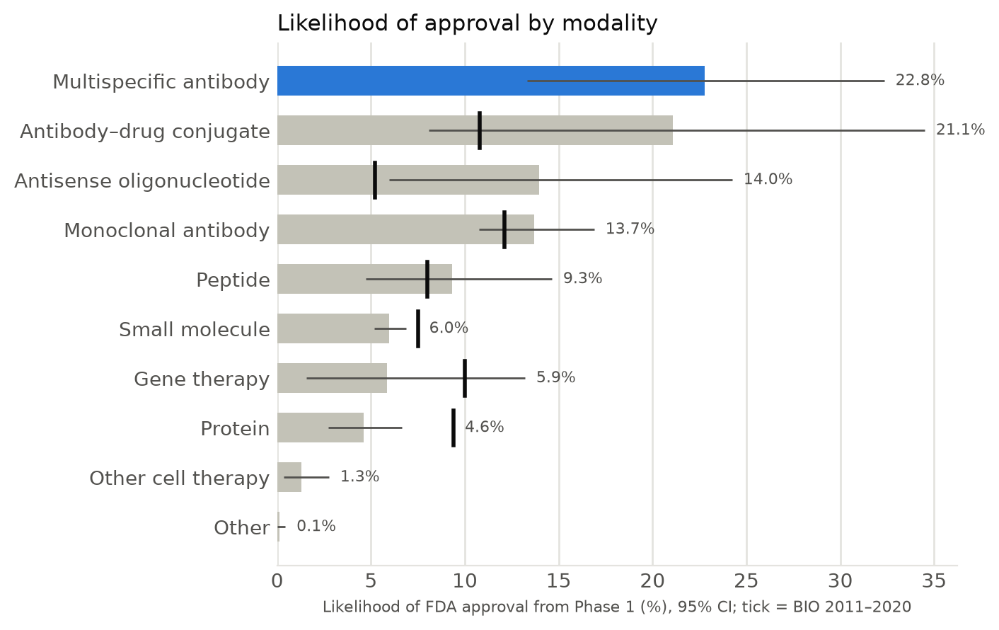
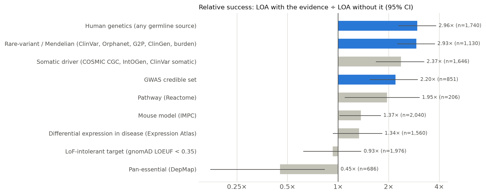
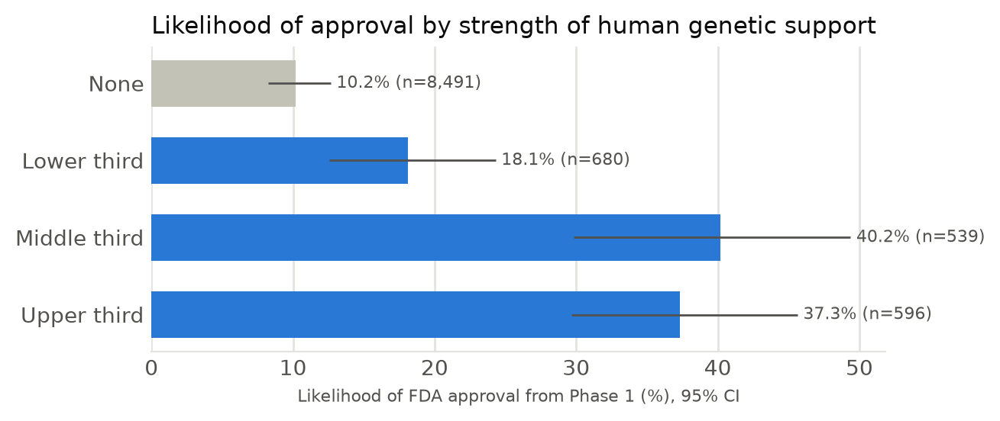
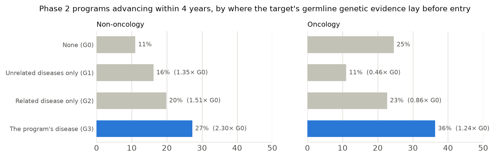
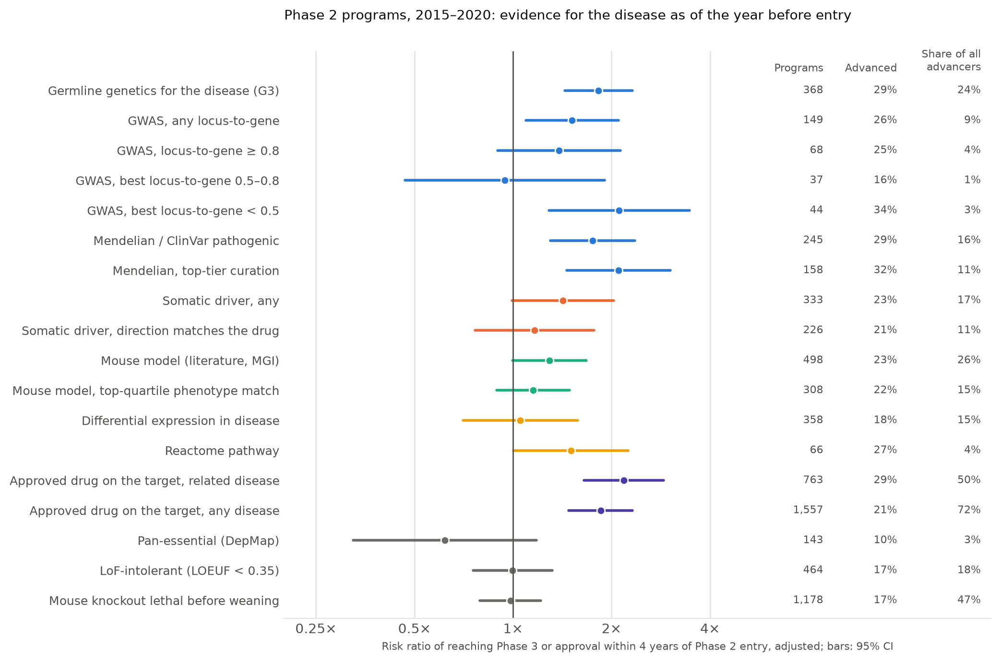
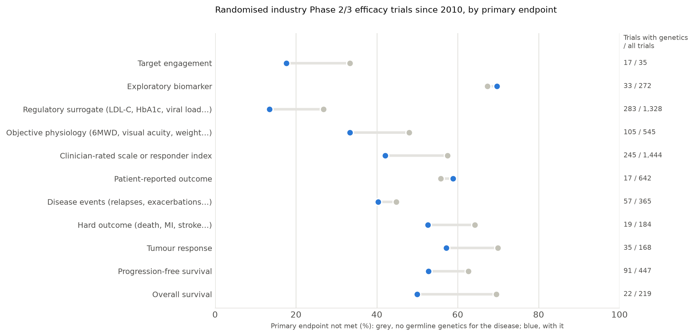
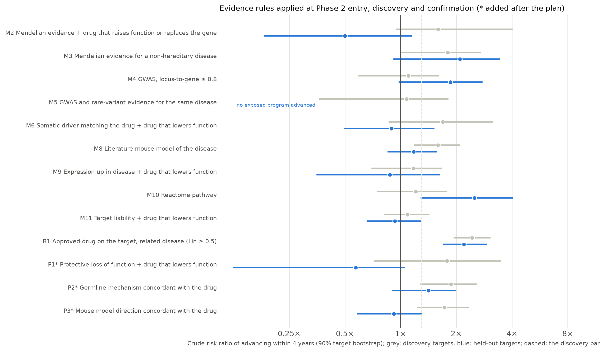

# Predictive Validity in Drug Development

<!-- Rendered by `python -m report.render` from report/output/*/numbers.json.
     Every number in braces comes from the generated outputs; edit prose here, never the numbers. -->

## Introduction

The number of new drugs approved per billion dollars of inflation-adjusted R&D spending halved roughly every nine years from 1950 to 2010, an ~80-fold fall ([Scannell et al. 2012](https://doi.org/10.1038/nrd3681)); the decline has flattened since about 2010 ([Ringel et al. 2020](https://doi.org/10.1038/d41573-020-00059-3)). Only 7.9% of drug development programs (drug–indication pairs) that enter Phase 1 reach FDA approval, and 6.8% for novel drugs ([Thomas et al. 2021, BIO](https://go.bio.org/rs/490-EHZ-999/images/ClinicalDevelopmentSuccessRates2011_2020.pdf)). More than nine in ten programs that enter the clinic never reach approval, and we can see little of why.

Existing analyses offer a few data points:

* Nelson et al. (2015) estimated that human genetic support could roughly double the chance of success in clinical development ([Nelson et al. 2015](https://doi.org/10.1038/ng.3314)). With a decade more genetic data, target–indication pairs with genetic support were 2.6 times as likely to progress from Phase 1 to launch ([Minikel et al. 2024](https://doi.org/10.1038/s41586-024-07316-0)).
* Of 174 Phase 2 and Phase 3 failures in 2013–2015 whose sponsors gave a reason, 52% were for efficacy and 24% for safety ([Harrison 2016](https://doi.org/10.1038/nrd.2016.184)).
* A review of AstraZeneca's 2005–2010 pipeline distilled five technical determinants of success, the "5Rs": right target, tissue, safety, patient and commercial potential ([Cook et al. 2014](https://doi.org/10.1038/nrd4309)). After the company adopted the framework, its success rate from candidate nomination to Phase 3 completion rose from 4% to 19% ([Morgan et al. 2018](https://doi.org/10.1038/nrd.2017.244)).

Scannell and colleagues called the decline Eroom's Law (Moore's Law backwards) and attributed it to four causes ([Scannell et al. 2012](https://doi.org/10.1038/nrd3681)):

1. **"Better than the Beatles":** each new drug must beat a growing catalogue of cheap, effective generics.
2. **The cautious regulator:** the bar for safety and evidence keeps rising.
3. **"Throw money at it":** the tendency to add people and money to R&D.
4. **The "basic research–brute force" bias:** overestimating how much molecular biology and high-throughput screening raise the chance that a molecule works in the clinic.

[Scannell and Bosley (2016)](https://doi.org/10.1371/journal.pone.0147215) later used decision theory to show that a model's *predictive validity*, meaning how well its output tracks the clinical outcome, matters far more than its throughput, and proposed that a fall in the predictive validity of the industry's screening and disease models explains much of the decline.

This report rebuilds both questions from primary records. We took every interventional drug or biological study on ClinicalTrials.gov (222,915 studies, snapshot of 2026-10-20), resolved each intervention to the molecular entity it contains and each condition to a MONDO disease, and joined them to every FDA approval we could document: Drugs@FDA applications, 6,529 approved uses read from 2008–2026 approval letters, current labels, and 177 CBER biologics applications rebuilt from the agency's yearly pages and letters. The unit throughout is a *development program*: one molecular entity developed for one indication. An entity counts toward a program only in trials where it is the investigational agent, not a comparator or background therapy.

The report has three parts:

1. **Industry failure modes.** Phase transitions, likelihood of approval (LOA) and the reasons programs stop, for programs that entered each phase in 2015–2025: an updated companion to BIO's *Clinical Development Success Rates 2011–2020*.
2. **Predictive power of preclinical evidence.** For programs aimed at a human protein target, whether the target had human genetic, somatic, animal-model, expression, pathway or functional-screen evidence for the program's disease, as known before the program entered the phase, and how much each line changes the chance of approval.
3. **What translates to the clinic.** Which kinds of evidence, at what strength and in which direction, predicted that a Phase 2 program would advance; on which trial endpoints the advantage shows; and which decision rules applied at Phase 2 entry predicted well enough to call a model, with verified case studies.

Every classification in the pipeline (entity resolution, disease mapping, trial purpose and roles, approvals, stop reasons, trial outcomes, targets, trial endpoints, gene–disease mechanisms and mouse-model relations) was made by an LLM reading the source record and recorded with its prompt and input. Disease mapping, entity resolution, approved uses, program approvals, stop reasons and trial outcomes were also checked against an independent re-derivation of a seeded sample (Appendix); trial purposes and roles were re-decided under a second prompt version and agree with the first on 98% and 97% of trials, and disease mapping, decided twice, chose the same MONDO term for 92% of conditions; modality, disease area and targets were not audited. The Section 3 endpoint classes were audited on a seeded sample of trials, and the mechanism and mouse-model labels were spot-checked (Section 3 and Appendix).


## A history of drug development

Over the past century, drug development moved from natural observation and phenotypic screening to target-based and genetically grounded hypotheses. Each era narrowed the unit of the biological hypothesis, from a whole-organism effect to a target in a specific patient context.

| Period | Technological developments | Biological hypothesis | Examples |
| :---- | :---- | :---- | :---- |
| Pre-1900 to 1930s | Observation, natural products, physiology | Therapeutic effect or organismal phenotype | Morphine, quinine, digitalis, aspirin |
| 1900s–1960s | Quantitative pharmacology and biochemistry | Receptor activity, enzyme, metabolic pathway | Sulfonamides, receptor theory, enzyme inhibitors |
| 1950s–1980s | Systematic medicinal chemistry | Desired pharmacological mechanism | β-blockers, H2 antagonists, antimetabolites |
| 1970s–1990s | Recombinant DNA and molecular cloning | Named gene and protein | Recombinant insulin, cloned GPCRs, channels, kinases |
| 1990s–2000s | Genomics, HTS, automation | Target plus compound library | Imatinib and kinase programs, genomic target portfolios |
| 2000s–2010s | Human genetics and functional genomics | Target–disease association | GWAS, RNAi, CRISPR, dependency maps |
| 2010s–present | Multimodal evidence integration and predictive modeling | Target–indication–mechanism–patient context | Open Targets, gnomAD, single-cell perturbation, AlphaFold |

## Industry failure modes

For development programs that entered a phase in 2015–2025 and were developed in the US, the likelihood of FDA approval from Phase 1 is 9.8% (95% CI 8.7%–10.9%), against BIO's 7.9% for 2011–2020 (6.8% for novel drugs). Across all industry programs registered on ClinicalTrials.gov, including those run only outside the US, it is 7.0%. Most programs stop without a stated reason: of 6,713 programs that stopped, 44% left no stated reason and no posted or published result, and 21% record an efficacy, safety or pharmacokinetic reason.

### How programs are counted

* **Trial:** a registered interventional study listing Early Phase 1 to Phase 3. A Phase 1/2 trial counts as Phase 2 and a Phase 2/3 trial as Phase 3. Withdrawn trials never enrolled and are left out.
* **Molecular entity:** the active substance, whatever its brand, sponsor code, dose or salt, resolved to its FDA UNII substance where one exists. Biosimilars fold into their reference entity.
* **Disease:** the MONDO term for the condition the trial treats, without line, stage, biomarker or age qualifiers.
* **Program:** one entity developed for one indication. An indication groups the entity's MONDO diseases the way a sponsor runs them as programs (prostate cancer with castration-resistant and metastatic prostate carcinoma; diffuse large B-cell and follicular lymphoma kept apart), decided by an LLM for each entity. An entity belongs to a program only in trials where it is the investigational agent, not a comparator or background therapy. Each industry trial's purpose is classified first: bioequivalence, formulation, food-effect, interaction and other product-support studies (10,770 trials) belong to no program; a first-in-human study or a basket across several diseases counts as Phase 1 only for the program the sponsor pursued next.
* **Phase entry and outcome:** a program enters a phase when its first industry-sponsored trial of that phase starts. It *advanced* when a later-phase trial in its disease started (any sponsor). A trial that has not started, because it is still not yet recruiting or its record went silent before its estimated start date, marks neither entry nor advancement or the FDA approved the entity for the disease; it is *suspended* when none of its trials, nor the trial that marked its Phase 1 entry, has been active within 24 months of the snapshot (2026-10-20); otherwise it is still running and *censored*. Programs whose entity was already approved for the disease are lifecycle programs and are left out; an approval dated only as before 2008 (the first approval letters read) is placed at the entity's first FDA approval, the earliest it could have happened. As in BIO's report, a phase a program skipped (Phase 1 straight to Phase 3, or approval from Phase 2) counts as a success in that phase, each phase's success rate is advanced ÷ (advanced + suspended), and LOA is their product. *US-developed* programs are those with a US-sited industry trial in the phase; a cohort with fewer than ten entities resolved in a phase gets no LOA.
* **Approval:** FDA approval of the entity for the program's disease, a subtype or population of it, or a broader approved class that includes it, judged from the dated approval letters, original-approval dates and labels of every application of the entity (CDER and CBER).

16,715 programs of 9,914 entities entered at least one phase in 2015–2025.

### Phase transitions

| Transition | All programs (95% CI) | Developed in the US (95% CI) | BIO 2011–2020 |
| :---- | :---- | :---- | :---- |
| Phase 1 → Phase 2 | 54.5% (52.6–56.4), n=5,719 | 54.4% (51.6–57.0), n=3,159 | 52.0% |
| Phase 2 → Phase 3 | 33.8% (32.3–35.4), n=4,774 | 33.8% (31.8–35.7), n=2,927 | 28.9% |
| Phase 3 → Approval | 38.1% (35.1–41.0), n=1,537 | 53.1% (49.8–56.3), n=1,051 | 52.4% |
| **Phase 1 → Approval (LOA)** | **7.0%** (6.2–7.8) | **9.8%** (8.7–10.9) | **7.9%** (novel drugs 6.8%) |

Programs developed in the US, the closest match to BIO's FDA-focused Biomedtracker programs, advance from Phase 1 at 54.4% (BIO 52.0%), from Phase 2 at 33.8% (BIO 28.9%) and from Phase 3 to approval at 53.1% (BIO 52.4%). Phase 2 remains the steepest single drop. Across all registered industry programs the Phase 3 rate falls to 38.1%, because many programs run only outside the US end in approvals elsewhere, which this report does not count.

The likelihood of approval depends on choices a registry-based count has to make, and the table below shows how far each moves it. It is most sensitive to how long a program must be idle before it counts as suspended: 5.0% with a 12-month window and 10.1% with 36 months (24 in the headline). If every shared trial (a healthy-volunteer study, a basket) counted as the start of every later indication of the drug, LOA would rise to 11.9%, mostly by crediting indication expansions begun at Phase 2 with a Phase 1 success. Restricting to programs that entered a phase in 2015–2019, which have had at least six years to resolve, changes little (9.9% for US-developed programs). Vaccines are left out of the headline figures: annual and variant strain updates are licensed as supplements to the parent product, so registry entities for updated formulations never reach an approval of their own (LOA with vaccines included: 6.3%).


| Cohort or definition | Ph1→2 | Ph2→3 | Ph3→approval | LOA (95% CI) |
| :---- | :---- | :---- | :---- | :---- |
| All programs | 54.5% | 33.8% | 38.1% | 7.0% (6.2–7.8) |
| Programs with a US-sited industry trial in the phase | 54.4% | 33.8% | 53.1% | 9.8% (8.7–10.9) |
| Entity not yet FDA-approved at phase entry | 55.0% | 33.2% | 37.7% | 6.9% (6.1–7.7) |
| Entity already FDA-approved for another disease | 51.8% | 38.3% | 39.3% | 7.8% (5.7–10.3) |
| Suspension lag 12 months | 49.5% | 29.7% | 34.2% | 5.0% (4.5–5.6) |
| Suspension lag 18 months | 51.8% | 31.4% | 35.8% | 5.8% (5.2–6.5) |
| Suspension lag 36 months | 60.0% | 38.6% | 43.5% | 10.1% (9.0–11.1) |
| Uncertain approvals counted as approved | 54.5% | 33.8% | 38.1% | 7.0% (6.2–7.8) |
| Shared trials mark entry for every program of the entity | 66.6% | 45.4% | 39.3% | 11.9% (10.4–13.6) |
| Including vaccines | 53.3% | 33.1% | 35.6% | 6.3% (5.6–7.0) |
| Phase entry 2015-2019 (at least six years of follow-up) | 53.1% | 30.6% | 41.4% | 6.7% (5.8–7.8) |
| Phase entry 2015-2019, developed in the US | 54.9% | 33.2% | 54.2% | 9.9% (8.4–11.4) |

### Why programs stop

Each suspended program takes one reason from the industry trials of the phase it stopped in, in this order: an efficacy reason stated by the sponsor, a primary endpoint missed in posted or published results, a safety signal, a pharmacokinetic or formulation problem, an explicit business or strategic reason, a bare "sponsor decision", an enrollment, operational or regulatory reason, a positive primary readout without advancement, another stated reason, posted results with no stated reason or readable endpoint, and finally neither a reason nor a result.

| Reason | Phase 1 | Phase 2 | Phase 3 |
| :---- | :---- | :---- | :---- |
| PK, dose or formulation | 1% (22) | 0% (8) | 0% (0) |
| business or strategic (explicit) | 12% (311) | 9% (273) | 6% (61) |
| completed, no results posted, no reason stated | 51% (1,337) | 20% (638) | 21% (204) |
| efficacy: primary endpoint not met | 0% (7) | 20% (635) | 19% (177) |
| efficacy: stated | 3% (67) | 6% (188) | 12% (112) |
| enrollment, operational or regulatory | 3% (67) | 6% (181) | 4% (41) |
| other stated reason | 1% (17) | 0% (14) | 1% (6) |
| positive readout, not advanced | 0% (13) | 10% (310) | 19% (178) |
| results posted, no reason stated, endpoint not assessable | 11% (275) | 11% (353) | 2% (23) |
| safety | 2% (55) | 3% (83) | 4% (34) |
| sponsor decision, unspecified | 4% (109) | 4% (135) | 3% (26) |
| stopped, no reason stated | 12% (321) | 11% (342) | 9% (90) |



The registry rarely says why a program stopped. In Phase 1, 64% of stopped programs left neither a stated reason nor a result, which is expected: Phase 1 trials seldom post results and companies seldom explain pausing early assets. In Phase 2 and Phase 3 the share without a reason falls to 31% and 31%. Efficacy is the recorded reason for 26% of programs that stopped in Phase 2 and 30% of those that stopped in Phase 3: the sponsor said so, or the posted or published primary endpoint was missed. Safety accounts for 3% and 4%: among Phase 2 and Phase 3 stops with an efficacy or safety reason, safety is 9% and 11%, against about 32% in Harrison (2016), whose 2013–2015 failures with a disclosed reason were 24% safety and 52% efficacy. Either registry records under-report safety stops, or company disclosures over-represent them.

At the level of individual trials, the 5,559 industry trials started in 2015–2025 that stopped early or were withdrawn with a reason give: an explicit business, portfolio or competitive reason 37%, a bare "sponsor decision" 19%, efficacy 14%, enrollment or operations 14% and safety 4%. The draft's single 44% "commercial or strategic" category mixed these two kinds of statement; a "sponsor decision" with no reason may or may not hide an efficacy result, and the record cannot tell. No study has measured how often a stated business reason hides an efficacy or safety failure. Where a registry gives a reason it mostly agrees with the trial's publication (53 of 57 in [Alturki et al. 2017](https://doi.org/10.1016/j.jclinepi.2016.08.011)); the usual gap is a missing reason. Analysts who also read company filings, press releases and regulator records attribute 57% of drug failures in pivotal trials to efficacy, 17% to safety and 22% to commercial reasons ([Hwang et al. 2016](https://doi.org/10.1001/jamainternmed.2016.6008)), so the efficacy and safety shares here are a floor.

Finally, 19% of Phase 3 programs that stopped short of FDA approval had met their primary endpoint. In a sample we read, most of them were approved outside the US (Japan, China, Korea, Russia) or received a complete response letter from the FDA: a positive Phase 3 readout is necessary but not sufficient for US approval.


### By disease area and modality

| Disease area | All programs, LOA (95% CI) | Entities | Developed in the US, LOA (95% CI) | BIO 2011–2020 |
| :---- | :---- | :---- | :---- | :---- |
| Hematology | 17.9% (11.7–25.6) | 266 | 16.3% (9.3–25.0) | 23.9% |
| Oncology | 17.5% (14.4–20.6) | 2,504 | 20.4% (16.5–24.3) | 5.3% |
| Metabolic | 17.2% (11.3–23.4) | 400 | 24.0% (16.4–32.7) | 15.5% |
| Endocrine | 12.0% (6.4–19.0) | 307 | 24.5% (15.5–34.5) | 6.6% |
| Allergy | 10.4% (4.5–17.7) | 127 | 11.6% (4.4–21.9) | 10.3% |
| Autoimmune | 10.0% (7.0–13.2) | 623 | 10.1% (6.5–14.2) | 10.7% |
| Psychiatry | 8.5% (4.1–12.3) | 284 | 10.5% (5.7–17.0) | 7.3% |
| Neurology | 8.2% (6.0–10.6) | 879 | 12.3% (9.0–15.8) | 5.9% |
| Other | 6.7% (4.8–9.1) | 880 | 8.6% (5.9–11.7) | 13.0% |
| Respiratory | 6.3% (3.3–10.0) | 460 | 7.9% (4.2–12.4) | 7.5% |
| Cardiovascular | 5.6% (2.7–9.2) | 348 | 12.2% (6.2–19.4) | 4.8% |
| Ophthalmology | 5.2% (3.0–7.9) | 410 | 6.4% (3.3–9.9) | 11.9% |
| Infectious disease | 3.7% (2.6–5.1) | 893 | 5.6% (3.6–8.1) | 13.2% |
| Gastroenterology | 2.2% (0.6–4.4) | 319 | 5.9% (1.9–10.8) | 8.3% |
| Urology | 1.0% (0.0–3.9) | 65 | – | 3.6% |

| Modality | All programs, LOA (95% CI) | Entities | Developed in the US, LOA (95% CI) | BIO 2011–2020 |
| :---- | :---- | :---- | :---- | :---- |
| Multispecific antibody | 22.8% (13.3–32.3) | 469 | 24.7% (13.9–34.7) | – |
| Antibody–drug conjugate | 21.1% (8.1–34.5) | 403 | 18.5% (6.9–32.4) | 10.8% |
| Antisense oligonucleotide | 14.0% (6.0–24.2) | 112 | 16.9% (7.0–31.5) | 5.2% |
| Monoclonal antibody | 13.7% (10.8–16.9) | 1,261 | 15.6% (11.7–19.5) | 12.1% |
| Peptide | 9.3% (4.7–14.6) | 341 | 12.3% (5.7–19.3) | 8.0% |
| Small molecule | 6.0% (5.2–6.9) | 5,040 | 8.8% (7.6–10.1) | 7.5% |
| Gene therapy | 5.9% (1.6–13.2) | 231 | 6.7% (1.7–14.7) | 10.0% |
| Protein | 4.6% (2.7–6.6) | 533 | 4.9% (2.7–7.7) | 9.4% |
| Other cell therapy | 1.3% (0.4–2.8) | 482 | 2.3% (0.5–5.8) | – |
| Other | 0.1% (0.0–0.4) | 276 | – | – |





Disease areas rank differently from BIO's: the rank correlation with BIO's LOA across the 15 areas is 0.25 for all programs and -0.25 for US-developed ones. Across all programs, hematology, metabolic and oncology programs reach approval most often (17.9%, 17.2% and 17.5%), and urology, gastroenterology and infectious-disease programs least. Among US-developed programs, endocrine (24.5%) and oncology programs (20.4%) come out far above BIO's 6.6% and 5.3%; for oncology, the 2015–2025 window holds the wave of immunotherapy, antibody–drug conjugate and bispecific approvals, and an approval in a cancer subtype counts for the program's cancer. Infectious disease (5.6%) sits far below BIO's 13.2%, largely because many registered anti-infective and COVID-19 programs, including US-run ones, were never approved; ophthalmology (6.4%) and gastroenterology (5.9%) also fall below BIO's 11.9% and 8.3%. Among modalities, multispecific antibodies and antibody–drug conjugates reach approval most often across all programs (22.8% and 21.1%), and among the classes BIO also reports, non-antibody proteins (4.6%), gene therapies (5.9%) and small molecules (6.0%) least. RNA interference and CAR-T, near the top of BIO's ordering, have too few entities resolved in Phase 3 here (most of their approvals came straight from Phase 2) to estimate. The modality ordering agrees with BIO's only loosely (rank correlation 0.11 across the 7 classes both estimate).


## Predictive power of preclinical evidence

Human genetic evidence linking a program's target to its disease is the clearest preclinical signal of success. Programs whose target had it before they entered the phase reached FDA approval 2.96 times as often as programs without it (30.1% against 10.2%; 95% CI 2.28–3.83), the likelihood rises with the strength of the evidence, and the association holds at every phase after accounting for disease area, modality, novelty and era. Somatic driver and mouse-model evidence carry weaker signals; targets essential in every cancer cell line are a liability. Yet as a predictor of which individual programs will be approved, the evidence lines raise discrimination only modestly over disease area and modality (held-out AUC 0.605 to 0.652), because most programs have none of them.


### Evidence lines and how they are matched

Each program aimed at a human protein (the entity's primary targets, resolved by an LLM from the entity's mechanism records and trial descriptions) is scored for the evidence its targets had **for the program's disease** in Open Targets Platform 26.09, **as of the year before the program entered the phase**. A target–disease association counts for the program's disease when the evidence disease is the same MONDO term, a subtype of it, or similar to it (Lin similarity ≥ 0.8, the criterion Minikel et al. used). Each association's score is rebuilt year by year from its evidence items, each dated by when it became known (ClinVar records by their creation rather than their latest review, IMPC knockouts by their first data release), so evidence is taken as it stood before phase entry, not as it stands today. Evidence lines:

* **Human germline genetics:** GWAS credible sets (with locus-to-gene scores), gene burden tests, ClinVar, Genomics England PanelApp, Orphanet, Gene2Phenotype, ClinGen and UniProt; split into GWAS and rare-variant/Mendelian sources.
* **Somatic drivers:** COSMIC Cancer Gene Census, IntOGen and ClinVar somatic.
* **Mouse models:** IMPC phenotypes. **Expression:** differential expression in the disease (Expression Atlas). **Pathways:** Reactome. **Functional screens:** CRISPR screens.
* **Target-level properties** that are not disease-specific: loss-of-function intolerance (gnomAD v4.1 LOEUF < 0.35) and pan-essentiality (DepMap Public 24Q4 common-essential genes), taken from those releases rather than as of phase entry.

Sources that encode clinical outcomes or literature co-mention (ChEMBL clinical precedence, Europe PMC) are not used. Vaccines, cell and gene therapies and other entities without a single human protein target fall outside this analysis, so its programs reach approval more often than the Section 1 cohort as a whole. Of the 10,169 programs on 1,467 targets scored, 15.2% of Phase 1 entrants had human genetic evidence for their disease at entry.

### Relative success

*Relative success* is the LOA of programs with the evidence divided by the LOA of programs without it (Nelson et al. 2015; Minikel et al. 2024). The 95% intervals resample primary-target sets (an entity's primary targets taken together), since programs on the same targets are not independent.

| Evidence line | Programs with it | LOA with / without | Relative success (95% CI) |
| :---- | :---- | :---- | :---- |
| Human genetics (any germline source) | 1,740 | 30.1% / 10.2% | 2.96 (2.28–3.83) |
| Rare-variant / Mendelian (ClinVar, Orphanet, G2P, ClinGen, burden) | 1,130 | 32.1% / 11.0% | 2.93 (2.24–3.77) |
| Somatic driver (COSMIC CGC, IntOGen, ClinVar somatic) | 1,646 | 26.8% / 11.3% | 2.37 (1.68–3.25) |
| GWAS credible set | 851 | 26.2% / 11.9% | 2.20 (1.54–2.98) |
| Pathway (Reactome) | 206 | 24.7% / 12.6% | 1.95 (1.09–3.05) |
| Mouse model (IMPC) | 2,040 | 16.3% / 11.9% | 1.37 (1.02–1.80) |
| Differential expression in disease (Expression Atlas) | 1,560 | 16.6% / 12.4% | 1.34 (0.93–1.83) |
| LoF-intolerant target (gnomAD LOEUF < 0.35) | 1,976 | 12.2% / 13.1% | 0.93 (0.62–1.37) |
| Pan-essential (DepMap) | 686 | 6.0% / 13.3% | 0.45 (0.17–0.83) |



Rare-variant and Mendelian evidence (2.93×) and GWAS evidence (2.20×) both carry the genetic signal, in line with Minikel et al. (2024), who found 2.6× from Phase 1 to launch with Mendelian evidence stronger than GWAS. Somatic driver evidence (2.37×), mouse phenotypes (1.37×) and Reactome pathways (1.95×, from only 206 programs) also associate with success; differential expression in the disease does not clearly (1.34×, interval spanning 1). Loss-of-function-intolerant targets show no penalty (0.93×), while pan-essential targets reach approval less than half as often (0.45×), mostly oncology small molecules aimed at machinery every cell needs (mTOR, tubulin, topoisomerases, histone deacetylases, WEE1 and ATR, BET proteins). CRISPR-screen evidence covered too few programs (62) to estimate.

Two checks bear on whether this reflects foresight rather than hindsight. Evidence is taken as it stood the year before the program entered the phase, each item dated by when it became known, so later discoveries do not count. Counting all evidence known by 2026 instead weakens the genetic relative success to 2.47×: what was known in advance is more telling than what was found afterwards. And restricting matches to diseases similar to the program's (Lin ≥ 0.8, Minikel's criterion, without the subtype rule) gives 2.98×.


### Genetic dose–response

| Human genetic support (Open Targets score, as of phase entry) | Programs | Targets | LOA (95% CI) |
| :---- | :---- | :---- | :---- |
| None | 8,491 | 1,310 | 10.2% (8.2–12.7) |
| Lower third (> 0.00 to 0.61) | 680 | 346 | 18.1% (12.5–24.3) |
| Middle third (> 0.61 to 0.88) | 539 | 204 | 40.2% (29.8–49.4) |
| Upper third (> 0.88) | 596 | 241 | 37.3% (29.7–45.6) |



### What each line adds once the others are known

Programs with genetic evidence differ from programs without it in disease area, modality and era, and the evidence lines overlap. The table gives, for each phase, the relative risk of advancing for programs with each line, from one Poisson model containing every line together with disease area, modality, entity novelty and entry period (standard errors clustered by primary-target set).

| Evidence | Phase 1 → next | Phase 2 → next | Phase 3 → next |
| :---- | :---- | :---- | :---- |
| GWAS credible set | 1.08 (1.01–1.15) | 1.54 (1.33–1.79) | 1.04 (0.78–1.39) |
| Rare-variant / Mendelian (ClinVar, Orphanet, G2P, ClinGen, burden) | 1.11 (1.03–1.21) | 1.35 (1.16–1.56) | 1.50 (1.25–1.80) |
| Somatic driver (COSMIC CGC, IntOGen, ClinVar somatic) | 1.02 (0.91–1.14) | 1.10 (0.89–1.37) | 1.06 (0.84–1.34) |
| Mouse model (IMPC) | 0.91 (0.85–0.98) | 0.98 (0.86–1.12) | 0.96 (0.81–1.14) |
| Differential expression in disease (Expression Atlas) | 0.94 (0.87–1.02) | 1.02 (0.86–1.21) | 0.92 (0.75–1.12) |
| Pathway (Reactome) | 1.10 (0.97–1.25) | 0.97 (0.73–1.28) | 1.12 (0.80–1.56) |
| LoF-intolerant target (gnomAD LOEUF < 0.35) | 0.92 (0.80–1.06) | 1.16 (0.99–1.37) | 1.03 (0.84–1.27) |
| Pan-essential (DepMap) | 0.86 (0.71–1.04) | 0.81 (0.59–1.12) | 0.68 (0.42–1.10) |

One evidence line at a time, with the same adjustments, human genetic evidence raises the chance of advancing by 1.10× in Phase 1, 1.62× in Phase 2 and 1.41× in Phase 3: the effect sits where efficacy is first tested. In the joint model, GWAS and rare-variant evidence each keep an independent effect at Phase 2, rare-variant evidence also at Phase 3 and GWAS a small one at Phase 1, and pan-essentiality keeps its penalty at Phase 2 (at Phase 1 its interval just reaches 1); somatic, mouse-model, expression and pathway evidence lose their association once genetics and the covariates are in the model, consistent with their univariate signal riding along with genetic support and with disease area.


### Does the evidence predict which programs reach approval?

We followed programs that entered Phase 1 in 2008–2016 for ten years (3,185 programs, 159 approved), with the Open Targets evidence lines and novelty taken as of entry (loss-of-function constraint and pan-essentiality come from current releases), and fitted logistic models on disease area, modality, novelty and entry year alone, and with the evidence lines added. Performance is measured on held-out primary-target sets (out-of-fold predictions averaged over 20 repetitions of 5-fold cross-validation grouped by primary-target set and stratified by outcome; a single split moves the AUC by several points) and on a temporal split (trained on 2008–2012 entries, tested on 2013–2016).

| Validation | Features | AUC (95% CI) | PR-AUC (base rate) | Programs (approved) |
| :---- | :---- | :---- | :---- | :---- |
| Held-out target sets | Area, modality, novelty, year | 0.605 (0.540–0.668) | 0.098 (0.050) | 3,185 (159) |
| Temporal (2013–2016) | Area, modality, novelty, year | 0.620 (0.545–0.691) | 0.105 (0.056) | 1,603 (89) |
| Held-out target sets | … plus all evidence lines | 0.652 (0.596–0.715) | 0.121 (0.050) | 3,185 (159) |
| Temporal (2013–2016) | … plus all evidence lines | 0.649 (0.578–0.727) | 0.127 (0.056) | 1,603 (89) |
| Held-out target sets | Evidence lines only | 0.625 (0.552–0.696) | 0.089 (0.050) | 3,185 (159) |
| Temporal (2013–2016) | Evidence lines only | 0.663 (0.601–0.727) | 0.117 (0.056) | 1,603 (89) |

Change in held-out AUC when each line is removed from the full model (human genetics: GWAS and rare-variant evidence removed together; lines carried by fewer than 100 programs are not modelled; paired bootstrap over target sets):

| Evidence removed | AUC change (95% CI) |
| :---- | :---- |
| Human genetics (any germline source) | -0.025 (-0.046 to -0.005) |
| Rare-variant / Mendelian (ClinVar, Orphanet, G2P, ClinGen, burden) | -0.025 (-0.047 to -0.006) |
| Pan-essential (DepMap) | -0.011 (-0.026 to +0.004) |
| Differential expression in disease (Expression Atlas) | -0.006 (-0.019 to +0.009) |
| Mouse model (IMPC) | +0.002 (-0.001 to +0.004) |
| LoF-intolerant target (gnomAD LOEUF < 0.35) | +0.003 (+0.001 to +0.005) |
| Somatic driver (COSMIC CGC, IntOGen, ClinVar somatic) | +0.006 (-0.008 to +0.020) |

A model on disease area, modality, novelty and entry year alone ranks programs at an AUC of 0.605 on held-out target sets; adding the evidence lines raises it to 0.652 (95% CI 0.596–0.715), and the temporal split agrees (0.620 without, 0.649 with). Human genetics carries most of the gain: removing it lowers the held-out AUC by 0.025 (95% CI 0.005–0.046), and pan-essentiality is the only other line whose removal measurably lowers it (0.011). GWAS evidence covered too few of the 2008–2016 entrants to be modelled, so genetics here means rare-variant and Mendelian evidence. Discrimination stays modest all the same, and that does not contradict the relative success: genetic support multiplies the chance of approval by about 2.96 for the minority of programs that have it (15% of Phase 1 entrants, fewer among the 2008–2016 entrants this model follows), but says nothing about the majority, so it can sort only a small slice of programs. The draft's AUCs of 0.825 and 0.769 came from a leaked model and phantom programs (AUDIT.md, C33–C34).


## What translates to the clinic

Human genetic evidence for the program's own disease is the one kind of preclinical evidence that consistently carried over into Phase 2. Outside oncology, programs whose target had germline genetic evidence for the disease before they entered Phase 2 reached Phase 3 or approval within four years 2.34 times as often as programs whose target had no germline genetic evidence at all (27% against 11%), and the advantage shrinks as the evidence moves to a related disease (20%) or to unrelated diseases only (16%). The same target does better in the diseases its genetics points to than in its other diseases (odds ratio 3.00), and the effect holds after accounting for an approved drug on the target. The advantage shows in efficacy: genetically supported programs stopped for efficacy less often (business and operational stops fell about as much), and their trials missed the primary endpoint less often on regulatory surrogates and clinician-rated scales; on patient-reported, exploratory-biomarker and event endpoints the difference was small or absent. Somatic drivers in oncology and Reactome pathway evidence carried weaker signals, literature mouse models a marginal one and differential expression none, and a mouse model whose direction matched the drug's did not predict Phase 2 success. Whether the direction of the genetic effect matters could not be tested, because almost no program went against an established mechanism. Of the rules a sponsor could have applied at Phase 2 entry, only the benchmark, an approved drug on the same target for a related disease, met the pre-registered bar for a particularly predictive model; Mendelian evidence for a non-hereditary disease came closest. Genetic support covered only 24% of the programs that advanced.


### Design

The analysis plan ([report/translation_plan.md](report/translation_plan.md)) was committed before any of these analyses touched outcomes; departures from it are marked below.

* **Cohort and outcome.** Programs on a human protein target that entered Phase 2 from 2015-01-01 to 2020-10-20 (2,519 programs on 883 primary-target sets). Each has at least four years of follow-up before the 24-month inactivity cutoff, so the outcome needs no inferred suspension: a program *advanced* if a Phase 3 trial of its own started, or the FDA approved it for the disease, within four years of entering Phase 2 (17.5% did). The same is done for Phase 1 entrants (a negative control: genetics should matter little for safety and dosing studies) and Phase 3 entrants (approval within four years).
* **Evidence.** Every Open Targets 26.09 evidence row for the program's primary targets, each dated by the year it became known (ClinVar records by their creation, IMPC knockouts by their first data release, otherwise the row's own publication), frozen at the year before entry and matched to the program's disease on MONDO: the same term, a subtype, or Lin similarity ≥ 0.8 (*G3*, genetics for the disease); a disease at Lin 0.5–0.8 only (*G2*); germline evidence only for unrelated diseases (*G1*); none (*G0*). Evidence is split by family and strength (the best GWAS locus-to-gene score, ≥ 0.8, 0.5–0.8 or below; ClinVar pathogenic with multiple submitters or expert review, ClinGen or Gene2Phenotype definitive or strong, PanelApp green; mouse phenotype match in the top quartile), and mouse models are split into IMPC high-throughput knockouts and literature-curated MGI models.
* **Regimes.** Oncology; *hereditary* (the disease is a MONDO hereditary disease and the target has curated Mendelian evidence for it); and every other disease (*non-oncology*, the regime of the headline hypothesis).
* **Models.** Modified Poisson regression (risk ratios) with standard errors clustered by primary-target set, adjusted for disease area, modality, entity novelty, entry period and target precedent (an FDA-approved entity on the target before entry). The seven confirmatory hypotheses are Holm-corrected together.
* **Trials.** Randomised industry Phase 2/3 trials since 2010 whose governing primary endpoint measures efficacy and whose result is readable (5,672 trials; an LLM classified each trial's governing primary endpoint from its registry entry, without the drug's name). Outcome: primary endpoint not met (a mixed result counts as not met).

### Confirmatory hypotheses

|  | Hypothesis | Measure | Estimate (95% CI) | p | Holm p | Result |
| :---- | :---- | :---- | :---- | :---- | :---- | :---- |
| H1 | Outside oncology: genetics for the disease (G3) vs no germline genetics (G0), advancing within 4 years of Phase 2 | risk ratio | 2.34 (1.33–4.14) | 0.003 | 0.020 | supported |
| H2 | Same target, different diseases: G3 vs not (conditional logit) | odds ratio | 3.00 (1.78–5.03) | < 0.001 | < 0.001 | supported |
| H3 | Direction of genetic effect vs drug action (Open Targets direction fields): discordant < undirected < concordant | risk ratio per step | 0.97 (0.69–1.37) | 0.871 | 1.000 | not supported |
| H4 | Trials outside oncology: change in G3's effect on NOT MET per step from proximal to distal endpoints (registry-posted results, FDAAA era) | ratio of risk ratios | 1.35 (1.09–1.69) | 0.007 | 0.036 | supported |
| H5 | G3 lowers efficacy failure more than business or operational failure (Phase 2 and 3) | ratio of risk ratios | 0.99 (0.58–1.69) | 0.975 | 1.000 | not supported |
| H6 | Outside oncology, target liability raises safety failure, and more than efficacy failure (Phases 1–3; intersection-union test) | risk ratio, safety failure | 0.88 (0.45–1.72) | 0.994 | 1.000 | not supported |
| H7 | Oncology: a somatic driver whose direction matches the drug, advancing within 4 years of Phase 2 | risk ratio | 1.12 (0.72–1.75) | 0.610 | 1.000 | not supported |



Two of the seven hypotheses hold after correction for multiple testing.

* **H1, H2 (supported).** Outside oncology, Phase 2 programs advanced within four years at 11% with no germline genetic evidence on the target (172 programs), 16% with evidence only for unrelated diseases (1,006), 20% with evidence for a related disease (146) and 27% with evidence for the disease itself (153); only the last differs from none once disease area, modality, novelty, period and target precedent are accounted for. Among the 52 targets developed in several diseases with and without genetic support and with different outcomes (380 programs), the diseases with support advanced more often (odds ratio 3.00, 1.78–5.03): the signal is not only that some targets are better than others.
* **H3 (not supported).** Open Targets' direction-of-effect fields follow each variant's predicted consequence, so a few truncating ClinVar variants make gain-of-function disease genes such as PCSK9, MYH7 and TTR read as loss of function, and inhibitors of them as discordant. The test is reported as registered; the direction analysis below replaces those fields.
* **H4 (supported in the registered analysis; not robust).** In trials with registry-posted results, genetic support lowered the chance of missing the primary endpoint most on proximal endpoints (risk ratio 0.58, 0.44–0.76), and the effect weakened by a factor of 1.35 per step towards distal endpoints (p = 0.007; 0.036 after Holm correction). The registered test survives correction, but the pattern does not hold across all readable trials (1.07, p = 0.525) or with mixed results counted as met (1.27).
* **H5 (not supported).** Genetic support lowered efficacy stops (risk ratio 0.71, 0.53–0.96), but business and operational stops fell by a similar factor (ratio of the two 0.99, 0.58–1.69), so the data cannot say that it acts on efficacy alone. Safety stops were no rarer (1.14, 0.58–2.24), nor were stops for pharmacokinetic, formulation or operational reasons, the plan's negative control (0.70, 0.34–1.44).
* **H6 (not supported).** Targets that are pan-essential, intolerant of loss of function, or lethal when knocked out in mice did not stop for safety more often (0.88, 0.45–1.72). Safety is the recorded reason for fewer than 2% of programs, so registries see little of it.
* **H7 (not supported).** In oncology, a somatic driver whose direction matches the drug's (an activated oncogene and an inhibitor) did not raise the chance of advancing (1.12, 0.72–1.75).

**Checks on H1.** Swapping each program's disease for another program's in the same disease area, 200 times, gives a median G3 risk ratio of 1.78 against the observed 2.34 (95th percentile 2.31; p = 0.040). Part of the contrast with G0 therefore reflects whether a target has been studied genetically at all; matching the disease adds to it. At Phase 1, where efficacy is rarely tested, the same contrast is 1.12 (0.89–1.41). Against all other programs rather than G0, genetic support gives 1.74 outside oncology, and 1.59 (1.13–2.21) after adjusting for an approved drug on the target for a related disease; on targets with no approved drug at all, genetic support gives 1.27 (0.80–2.02, all disease areas). Leaving out the most influential target set (PDE4A+PDE4B+PDE4C+PDE4D) gives 2.21. Leaving out each of the 5 largest target classes in turn gives 1.97 to 2.56; the lowest, without the "gpcr" class, has an interval of 1.01–3.86, so the estimate leans on that class.

**Who is in the cohort.** The cohort is Phase 2 programs with a disease and a single resolved human protein target. Left out are 258 programs with no disease (healthy-volunteer, basket or symptom trials; 6% advanced) and 736 without a single human protein target (8%), so the cohort's base rate is higher than Section 1's.


### Which evidence translates

| Evidence for the program's disease, before entry | Programs (targets) | Advanced: with / without | Share of all that advanced | Risk ratio vs programs without it, all (95% CI) | Non-oncology | Oncology |
| :---- | :---- | :---- | :---- | :---- | :---- | :---- |
| Germline genetics for the disease (G3) | 368 (194) | 29% / 16% | 24% | 1.83 (1.44–2.32) | 1.74 (1.24–2.43) | 1.98 (1.28–3.07) |
| GWAS, any locus-to-gene | 149 (84) | 26% / 17% | 9% | 1.52 (1.10–2.10) | 1.71 (1.14–2.57) | 1.70 (0.88–3.27) |
| GWAS, locus-to-gene ≥ 0.8 | 68 (41) | 25% / 17% | 4% | 1.38 (0.90–2.13) | 1.44 (0.89–2.35) | – |
| GWAS, best locus-to-gene 0.5–0.8 | 37 (24) | 16% / 18% | 1% | 0.95 (0.47–1.91) | – | – |
| GWAS, best locus-to-gene < 0.5 | 44 (27) | 34% / 17% | 3% | 2.11 (1.29–3.46) | 2.37 (1.36–4.13) | – |
| Mendelian / ClinVar pathogenic | 245 (131) | 29% / 16% | 16% | 1.75 (1.30–2.35) | 1.71 (1.11–2.62) | 1.76 (1.02–3.03) |
| Mendelian, top-tier curation | 158 (89) | 32% / 17% | 11% | 2.10 (1.46–3.03) | 1.81 (1.04–3.13) | – |
| Somatic driver, any | 333 (103) | 23% / 17% | 17% | 1.42 (0.99–2.03) | – | 1.48 (1.02–2.14) |
| Somatic driver, direction matches the drug | 226 (70) | 21% / 17% | 11% | 1.17 (0.77–1.77) | – | 1.12 (0.72–1.75) |
| Mouse model (literature, MGI) | 498 (281) | 23% / 16% | 26% | 1.29 (1.00–1.68) | 1.30 (0.97–1.72) | 1.16 (0.60–2.24) |
| Mouse model, top-quartile phenotype match | 308 (184) | 22% / 17% | 15% | 1.15 (0.89–1.49) | 1.08 (0.77–1.51) | 0.95 (0.55–1.64) |
| Differential expression in disease | 358 (198) | 18% / 17% | 15% | 1.05 (0.70–1.58) | 0.66 (0.35–1.22) | 1.33 (0.84–2.10) |
| Reactome pathway | 66 (32) | 27% / 17% | 4% | 1.50 (1.00–2.25) | – | – |
| Approved drug on the target, related disease | 763 (269) | 29% / 12% | 50% | 2.18 (1.65–2.88) | 2.16 (1.58–2.95) | 2.05 (1.11–3.78) |
| Approved drug on the target, any disease | 1,557 (439) | 21% / 13% | 72% | 1.85 (1.48–2.32) | 1.68 (1.26–2.24) | 2.28 (1.50–3.47) |
| Pan-essential (DepMap) | 143 (60) | 10% / 18% | 3% | 0.62 (0.33–1.18) | 0.79 (0.34–1.83) | 0.56 (0.25–1.27) |
| LoF-intolerant (LOEUF < 0.35) | 464 (160) | 17% / 18% | 18% | 1.00 (0.76–1.32) | 1.26 (0.89–1.78) | 0.82 (0.54–1.25) |
| Mouse knockout lethal before weaning | 1,178 (411) | 17% / 18% | 47% | 0.98 (0.79–1.21) | 0.96 (0.72–1.26) | 0.97 (0.67–1.41) |



* **Human genetics.** Mendelian and ClinVar evidence for the disease (1.75; top-tier curation 2.10) and GWAS (1.52) both carry the signal. Within GWAS, the locus-to-gene score did not grade it: the best score at 0.8 or above gives 1.38, 0.5–0.8 gives 0.95 and below 0.5 gives 2.11, each from a few dozen programs. Most GWAS rows in Open Targets are on measurement traits (LDL cholesterol, blood pressure, body-mass index) with no MONDO disease; they count as germline evidence on the target but cannot match a disease, so G3 undercounts genetics found through a trait. Gene burden results start in 2019, too late for these cohorts.
* **Somatic drivers.** In oncology, a somatic driver for the tumour raised the chance of advancing (1.48, 1.02–2.14); requiring the driver's direction to match the drug's did not sharpen it (1.12). Germline genetics for the tumour type was the stronger signal (1.98), carried by well-validated targets such as EGFR, ERBB2 and ESR1.
* **Mouse models.** Literature-curated (MGI) mouse models of the disease gave 1.29 (1.00–1.68), and a top-quartile phenotype match 1.15. Each MGI model is dated by its first paper, and each knockout from the IMPC consortia by the first IMPC data release with calls for it (2015 at the earliest).
* **Expression and pathways.** Differential expression in the disease carried nothing (1.05; outside oncology 0.66). Reactome pathway evidence gave 1.50 from 66 programs, most of them in hereditary diseases, which Reactome curates. No CRISPR-screen evidence matched a program before its entry.
* **Clinical precedent.** An FDA-approved drug on the target for a related disease (Lin similarity ≥ 0.5) was the strongest single predictor (2.18) and was present for 50% of the programs that advanced.
* **Target liabilities.** Pan-essential targets (DepMap's common-essential genes) tended to advance less often, but the interval includes no effect (0.62, 0.33–1.18, mostly oncology); loss-of-function intolerance (1.00) and lethality of the mouse knockout (0.98) made no difference.

**What the evidence leaves out.** Of the 442 Phase 2 programs that advanced, 24% had germline genetics for the disease, 48% had any of the disease-specific evidence families, and 30% had neither such evidence nor an approved drug on the target for a related disease.


### By endpoint

| Class of the governing primary endpoint | Trials | Not met | Trials with G3 | Not met: with G3 / without | Risk ratio of NOT MET, all readable (95% CI) | Registry-posted, FDAAA era |
| :---- | :---- | :---- | :---- | :---- | :---- | :---- |
| Target engagement | 35 | 26% | 17 | 18% / 33% | – | – |
| Exploratory biomarker | 272 | 68% | 33 | 70% / 67% | 1.06 (0.80–1.42) | – |
| Regulatory surrogate (LDL-C, HbA1c, viral load…) | 1,328 | 24% | 283 | 13% / 27% | 0.68 (0.47–0.98) | 0.45 (0.32–0.63) |
| Objective physiology (6MWD, visual acuity, weight…) | 545 | 45% | 105 | 33% / 48% | 0.86 (0.63–1.18) | 0.84 (0.56–1.28) |
| Clinician-rated scale or responder index | 1,444 | 55% | 245 | 42% / 57% | 0.73 (0.60–0.89) | 0.76 (0.61–0.95) |
| Patient-reported outcome | 642 | 56% | 17 | 59% / 56% | 1.24 (0.88–1.73) | – |
| Disease events (relapses, exacerbations…) | 365 | 44% | 57 | 40% / 45% | 0.90 (0.60–1.33) | 0.94 (0.61–1.45) |
| Hard outcome (death, MI, stroke…) | 184 | 63% | 19 | 53% / 64% | – | – |
| Tumour response | 168 | 67% | 35 | 57% / 70% | 0.86 (0.62–1.19) | 0.72 (0.46–1.11) |
| Progression-free survival | 447 | 61% | 91 | 53% / 63% | 1.09 (0.88–1.36) | 1.05 (0.79–1.39) |
| Overall survival | 219 | 68% | 22 | 50% / 70% | – | – |



Across 5,672 randomised industry efficacy trials, 48% missed their governing primary endpoint. Regulatory surrogates were missed least (24%); outside oncology, exploratory biomarkers (68%) and hard outcomes (63%) were missed most, and oncology's response and survival endpoints as often.

Genetic support for the disease lowered the chance of a miss most on regulatory surrogates (risk ratio 0.68; 0.45 in trials with registry-posted results since FDAAA) and on clinician-rated scales (0.73). Objective physiology (0.86) and disease events (0.90) point the same way with intervals spanning 1; exploratory biomarkers (1.06), patient-reported outcomes (1.24, only 17 genetically supported trials) and oncology's response and progression endpoints show no benefit. Too few genetically supported trials had hard-outcome or overall-survival primaries to estimate. One reading is that genetic support predicts most reliably that a drug will move the measures nearest its biology, often the trait through which the genetics was found (LDL cholesterol, urate, glycaemia), and less reliably that it will change what patients feel or how often events happen.

At the program level, classifying each Phase 2 program by the endpoint of its first randomised Phase 2 efficacy trial (started within a year of entry and before it advanced), genetic support gives 1.32 (0.76–2.28; 296 programs) where that endpoint was proximal and 1.40 (0.83–2.36; 624) where it was intermediate; distal-endpoint and oncology programs had too few genetically supported targets to estimate.

The endpoint classifier read each trial's registered primary outcomes without the drug. In an audit of 40 trials stratified by class, it picked the governing outcome correctly in 40 and the class in 39. Not knowing the drug, it cannot apply the codebook's drug-specific rules: FEV1 is a regulatory surrogate only for bronchodilators, and target engagement means the drug's own target. Trials still in follow-up that have posted results have no outcome label yet and are not counted (168, against 5,672 in the analysis).


### Direction of effect

A drug that lowers its target's function should help when loss of function protects against the disease or gain of function causes it, and harm or do nothing when loss of function causes it. Open Targets' direction fields cannot test this: they label each variant from its predicted consequence, so the few truncating ClinVar variants listed for PCSK9 in hypercholesterolaemia, MYH7 in hypertrophic cardiomyopathy or TTR in amyloidosis make these gain-of-function diseases read as loss of function; their many pathogenic missense variants carry no direction at all.

We therefore had an LLM state, for every target and disease with germline evidence, without being told any drug, whether disease-causing variants lower or raise the gene's function, whether protective variants are known, and the year each was first shown for that disease. Where Gene2Phenotype records an absent gene product, the label was loss of function in 55 of 58 pairs and gain of function in 0. A spot check of an earlier version of the labels found somatic cancer mutations counted as germline and some years taken from another disease; the final prompt rules out both.

Sponsors almost never develop against an established mechanism. Of the Phase 2 programs with genetic support, 189 acted in the direction the genetics favoured, 6 against it, and 111 had genetics without an established direction by entry. Concordant programs advanced at 29% and undirected ones at 26%: once there is genetic support, knowing its direction did not pick winners among the programs sponsors chose to run, and the discordant group is too small to show whether going against the genetics fails. Protective loss of function plus a drug that lowers function, the PCSK9 pattern, covered 36 Phase 2 programs on 16 targets, which advanced as often as others (1.03, 0.56–1.92).

Mouse models were treated the same way: for each model, without the drug, whether it lowers or raises the gene's function and whether its phenotypes resemble the disease or its opposite. A model pointing the drug's way (a knockout protected from the disease, for an inhibitor) gave 1.33 (0.97–1.83) against programs with no oriented model, a model pointing the other way 1.20, and nothing once genetic support is accounted for (1.02). Among Phase 3 programs a concordant model went with approval within four years (2.38, 1.54–3.69), one of many comparisons made after the plan.


### Models that predict: rules applied at Phase 2 entry

A *model* here is a rule a sponsor could have applied at Phase 2 entry without knowing the outcome: an evidence family, strength, direction and drug action. Rules M1–M11 and the precedent benchmark B1 were fixed in the plan; P1–P3 (marked \*) were added after the plan, once the direction labels existed. Target sets were split 60/40 at random; a rule counts as *particularly predictive* when, on the discovery targets, its risk ratio's 90% bootstrap lower bound is above 1.3, and, on the held-out targets, its risk ratio is at least 1.2 with a one-sided 95% lower bound above 1, and it stays at least 1.2 without its most influential target.

| Rule | Applied at Phase 2 entry | Regime | Programs (targets) | Advanced | Share of all that advanced | Adjusted RR (95% CI) | Discovery RR (90%) | Held-out RR (90%) | Meets the bar |
| :---- | :---- | :---- | :---- | :---- | :---- | :---- | :---- | :---- | :---- |
| M1 | Protective loss-of-function burden + drug that lowers function | All | 0 (0) | – | 0% | – | – | – | not testable |
| M2 | Mendelian evidence + drug that raises function or replaces the gene | Hereditary | 75 (37) | 25% | 66% | 1.08 (0.61–1.90) | 1.59 (0.95–4.00) | 0.50 (0.18–1.15) | no |
| M3 | Mendelian evidence for a non-hereditary disease | Non-oncology | 57 (44) | 32% | 7% | 1.71 (1.11–2.62) | 1.80 (1.01–2.70) | 2.09 (0.92–3.41) | no |
| M4 | GWAS, locus-to-gene ≥ 0.8 | All | 68 (41) | 25% | 4% | 1.38 (0.90–2.13) | 1.10 (0.60–1.60) | 1.86 (0.99–2.75) | no |
| M5 | GWAS and rare-variant evidence for the same disease | All | 26 (17) | 15% | 1% | 0.78 (0.35–1.72) | 1.08 (0.37–1.80) | none advanced | no |
| M6 | Somatic driver matching the drug + drug that lowers function | Oncology | 215 (67) | 22% | 29% | 1.14 (0.73–1.78) | 1.69 (0.87–3.13) | 0.89 (0.50–1.51) | no |
| M7 | IMPC knockout matching the disease, top quartile | All | 9 (5) | 33% | 1% | – | – | – | no |
| M8 | Literature mouse model of the disease | All | 498 (281) | 23% | 26% | 1.29 (1.00–1.68) | 1.59 (1.19–2.09) | 1.18 (0.86–1.56) | no |
| M9 | Expression up in disease + drug that lowers function | All | 177 (104) | 18% | 7% | 1.00 (0.63–1.58) | 1.18 (0.70–1.66) | 0.88 (0.35–1.62) | no |
| M10 | Reactome pathway | All | 66 (32) | 27% | 4% | 1.50 (1.00–2.25) | 1.21 (0.75–1.77) | 2.51 (1.29–4.03) | no |
| M11 | Target liability + drug that lowers function | All | 924 (325) | 18% | 37% | 1.04 (0.82–1.32) | 1.09 (0.82–1.42) | 0.93 (0.66–1.28) | no |
| B1 | Approved drug on the target, related disease (Lin ≥ 0.5) | All | 763 (269) | 29% | 50% | 2.18 (1.65–2.88) | 2.43 (1.95–3.03) | 2.20 (1.72–2.91) | **predictive** |
| P1* | Protective loss of function + drug that lowers function | All | 36 (16) | 19% | 2% | 1.03 (0.56–1.92) | 1.78 (0.73–3.47) | 0.57 (0.00–1.05) | no |
| P2* | Germline mechanism concordant with the drug | All | 189 (97) | 29% | 12% | 1.79 (1.28–2.51) | 1.87 (1.29–2.57) | 1.42 (0.91–1.98) | no |
| P3* | Mouse model direction concordant with the drug | All | 178 (111) | 24% | 10% | 1.29 (0.95–1.75) | 1.72 (1.24–2.32) | 0.92 (0.59–1.30) | no |



Only the benchmark met the bar: an approved drug on the target for a related disease (763 programs, 29% advanced; held-out risk ratio 2.20). Among evidence rules:

* **Mendelian evidence for a non-hereditary disease (M3)** came closest: 57 programs on 44 targets, 32% advanced, held-out risk ratio 2.09 (90% lower bound 0.92), but its discovery lower bound (1.01) fell short of 1.3. It covers few programs (7% of the non-oncology programs that advanced).
* **GWAS with locus-to-gene ≥ 0.8 (M4)** and the post-hoc **germline mechanism concordant with the drug (P2)** have adjusted risk ratios of 1.38 and 1.79, but their held-out lower bounds reach 1 or below (0.99 and 0.91).
* **Reactome pathway evidence (M10)** held up on the held-out targets (risk ratio 2.51, 90% lower bound 1.29) but not on the discovery targets (lower bound 0.75); its adjusted risk ratio is 1.50.
* **Literature mouse models (M8)** gave 1.59 on the discovery targets (90% lower bound 1.19) and 1.18 on the held-out targets (90% lower bound 0.86): inconsistent between the two halves.
* **Replacing or activating the gene in a hereditary disease (M2)** advanced at 25%, against 24% for other programs in hereditary diseases.
* Expression up plus an inhibitor (M9), target liability plus an inhibitor (M11), the allelic series (M5), protective loss of function plus an inhibitor (P1) and a concordant mouse model (P3) carry no consistent signal. Protective-variant burden evidence (M1) could not be tested, because Open Targets has no burden results before 2019, and IMPC knockouts matching the disease (M7) covered 9 programs, too few to estimate.


### Verified case studies

The plan's protocol picked cases for the benchmark B1, the only rule that met the bar, and, beyond the plan, for every rule whose adjusted risk ratio's lower bound is above 1 (M3, M4, M10 and P2): four successes and four failures at random, up to two programs of each of the three most influential targets, and up to six programs that stopped after a randomised trial missed its primary endpoint (the plan asked for all such programs; the cap keeps every case checkable against primary sources). In all, 75 cases on 62 programs were checked. For each program one agent established the outcome from registry records, company filings, papers and FDA documents without seeing the evidence, another checked the evidence claim without seeing the outcome, a second coder classified each failure independently, and a third agent adjudicated any disagreement.

The pipeline's outcome was right for 58 of 62 programs. In each of the 4 errors the program advanced and the pipeline missed it: Phase 3 trials registered under another condition (sabizabulin's COVID-19 trial in patients at risk of ARDS; pegadricase's gout trials, against a program mapped to purine metabolism disease), Phase 3 trials run in China and never registered on ClinicalTrials.gov (pruxelutamide), and a Phase 3 the pipeline did not link to the program (eneboparatide's CALYPSO). The evidence claim held for 49 of 75 cases and partly for 19 more (usually because the source matched a broader or neighbouring disease, or the earliest paper predated the row's date), and failed for 7. Of the 30 programs that did not advance, 16 failed for reasons that test the evidence's biology (F2–F5: engagement without benefit, the wrong population, a surrogate gap, on-target toxicity); the rest stopped because exposure or engagement was never shown (F1), on trial design (F7), off-target toxicity (F6) or commercial grounds (F8), which say nothing about whether the evidence was right, and a few are still progressing or unexplained.

| Rule | Cases | Advanced within 4 years (verified) | Evidence claim verified | Evidence published before entry | Why the others stopped (codes) |
| :---- | :---- | :---- | :---- | :---- | :---- |
| M3 Mendelian evidence for a non-hereditary disease | 18 | 9 | 15 (5 partly) | 16 | F2: 4, F3: 2, unknown: 2, F1: 1 |
| M10 Reactome pathway | 17 | 9 | 13 (3 partly) | 13 | F2: 4, F8: 1, F6: 1, unknown: 1, F1: 1 |
| B1 Approved drug on the target, related disease (Lin ≥ 0.5) | 20 | 13 | 20 (5 partly) | 20 | F2: 4, F8: 2, F7: 1 |
| P2* Germline mechanism concordant with the drug | 20 | 10 | 20 (6 partly) | 20 | F2: 5, F8: 2, F6: 2, F1: 1 |

**When the model worked.** The clearest successes pair germline genetics that points in one direction with a drug that pushes the other way, in a disease defined close to that genetics.

* *Cardiac myosin inhibitors in hypertrophic cardiomyopathy* (M3, P2). Dominant missense mutations in *MYH7* that raise myosin activity were known to cause the disease from 1990. Mavacamten entered Phase 2 in 2016, started its pivotal Phase 3 (EXPLORER-HCM) in May 2018 and was approved in April 2022 for obstructive HCM ([label](https://www.accessdata.fda.gov/drugsatfda_docs/label/2022/214998s000lbl.pdf)); aficamten followed the same path to approval.
* *APOL1 in kidney disease* (M3). The G1 and G2 variants of *APOL1*, toxic gain of function, were linked to FSGS and kidney failure in people of African ancestry in 2010. Inaxaplin, an APOL1 channel inhibitor, cut proteinuria by about half in a Phase 2a restricted to carriers of two risk variants and moved into an adaptive Phase 2/3 (AMPLITUDE) in 2022 ([NEJM 2023](https://pubmed.ncbi.nlm.nih.gov/36920755/)).
* *Amyloid in Alzheimer's disease* (M3, M10). Mendelian *APP* mutations underlie the amyloid hypothesis; donanemab, which clears plaque, advanced to Phase 3 and approval.
* *Clinical precedent* (B1). The benchmark's successes are next-in-class drugs on validated targets: third-generation EGFR inhibitors in lung cancer, HER2 antibodies and conjugates in biliary, gastric and breast cancer, and a PARP inhibitor moving from ovarian into prostate cancer.

**When it did not.** The verified failures show where the same kind of evidence stops predicting:

* *The target was hit and the disease did not move* (F2). Evazarsen, an antisense drug against angiotensinogen, whose common variants were linked to essential hypertension in 1992, lowered plasma angiotensinogen by 55–67% in every trial but did not lower blood pressure in its Phase 2b (NCT04714320). Galegenimab inhibited HtrA1, the gene at one of the two strongest GWAS loci for age-related macular degeneration, but geographic atrophy grew no slower, slightly faster, than on sham (NCT03972709).
* *Protective genetics, the right direction, and still no benefit* (F2). Loss-of-function *TYK2* variants protect against Crohn's disease, and the TYK2 inhibitor deucravacitinib, approved for psoriasis, missed both co-primary endpoints in Crohn's disease (LATTICE-CD, NCT03599622), with no dose response.
* *The molecule, not the target* (F1). NGM621, an anti-C3 antibody for geographic atrophy, a disease in which gain-of-function *C3* variants raise risk, missed its primary endpoint (NCT04465955), while another C3 inhibitor, pegcetacoplan, was approved for the same disease.
* *The evidence was an artefact.* The GWAS evidence linking *CXCR2* to palmoplantar pustulosis came from a pleiotropy meta-analysis that Open Targets mapped to psoriasis at the study level; the locus carries no psoriasis signal in the paper itself. Vimnerixin, the CXCR2 antagonist, was stopped for hepatic safety findings.
* *Commercial stops after positive trials* (F8). Several programs met their Phase 2 endpoints and stopped for portfolio reasons: brepocitinib in psoriasis and Crohn's disease, olamkicept in ulcerative colitis, dalcinonacog alfa in haemophilia B. They count as failures of the outcome, not of the evidence.

Every case, with its verdict and sources, is in the Appendix and in `report/audits/section3_cases.json`.


### What this means

* **Disease-specific human genetics is the evidence that carries over.** It is specific (it fades as the evidence moves away from the disease), it holds within a target, it does not come from hindsight, and it adds to clinical precedent. Its size, about twice the chance of reaching Phase 3 within four years, is in line with published estimates of what genetic support does for clinical success.
* **It is a filter, not a forecast.** Even with it, about two in three Phase 2 programs did not advance within four years, and most programs that did advance had no such evidence. No single rule built from preclinical evidence ranks programs reliably on targets it was not tuned on.
* **It predicts efficacy where efficacy is measured close to the biology.** The advantage is clearest on regulatory surrogates and clinician scales and is not demonstrable on patient-reported outcomes or exploratory biomarkers; trials with hard-outcome primaries were too few to judge.
* **Other preclinical evidence adds less at Phase 2.** Somatic drivers in oncology and Reactome pathways carry weaker signals than germline genetics, literature mouse models a marginal one and differential expression none; neither the mouse model's direction nor the somatic driver's direction sharpens them.
* **Direction cannot be learned from what sponsors ran.** Programs against an established genetic mechanism barely exist, so the data cannot show the cost of getting direction wrong, only that knowing the direction does not separate winners among the programs that were run.
* **Registries do not see target safety.** Genetic and mouse liabilities did not predict safety stops, which are rarely recorded as such.


## Historical case studies

The cases below each looked strong on mechanism, cell and animal evidence, and failed in humans.

| Drug (indication) | Evidence that looked strong | Why it failed |
| :---- | :---- | :---- |
| BACE1 inhibitors: verubecestat, lanabecestat, atabecestat (Alzheimer's disease) | Crystal structures; Aβ lowering in cells and animals; a protective human *APP* variant (A673T) that reduces BACE1 cleavage; CSF Aβ down 50–90% in Phase 1 | No slowing of decline. In the verubecestat (prodromal) and atabecestat (preclinical) trials cognition worsened early, with a dose-related effect that reversed after stopping, consistent with BACE1's other neuronal substrates. Reducing Aβ production did not help people who already had plaques; antibodies that clear plaque (lecanemab, donanemab) later slowed decline modestly. ([Egan 2018](https://doi.org/10.1056/NEJMoa1706441); [Egan 2019](https://doi.org/10.1056/NEJMoa1812840); [Sperling 2021](https://doi.org/10.1001/jamaneurol.2020.4857)) |
| Torcetrapib and later CETP inhibitors (cardiovascular disease) | Raised HDL in people with CETP deficiency; HDL up 60–70% as predicted; less atherosclerosis in rabbits | Torcetrapib increased deaths by 58% (93 vs 59) and major cardiovascular events by 25%, probably through an off-target rise in aldosterone and blood pressure. Dalcetrapib and evacetrapib raised HDL without cutting events. Anacetrapib cut major coronary events by 9%, in line with its modest non-HDL-cholesterol lowering, and was not filed. ([Barter 2007](https://doi.org/10.1056/NEJMoa0706628); [Schwartz 2012](https://doi.org/10.1056/NEJMoa1206797); [Lincoff 2017](https://doi.org/10.1056/NEJMoa1609581); [HPS3/TIMI55–REVEAL 2017](https://doi.org/10.1056/NEJMoa1706444)) |
| Semagacestat (Alzheimer's disease) | Aβ lowering in cells and mice; dose-dependent 47–84% cut in CNS Aβ production in a small human kinetic study | Did not slow decline. At the higher dose, daily function worsened significantly faster than on placebo and cognition trended worse. Patients had more skin cancers, infections and weight loss, consistent with blocking γ-secretase substrates such as Notch. ([Doody 2013](https://doi.org/10.1056/NEJMoa1210951)) |
| Solanezumab, bapineuzumab (Alzheimer's disease) | Aβ binding; plaque prevention in transgenic mice; peripheral Aβ engagement (solanezumab) and partial plaque lowering on PET in APOE4 carriers (bapineuzumab) | No cognitive benefit across several Phase 3 trials. Solanezumab binds soluble Aβ and did not remove plaque; bapineuzumab's dose was capped by brain swelling (ARIA). Antibodies that cleared plaque more deeply later slowed decline modestly, so these failures look more like insufficient target engagement than a misleading mouse model. ([Doody 2014](https://doi.org/10.1056/NEJMoa1312889); [Salloway 2014](https://doi.org/10.1056/NEJMoa1304839)) |
| TGN1412 (B-cell leukemia, rheumatoid arthritis) | Cynomolgus monkeys tolerated 500 times the human starting dose | All six volunteers who received the drug developed a cytokine storm within 90 minutes. Unlike in the monkeys used for toxicology, human CD4+ effector memory T cells carry CD28. The starting dose already occupied most CD28 receptors; human-cell assays and dosing from the minimal anticipated biological effect level would have flagged the risk. ([Suntharalingam 2006](https://doi.org/10.1056/NEJMoa063842); [Eastwood 2010](https://doi.org/10.1111/j.1476-5381.2010.00922.x); [Stebbings 2007](https://doi.org/10.4049/jimmunol.179.5.3325)) |
| Fialuridine (hepatitis B) | Clean toxicology in mice, rats, dogs and monkeys | Seven of 15 patients developed liver failure with lactic acidosis: five died and two needed transplants. Human ENT1, unlike the rodent transporter, is targeted to mitochondria and carries the drug into them. ([McKenzie 1995](https://doi.org/10.1056/NEJM199510263331702); [Lee 2006](https://doi.org/10.1074/jbc.M513825200)) |

## Appendix

### Data

| Source | What it gives | Version |
| :---- | :---- | :---- |
| ClinicalTrials.gov API v2 | Every interventional drug or biological study: phases, status, dates, sponsor, arms, interventions, conditions, sites, why stopped, posted results | Snapshot 2026-10-20 (222,915 studies) |
| PubMed | Results papers linked to completed trials without posted results (registry RESULT/DERIVED references and the NCT secondary identifier) | Retrieved 2026-10-20 |
| Drugs@FDA, FDA approval letters, openFDA labels | NDA/BLA applications, submissions and action dates; 6,529 approved uses read from 2008–2026 approval letters; current Indications and Usage text | Retrieved October 2026 |
| CBER yearly approval pages, product pages and letters | 177 biologics applications (vaccines, blood products, cell and gene therapies) and their 2015–2025 approval actions, verified by an independent second enumeration | Retrieved October 2026 |
| FDA Global Substance Registration System | UNII substance identifiers and every registered name (official, common, code, brand) | 2026-08-04 |
| MONDO | Disease ontology and hierarchy | 2026-10-06 |
| Open Targets Platform | Target–disease associations by data source, with yearly score series | 26.09 |
| Open Targets Platform evidence | Every evidence row behind those associations for drug targets, with its date, direction of effect, confidence and source detail; mouse-model phenotypes | 26.09 |
| Mammalian Phenotype ontology | Mouse phenotype hierarchy (knockouts lethal before weaning) | Retrieved October 2026 |
| gnomAD | Loss-of-function constraint (LOEUF) | v4.1 |
| DepMap | Common-essential genes from CRISPR (Chronos) screens | Public 24Q4 |
| HGNC | Approved human gene symbols with previous symbols and aliases | 2026-10-16 |
| ChEMBL | Drug mechanisms of action, as hints for target assignment | 37 |

### Sources in detail

Each entry gives who compiles the source and from what, what the pipeline keeps, the shape of the raw response, and a real record from the cached download, trimmed to the fields used.

#### ClinicalTrials.gov API v2

*Snapshot 2026-10-20, 222,915 studies · `GET https://clinicaltrials.gov/api/v2/studies?filter.advanced=AREA[StudyType]INTERVENTIONAL AND AREA[InterventionType](DRUG OR BIOLOGICAL)&pageSize=1000` paged by `pageToken`*

**Compiled by.** The National Library of Medicine runs the registry. Sponsors enter the protocol record and the results themselves, as FDAAA 801 requires for applicable trials. NLM reviews entries for quality but does not check them against source records.
**We use.** From the protocol section we keep status, dates, the why-stopped text, phases, sponsor and its class, design, conditions, interventions, arms, references, countries, brief summary and primary outcomes. From the results section, posted for 53,446 studies, we keep every primary outcome's values per group and every statistical analysis, plus deaths and serious adverse events per arm.
**Shape.** `{totalCount, nextPageToken, studies: [{protocolSection: {statusModule, sponsorCollaboratorsModule, designModule, armsInterventionsModule, conditionsModule, outcomesModule, referencesModule, …}, resultsSection: {participantFlowModule, baselineCharacteristicsModule, outcomeMeasuresModule, adverseEventsModule}, hasResults}]}`

```json
{"nctId": "NCT03548935", "overallStatus": "COMPLETED", "phases": ["PHASE3"],
 "leadSponsor": {"name": "Novo Nordisk A/S", "class": "INDUSTRY"},
 "startDateStruct": {"date": "2018-06-04"}, "enrollmentInfo": {"count": 1961},
 "primaryOutcomes": [{"measure": "Change in Body Weight (%)", "timeFrame": "…week 68"}],
 "outcomeMeasures[0].analyses[0]": {"pValue": "<.0001", "statisticalMethod": "ANCOVA",
   "paramType": "Treatment difference", "paramValue": "-12.44", "ciLowerLimit": "-13.37", "ciUpperLimit": "-11.51"},
 "eventGroups[0]": {"title": "Sema 2.4 mg", "deathsNumAffected": 1, "deathsNumAtRisk": 1306, "seriousNumAffected": 128}}
```

#### PubMed E-utilities

*Queried at run time; each run is recorded with its date and a hash of what it returned · `esearch.fcgi?db=pubmed&term=NCT…[si]`, then `efetch.fcgi?retmode=xml`*

**Compiled by.** NCBI indexes citations from publishers and MEDLINE. A trial registration number named in an article is recorded in its data-bank list and is searchable as a secondary identifier.
**We use.** We look up only completed industry Phase 2/3 trials, started from 2010, that posted no results. A paper links to a trial when the registry lists it as a RESULT or DERIVED reference, or when PubMed lists the NCT number. This links 2,284 trials. For each paper we keep title, first author, journal, year, DOI and abstract, and the abstracts feed the outcome classifier.
**Shape.** `<PubmedArticle><MedlineCitation><PMID/><Article><Journal/><ArticleTitle/><Abstract/><DataBankList><DataBank><AccessionNumber/></DataBank></DataBankList></Article></MedlineCitation><PubmedData><ArticleIdList><ArticleId IdType="doi"/></ArticleIdList></PubmedData></PubmedArticle>`

```text
NCT03036488 (KEYNOTE-522; no posted results) -> PMID 32101663, linked by both routes
  N Engl J Med 2020, "Pembrolizumab for Early Triple-Negative Breast Cancer", Schmid P et al.
  DataBank ClinicalTrials.gov / AccessionNumber NCT03036488, doi 10.1056/NEJMoa1910549
```

#### Drugs@FDA data files

*Data to 2026-10-26 · `GET https://www.fda.gov/media/89850/download`, a zip of tab-separated tables*

**Compiled by.** FDA's drug center (CDER) publishes these files from its own application records. They cover drugs and therapeutic biologics, not the vaccines, blood products and cell or gene therapies that CBER regulates.
**We use.** NDA and BLA applications: sponsor, products and active ingredients, every original and supplement submission with its class, status, date and review priority, and the links to approval letters. That is 6,394 applications.
**Shape.** `Applications.txt` (ApplNo, ApplType, SponsorName), `Products.txt`, `Submissions.txt` (ApplNo, SubmissionClassCodeID, SubmissionType, SubmissionNo, SubmissionStatus, SubmissionStatusDate, ReviewPriority), `ApplicationDocs.txt` (type 1 = letter, URL, date).

```text
Applications     125514  BLA  MERCK SHARP DOHME
Products         125514  001  SOLUTION;INTRAVENOUS  100MG/4ML  KEYTRUDA  PEMBROLIZUMAB
Submissions      125514  class 2 (EFFICACY)  SUPPL 89  AP  2021-07-26  STANDARD
ApplicationDocs  125514  SUPPL 89  letter  …/appletter/2021/125514Orig1s089s114ltr_.pdf
```

#### FDA approval letters (CDER)

*Actions 2008 to 2026-10-22 · PDFs at `https://www.accessdata.fda.gov/drugsatfda_docs/appletter/<year>/<ApplNo>…ltr.pdf`, from the Drugs@FDA links*

**Compiled by.** The review division sends the letter to the sponsor when it acts, and FDA posts it. It names the approved submission and, for efficacy supplements, usually the new use it provides for.
**We use.** We fetch letters for every approved original application and every efficacy supplement. Text comes from the PDF's text layer, or from OCR when that layer is empty or garbled. An LLM records each approved use from the letter: disease, verbatim indication, qualifiers, type of change and accelerated approval.

```text
BLA 125514/S-089 + S-114 (Keytruda, 2021-07-26):
"(S-089) provides for a new indication for the treatment of patients with high-risk, early-stage
 triple negative breast cancer, in combination with chemotherapy as neoadjuvant treatment, then as
 a single agent as adjuvant treatment after surgery…"
-> use: triple-negative breast cancer · new population · not accelerated
-> use (S-114): metastatic TNBC, PD-L1 CPS ≥10 · conversion of the 2020 accelerated approval to full
```

#### openFDA drug labels

*Export 2026-10-28, 262,903 labels · `GET https://api.fda.gov/download.json` lists the bulk files, e.g. `https://download.open.fda.gov/drug/label/drug-label-0001-of-0014.json.zip`*

**Compiled by.** Manufacturers submit Structured Product Labeling to FDA. openFDA republishes it in bulk with harmonised identifiers and notes that the data are not validated.
**We use.** We keep the current label of each NDA or BLA product, 5,273 in all, with its application numbers, names, UNII and the full Indications and Usage text. The approval classifier reads that text as evidence of approved uses, including uses approved before 2008.
**Shape.** `{meta, results: [{set_id, id, version, effective_time, indications_and_usage: [str], …, openfda: {application_number[], brand_name[], generic_name[], substance_name[], unii[]}}]}`

```json
{"set_id": "9333c79b-d487-4538-a9f0-71b91a02b287", "effective_time": "20260710",
 "openfda": {"application_number": ["BLA125514"], "brand_name": ["KEYTRUDA"], "unii": ["DPT0O3T46P"]},
 "indications_and_usage": ["1 INDICATIONS AND USAGE KEYTRUDA is a programmed death receptor-1 (PD-1)-blocking
   antibody indicated: Melanoma for the treatment of patients with unresectable or metastatic melanoma. …"]}
```

#### CBER biologics approvals

*Actions 2015-01-09 to 2025-12-19, 324 records on 177 applications · yearly pages `https://www.fda.gov/vaccines-blood-biologics/development-approval-process-cber/<year>-biological-license-application-approvals`, live from 2023 and from the Wayback Machine before; product pages; letter PDFs at `https://www.fda.gov/media/<id>/download`*

**Compiled by.** FDA's biologics center posts a yearly table of original licence approvals and noteworthy supplements, and a page per product linking its letters. None of these products are in Drugs@FDA.
**We use.** We keep original licences and supplements that add or change an indication, population, dose or formulation, with each letter's text. 53 letters came from Wayback captures. For the 10 records without a letter, the yearly-table entry stands in.

```json
{"appl_no": "125646", "submission_type": "ORIG", "approval_date": "2017-08-30",
 "product_brand": "KYMRIAH", "proper_name": "tisagenlecleucel", "product_class": "cell_therapy",
 "url": "https://www.fda.gov/media/106989/download", "pdf_source": "fda.gov",
 "yearly_listing_text": "KYMRIAH Tisagenlecleucel | For the treatment of patients up to 25 years of age with B-cell precursor ALL …"}
```

#### FDA Global Substance Registration System (UNII)

*2026-08-04, 171,912 substances and 1,047,975 names · `https://precision.fda.gov/uniisearch/archive/2026-08-04/UNII_Data_20260804.zip`, plus the matching names file*

**Compiled by.** FDA assigns each Unique Ingredient Identifier from a substance's structure or defining information. It collects the substance's names from INN, USAN, JAN, brands and sponsor codes, each tagged with its type.
**We use.** Substances, with their INN, RxNorm and PubChem cross-references, and every name in normalised form. These resolve trial intervention names to one molecular entity and merge entities that are the same substance.
**Shape.** Records: 25 tab-separated columns, including UNII, DISPLAY_NAME, RXCUI, PUBCHEM, INN_ID, INCHIKEY and SUBSTANCE_TYPE. Names: NAME, TYPE (brand, code, common, official or systematic), UNII.

```text
53AXN4NNHX  SEMAGLUTIDE  RXCUI 1991302  PUBCHEM 56843331  INN_ID 9113  SUBSTANCE_TYPE protein
  names: NN9535 (code) · NNC-0113-0217 (code) · OZEMPIC (brand) · WEGOVY (brand) · SEMAGLUTIDE [JAN] (common)
```

#### MONDO disease ontology

*2026-10-06 · `https://github.com/monarch-initiative/mondo/releases/latest/download/mondo.obo`*

**Compiled by.** The Monarch Initiative merges disease terms from OMIM, Orphanet, DOID, NCIT, EFO and others into one hierarchy. Each cross-reference is tagged as an exact equivalence or a looser relation.
**We use.** We keep terms, exact synonyms, obsolete flags, the is-a hierarchy with its full ancestor closure, and the cross-references with their equivalence flag. MONDO is the target vocabulary for trial conditions and for Open Targets diseases. Its hierarchy defines disease similarity: subtypes, and Lin ≥ 0.8.

```text
id: MONDO:0005439
name: familial hypercholesterolemia
synonym: "hyperlipoproteinemia type II" EXACT []
xref: EFO:0004911 {source="MONDO:equivalentTo"}      -> equivalent
xref: ICD9:V19.8 {source="MONDO:relatedTo"}          -> not equivalent
is_a: MONDO:0001336 ! familial hyperlipidemia
```

#### EFO

*Reaches the analysis only as Open Targets disease identifiers*

**Compiled by.** EMBL-EBI maintains EFO for Open Targets, the GWAS Catalog and Expression Atlas. It imports disease classes from MONDO and other ontologies and adds terms of its own.
**We use.** No EFO file. Open Targets keys 9,257 of its diseases by EFO identifiers. Each is mapped to MONDO through the disease's own MONDO cross-reference, then MONDO's declared equivalence to the EFO term. Failing both, it maps through a DOID, Orphanet, NCIT or MeSH cross-reference that points to a single MONDO term.

```text
EFO_0000768 idiopathic pulmonary fibrosis: no MONDO xref, and no MONDO term lists EFO:0000768
  -> DOID:0050156 and Orphanet:2032 are both equivalent to MONDO:0800504
```

#### Mammalian Phenotype ontology

*2026-09-23 · `http://purl.obolibrary.org/obo/mp.obo`*

**Compiled by.** Mouse Genome Informatics at the Jackson Laboratory maintains it. MGI and IMPC curators use it to annotate phenotypes of mutant mice.
**We use.** The hierarchy only. A target counts as "knockout lethal before weaning" when any of its Open Targets mouse phenotypes is MP:0010770 *preweaning lethality* or a descendant. That flags 688 genes.

```text
id: MP:0011100
name: preweaning lethality, complete penetrance
is_a: MP:0010770 ! preweaning lethality
```

#### Gene symbols and identifiers

*Project catalogue, resolved through HGNC 2026-10-16 · `https://storage.googleapis.com/public-download-files/hgnc/tsv/tsv/hgnc_complete_set.txt`*

**Compiled by.** HGNC approves one symbol per human gene and records each gene's previous symbols and aliases. The project's own catalogue of 26,957 human proteins adds Ensembl identifiers, Pharos development level and family, and RefSeq summaries; some of its symbols predate HGNC renames.
**We use.** A target the LLM names is accepted when the symbol is a catalogue protein, or an HGNC approved, previous or alias symbol of one (an alias two genes share is not used). Ensembl identifiers join targets to Open Targets, gnomAD and DepMap.
**Shape.** Tab-separated, one approved gene per row: `hgnc_id, symbol, name, locus_group, alias_symbol, prev_symbol, entrez_id, ensembl_gene_id, uniprot_ids, …`, with lists separated by `|`.

```text
HGNC:11701  CRIPTO  cripto, EGF-CFC family member  protein-coding gene  prev_symbol TDGF1  ensembl ENSG00000241186
TDGF1 (previous) -> CRIPTO · CTGF (previous) -> CCN2 · CD20 (alias) -> MS4A1 · TIM3 (alias) -> HAVCR2
```

#### ChEMBL mechanisms of action

*ChEMBL 37 (2026-05-01), 7,561 mechanisms · `GET https://www.ebi.ac.uk/chembl/api/data/mechanism.json?limit=1000&offset=…`, then `target.json` and `molecule.json` for the ids they name*

**Compiled by.** EMBL-EBI curators assign each approved or clinical-stage drug its molecular targets and action type, with references from labels and the literature.
**We use.** Only as hints. When the LLM assigns an entity's targets, it sees every mechanism of the parent molecule of each of its ChEMBL ids, as "SYMBOL: action" for each human gene of the target; its own answer is what we store. A target's genes are its UniProt components mapped to HGNC, so a complex or receptor family keeps all of them (1,257 mechanisms name more than one gene); mechanisms with no human gene, such as antibacterials, are shown as text.
**Shape.** `{mechanisms: [{mec_id, molecule_chembl_id, parent_molecule_chembl_id, target_chembl_id, action_type, mechanism_of_action, …}], page_meta: {next, …}}`; a target's `target_components[{accession}]` give its genes.

```json
{"mec_id": 8862, "molecule_chembl_id": "CHEMBL4297839", "target_chembl_id": "CHEMBL4383", "action_type": "AGONIST",
 "mechanism_of_action": "Gastric inhibitory polypeptide receptor agonist"}
{"mec_id": 8994, "molecule_chembl_id": "CHEMBL4297839", "target_chembl_id": "CHEMBL1784", "action_type": "AGONIST",
 "mechanism_of_action": "Glucagon-like peptide 1 receptor agonist"}
```

Tirzepatide's hints: GIPR: agonist, GLP1R: agonist.

#### gnomAD constraint

*v4.1 · loaded by earlier project code*

**Compiled by.** The Broad Institute's gnomAD compares each gene's observed loss-of-function variants, in exomes and genomes from about 800,000 people, with the number a mutation model expects. LOEUF is the upper bound of the 90% interval of observed over expected, and a low value means the gene does not tolerate loss of function.
**We use.** A target is LoF-intolerant when its LOEUF is below 0.35. That flags 1,385 of 18,164 genes. The value is today's, not the value at phase entry.

```text
PCSK9   pLI 1.1e-20  LOEUF 1.25    missense z 0.59
POLR2A  pLI 1.0      LOEUF 0.161   missense z 9.21
```

#### DepMap gene essentiality

*DepMap Public 24Q4 · `CRISPRInferredCommonEssentials.csv` from the release's figshare record, `https://api.figshare.com/v2/articles/27993248/files`*

**Compiled by.** The Broad Institute's Cancer Dependency Map knocks out every gene by CRISPR in about a thousand cancer cell lines, and Chronos estimates each gene's effect on growth. DepMap's inferred common-essential list holds the genes whose knockout ranks among the most depleting in most lines.
**We use.** That list, 1,523 genes keyed by Entrez id and mapped to Ensembl through HGNC, as the pan-essential flag. It is the 24Q4 release, not the state at phase entry; it is the newest release the DepMap portal's download block leaves reachable to scripts.
**Shape.** One column, `Essentials`, each row `SYMBOL (Entrez id)`.

```text
Essentials
AAMP (14)
AARS1 (16)
POLR2B (5431)
```

#### Open Targets Platform: associations

*26.09 · `https://ftp.ebi.ac.uk/pub/databases/opentargets/platform/26.09/output/association_by_datasource_direct/*.parquet` and `…/disease/`*

**Compiled by.** EMBL-EBI, the Wellcome Sanger Institute and partners run Open Targets. It maps evidence from about 20 resources to Ensembl genes and to disease terms (MONDO, EFO, HP, Orphanet) and scores each item from 0 to 1. Per target, disease and datasource, it combines the items into one association score with a weighted harmonic sum. A "direct" association counts only evidence annotated to that exact disease, not to its subtypes. Each association carries a yearly series of its cumulative score.
**We use.** Direct associations from the 17 datasources below, for targets of drugs in industry programs. We keep the score, the evidence count and the yearly series, so evidence is taken as of the year before phase entry. The yearly series leaves out undated evidence.
**Shape.** `targetId, diseaseId, aggregationValue (datasource), associationScore, evidenceCount, timeseries[{year, associationScore, yearlyEvidenceCount}]`; diseases: `id, name, dbXRefs[], therapeuticAreas[]`.

```json
{"targetId": "ENSG00000169174", "diseaseId": "MONDO_0005439", "aggregationValue": "eva",
 "associationScore": 0.875, "evidenceCount": 829,
 "timeseries": [{"year": 2018, "associationScore": 0.0}, {"year": 2019, "associationScore": 0.704},
                {"year": 2021, "associationScore": 0.800}, {"year": 2026, "associationScore": 0.875},
                {"year": null, "associationScore": 0.875}]}
```

PCSK9 · familial hypercholesterolemia, ClinVar evidence.

#### Open Targets Platform: evidence

*26.09 · `…/output/evidence_<datasource>/*.parquet` and `…/mouse_phenotype/`*

**Compiled by.** One row per supporting item: a variant, study, curated assertion, mouse model, expression contrast or reaction. Each row has a 0–1 score and the upstream statistic. Where the source allows, it also has a date, a confidence grade, and the direction of effect on the target (loss or gain of function) and on the trait (risk or protection).
**We use.** Every row for program targets. Section 3 groups them into families and strength tiers, such as locus-to-gene ≥ 0.8, burden p < 2.5e-6, ClinGen definitive or strong, and PanelApp green. Mouse phenotypes give the knockout-lethality flag.
**Shape.** `id, targetId, diseaseId, datasourceId, score, resourceScore, confidence, publicationDate, directionOnTarget, directionOnTrait, variantFunctionalConsequenceId, literature[]`, plus source-specific fields such as `studyLocusId`, `beta`, `pValueMantissa`/`pValueExponent`, `clinicalSignificances`, `biologicalModelAllelicComposition`, `log2FoldChangeValue`.

```json
{"datasourceId": "gene_burden", "targetId": "ENSG00000169174", "diseaseId": "EFO_0022275",
 "projectId": "AstraZeneca PheWAS Portal", "cohortId": "UK Biobank 470k", "statisticalMethod": "flexdmg",
 "studyCasesWithQualifyingVariants": 584, "beta": -0.527, "pValueMantissa": 2.107, "pValueExponent": -40,
 "score": 1.0, "directionOnTarget": "LoF", "directionOnTrait": "protect", "publicationDate": "2021-08-10"}
```

PCSK9 loss of function lowers free cholesterol in very small VLDL.

| Datasource | Upstream and how Open Targets builds it | A row asserts | Example (target · disease · value) |
| :---- | :---- | :---- | :---- |
| GWAS credible sets | GWAS Catalog and summary statistics, fine-mapped; genes assigned by the locus-to-gene model | A fine-mapped locus implicates the gene; score = locus-to-gene | PCSK9 · LDL cholesterol · 0.987 |
| Gene burden | Rare-variant burden tests in exome cohorts (AstraZeneca PheWAS, Genebass, Regeneron, FinnGen and others) | Qualifying variants associate with the trait; effect, p, direction | PCSK9 · VLDL free cholesterol · β −0.53, p 2e-40, LoF protective |
| ClinVar (EVA) | ClinVar germline submissions via EMBL-EBI | A variant is classified for the disease; review status as confidence | PCSK9 · hypercholesterolemia AD3 · pathogenic, multiple submitters |
| Genomics England PanelApp | Diagnostic gene panels | Gene is on the disease's panel; green (diagnostic grade) or amber | PCSK9 · familial hypercholesterolaemia panel · green |
| Orphanet | Expert-curated gene–rare disease links | Gene causes or is associated with the disease | PCSK9 · homozygous FH · assessed |
| Gene2Phenotype | EMBL-EBI curated panels | Gene–disease link with allelic requirement; definitive to limited | LDLR · hypercholesterolemia · definitive, monoallelic |
| ClinGen | Gene–disease validity expert panels | Validity classification, definitive to refuted | PCSK9 · hypercholesterolemia AD3 · definitive (2018) |
| UniProt literature | UniProtKB disease annotations, from OMIM and the literature | Gene is involved in the disease | PCSK9 · hypercholesterolemia AD3 · high, 5 papers |
| UniProt variants | UniProtKB curated disease variants | A specific variant causes the disease | LDLR · FH type 1 · rs879254753 |
| Cancer Gene Census | COSMIC census drivers with per-tumour mutation counts | Gene drives the tumour type; oncogene (GoF) or suppressor (LoF) | EGFR · ovarian adenocarcinoma · GoF, 24/54 samples |
| IntOGen | Driver discovery over tumour cohorts (TCGA, PCAWG) | Gene is a significant driver in the cohort | EGFR · lung adenocarcinoma · p 2e-48, 7 methods |
| ClinVar somatic | ClinVar somatic submissions | A somatic variant is classified for the disease | LDLR · FH type 1 · pathogenic, expert panel |
| IMPC | IMPC and MGI mouse models, matched to diseases by PhenoDigm phenotype similarity | The mutant's phenotypes resemble the disease's | PCSK9 · hyperlipoproteinemia V · knockout, PhenoDigm 95 |
| Expression Atlas | Disease-versus-normal differential expression experiments | Gene is differentially expressed in the disease | PCSK9 · psoriasis · log2FC +2.5 |
| Reactome | Curated disease reactions | A variant perturbs a reaction in a disease pathway | CFTR · cystic fibrosis · F508del binds ERAD machinery |
| CRISPR | Project Score knockout fitness screens in cancer lines | Gene is a fitness dependency in that cancer type | KRAS · plasma cell myeloma · priority 78 |
| CRISPR screens | CRISPRbrain screens in iPSC-derived neurons | Perturbing the gene shifts a screen phenotype | LDLR · neurodegeneration · log2FC −5.8 |
| Mouse phenotypes | IMPC and MGI phenotype annotations (MP terms), not linked to a disease | A mutant allele shows the phenotype | PCSK9 · decreased circulating LDL cholesterol |

We leave out three datasources. Clinical precedence and cancer biomarkers come from drugs' clinical records, so they would leak the outcome. Europe PMC counts literature co-mentions of gene and disease, which is attention, not evidence. For PCSK9 and familial hypercholesterolemia, clinical precedence alone scores 0.97.


### How each label was made, and how good it is

Every judgement in the pipeline is an LLM call (Claude) that reads the source record and returns a structured answer, stored with its prompt, input, model and code version. Disease mapping, entity resolution, trial purpose and roles, approvals, stop reasons, trial outcomes, modality, disease area and targets were all made this way, not with keyword rules. For each high-stakes label, a seeded random sample was re-derived independently by agents working from the primary sources (registry records, PubMed, Drugs@FDA, DailyMed, CBER pages) before they saw the stored answer. Agreement counts answers judged correct or defensibly different under the same rules.

| Label | Audited | Agreement (95% CI) | Wrong |
| :---- | :---- | :---- | :---- |
| Condition → MONDO disease | 100 | 99% (95%–100%) | 1 |
| Intervention name → molecular entities | 100 | 92% (85%–96%) | 8 |
| FDA application → molecular entities | 100 | 98% (93%–99%) | 2 |
| Approval letter → approved uses | 60 | 100% (94%–100%) | 0 |
| Trial stop reason | 30 | 97% (83%–99%) | 1 |
| Primary endpoint met / not met (posted results) | 60 | 100% (94%–100%) | 0 |
| Primary endpoint met / not met (results papers) | 30 | 97% (83%–99%) | 1 |
| Approval (sampled as approved, dated 2015 or later) | 25 | 100% (87%–100%) | 0 |
| Approval date (sampled as approved, dated 2015 or later) | 24 | 96% (80%–99%) | 1 |
| Approval (sampled as approved before 2015) | 15 | 100% (80%–100%) | 0 |
| Approval (sampled as not approved, Phase 2+ programs) | 31 | 100% (89%–100%) | 0 |
| Approval (sampled as uncertain) | 14 | 64% (39%–84%) | 5 |

Each error pattern these audits found was fixed in the pipeline and the affected labels re-derived, not patched by hand: diseases MONDO has no exact term for now map to their nearest broader term; development codes resolve to UNII substances, and the same substance under two names is merged; scanned FDA letters are read by OCR; labelling-only supplements no longer count as approvals; stop reasons stated only in a trial's summary are read; publication-based outcomes use only the abstracts given; and approval dates account for older applications of the same drug. The disease-mapping, entity and approval figures above come from fresh samples drawn after those fixes; before them, disease mapping agreed 94% of the time, entity resolution 95%, and 8 of 25 dated first approvals were wrong. Remaining entity errors are scattered (a development code resolved to the wrong substance, a salt chosen over its parent) rather than systematic. Programs whose approval is judged "uncertain" (106 of 24,339 judgements) count as not approved; counting them as approved instead moves no rate by more than a tenth of a percentage point (sensitivity table). The approval audit's strata are those of the judgements it sampled; it was re-scored after the final rebuild against the auditors' own answers, and programs that are no longer development programs left the sample. The audit of the earlier draft, with every claim's verdict and every data issue, is in `AUDIT.md`.

### Section 3 case studies

Every case picked by the rule protocol, checked by agents against primary sources: one agent established each program's outcome without seeing its evidence, another checked the evidence claim without seeing the outcome, a second agent coded each failure independently, and a third adjudicated any disagreement with the pipeline or between agents.

| Rule | Drug (target, action) | Disease | Phase 2 entry | Evidence claim: verdict; earliest source | Outcome (verified) | Failure |
| :---- | :---- | :---- | :---- | :---- | :---- | :---- |
| M3 | dorzagliatin (GCK) | type 2 diabetes mellitus | 2015-09-01 | yes; Froguel P et al. Close linkage of glucokinase locus on chromosome 7p to early-onset non-insulin-dependent diabetes mellitus. Nature 1992;356:162-164; Vionnet N… (1992) | advanced | – |
| M3 | valiltramiprosate (APP (other)) | Alzheimer disease | 2020-09-30 | yes; Goate A et al., 'Segregation of a missense mutation in the amyloid precursor protein gene with familial Alzheimer's disease', Nature 1991 Feb… (1991) | advanced | – |
| M3 | insulin efsitora alfa (INSR) | type 2 diabetes mellitus | 2018-11-15 | yes; Kadowaki T et al., 'Two mutant alleles of the insulin receptor gene in a patient with extreme insulin resistance', Science 1988 (PMID 2834824) - INSR… (1988) | advanced | – |
| M3 | padsevonil (GABRA1+SV2A+SV2B+SV2C) | epilepsy | 2015-07-01 | yes; Cossette P et al. Mutation of GABRA1 in an autosomal dominant form of juvenile myoclonic epilepsy. Nat Genet 2002;31:184-189 (GABRA1 A322D; OMIM 611136 EJM5… (2002) | advanced | – |
| M3 | cevidoplenib (SYK) | rheumatoid arthritis | 2019-03-20 | no; Wang L et al., Gain-of-function variants in SYK cause immune dysregulation and systemic inflammation in humans and mice, Nat Genet 53:500-510 (closest… (2021) | did not advance | F3 wrong population |
| M3 | rocacetrapib (CETP) | hyperlipidemia | 2017-03-23 | partial; Brown ML, Inazu A, et al. Molecular basis of lipid transfer protein deficiency in a family with increased high-density lipoproteins. Nature 1989;342:448-51… (1989) | did not advance | unknown |
| M3 | globalagliatin (GCK) | type 2 diabetes mellitus | 2019-12-10 | yes; Froguel P et al. 'Close linkage of glucokinase locus on chromosome 7p to early-onset non-insulin-dependent diabetes mellitus.' Nature 1992;356:162-164 (PMID… (1992) | did not advance | unknown |
| M3 | eneboparatide (PTH1R) | hypoparathyroidism | 2020-09-07 | no; None found for PTH1R-hypoparathyroidism. PTH1R Mendelian disease links are Blomstrand chondrodysplasia (LoF, Jobert 1998), Jansen metaphyseal chondrodysplasia… (2021) | advanced (pipeline wrong) | – |
| M3 | donanemab (APP (depleter)) | Alzheimer disease | 2017-12-18 | yes; Goate A et al., 'Segregation of a missense mutation in the amyloid precursor protein gene with familial Alzheimer's disease', Nature 1991 Feb 21;349:704-6… (1991) | advanced | – |
| M3 | somapacitan (GHR) | pituitary dwarfism | 2016-03-31 | yes; Godowski PJ et al., 'Characterization of the human growth hormone receptor gene and demonstration of a partial gene deletion in two patients with Laron-type… (1989) | advanced | – |
| M3 | mavacamten (MYH7 (inhibitor)) | hypertrophic cardiomyopathy | 2016-08-01 | yes; Geisterfer-Lowrance AA, Kass S, Tanigawa G, Vosberg HP, McKenna W, Seidman CE, Seidman JG. "A molecular basis for familial hypertrophic cardiomyopathy: a beta… (1990) | advanced | – |
| M3 | aficamten (MYH7 (inhibitor)) | hypertrophic cardiomyopathy | 2020-01-10 | yes; Geisterfer-Lowrance AA, Kass S, Tanigawa G, Vosberg HP, McKenna W, Seidman CE, Seidman JG. "A molecular basis for familial hypertrophic cardiomyopathy: a beta… (1990) | advanced | – |
| M3 | zagotenemab (MAPT) | Alzheimer disease | 2018-04-30 | partial; Hutton M et al. Association of missense and 5'-splice-site mutations in tau with the inherited dementia FTDP-17. Nature 1998;393:702-705 (includes R406W, a… (1998) | did not advance | F2 biology did not translate |
| M3 | asp-8302 (CHRM3 (positive_modulator)) | urinary bladder disorder | 2018-11-20 | yes; Weber S et al., "Muscarinic Acetylcholine Receptor M3 Mutation Causes Urinary Bladder Disease and a Prune-Belly-like Syndrome", Am J Hum Genet 2011 Nov… (2011) | did not advance | F3 wrong population |
| M3 | semorinemab (MAPT) | Alzheimer disease | 2017-10-04 | partial; Hutton M et al., 'Association of missense and 5'-splice-site mutations in tau with the inherited dementia FTDP-17', Nature 1998 (PMID 9641683); also Poorkaj… (1998) | did not advance | F2 biology did not translate |
| M3 | RO7123520 (CDH11 (binder_neutralizer), TNF (binder_neutralizer)) | rheumatoid arthritis | 2016-12-22 | no; Balding J et al., "Cytokine gene polymorphisms: association with psoriatic arthritis susceptibility and severity", Arthritis Rheum 2003;48(5):1408-13, PMID… (2003) | did not advance | F1 exposure |
| M3 | evazarsen (AGT (gene_expression_reduction)) | hypertensive disorder | 2019-01-03 | partial; Jeunemaitre X, Soubrier F, ... Lifton RP, ... Lalouel JM. "Molecular basis of human hypertension: role of angiotensinogen." Cell 1992 Oct 2;71(1):169-80 (PMID… (1992) | did not advance | F2 biology did not translate |
| M3 | TOL-3021 (INS (other)) | type 1 diabetes mellitus | 2019-06-17 | partial; Stoy J et al., "Insulin gene mutations as a cause of permanent neonatal diabetes", PNAS 2007;104(38):15040-4 (PMID 17855560). It is the earliest publication… (2007) | did not advance | F2 biology did not translate |
| M10 | elexacaftor (CFTR) | cystic fibrosis | 2017-01-23 | yes; Reactome pathway R-HSA-5678895 'Defective CFTR causes cystic fibrosis' (disease: cystic fibrosis; reaction R-HSA-5678822 'Defective CFTR does not transport… (2015) | advanced | – |
| M10 | cipaglucosidase alfa (GAA) | glycogen storage disease II | 2016-04-01 | yes; Reactome pathway R-HSA-5357609 'Glycogen storage disease type II (GAA)' (disease-annotated: glycogen storage disease II), first released 2015-09-22 (Reactome… (2015) | advanced | – |
| M10 | valoctocogene roxaparvovec (F8) | hemophilia A | 2015-09-28 | no; Reactome pathway R-HSA-9662001 'Defective factor VIII causes hemophilia A' (disease: factor VIII deficiency) and its reactions (R-HSA-9672397 Defective F8… (2020) | advanced | – |
| M10 | bamocaftor (CFTR) | cystic fibrosis | 2017-08-08 | yes; Reactome R-HSA-5678895 'Defective CFTR causes cystic fibrosis' (releaseDate 2015-06-17) (2015) | advanced | – |
| M10 | efzofitimod (NRP1) | COVID-19 | 2020-06-04 | no; Reactome v74 (Sept 2020) first released the SARS-CoV-2 Infection pathway; NRP1 appears only in later SARS-CoV-2 spike cleavage/endocytosis reactions… (2020) | did not advance | F8 commercial |
| M10 | OCTA12 (F8) | hemophilia A | 2019-07-03 | no; Reactome pathway R-HSA-9662001 'Defective factor VIII causes hemophilia A' (with child pathways R-HSA-9672397 Defective F8 secretion, R-HSA-9672391 cleavage by… (2020) | did not advance | F6 off-target toxicity |
| M10 | sar-125844 (MET) | cancer | 2015-11-01 | partial; Reactome R-HSA-2219530 'Constitutive Signaling by Aberrant PI3K in Cancer' (released 2012-09-18; disease: cancer) includes MET only as one of the activated… (2012) | did not advance | unknown |
| M10 | MRT5005 (CFTR) | cystic fibrosis | 2018-05-10 | yes; Reactome pathway R-HSA-5678895 'Defective CFTR causes cystic fibrosis' (disease tag: cystic fibrosis), first released 2015-06-17 (2015) | did not advance | F1 exposure |
| M10 | donanemab (APP) | Alzheimer disease | 2017-12-18 | yes; Reactome pathway R-HSA-8862803 'Deregulated CDK5 triggers multiple neurodegenerative pathways in Alzheimer's disease models' with APP reactions R-HSA-8870710… (2016) | advanced | – |
| M10 | valiltramiprosate (APP) | Alzheimer disease | 2020-09-30 | yes; Reactome pathway R-HSA-8862803 'Deregulated CDK5 triggers multiple neurodegenerative pathways in Alzheimer's disease models' (disease: Alzheimer's disease)… (2016) | advanced | – |
| M10 | miglustat (GAA+UGCG) | glycogen storage disease II | 2016-04-01 | yes; Reactome pathway R-HSA-5357609 'Glycogen storage disease type II (GAA)' (disease: glycogen storage disease II), containing reaction R-HSA-9036729 'Defective… (2015) | advanced | – |
| M10 | pabinafusp alfa (IDS) | mucopolysaccharidosis type 2 | 2017-03-30 | yes; Reactome R-HSA-2206296 'MPS II - Hunter syndrome' (releaseDate 2012-09-18) (2012) | advanced | – |
| M10 | tividenofusp alfa (IDS) | mucopolysaccharidosis type 2 | 2020-07-16 | yes; Reactome R-HSA-2206296 'MPS II - Hunter syndrome (HS-GAG degradation)', released 18 Sept 2012 (defective IDS disease reaction) (2012) | advanced | – |
| M10 | DFV890 (NLRP3) | COVID-19 | 2020-05-27 | no; Reactome reactions 'SARS-CoV-2 N binds NLRP3' (R-HSA-9757097) and 'SARS-CoV-2 3a induces potassium efflux' (R-HSA-9730521) within 'SARS-CoV-2… (2022) | did not advance | F2 biology did not translate |
| M10 | derazantinib (FGFR1+FGFR2+FGFR3) | gastric adenocarcinoma | 2020-10-06 | yes; Reactome R-HSA-2023837 'Signaling by FGFR2 amplification mutants' and parent R-HSA-5655253 'Signaling by FGFR2 in disease' (release date 2012-06-12): FGFR2… (2012) | did not advance | F2 biology did not translate |
| M10 | afuresertib (AKT1+AKT2+AKT3) | ovarian cancer | 2020-07-07 | partial; Reactome pathways R-HSA-2219528 'PI3K/AKT Signaling in Cancer' and R-HSA-5674400 'Constitutive Signaling by AKT1 E17K in Cancer' (plus reaction R-HSA-2400010… (2012) | did not advance | F2 biology did not translate |
| M10 | dilpacimab (DLL4+VEGFA) | cancer | 2018-03-20 | partial; Reactome 'Signaling by NOTCH1 in Cancer' sub-pathways, e.g. R-HSA-2894862 'Constitutive Signaling by NOTCH1 HD+PEST Domain Mutants' with reactions… (2012) | did not advance | F2 biology did not translate |
| B1 | fuzuloparib (PARP1, PARP2) | malignant pancreatic neoplasm | 2020-01-21 | yes; Olaparib (Lynparza tablets, AstraZeneca), NDA 208558 (supplemental approval), approved 2019-12-27 as maintenance treatment of adults with germline BRCA-mutated… (2019) | advanced | – |
| B1 | dasiglucagon (GCGR) | type 1 diabetes mellitus | 2016-11-01 | yes; Glucagon (Eli Lilly), NDA 012122, approved 1960-11-14 (NME), for severe hypoglycemia (insulin reactions) in patients with diabetes. The rDNA Lilly Glucagon for… (1960) | advanced | – |
| B1 | vepdegestrant (ESR1) | breast cancer | 2019-09-22 | yes; Tamoxifen citrate (Nolvadex), NDA 017970 (ICI, now AstraZeneca), original approval 1977-12-30, for breast cancer (metastatic breast cancer). A closer match by… (1977) | advanced | – |
| B1 | anbenitamab (ERBB2) | breast cancer | 2019-12-31 | yes; FDA approval of trastuzumab (Herceptin, BLA 103792) for HER2-overexpressing metastatic breast cancer, 25 Sep 1998 (1998) | advanced | – |
| B1 | cerdulatinib (JAK1, JAK3, SYK, TYK2) | vitiligo | 2019-09-27 | partial; Jakafi (ruxolitinib phosphate, a JAK1/JAK2 inhibitor), NDA 202192, approved 2011-11-16 for intermediate- or high-risk myelofibrosis (2011) | did not advance | F8 commercial |
| B1 | avadomide (CRBN) | B-cell chronic lymphocytic leukemia | 2015-07-27 | yes; Lenalidomide (Revlimid), NDA 021880 supplement S-034, approved 2013-06-05 for relapsed/progressive mantle cell lymphoma after two prior therapies including… (2013) | did not advance | F8 commercial |
| B1 | pegadricase (UOX) | purine metabolism disease | 2016-10-01 | yes; Krystexxa (pegloticase, Savient), BLA 125293, approved 2010-09-14, for chronic gout in adults refractory to conventional therapy (2010) | advanced (pipeline wrong) | – |
| B1 | pruxelutamide (AR) | prostate cancer | 2019-05-30 | yes; Flutamide (EULEXIN, Schering), NDA 018554, approved 1989-01-27 (new molecular entity) for metastatic prostate cancer, given with an LHRH agonist; later… (1989) | advanced (pipeline wrong) | – |
| B1 | aumolertinib (EGFR (inhibitor)) | non-small cell lung carcinoma | 2017-05-08 | yes; FDA accelerated approval of IRESSA (gefitinib), NDA 21-399, AstraZeneca, 5 May 2003, for locally advanced or metastatic NSCLC after failure of platinum-based… (2003) | advanced | – |
| B1 | rezivertinib (EGFR (inhibitor)) | non-small cell lung carcinoma | 2017-08-16 | yes; FDA accelerated approval letter, NDA 21-399, IRESSA (gefitinib, an EGFR tyrosine kinase inhibitor), to AstraZeneca, signed 5/5/03. It covers monotherapy for… (2003) | advanced | – |
| B1 | zanidatamab (ERBB2 (inhibitor)) | biliary tract cancer | 2020-10-01 | partial; FDA supplemental BLA approval letter, Herceptin (trastuzumab) BLA 103792/5250, October 20, 2010, approving trastuzumab for HER2-overexpressing metastatic… (2010) | advanced | – |
| B1 | trastuzumab deruxtecan (ERBB2 (binder_neutralizer)) | gastric cancer | 2019-11-26 | yes; FDA supplemental BLA approval letter STN 103792/5250, Herceptin (trastuzumab, Genentech), dated October 20, 2010. It approved Herceptin for HER2-overexpressing… (2010) | advanced | – |
| B1 | niraparib (PARP1 (inhibitor), PARP2 (inhibitor)) | ovarian cancer | 2015-03-23 | yes; FDA accelerated approval of Lynparza (olaparib, AstraZeneca), NDA 206162, approval letter dated 12/19/2014: monotherapy for deleterious or suspected… (2014) | advanced | – |
| B1 | niraparib (PARP1 (inhibitor), PARP2 (inhibitor)) | prostate cancer | 2016-08-31 | partial; FDA accelerated approval of Lynparza (olaparib) capsules, NDA 206162, AstraZeneca, signed 12/19/2014. Indication: monotherapy for deleterious germline… (2014) | advanced | – |
| B1 | trazodone (HTR2A, SLC6A4) | diabetic neuropathy | 2017-05-16 | yes; Cymbalta (duloxetine HCl, Eli Lilly), NDA 021733, approved 2004-09-03 (Lilly announced it 2004-09-07) for the management of diabetic peripheral neuropathic… (2004) | did not advance | F7 trial design |
| B1 | OPC-64005 (SLC6A2, SLC6A3, SLC6A4) | major depressive disorder | 2020-03-03 | yes; Desipramine (Norpramin), NDA 014399, original approval 1964-11-20, for depression (a tricyclic that blocks norepinephrine reuptake, SLC6A2). A cleaner… (1964) | did not advance | F2 biology did not translate |
| B1 | ramucirumab (KDR) | synovial sarcoma | 2020-03-04 | yes; Pazopanib (Votrient), NDA 022465 supplement S-010, approved 2012-04-26 for advanced soft tissue sarcoma in patients who had received prior chemotherapy.… (2012) | did not advance | F2 biology did not translate |
| B1 | sabizabulin (TUBB) | adult acute respiratory distress syndrome | 2020-06-18 | partial; Oncovin (vincristine sulfate, Eli Lilly), NDA 014103, approved 1963-07-10, oncology (acute leukemia); a beta-tubulin binder that inhibits polymerization.… (1963) | advanced (pipeline wrong) | – |
| B1 | samotolisib (MTOR+PIK3CA+PIK3CB+PIK3CD+PIK3CG) | pancreatic ductal adenocarcinoma | 2017-01-12 | partial; FDA approval of everolimus (Afinitor, NDA 022334 supplement) for progressive pancreatic neuroendocrine tumours, May 2011 (2011) | did not advance | F2 biology did not translate |
| B1 | min-117 (HTR1A+SLC6A4) | major depressive disorder | 2018-03-30 | yes; FDA approval of fluoxetine (Prozac, NDA 018936), a SLC6A4 (SERT) inhibitor, for major depressive disorder, 1987-12-29; many later SSRIs/SNRIs and vilazodone… (1987) | did not advance | F2 biology did not translate |
| P2 | ask-120067 (EGFR) | non-small cell lung carcinoma | 2017-11-30 | partial; Bell DW et al. 'Inherited susceptibility to lung cancer may be associated with the T790M drug resistance mutation in EGFR.' Nat Genet 2005;37:1315-1316 (PMID… (2005) | advanced | – |
| P2 | cipaglucosidase alfa (GAA) | glycogen storage disease II | 2016-04-01 | yes; Hermans MM et al., Biochem Biophys Res Commun 1991, 'Identification of a point mutation in the human lysosomal alpha-glucosidase gene causing infantile… (1990) | advanced | – |
| P2 | pyrotinib (EGFR+ERBB2) | non-small cell lung carcinoma | 2016-10-20 | partial; Bell DW et al., 'Inherited susceptibility to lung cancer may be associated with the T790M drug resistance mutation in EGFR', Nat Genet 2005 (PMID 16258541) (2005) | advanced | – |
| P2 | firmonertinib (EGFR) | non-small cell lung carcinoma | 2018-04-30 | yes; Bell DW et al. 'Inherited susceptibility to lung cancer may be associated with the T790M drug resistance mutation in EGFR', Nat Genet 2005;37:1315-1316 (PMID… (2005) | advanced | – |
| P2 | mavelertinib (EGFR) | non-small cell lung carcinoma | 2015-05-14 | partial; Bell DW et al., 'Inherited susceptibility to lung cancer may be associated with the T790M drug resistance mutation in EGFR', Nat Genet 2005;37:1315-1316 (PMID… (2005) | did not advance | F8 commercial |
| P2 | vupanorsen (ANGPTL3) | hyperlipidemia | 2020-09-28 | yes; Romeo S et al., 'Rare loss-of-function mutations in ANGPTL family members contribute to plasma triglyceride levels in humans', J Clin Invest 2009;119:70-79… (2009) | did not advance | F6 off-target toxicity |
| P2 | VX-152 (CFTR) | cystic fibrosis | 2016-11-01 | yes; Riordan JR et al., Identification of the cystic fibrosis gene: cloning and characterization of complementary DNA, Science 245:1066-73 (with Rommens et al. and… (1989) | did not advance | F8 commercial |
| P2 | OCTA12 (F8) | hemophilia A | 2019-07-03 | yes; Gitschier J et al. Characterization of the human factor VIII gene. Nature 1984;312:326-30, and Gitschier J et al. Detection and sequence of mutations in the… (1985) | did not advance | F6 off-target toxicity |
| P2 | aumolertinib (EGFR (inhibitor)) | non-small cell lung carcinoma | 2017-05-08 | yes; Bell DW et al., "Inherited susceptibility to lung cancer may be associated with the T790M drug resistance mutation in EGFR", Nat Genet 2005;37(12):1315-6 (PMID… (2005) | advanced | – |
| P2 | rezivertinib (EGFR (inhibitor)) | non-small cell lung carcinoma | 2017-08-16 | yes; Bell DW, ..., Haber DA. "Inherited susceptibility to lung cancer may be associated with the T790M drug resistance mutation in EGFR." Nat Genet… (2005) | advanced | – |
| P2 | pabinafusp alfa (IDS) | mucopolysaccharidosis type 2 | 2017-03-30 | yes; Wilson PJ et al. Hunter syndrome: isolation of an iduronate-2-sulfatase cDNA clone and analysis of patient DNA. PNAS 1990;87:8531-8535 (PMID 2122463), preceded… (1990) | advanced | – |
| P2 | tividenofusp alfa (IDS) | mucopolysaccharidosis type 2 | 2020-07-16 | yes; Wilson PJ et al., PNAS 1990;87:8531-8535, 'Hunter syndrome: isolation of an iduronate-2-sulfatase cDNA clone and analysis of patient DNA' (germline IDS gene… (1990) | advanced | – |
| P2 | mavacamten (MYH7 (inhibitor)) | hypertrophic cardiomyopathy | 2016-08-01 | partial; Geisterfer-Lowrance AA, Kass S, Tanigawa G, Vosberg HP, McKenna W, Seidman CE, Seidman JG. 'A molecular basis for familial hypertrophic cardiomyopathy: a beta… (1990) | advanced | – |
| P2 | aficamten (MYH7 (inhibitor)) | hypertrophic cardiomyopathy | 2020-01-10 | yes; Geisterfer-Lowrance AA, ..., Seidman CE, Seidman JG. 'A molecular basis for familial hypertrophic cardiomyopathy: a beta cardiac myosin heavy chain gene… (1990) | advanced | – |
| P2 | PF-06687234 (IL10RA (agonist)) | ulcerative colitis | 2017-12-20 | partial; Glocker EO et al. "Inflammatory bowel disease and mutations affecting the interleukin-10 receptor." N Engl J Med 2009;361(21):2033-45, PMID 19890111. It… (2009) | did not advance | F1 exposure |
| P2 | evazarsen (AGT (gene_expression_reduction)) | hypertensive disorder | 2019-01-03 | yes; Jeunemaitre X, Soubrier F, Kotelevtsev YV, Lifton RP, ... Lalouel JM. "Molecular basis of human hypertension: role of angiotensinogen." Cell 1992 Oct… (1992) | did not advance | F2 biology did not translate |
| P2 | asp-8302 (CHRM3) | urinary bladder disorder | 2018-11-20 | yes; Weber S et al. Muscarinic acetylcholine receptor M3 mutation causes urinary bladder disease and a prune-belly-like syndrome. Am J Hum Genet 2011;89:668-674… (2011) | did not advance | F2 biology did not translate |
| P2 | cinpanemab (SNCA) | Parkinson disease | 2018-01-10 | yes; Polymeropoulos MH et al. 'Mutation in the alpha-synuclein gene identified in families with Parkinson's disease.' Science 1997;276:2045-2047 (PMID 9197268… (1997) | did not advance | F2 biology did not translate |
| P2 | semorinemab (MAPT) | Alzheimer disease | 2017-10-04 | partial; Hutton M et al. Association of missense and 5'-splice-site mutations in tau with the inherited dementia FTDP-17. Nature 1998;393:702-705… (1998) | did not advance | F2 biology did not translate |
| P2 | ngm-621 (C3) | dry age related macular degeneration | 2020-07-22 | yes; Yates JR et al., N Engl J Med 2007, 'Complement C3 variant and the risk of age-related macular degeneration' (PMID 17634448). C3 R102G (rs2230199) risk allele… (2007) | did not advance | F2 biology did not translate |

### Limitations

* **Registry programs are not Biomedtracker programs.** BIO counts transitions that analysts record for programs companies disclose; this report counts programs from registered trials. Trials registered only outside ClinicalTrials.gov (ChiCTR, EU CTR, CTIS) are missing, so programs developed there look suspended. Restricting to programs with a US site removes most of the difference.
* **Suspension is inferred from inactivity.** A program counts as suspended when none of its trials has been active within 24 months. The rates move with that window (sensitivity table); BIO dates suspensions from company disclosures instead.
* **Recent entrants are mostly unresolved.** Programs that entered a phase in 2023–2025 are largely still running; the success rate counts only resolved programs, so it leans on early failures. Entries from 2015–2019 alone, with at least six years of follow-up, are shown as a sensitivity.
* **Outcome is FDA approval only.** Approvals elsewhere count as no approval.
* **Symptom and procedure indications without a MONDO term** (pain, cough, contraception; about 3% of trials) are grouped in each entity's disease-unspecified program, followed through Phase 2 but not to approval.
* **Most stopped programs give no reason.** Reasons come from the registry's why-stopped field, posted results and abstracts of results papers. Published results favour positive findings, and a missing reason is reported as such, not inferred. A vague reason ("sponsor decision", "business reasons") may hide an efficacy or safety result; reasons were not filled in from press releases, company filings or pipeline updates, so efficacy and safety shares are lower bounds.
* **The model declines some products.** Claude declines to classify some products derived from pathogens, toxins or live bacterial and viral vectors (botulinum and plague vaccines, oncolytic viruses, engineered bacteria) on every attempt: 142 entities have no resolved target and 37 no modality, so they fall out of Section 2 and the modality strata.
* **Constraint and essentiality are current.** gnomAD v4.1 constraint and the DepMap Public 24Q4 common-essential genes come from those releases, not as of phase entry.
* **Evidence as of phase entry undercounts.** The yearly series count only dated evidence. Cancer Gene Census, Orphanet, UniProt, Reactome and PanelApp entries without a publication, and IMPC knockouts first released after 2024, have no date; a sensitivity uses the 2026 scores instead.
* **Section 3 rests on labels made for it.** The trial endpoint class, the germline mechanism of each target in each disease and the orientation of each mouse model were classified by an LLM without the drug's name. The endpoint classifier was audited on 40 trials (39 classes and 40 governing outcomes right); the mechanism and mouse labels were spot-checked, and the errors found there led to a revised prompt rather than hand corrections.
* **Some evidence is dated approximately.** Open Targets dates ClinVar records by their latest review; here each record takes the year it was created, read off its accession number, so a variant first submitted as uncertain and reclassified pathogenic later counts from its first submission. IMPC knockouts take the year of the first IMPC data release with calls for the allele (none before 2015) and MGI models the year of their first paper. Gene-burden results start in 2019, and GWAS on measurement traits cannot be matched to a disease, so these lines are undercounted in Section 3.
* **Section 3's post-hoc analyses are exploratory.** The direction analyses and rules P1–P3 were added after the plan was committed, once their labels existed; their intervals are not corrected for the number of comparisons.


## Sources

* Cook D et al. (2014). [Lessons learned from the fate of AstraZeneca's drug pipeline: a five-dimensional framework](https://doi.org/10.1038/nrd4309). *Nature Reviews Drug Discovery* 13, 419–431.
* Harrison RK (2016). [Phase II and phase III failures: 2013–2015](https://doi.org/10.1038/nrd.2016.184). *Nature Reviews Drug Discovery* 15, 817–818.
* Minikel EV et al. (2024). [Refining the impact of genetic evidence on clinical success](https://doi.org/10.1038/s41586-024-07316-0). *Nature* 629, 624–629.
* Morgan P et al. (2018). [Impact of a five-dimensional framework on R&D productivity at AstraZeneca](https://doi.org/10.1038/nrd.2017.244). *Nature Reviews Drug Discovery* 17, 167–181.
* Nelson MR et al. (2015). [The support of human genetic evidence for approved drug indications](https://doi.org/10.1038/ng.3314). *Nature Genetics* 47, 856–860.
* Ringel MS, Scannell JW, Baedeker M, Schulze U (2020). [Breaking Eroom's Law](https://doi.org/10.1038/d41573-020-00059-3). *Nature Reviews Drug Discovery* 19, 833–834.
* Scannell JW et al. (2012). [Diagnosing the decline in pharmaceutical R&D efficiency](https://doi.org/10.1038/nrd3681). *Nature Reviews Drug Discovery* 11, 191–200.
* Scannell JW, Bosley J (2016). [When quality beats quantity: decision theory, drug discovery, and the reproducibility crisis](https://doi.org/10.1371/journal.pone.0147215). *PLoS ONE* 11, e0147215.
* Thomas D et al. (2021). [Clinical Development Success Rates and Contributing Factors 2011–2020](https://go.bio.org/rs/490-EHZ-999/images/ClinicalDevelopmentSuccessRates2011_2020.pdf). BIO, Informa Pharma Intelligence and QLS Advisors.
* Case-study primary sources are linked in the table.
