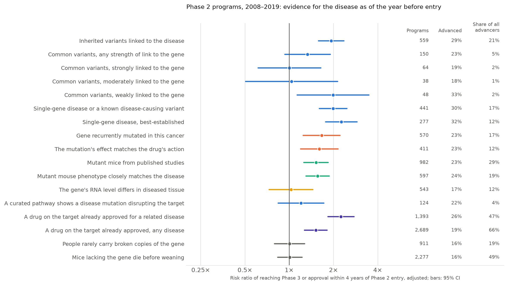

# Appendix detail

<!-- Rendered by `python -m report` into REPORT_APPENDIX.md, the doc's "Appendix detail" tab. -->

## Definitions

What each cause of a stop, and each kind of evidence, means in the main tab.

### Why programs stop: causes and subcauses

Every stop has one cause; where a source gives more detail, one subcause from the cause's list, the first listed winning when more than one applies. A stop no source explains is described by what the drug and its sponsor did next.

| Cause | Subcause | Definition |
| :---- | :---- | :---- |
| **Efficacy or exposure (PK, dose, formulation)** |  | No or too little efficacy: futility, a missed primary endpoint, or efficacy not competitive with the standard of care; or a failure of exposure, pharmacokinetics, dose or formulation |
|  | Not engaged | Exposure or engagement too low, or another drug on the target worked |
|  | Engaged, no benefit | Target or mechanism wrong for the disease as tested |
|  | Trial design, population, endpoint | Trial design, population or endpoint, mechanism not in question |
|  | No engagement data | No human evidence of engagement either way |
| **Safety** |  | Adverse events, poor tolerability, a safety signal, or a clinical hold for safety |
|  | On-target toxicity | The text ties the harm to the drug's mechanism, to hitting its target |
|  | Off-target toxicity | The text ties the harm to the molecule rather than the target (off-target binding, metabolites, the formulation) |
|  | Animal toxicology finding | A toxicity finding in animal or laboratory studies stopped it, with no mechanism stated (a need for more preclinical work that names no toxicity is "not stated") |
|  | Harm in patients, mechanism not stated | Harm or a safety signal seen in people in a trial, named or not (liver injury, deaths, side effects patients would not tolerate, an unfavourable benefit-risk), with no mechanism stated |
|  | Other stated reason | The text gives a specific reason that none of the listed subcauses covers, each read broadly |
|  | Not stated | The text gives no more detail than the cause: 'strategic reasons', 'a change in strategy', 'business' or 'administrative reasons', or a safety concern without saying whether it was seen in people or animals |
| **Sponsor decision (portfolio, commercial, partner, acquisition, funding or closure)** |  | The sponsor chose to stop or could not go on: other programs put first, commercial or competitive reasons, a partner leaving, an acquisition or merger, or running out of money |
|  | Acquisition or merger | The sponsor was acquired or merged and the program was dropped |
|  | Funding or closure | The sponsor or the trial ran out of money (including a grant that ended), or the sponsor wound down, went bankrupt or closed |
|  | Partner exit or none found | A licensing or development partner ended the deal or handed the rights back, or the sponsor was looking for a partner to take it forward and none did |
|  | Replaced by a successor | Development moved to another formulation, dose form, combination or follow-on drug |
|  | Regulator asked for more trials | A regulator required further trials or data and the sponsor did not go on |
|  | Commercial or competitive | The market, pricing, reimbursement, a competing drug, a change in the standard of care or a change in the clinical landscape made it not worth pursuing |
|  | Portfolio prioritisation | The text says the sponsor chose to put its resources into other programs, areas or indications |
|  | Other stated reason | The text gives a specific reason that none of the listed subcauses covers, each read broadly |
|  | Not stated | The text gives no more detail than the cause: 'strategic reasons', 'a change in strategy', 'business' or 'administrative reasons', or a safety concern without saying whether it was seen in people or animals |
| **Operational (enrollment, sites, supply, regulatory)** |  | Running the trial failed: enrollment, sites or drug supply, COVID-19, a regulatory or procedural hold not about safety, or a trial redesigned or replaced |
|  | COVID-19 | The COVID-19 pandemic disrupted the trial |
|  | Regulatory hold on the trial | A regulatory or procedural requirement or hold, not about safety, stopped the trial itself |
|  | Trial redesigned or replaced | The trial was stopped to be redesigned or replaced by another trial of the same drug, or its design could not answer the question |
|  | Enrollment | Patients could not be recruited or retained fast enough |
|  | Sites or supply | Running the trial: sites, investigators or staff, drug supply, manufacturing for the trial, trial procedures or measurements, delays, or other logistics |
|  | Other stated reason | The text gives a specific reason that none of the listed subcauses covers, each read broadly |
|  | Not stated | The text gives no more detail than the cause: 'strategic reasons', 'a change in strategy', 'business' or 'administrative reasons', or a safety concern without saying whether it was seen in people or animals |
| **Positive readout, not yet advanced** |  | The trial met its primary endpoint and the program still did not move on in the disease |
|  | Regulator declined approval | A regulator (the FDA, the EMA, China's NMPA or another) declined to approve it |
|  | Acquisition or merger | The sponsor was acquired or merged and the program was dropped |
|  | Funding or closure | The sponsor or the trial ran out of money (including a grant that ended), or the sponsor wound down, went bankrupt or closed |
|  | Partner exit or none found | A licensing or development partner ended the deal or handed the rights back, or the sponsor was looking for a partner to take it forward and none did |
|  | Replaced by a successor | Development moved to another formulation, dose form, combination or follow-on drug |
|  | Regulator asked for more trials | A regulator required further trials or data and the sponsor did not go on |
|  | Commercial or competitive | The market, pricing, reimbursement, a competing drug, a change in the standard of care or a change in the clinical landscape made it not worth pursuing |
|  | Portfolio prioritisation | The text says the sponsor chose to put its resources into other programs, areas or indications |
|  | Approved outside the US | The drug was approved, or filed, outside the United States, and no other reason is given |
|  | Other stated reason | The text gives a specific reason that none of the listed subcauses covers, each read broadly |
|  | Not stated | The text gives no more detail than the cause: 'strategic reasons', 'a change in strategy', 'business' or 'administrative reasons', or a safety concern without saying whether it was seen in people or animals |
| **Unknown** |  | No source gives the cause or allows a reasoned inference; described instead by what the drug and its sponsor did next |
|  | Sponsor started no later trial | The sponsor started no registered trial more than 12 months after the stop |
|  | Drug approved in another disease | The drug has an FDA approval for another disease |
|  | Drug continued in other diseases | The drug went on in other diseases |
|  | Drug dropped, sponsor active | None of these: the drug went no further while its sponsor stayed active |
| **Did not actually stop** |  | Development went on under another registry, region, name or combination, or the FDA approved the drug for the disease |
| **Not a development program** |  | An academic study using an approved drug as a research tool, or a drug-interaction or dosing study |

### Kinds of evidence

Each program is scored for the evidence its targets had for its disease as of the year before it entered the phase.

| Evidence | What counts | Source and dating |
| :---- | :---- | :---- |
| **Human genetics** |  |  |
| Human genetics | Inherited variants link the target to the disease (GWAS, gene burden, Mendelian): the program's disease, a subtype of it or a disease at least 0.8 similar on MONDO (Lin) | Open Targets 26.09 (GWAS credible sets, gene burden tests, ClinVar, PanelApp, Orphanet, Gene2Phenotype, ClinGen, UniProt); each item dated by when it became known |
| Protein genetics | A variant that changes the level of the target's protein in blood (a cis-pQTL) colocalises with a GWAS signal of the program's disease, a subtype of it or a disease at least 0.8 similar on MONDO (Lin); the sign says which way changing the protein moves risk | Open Targets 26.09 colocalisation (coloc H4 at least 0.8) of plasma pQTLs (Sun 2018, INTERVAL; UKB-PPP 2023) with GWAS credible sets; each dated by the later of the two studies |
| Tumour genetics (oncology) | The gene is recurrently mutated in this cancer (oncology only) | COSMIC Cancer Gene Census, IntOGen and ClinVar somatic, through Open Targets |
| Curated pathway | A curated human pathway shows a mutation that causes the disease in people disrupting the target | Reactome's human pathways, through Open Targets |
| **In vitro and ex vivo** |  |  |
| Diseased tissue | The gene's RNA or protein level differs in diseased tissue (protein is to come, #154) | Expression Atlas, through Open Targets (RNA, at least 2.1-fold) |
| Cell lines | Changing the target in an established cell line changes a disease feature. Today only knockout screens reach it: in screens published before entry, cancer cell lines of the program's tumour type need the gene (oncology entries from 2015); the literature is to come (#154) | DepMap and earlier RNAi and CRISPR dependency screens, each line dated by its first public release; Project Score through Open Targets, 2019 at the earliest |
| **Animals** |  |  |
| Mouse genetics | A genetic change in an animal links the target to the disease: the mutant shows the disease (a knockout or transgene altering an animal model of it is to come, #154) | IMPC knockouts (dated by first data release) and MGI lines (dated by first paper), matched by PhenoDigm |
| Animal model pharmacology | A non-genetic change to the target (drug, antibody, siRNA) alters an animal model of the disease, whatever the agent; today only published studies of the program's own drug are searched, other agents are to come (#154) (exploratory: the searches miss some of these studies) | PubMed abstracts and Firecrawl's research index, screened by an LLM |
| **Human** |  |  |
| Clinical observation | An effect seen in people that implicates the target, such as a side effect. Today the FAERS side effects of other drugs on the target, approved before entry and developed for no related disease, that are the program's disease or a very close one and were a signal in the reports received by the year before entry; the literature is to come (#154) | FAERS: the reactions Open Targets 26.09 finds significant for each drug (openFDA likelihood-ratio test), matched to MONDO by name, each dated by the first year its reports received by then gave a signal (openFDA receivedate; at least 3 reports, PRR at least 2, chi-squared at least 4); literature (#154) |
| Approved on the target | A drug on the target was approved before entry, banded by how close its disease is to the program's: the same or a very close disease (Lin at least 0.8, validated at entry), a related one (Lin 0.5 to 0.8), or only unrelated ones | Drugs@FDA approvals |
| **The drug** |  |  |
| Binding to the target measured before entry (about the drug) | The drug's binding or activity at its primary target was measured in laboratory assays before entry (small molecules) | ChEMBL 37, each measurement dated by the paper, patent or dataset that reported it |
| Pharmacokinetics or target engagement measured in healthy animals (about the drug) | A published study of the drug's pharmacokinetics, or of its effect on its target or pathway, in healthy animals (exploratory: the searches miss some of these studies) | PubMed abstracts and Firecrawl's research index, screened by an LLM |
| Drug shown to act on its target in people (about the drug) | A published study showing the drug acting on its target in people (exploratory) | PubMed abstracts, screened by an LLM |
| Molecule properties (about the drug) | Drug-like size and chemistry (no more than one Lipinski violation); for brain diseases, chemistry suited to entering the brain (TPSA under 90, weight under 450, at most 3 donors) | PubChem and ChEMBL computed properties |
| **Target safety risk** |  |  |
| Any standard safety flag (aggregate) | A property of the target, not evidence for the disease: people rarely carry broken copies of the gene (gnomAD LOEUF below 0.35), mice lacking it die before weaning, or most human cell types need it | gnomAD v4.1; Mammalian Phenotype ontology, through Open Targets; DepMap |

## Tables behind the figures

The numbers each figure in the main tab draws, with the columns the figures leave out.

### Phase transitions

| Transition | All programs (95% CI) | Developed in the US (95% CI) | BIO 2011–2020 |
| :---- | :---- | :---- | :---- |
| Phase 1 → Phase 2 | 57.5% (55.5–59.2), n=6,210 | 58.5% (56.0–61.0), n=3,930 | 52.0% |
| Phase 2 → Phase 3 | 31.5% (30.1–32.9), n=6,095 | 34.0% (32.2–35.8), n=3,993 | 28.9% |
| Phase 3 → Approval | 43.4% (40.4–46.1), n=1,998 | 57.2% (54.1–60.2), n=1,430 | 52.4% |
| **Phase 1 → Approval (LOA)** | **7.9%** (7.1–8.7) | **11.4%** (10.2–12.6) | **7.9%** (novel drugs 6.8%) |

### Why programs stop

Cause of each Phase 2 and 3 stop as registered and after tracing.

| Cause of the stop | As registered | After tracing: sourced | After tracing: sourced or likely |
| :---- | :---- | :---- | :---- |
| Efficacy or exposure (PK, dose, formulation) | 29% (1,610) | 41% (2,263) | 46% (2,508) |
| Safety | 1% (69) | 4% (205) | 4% (216) |
| Sponsor decision (portfolio, commercial, partner, acquisition, funding or closure) | 5% (270) | 12% (661) | 20% (1,119) |
| Operational (enrollment, sites, supply, regulatory) | 5% (286) | 6% (322) | 6% (342) |
| Positive readout, not yet advanced | 10% (523) | 17% (941) | 18% (973) |
| Unknown | 50% (2,729) | 15% (820) | 1% (49) |
| Did not actually stop | 0% (0) | 4% (224) | 4% (229) |
| Not a development program | 0% (0) | 1% (51) | 1% (51) |

### Why drugs that engaged their target failed, by disease

A stop where the drug engaged its target without benefit takes one failure mode, decided in order, and each mode falls under one of three groups: the target is not causal; the target is causal but the drug fell short, or the trial treated the wrong patients or at the wrong time; or it is unclear, because the trial could not answer or nothing settles it. The target is not causal when no drug on the target has worked in the disease while drugs on it worked elsewhere or were tried again, or when the program's sources judge the only attempt not causal. Next, a drug the program's sources judge inadequate fell short; this comes before wrong patients or wrong time, so each stop has one primary reason. When a drug on the target worked only in a disease the ontology rates as related, a reading of the two diseases decides whether the success was in a subgroup of this one (wrong patients), a stage of it (wrong time) or a different disease (not causal); of the headline stops it read, nearly all were a different disease. A success in this disease only in biomarker-selected trials, when this program did not select, is wrong patients. Otherwise the verdict read from the program's sources decides: wrong patients, wrong stage or timing, or trial inadequate. Everything else is unresolved, including a "not causal" verdict where another drug on the target worked in this disease, which the record contradicts. A not-causal call rests on the stop's own evidence when its sources judge the target not causal, and otherwise on the target's later record alone.

By disease area, each failure mode as a share of the area's stops.

| Disease area | Stops | Target not causal | Causal: drug fell short | Causal: wrong patients | Causal: wrong time | Unclear: trial couldn't answer | Unclear: unresolved |
| :---- | :---- | :---- | :---- | :---- | :---- | :---- | :---- |
| All areas | 1,061 | 61% | 5% | 5% | 0% | 6% | 22% |
| Oncology | 318 | 58% | 8% | 11% | 0% | 3% | 19% |
| Autoimmune | 124 | 68% | 4% | 5% | 0% | 7% | 16% |
| Neurology | 122 | 68% | 3% | 4% | 1% | 4% | 20% |
| Other | 118 | 85% | 1% | 1% | 0% | 6% | 8% |
| Respiratory | 79 | 58% | 3% | 3% | 0% | 8% | 29% |
| Psychiatry | 61 | 56% | 3% | 2% | 0% | 15% | 25% |
| Cardiovascular | 54 | 56% | 4% | 4% | 2% | 7% | 28% |
| Infectious disease | 43 | 16% | 0% | 0% | 0% | 2% | 81% |
| Gastroenterology | 37 | 54% | 3% | 3% | 3% | 8% | 30% |
| Ophthalmology | 29 | 72% | 7% | 0% | 3% | 10% | 7% |
| Endocrine | 26 | 38% | 23% | 8% | 0% | 8% | 23% |
| Metabolic | 19 | 53% | 0% | 5% | 0% | 0% | 42% |
| Allergy | 12 | 67% | 0% | 0% | 0% | 0% | 33% |
| Urology | 10 | 80% | 0% | 10% | 0% | 10% | 0% |
| Hematology | 9 | 67% | 22% | 0% | 0% | 0% | 11% |

Every disease with at least ten such stops, by group and then by failure mode.

| Disease | Area | Stops | Target not causal | Target causal | Unclear | Causal: drug fell short | Causal: wrong patients | Causal: wrong time | Unclear: trial couldn't answer | Unclear: unresolved |
| :---- | :---- | :---- | :---- | :---- | :---- | :---- | :---- | :---- | :---- | :---- |
| No disease term (symptom or procedure) | Other | 43 | 95% | 0% | 5% | 0% | 0% | 0% | 2% | 2% |
| Non-small cell lung carcinoma | Oncology | 37 | 51% | 8% | 41% | 0% | 8% | 0% | 5% | 35% |
| Asthma | Respiratory | 30 | 43% | 3% | 53% | 3% | 0% | 0% | 7% | 47% |
| Rheumatoid arthritis | Autoimmune | 29 | 59% | 10% | 31% | 7% | 3% | 0% | 3% | 28% |
| Alzheimer disease | Neurology | 26 | 62% | 12% | 27% | 4% | 8% | 0% | 0% | 27% |
| Colorectal cancer | Oncology | 21 | 52% | 24% | 24% | 5% | 19% | 0% | 10% | 14% |
| Breast cancer | Oncology | 19 | 58% | 21% | 21% | 5% | 16% | 0% | 0% | 21% |
| Ovarian cancer | Oncology | 18 | 61% | 28% | 11% | 17% | 11% | 0% | 0% | 11% |
| Ulcerative colitis | Autoimmune | 17 | 65% | 12% | 24% | 6% | 6% | 0% | 6% | 18% |
| Hepatocellular carcinoma | Oncology | 16 | 56% | 38% | 6% | 19% | 19% | 0% | 0% | 6% |
| Malignant pancreatic neoplasm | Oncology | 15 | 67% | 7% | 27% | 0% | 7% | 0% | 0% | 27% |
| Atopic eczema | Other | 15 | 87% | 0% | 13% | 0% | 0% | 0% | 0% | 13% |
| Acute myeloid leukemia | Oncology | 13 | 38% | 15% | 46% | 8% | 8% | 0% | 8% | 38% |
| Type 2 diabetes mellitus | Endocrine | 13 | 23% | 31% | 46% | 15% | 15% | 0% | 15% | 31% |
| Prostate cancer | Oncology | 13 | 77% | 23% | 0% | 23% | 0% | 0% | 0% | 0% |
| Small cell lung carcinoma | Oncology | 13 | 69% | 8% | 23% | 0% | 8% | 0% | 0% | 23% |
| Schizophrenia | Psychiatry | 13 | 46% | 0% | 54% | 0% | 0% | 0% | 0% | 54% |
| Chronic obstructive pulmonary disease | Respiratory | 13 | 69% | 8% | 23% | 0% | 8% | 0% | 8% | 15% |
| Plasma cell myeloma | Oncology | 12 | 58% | 17% | 25% | 8% | 8% | 0% | 0% | 25% |
| Major depressive disorder | Psychiatry | 12 | 42% | 17% | 42% | 8% | 8% | 0% | 8% | 33% |
| Systemic lupus erythematosus | Autoimmune | 11 | 64% | 18% | 18% | 0% | 18% | 0% | 18% | 0% |
| Idiopathic pulmonary fibrosis | Respiratory | 10 | 100% | 0% | 0% | 0% | 0% | 0% | 0% | 0% |
| Crohn disease | Autoimmune | 10 | 60% | 10% | 30% | 10% | 0% | 0% | 20% | 10% |

### Why efficacy failed

Efficacy and exposure stops by what the evidence shows about target engagement, by phase.

| What the evidence shows | Phase 2 | Phase 3 | Phase 2 and 3 | Outside oncology |
| :---- | :---- | :---- | :---- | :---- |
| Not engaged: exposure or engagement too low, or another drug on the target worked | 12% (201) | 10% (51) | 11% (252) | 10% (167) |
| Engaged, no benefit: target or mechanism wrong for the disease as tested | 47% (816) | 50% (247) | 47% (1,063) | 45% (745) |
| Trial design, population or endpoint, mechanism not in question | 6% (102) | 9% (47) | 7% (149) | 8% (128) |
| No engagement data: no human evidence of engagement either way | 36% (625) | 30% (150) | 35% (775) | 37% (624) |
| **Not engaged, of failures whose mechanism was tested** | **20%** (17–23) | **17%** (13–22) | **19%** (17–22) | **18%** (16–21) |
| Programs (entities) | 1,745 (1,348) | 495 (432) | 2,240 (1,656) | 1,665 (1,308) |

### By disease area and modality

| Disease area | All programs, LOA (95% CI) | Entities | Developed in the US, LOA (95% CI) | BIO 2011–2020 |
| :---- | :---- | :---- | :---- | :---- |
| Hematology | 24.4% (17.8–31.6) | 231 | 30.7% (21.4–40.3) | 23.9% |
| Oncology | 13.7% (11.2–16.6) | 1,811 | 16.0% (12.5–19.7) | 5.3% |
| Metabolic | 13.1% (8.7–18.2) | 268 | 19.8% (12.9–26.6) | 15.5% |
| Allergy | 11.9% (6.1–18.9) | 125 | 20.7% (8.6–34.0) | 10.3% |
| Infectious disease | 10.5% (8.1–13.1) | 641 | 19.3% (15.1–23.6) | 13.2% |
| Autoimmune | 9.4% (6.4–12.5) | 511 | 12.0% (8.3–16.1) | 10.7% |
| Endocrine | 8.9% (5.4–12.7) | 320 | 15.4% (9.6–21.9) | 6.6% |
| Neurology | 8.7% (6.7–10.9) | 752 | 12.2% (9.6–15.1) | 5.9% |
| Psychiatry | 8.0% (4.7–11.6) | 309 | 10.3% (6.2–15.0) | 7.3% |
| Ophthalmology | 7.4% (4.7–10.6) | 320 | 7.9% (4.7–11.4) | 11.9% |
| Respiratory | 6.6% (3.7–9.5) | 348 | 11.5% (6.8–16.7) | 7.5% |
| Other | 6.0% (4.4–8.0) | 730 | 11.1% (8.0–14.7) | 13.0% |
| Cardiovascular | 4.8% (2.5–7.5) | 313 | 7.9% (3.9–12.3) | 4.8% |
| Gastroenterology | 3.6% (1.7–5.8) | 315 | 8.6% (4.6–13.1) | 8.3% |
| Urology | 3.4% (0.7–7.3) | 78 | – | 3.6% |

| Modality | All programs, LOA (95% CI) | Entities | Developed in the US, LOA (95% CI) | BIO 2011–2020 |
| :---- | :---- | :---- | :---- | :---- |
| Monoclonal antibody | 16.1% (12.2–20.4) | 836 | 18.2% (13.4–23.0) | 12.1% |
| Antibody–drug conjugate | 12.3% (5.7–19.5) | 148 | 12.4% (5.7–20.1) | 10.8% |
| Protein | 9.0% (6.4–11.8) | 465 | 11.4% (7.9–15.5) | 9.4% |
| Small molecule | 7.5% (6.6–8.4) | 4,099 | 10.7% (9.4–12.1) | 7.5% |
| Gene therapy | 6.8% (2.7–11.8) | 149 | 8.1% (3.4–14.5) | 10.0% |
| Peptide | 5.2% (2.9–8.2) | 275 | 8.0% (4.3–12.8) | 8.0% |
| Antisense oligonucleotide | 4.0% (1.0–9.0) | 91 | 5.5% (1.5–12.4) | 5.2% |
| Other cell therapy | 2.7% (0.9–5.2) | 270 | 5.4% (2.0–11.4) | – |
| Microbiome or live biotherapeutic | 1.0% (0.0–5.3) | 47 | – | – |
| Other | 0.7% (0.2–1.4) | 273 | 1.8% (0.4–4.5) | – |

### Evidence by kind

Every kind of evidence on US-developed programs, section by section: the kind, the values of its facts, and the lines derived from them, such as evidence agreeing with the drug's direction. The main tab's evidence chart draws each kind and the values of one of its facts.

| Evidence | Entries with it / known | Targets | Relative success to approval (95% CI) | Advancing from Phase 2, adjusted RR | Same, biomarker enrolment held fixed | Stop, adjusted RR |
| :---- | :---- | :---- | :---- | :---- | :---- | :---- |
| **Human genetics** |  |  |  |  |  |  |
| Human genetics: inherited variants link the target to the disease | 919 / 7,656 | 287 | 2.48 (1.90–3.17) | 1.80 (1.45–2.23) | 1.75 (1.41–2.18) | 0.65 (0.49–0.86) |
| · Rare variants only | 676 / 7,656 | 210 | 2.65 (2.03–3.45) | 2.05 (1.64–2.56) | 2.00 (1.58–2.52) | 0.47 (0.32–0.69) |
| · Common variants only (genome-wide association studies) | 195 / 7,656 | 75 | 1.73 (1.01–2.52) | 1.37 (0.89–2.10) | 1.38 (0.91–2.10) | 0.97 (0.65–1.46) |
| · Both rare and common variants | 48 / 7,656 | 24 | Too rare to estimate | – | – | – |
| · How strong the strongest inherited-variant evidence is (exploratory) | 516 / 7,656 | 179 | 2.95 (2.28–3.86) | 1.93 (1.50–2.48) | 1.86 (1.45–2.40) | 0.56 (0.39–0.81) |
| · Rare inherited variants, including single-gene disease (derived) | 724 / 7,656 | 225 | 2.55 (1.95–3.29) | 1.88 (1.50–2.37) | 1.83 (1.44–2.31) | 0.55 (0.39–0.78) |
| · Common variants (genome-wide association studies) (derived) | 243 / 7,656 | 95 | 1.60 (0.99–2.24) | 1.11 (0.71–1.73) | 1.12 (0.73–1.73) | 1.09 (0.78–1.52) |
| · Genetics agrees with the drug's direction (derived) | 447 / 7,656 | 148 | 2.51 (1.91–3.29) | 1.82 (1.37–2.43) | 1.76 (1.31–2.36) | 0.52 (0.32–0.83) |
| Protein genetics: variants that change the target's protein level change disease risk | 2 / 7,656 | 2 | Too rare to estimate | – | – | – |
| · Higher protein raises risk | 2 / 7,656 | 2 | Too rare to estimate | – | – | – |
| · Higher protein lowers risk | 0 / 7,656 | 0 | Too rare to estimate | – | – | – |
| · Both, in different studies or diseases | 0 / 7,656 | 0 | Too rare to estimate | – | – | – |
| · A cis-pQTL of the target's protein colocalises with a disease GWAS signal, on today's data (hindsight) | 101 / 7,656 | 36 | – | 1.02 (0.45–2.33) | 1.03 (0.44–2.43) | 1.07 (0.67–1.72) |
| · Protein genetics agrees with the drug's direction (derived) | 2 / 7,656 | 2 | Too rare to estimate | – | – | – |
| Tumour genetics (oncology): the gene is recurrently mutated in this cancer | 1,108 / 3,714 | 164 | 1.96 (1.13–3.43) | 1.55 (1.09–2.22) | 1.47 (1.03–2.10) | 0.84 (0.62–1.13) |
| · Activating | 776 / 3,714 | 112 | 1.69 (0.96–2.95) | 1.41 (1.00–1.99) | 1.34 (0.95–1.89) | 0.81 (0.58–1.13) |
| · Inactivating | 47 / 3,714 | 13 | Too rare to estimate | – | – | – |
| · Both | 51 / 3,714 | 23 | Too rare to estimate | – | – | – |
| · Mutated, effect unknown | 234 / 3,714 | 48 | 2.08 (0.60–3.58) | 1.88 (1.25–2.81) | 1.82 (1.24–2.68) | 0.75 (0.45–1.25) |
| · The mutation's effect matches the drug's action (derived) | 778 / 3,714 | 111 | 1.70 (0.92–2.90) | 1.43 (1.02–2.00) | 1.32 (0.94–1.87) | 0.85 (0.61–1.20) |
| Curated pathway: a mutation that causes the disease in people disrupts the target's pathway | 200 / 7,656 | 57 | 1.81 (0.95–2.73) | 1.25 (0.86–1.81) | 1.16 (0.80–1.69) | 0.71 (0.35–1.44) |
| **In vitro and ex vivo** |  |  |  |  |  |  |
| Diseased tissue: the gene's level differs in diseased tissue | 946 / 7,656 | 330 | 0.95 (0.65–1.33) | 0.93 (0.66–1.32) | 0.89 (0.63–1.24) | 1.23 (0.99–1.51) |
| · Higher in disease (in at least one comparison) | 568 / 7,656 | 234 | 0.62 (0.33–0.95) | 0.73 (0.47–1.15) | 0.71 (0.46–1.11) | 1.44 (1.14–1.82) |
| · Lower in disease only | 378 / 7,656 | 148 | 1.59 (0.99–2.30) | 1.23 (0.80–1.88) | 1.16 (0.76–1.75) | 0.91 (0.66–1.24) |
| · Target more active in disease, and the drug blocks it (derived) | 436 / 7,656 | 163 | 0.68 (0.35–1.09) | 0.81 (0.49–1.33) | 0.79 (0.48–1.28) | 1.39 (1.06–1.82) |
| Cell lines: changing the target in an established cell line changes a disease feature (oncology, from 2015) | 239 / 1,841 | 62 | 0.47 (0.15–1.15) | 0.53 (0.24–1.20) | 0.55 (0.24–1.23) | 0.60 (0.31–1.16) |
| · A genome-wide knockout screen ranks the target for this cancer, on today's data (hindsight) | 386 / 7,656 | 100 | 1.94 (1.15–2.77) | 1.68 (1.19–2.37) | 1.57 (1.10–2.24) | 0.97 (0.69–1.36) |
| · Cancer cells of this type need the gene to grow (dependency screens) (derived) | 239 / 1,841 | 62 | 0.47 (0.15–1.15) | 0.53 (0.24–1.20) | 0.55 (0.24–1.23) | 0.60 (0.31–1.16) |
| · Gene-knockout screens in human cells (Project Score) (derived) | 0 / 7,656 | 0 | Too rare to estimate | – | – | – |
| **Animals** |  |  |  |  |  |  |
| Mouse genetics: mice with the gene altered show the disease | 1,576 / 7,656 | 469 | 1.44 (1.07–1.86) | 1.41 (1.15–1.73) | 1.39 (1.14–1.70) | 0.83 (0.69–1.00) |
| · Closely | 923 / 7,656 | 322 | 1.47 (1.10–1.93) | 1.47 (1.19–1.81) | 1.45 (1.18–1.79) | 0.76 (0.61–0.94) |
| · Loosely | 653 / 7,656 | 249 | 1.24 (0.86–1.70) | 1.13 (0.82–1.55) | 1.11 (0.82–1.51) | 1.00 (0.79–1.26) |
| · Mutant mice from published studies (MGI) (derived) | 1,568 / 7,656 | 465 | 1.44 (1.08–1.87) | 1.41 (1.15–1.73) | 1.39 (1.14–1.70) | 0.83 (0.69–1.00) |
| · Mouse knockout from a large-scale screen (IMPC) (derived) | 46 / 7,656 | 16 | Too rare to estimate | – | – | – |
| · Mouse genetics agrees with the drug's direction (derived) | 507 / 7,656 | 186 | 1.81 (1.37–2.41) | 1.44 (1.10–1.90) | 1.43 (1.09–1.87) | 0.59 (0.43–0.80) |
| Animal model pharmacology: a non-genetic change to the target alters a disease model (today: the program's own drug) | 4,782 / 9,060 | 1,542 | 0.74 (0.61–0.91) | 0.85 (0.73–1.00) | 0.85 (0.72–0.99) | 0.93 (0.84–1.05) |
| **Human** |  |  |  |  |  |  |
| Clinical observation: an effect seen in people implicates the target, such as a side effect | 189 / 1,961 | 61 | 1.91 (1.09–3.19) | 1.90 (1.25–2.89) | 1.98 (1.28–3.05) | 0.66 (0.44–1.00) |
| · Lowering it: a drug that blocks the target | 58 / 1,961 | 33 | Too rare to estimate | – | – | – |
| · Raising it: a drug that activates it | 125 / 1,961 | 28 | 2.07 (1.03–3.76) | 1.55 (0.92–2.59) | 1.63 (0.92–2.89) | 0.58 (0.33–1.03) |
| · Both | 4 / 1,961 | 3 | Too rare to estimate | – | – | – |
| · A drug of unclear action | 2 / 1,961 | 2 | Too rare to estimate | – | – | – |
| · Another drug on the target has the disease as a significant side effect, on today's FAERS (hindsight) | 296 / 7,656 | 89 | 1.34 (0.87–1.93) | 1.51 (1.02–2.22) | 1.51 (1.03–2.22) | 0.75 (0.55–1.03) |
| · A side effect argues for the drug's direction (derived) | 51 / 1,961 | 15 | Too rare to estimate | – | – | – |
| Approved on the target: a drug on the target was approved before entry, for this disease or another | 4,436 / 7,656 | 614 | 1.45 (1.16–1.82) | 1.36 (1.12–1.65) | 1.35 (1.12–1.64) | 0.74 (0.64–0.86) |
| · This disease or a very close one (Lin at least 0.8): validated at entry | 1,439 / 7,656 | 361 | 2.05 (1.68–2.53) | 1.90 (1.58–2.28) | 1.87 (1.56–2.25) | 0.61 (0.51–0.74) |
| · A related disease (Lin 0.5 to 0.8) | 994 / 7,656 | 248 | 1.31 (0.94–1.71) | 1.21 (0.96–1.53) | 1.21 (0.96–1.53) | 0.75 (0.61–0.93) |
| · Only unrelated diseases | 2,003 / 7,656 | 429 | 0.68 (0.53–0.85) | 0.67 (0.53–0.84) | 0.67 (0.54–0.84) | 1.17 (1.02–1.35) |
| · A drug on the target approved for another disease (related or unrelated; the earlier_drug_other_disease origin) (derived) | 2,997 / 7,656 | 500 | 0.83 (0.66–1.04) | 0.79 (0.65–0.95) | 0.79 (0.65–0.96) | 1.03 (0.89–1.18) |
| · A drug on the target approved for a related disease, Lin at least 0.5 (B1) (derived) | 2,433 / 7,656 | 447 | 1.98 (1.56–2.46) | 1.80 (1.52–2.13) | 1.78 (1.50–2.11) | 0.61 (0.52–0.72) |
| **The drug** |  |  |  |  |  |  |
| Binding to the target measured before entry | 1,708 / 6,216 | 416 | 1.41 (1.04–1.83) | 1.05 (0.81–1.34) | 1.03 (0.80–1.33) | 1.07 (0.90–1.27) |
| · 10 nM or better | 1,063 / 6,216 | 263 | 1.95 (1.35–2.68) | 1.23 (0.93–1.62) | 1.20 (0.91–1.60) | 0.98 (0.80–1.20) |
| · 10 to 100 nM | 371 / 6,216 | 136 | 0.63 (0.37–1.07) | 0.74 (0.49–1.13) | 0.74 (0.48–1.12) | 1.37 (1.08–1.74) |
| · Weaker than 100 nM | 274 / 6,216 | 92 | 0.78 (0.43–1.26) | 0.89 (0.58–1.38) | 0.92 (0.59–1.43) | 0.86 (0.59–1.24) |
| · Drug's effect measured in living cells | 371 / 6,216 | 105 | 1.18 (0.72–1.87) | 1.01 (0.68–1.49) | 1.01 (0.69–1.50) | 1.11 (0.84–1.47) |
| · Drug binds its target strongly (100 nM or better) (derived) | 1,434 / 6,216 | 359 | 1.53 (1.09–2.06) | 1.09 (0.83–1.42) | 1.06 (0.81–1.39) | 1.11 (0.93–1.33) |
| · Drug binds its target 10× more strongly than other proteins tested (derived) | 604 / 1,158 | 164 | 1.45 (0.79–2.58) | 0.99 (0.66–1.49) | 0.99 (0.66–1.49) | 0.96 (0.68–1.37) |
| · The drug binds another protein within 10-fold of its target (derived) | 554 / 1,158 | 155 | 0.69 (0.39–1.27) | 1.01 (0.67–1.53) | 1.01 (0.67–1.52) | 1.04 (0.73–1.47) |
| Pharmacokinetics or target engagement measured in healthy animals | 5,515 / 10,102 | 1,916 | 0.65 (0.54–0.77) | 0.81 (0.68–0.95) | 0.81 (0.69–0.96) | 0.93 (0.82–1.06) |
| Drug shown to act on its target in people | 2,281 / 5,815 | 863 | 1.06 (0.89–1.29) | 1.15 (0.96–1.39) | 1.16 (0.97–1.40) | 0.97 (0.85–1.10) |
| Molecule properties: drug-like, or suited to the brain | 4,754 / 5,645 | 1,271 | 0.99 (0.71–1.37) | 0.89 (0.68–1.17) | 0.89 (0.68–1.17) | 0.90 (0.74–1.08) |
| · Drug-like size and chemistry | 4,754 / 5,645 | 1,271 | 0.99 (0.71–1.37) | 0.89 (0.68–1.17) | 0.89 (0.68–1.17) | 0.90 (0.74–1.08) |
| · Chemistry suited to entering the brain | 556 / 823 | 194 | 0.90 (0.51–1.74) | 1.45 (0.79–2.67) | 1.42 (0.77–2.62) | 0.89 (0.69–1.15) |
| **Target safety risk** |  |  |  |  |  |  |
| Any standard safety flag (aggregate): people rarely carry broken copies of the gene, mice lacking it die before weaning, or most cell types need it | 4,141 / 7,656 | 640 | 0.96 (0.70–1.32) | 1.10 (0.89–1.36) | 1.09 (0.88–1.35) | 1.03 (0.54–1.97) (safety) |
| · People rarely carry broken copies of the gene (gnomAD LOEUF below 0.35; today's data) | 1,674 / 7,656 | 243 | 0.84 (0.58–1.18) | 0.98 (0.77–1.26) | 0.99 (0.78–1.27) | 0.61 (0.24–1.60) (safety) |
| · Mice lacking the gene die before weaning: as embryos, at birth or as pups (today's data) | 3,836 / 7,656 | 594 | 0.96 (0.70–1.32) | 1.07 (0.87–1.32) | 1.06 (0.87–1.30) | 1.17 (0.63–2.20) (safety) |
| · Most human cell types need the gene (DepMap common essential) | 0 / 7,656 | 0 | Too rare to estimate | – | – | – |
| · Mutant mice show any abnormality in a vital organ system: heart and blood vessels, liver, blood, immune or nervous system (today's data) (exploratory) | 6,782 / 7,656 | 1,106 | 1.44 (0.96–2.30) | 1.13 (0.86–1.48) | 1.12 (0.86–1.47) | 2.06 (0.72–5.89) (safety) |
| · An earlier drug on the same target stopped for safety (exploratory) | 1,193 / 6,011 | 257 | 0.84 (0.59–1.18) | 1.07 (0.85–1.33) | 1.07 (0.86–1.33) | 1.24 (0.45–3.44) (safety) |
| · Most human cell types need the gene, on today's list (hindsight) | 692 / 7,656 | 102 | 0.42 (0.22–0.71) | 0.64 (0.42–0.98) | 0.64 (0.42–0.98) | 0.88 (0.27–2.87) (safety) |
| **Adjustment** |  |  |  |  |  |  |
| Trial enrolled patients selected by a biomarker | 1,906 / 10,194 | 832 | 1.71 (1.32–2.18) | 1.25 (1.04–1.50) | – | 0.93 (0.79–1.10) |

### Relative success, all programs

| Evidence line | Programs with it | LOA with / without | Relative success (95% CI) |
| :---- | :---- | :---- | :---- |
| Rare inherited variants, including single-gene disease | 726 | 26.7% / 9.6% | 2.79 (2.08–3.70) |
| Human genetics: inherited variants link the target to the disease | 940 | 25.1% / 9.4% | 2.68 (2.03–3.47) |
| Curated pathway: a mutation that causes the disease in people disrupts the target's pathway | 202 | 22.5% / 10.6% | 2.11 (1.13–3.16) |
| Tumour genetics (oncology): the gene is recurrently mutated in this cancer | 1,203 | 22.3% / 11.5% | 1.93 (1.14–3.47) |
| Common variants (genome-wide association studies) | 271 | 18.6% / 10.7% | 1.74 (1.12–2.51) |
| Mouse genetics: mice with the gene altered show the disease | 1,741 | 14.5% / 9.9% | 1.46 (1.11–1.91) |
| Diseased tissue: the gene's level differs in diseased tissue | 1,083 | 11.8% / 10.8% | 1.09 (0.73–1.48) |
| **Safety risk of the target** (not specific to the disease) |  |  |  |
| People rarely carry broken copies of the gene (gnomAD LOEUF below 0.35; today's data) | 1,859 | 9.8% / 11.2% | 0.87 (0.60–1.25) |
| **The molecule** (assays of the drug itself, not evidence for the disease) |  |  |  |
| 10 nM or better | 1,180 | 14.2% / 7.9% | 1.80 (1.24–2.42) |
| Drug binds its target strongly (100 nM or better) | 1,638 | 11.8% / 8.0% | 1.48 (1.06–1.95) |
| Binding to the target measured before entry | 1,961 | 10.7% / 8.0% | 1.33 (1.00–1.71) |
| Drug binds its target 10× more strongly than other proteins tested | 693 | 12.7% / 9.6% | 1.33 (0.74–2.30) |
| Drug's effect measured in living cells | 450 | 7.6% / 9.2% | 0.83 (0.52–1.31) |

### Genetic dose–response

| Human genetic support before entry | Programs | Targets | LOA (95% CI) |
| :---- | :---- | :---- | :---- |
| None | 7,874 | 1,268 | 9.4% (7.6–11.5) |
| Supported, none of it strong | 425 | 204 | 18.2% (11.4–25.4) |
| Strong: a gene burden test, GWAS locus-to-gene at least 0.8, or a curated or multi-submitter Mendelian record | 529 | 246 | 30.2% (25.2–35.4) |

### Relative success by disease area

| Evidence line | Oncology | Immunology and inflammation | Other | Neuroscience | Cardiometabolic and endocrine | Hematology | Differs between groups, Phase 2 (p) |
| :---- | :---- | :---- | :---- | :---- | :---- | :---- | :---- |
| Human genetics: inherited variants link the target to the disease | 1.98 (1.14–3.30), n=329 | 1.53 (0.64–2.57), n=144 | –, n=94 | 2.66 (1.24–4.56), n=124 | 3.36 (2.09–5.74), n=167 | –, n=82 | 0.64 (6 groups) |
| Common variants (genome-wide association studies) | –, n=72 | –, n=84 | –, n=47 | –, n=29 | –, n=39 | –, n=0 | 0.96 (4 groups) |
| Rare inherited variants, including single-gene disease | 2.10 (1.14–3.47), n=268 | –, n=63 | –, n=56 | 2.57 (1.13–4.40), n=109 | 3.32 (2.00–5.59), n=148 | –, n=82 | 0.56 (6 groups) |
| Tumour genetics (oncology): the gene is recurrently mutated in this cancer | 1.93 (1.14–3.47), n=1,203 | –, n=0 | –, n=0 | –, n=0 | –, n=0 | –, n=0 | – |
| Mouse genetics: mice with the gene altered show the disease | 1.07 (0.61–1.81), n=492 | 1.59 (0.94–2.51), n=254 | 1.21 (0.53–2.47), n=191 | 1.84 (1.13–3.10), n=278 | 1.58 (0.96–2.71), n=419 | 1.58 (0.90–3.89), n=107 | 0.73 (6 groups) |
| Diseased tissue: the gene's level differs in diseased tissue | 1.01 (0.63–1.61), n=793 | 0.45 (0.10–0.86), n=172 | –, n=35 | –, n=73 | –, n=10 | –, n=0 | 0.01 (4 groups) |
| Drug binds its target strongly (100 nM or better) | 1.08 (0.62–1.65), n=862 | 2.27 (1.34–3.86), n=194 | 2.24 (1.12–4.10), n=210 | 0.94 (0.48–1.70), n=225 | 1.72 (0.78–3.46), n=130 | –, n=17 | 0.22 (5 groups) |

### What each line adds once the others are known

| Evidence | Phase 1 → 2 | Phase 2 → 3 | Phase 3 → approval |
| :---- | :---- | :---- | :---- |
| Common variants (genome-wide association studies) | 1.06 (0.95–1.19) | 1.15 (0.89–1.48) | 1.09 (0.81–1.48) |
| Rare inherited variants, including single-gene disease | 1.06 (0.97–1.16) | 1.50 (1.28–1.75) | 1.37 (1.14–1.64) |
| Tumour genetics (oncology): the gene is recurrently mutated in this cancer | 1.10 (0.99–1.22) | 1.32 (1.04–1.66) | 1.10 (0.87–1.39) |
| Mouse genetics: mice with the gene altered show the disease | 0.98 (0.92–1.04) | 1.16 (1.03–1.31) | 1.06 (0.90–1.24) |
| Diseased tissue: the gene's level differs in diseased tissue | 0.95 (0.88–1.04) | 0.89 (0.73–1.08) | 0.86 (0.70–1.07) |
| Curated pathway: a mutation that causes the disease in people disrupts the target's pathway | 1.10 (1.00–1.22) | 0.81 (0.59–1.10) | 1.16 (0.94–1.45) |
| **Safety risk of the target** (not specific to the disease) |  |  |  |
| People rarely carry broken copies of the gene (gnomAD LOEUF below 0.35; today's data) | 0.90 (0.82–0.99) | 1.01 (0.85–1.19) | 0.98 (0.81–1.20) |
| **The molecule** (assays of the drug itself, not evidence for the disease) |  |  |  |
| Binding to the target measured before entry | 0.80 (0.62–1.02) | 0.88 (0.67–1.17) | 1.20 (0.86–1.67) |
| Drug binds its target strongly (100 nM or better) | 1.19 (0.93–1.51) | 1.20 (0.87–1.65) | 1.09 (0.79–1.51) |
| Drug's effect measured in living cells | 0.78 (0.59–1.03) | 0.85 (0.67–1.08) | 1.03 (0.78–1.36) |
| Drug binds its target 10× more strongly than other proteins tested | 1.08 (0.90–1.30) | 1.14 (0.91–1.43) | 1.01 (0.78–1.30) |

### Does the evidence predict which programs reach approval?

| Validation | Features | AUC (95% CI) | PR-AUC (base rate) | Programs (approved) |
| :---- | :---- | :---- | :---- | :---- |
| Held-out target sets | Area, modality, novelty, year | 0.607 (0.535–0.668) | 0.132 (0.062) | 3,017 (187) |
| Temporal (later entrants held out) | Area, modality, novelty, year | 0.642 (0.566–0.706) | 0.130 (0.065) | 1,543 (100) |
| Held-out target sets | … plus all evidence lines | 0.638 (0.587–0.692) | 0.149 (0.062) | 3,017 (187) |
| Temporal (later entrants held out) | … plus all evidence lines | 0.654 (0.574–0.729) | 0.148 (0.065) | 1,543 (100) |
| Held-out target sets | Evidence lines only | 0.566 (0.492–0.637) | 0.092 (0.062) | 3,017 (187) |
| Temporal (later entrants held out) | Evidence lines only | 0.616 (0.552–0.690) | 0.113 (0.065) | 1,543 (100) |

Change in held-out AUC when each line is removed from the full model:

| Evidence removed | AUC change (95% CI) |
| :---- | :---- |
| Human genetics: inherited variants link the target to the disease | -0.027 (-0.051 to -0.003) |
| Rare inherited variants, including single-gene disease | -0.027 (-0.049 to -0.002) |
| Tumour genetics (oncology): the gene is recurrently mutated in this cancer | -0.005 (-0.020 to +0.008) |
| Mouse genetics: mice with the gene altered show the disease | +0.002 (-0.001 to +0.005) |
| People rarely carry broken copies of the gene (gnomAD LOEUF below 0.35; today's data) | +0.005 (+0.001 to +0.009) |
| Diseased tissue: the gene's level differs in diseased tissue | +0.005 (-0.003 to +0.017) |

### Confirmatory hypotheses

| Hypothesis | Measure | Estimate (95% CI) | p | Holm p | Result |
| :---- | :---- | :---- | :---- | :---- | :---- |
| Outside oncology: genetics for the disease vs no germline genetics on the target, advancing within 4 years of Phase 2 | risk ratio | 1.71 (1.19–2.47) | 0.004 | 0.022 | supported |
| Same target in different diseases: genetics for the disease vs not (conditional logit) | odds ratio | 2.94 (1.98–4.36) | < 0.001 | < 0.001 | supported |
| Direction of genetic effect vs drug action (Open Targets direction fields): discordant < undirected < concordant | risk ratio per step | 1.05 (0.79–1.39) | 0.757 | 1.000 | not supported |
| Trials outside oncology: how the effect of genetics on missing the primary endpoint changes per step from proximal to distal endpoints (registry-posted results, FDAAA era) | ratio of risk ratios | 1.07 (0.82–1.39) | 0.621 | 1.000 | not supported |
| Genetics for the disease lowers efficacy failure more than business or operational failure (Phases 2 and 3) | ratio of risk ratios | 1.15 (0.74–1.80) | 0.530 | 1.000 | not supported |
| Outside oncology, the target's safety risk raises safety failure, and more than efficacy failure (Phases 1–3; intersection-union test) | risk ratio, safety failure | 0.95 (0.51–1.75) | 0.860 | 1.000 | not supported |
| Oncology: a gene recurrently mutated in the cancer whose mutation matches the drug, advancing within 4 years of Phase 2 | risk ratio | 1.51 (1.10–2.08) | 0.011 | 0.053 | not supported |

Added by the plan amendment, on US-developed programs:

| Hypothesis | Claim | Exposed entries | Risk ratio (95% CI) | p | Holm p | Result |
| :---- | :---- | :---- | :---- | :---- | :---- | :---- |
| N1 | Small molecules measured on the primary target and an off-target: at least 10-fold selective raises advancing from Phase 2 | 208 (113 targets) | 0.99 (0.66–1.49) | 0.950 | 1.000 | not supported |
| N2 | Small molecules: at most one Rule-of-5 violation raises advancing | 1,943 (801 targets) | 0.89 (0.68–1.17) | 0.414 | 1.000 | not supported |
| N2 | Neurology and psychiatry: brain-penetrant properties raise advancing | 266 (136 targets) | 1.45 (0.79–2.67) | 0.235 | 1.000 | not supported |
| N3 | Outside oncology, small molecules: potency of 100 nM or better raises advancing, human genetics and drug-likeness held fixed | 282 (149 targets) | 1.04 (0.77–1.41) | 0.788 | 1.000 | not supported |

### Which evidence translates: the registered screen

Every rule the plan registered, each against programs without it, before the rules were grouped by kind.



| Evidence for the disease, known before Phase 2 | Programs (targets) | Advanced: with / without | Share of all that advanced | Risk ratio, all (95% CI) | Risk ratio, non-oncology | Risk ratio, oncology |
| :---- | :---- | :---- | :---- | :---- | :---- | :---- |
| Inherited variants linked to the disease | 559 (248) | 29% / 15% | 21% | 1.93 (1.58–2.36) | 1.60 (1.20–2.15) | 2.19 (1.58–3.03) |
| Common variants, any strength of link to the gene | 150 (80) | 23% / 16% | 5% | 1.33 (0.93–1.91) | 1.42 (0.88–2.29) | 1.64 (1.00–2.70) |
| Common variants, strongly linked to the gene | 64 (38) | 19% / 16% | 2% | 1.00 (0.61–1.64) | 1.13 (0.60–2.13) | – |
| Common variants, moderately linked to the gene | 38 (23) | 18% / 16% | 1% | 1.04 (0.51–2.14) | 0.57 (0.08–4.09) | – |
| Common variants, weakly linked to the gene | 48 (30) | 33% / 16% | 2% | 1.99 (1.13–3.49) | 2.22 (1.17–4.21) | – |
| Single-gene disease or a known disease-causing variant | 441 (192) | 30% / 15% | 17% | 1.99 (1.61–2.47) | 1.70 (1.22–2.35) | 2.07 (1.45–2.96) |
| Single-gene disease, best-established | 277 (128) | 32% / 15% | 12% | 2.27 (1.77–2.90) | 1.80 (1.24–2.59) | 2.90 (2.02–4.17) |
| Gene recurrently mutated in this cancer | 570 (135) | 23% / 15% | 17% | 1.66 (1.25–2.22) | – | 1.59 (1.15–2.19) |
| The mutation's effect matches the drug's action | 411 (91) | 23% / 16% | 12% | 1.60 (1.20–2.15) | – | 1.51 (1.10–2.08) |
| Mutant mice from published studies | 982 (435) | 23% / 15% | 29% | 1.52 (1.26–1.85) | 1.55 (1.26–1.90) | 1.36 (0.88–2.13) |
| Mutant mouse phenotype closely matches the disease | 597 (288) | 24% / 15% | 19% | 1.56 (1.30–1.88) | 1.68 (1.33–2.11) | 1.22 (0.83–1.77) |
| The gene's RNA level differs in diseased tissue | 543 (264) | 17% / 16% | 12% | 1.03 (0.73–1.45) | 0.59 (0.35–1.00) | 1.18 (0.80–1.73) |
| A curated pathway shows a disease mutation disrupting the target | 124 (44) | 22% / 16% | 4% | 1.20 (0.84–1.72) | – | – |
| **Earlier drugs on the same target** |  |  |  |  |  |  |
| A drug on the target already approved for a related disease | 1,393 (381) | 26% / 12% | 47% | 2.25 (1.83–2.76) | 2.08 (1.65–2.63) | 2.52 (1.50–4.23) |
| A drug on the target already approved, any disease | 2,689 (573) | 19% / 13% | 66% | 1.52 (1.27–1.81) | 1.47 (1.17–1.85) | 1.62 (1.19–2.20) |
| **Safety risk of the target** (not specific to the disease) |  |  |  |  |  |  |
| Most human cell types need the gene | 0 (0) | – / 16% | 0% | – | – | – |
| People rarely carry broken copies of the gene | 911 (220) | 16% / 17% | 19% | 1.01 (0.80–1.27) | 1.21 (0.92–1.59) | 0.81 (0.55–1.18) |
| Mice lacking the gene die before weaning | 2,277 (550) | 16% / 16% | 49% | 1.01 (0.84–1.22) | 0.89 (0.73–1.09) | 1.09 (0.73–1.62) |

### By endpoint

| Class of the governing primary endpoint | Trials | Missed primary endpoint | Trials with genetics for the disease | Missed: with / without genetics | Risk ratio of a miss, all readable trials (95% CI) | Risk ratio, registry-posted results (FDAAA era) |
| :---- | :---- | :---- | :---- | :---- | :---- | :---- |
| Target engagement | 64 | 28% | 22 | 32% / 26% | 1.00 (0.39–2.56) | – |
| Exploratory biomarker | 278 | 68% | 29 | 72% / 67% | 1.09 (0.83–1.43) | – |
| Regulatory surrogate (LDL-C, HbA1c, viral load…) | 1,468 | 21% | 268 | 14% / 23% | 0.97 (0.65–1.46) | 0.51 (0.26–0.99) |
| Objective physiology (6MWD, visual acuity, weight…) | 461 | 53% | 86 | 45% / 55% | 0.99 (0.70–1.40) | 1.09 (0.77–1.53) |
| Clinician-rated scale or responder index | 1,490 | 50% | 216 | 39% / 52% | 0.82 (0.60–1.12) | 0.89 (0.67–1.17) |
| Patient-reported outcome | 686 | 51% | 7 | 57% / 51% | – | – |
| Disease events (relapses, exacerbations…) | 371 | 41% | 62 | 35% / 42% | 0.83 (0.56–1.23) | 0.82 (0.48–1.40) |
| Hard outcome (death, MI, stroke…) | 174 | 50% | 15 | 40% / 51% | – | – |
| Tumour response | 180 | 63% | 35 | 60% / 63% | 0.95 (0.70–1.31) | – |
| Progression-free survival | 604 | 57% | 117 | 54% / 58% | 1.09 (0.90–1.32) | 1.06 (0.79–1.43) |
| Overall survival | 267 | 67% | 28 | 54% / 69% | 0.75 (0.53–1.06) | – |

### Which kinds of evidence predict, and whether being more specific helps

| Evidence before Phase 2 | Applies to | With it (targets) | Advanced: with / without | Adjusted risk ratio (95% CI) | Holm-corrected p |
| :---- | :---- | :---- | :---- | :---- | :---- |
| Inherited variants linked to the disease | All | 559 (248) | 29% / 15% | 1.93 (1.58–2.36) | < 0.001 |
| Mouse genetics: knocked-out or mutant mice show the disease | All | 988 (440) | 23% / 15% | 1.52 (1.26–1.84) | < 0.001 |
| Gene recurrently mutated in this cancer | Oncology | 563 (134) | 23% / 13% | 1.59 (1.15–2.19) | 0.018 |
| Gene-knockout screens in human cells | All | 0 (0) | – / 16% | too few programs (0) to test | – |
| The gene's RNA level differs in diseased tissue | All | 543 (264) | 17% / 16% | 1.03 (0.73–1.45) | 1.000 |
| A curated pathway shows a disease mutation disrupting the target | All | 124 (44) | 22% / 16% | 1.20 (0.84–1.72) | 0.925 |
| Safety risk of the target | All | 2,430 (589) | 16% / 16% | 1.01 (0.83–1.23) | 1.000 |
| **Benchmark** (clinical precedent, not preclinical evidence) |  |  |  |  |  |
| A drug on the target already approved for a related disease | All | 1,393 (381) | 26% / 12% | 2.25 (1.83–2.76) | – |

| More specific version | Within programs with | Programs | Advanced: with / rest of the type | Adjusted risk ratio (95% CI) | Holm-corrected p |
| :---- | :---- | :---- | :---- | :---- | :---- |
| GWAS with locus-to-gene ≥ 0.8 | Inherited variants linked to the disease | 64 of 559 | 19% / 30% | 0.68 (0.39–1.20) | 1.000 |
| Mendelian evidence in a non-hereditary disease | Inherited variants linked to the disease | 132 of 221 | 30% / 22% | 1.01 (0.49–2.09) | 1.000 |
| Both common and rare variants | Inherited variants linked to the disease | 32 of 559 | 16% / 30% | 0.43 (0.21–0.88) | 0.214 |
| Drug raises function or replaces the gene, hereditary disease | Inherited variants linked to the disease | 112 of 170 | 31% / 19% | 1.90 (0.89–4.05) | 0.863 |
| Genetics agrees with the drug's direction (added after the plan) | Inherited variants linked to the disease | 280 of 559 | 30% / 28% | 1.18 (0.82–1.68) | 1.000 |
| Broken copies of the gene protect, and the drug blocks it (added after the plan) | Inherited variants linked to the disease | 37 of 559 | 30% / 29% | too few to test | – |
| Mutant mouse phenotype closely matches the disease | Mouse genetics: knocked-out or mutant mice show the disease | 598 of 988 | 24% / 20% | 1.19 (0.84–1.68) | 1.000 |
| Mouse genetics points the same way as the drug (added after the plan) | Mouse genetics: knocked-out or mutant mice show the disease | 351 of 988 | 25% / 21% | 1.17 (0.89–1.55) | 1.000 |
| Driver matches the drug (activated oncogene + inhibitor) | Gene recurrently mutated in this cancer | 399 of 563 | 23% / 21% | 0.99 (0.63–1.55) | 1.000 |
| Expression up + drug that lowers function | The gene's RNA level differs in diseased tissue | 254 of 543 | 16% / 18% | 0.98 (0.56–1.70) | 1.000 |
| Liability + drug that lowers function | Safety risk of the target | 1,762 of 2,430 | 16% / 17% | 1.06 (0.81–1.38) | 1.000 |

## Sources in detail

Each entry gives who compiles the source and from what, what this analysis takes from it, the shape of the raw response, and a real record from the cached download, trimmed to the fields used.

### ClinicalTrials.gov API v2

*Snapshot 2026-11-02, 227,130 studies · `GET https://clinicaltrials.gov/api/v2/studies?filter.advanced=AREA[StudyType]INTERVENTIONAL AND AREA[InterventionType](DRUG OR BIOLOGICAL OR GENETIC OR COMBINATION_PRODUCT)&pageSize=1000` paged by `pageToken`*

**Compiled by.** The National Library of Medicine runs the registry. Sponsors enter the protocol record and the results themselves, as FDAAA 801 requires for applicable trials. NLM reviews entries for quality but does not check them against source records.
**We use.** From the protocol section we keep status, dates, the why-stopped text, phases, sponsor and its class, design, conditions, interventions, arms, references, countries, brief summary and primary outcomes. From the results section, posted for 53,902 studies, we keep every primary outcome's values per group and every statistical analysis, plus deaths and serious adverse events per arm.
**Shape.** `{totalCount, nextPageToken, studies: [{protocolSection: {statusModule, sponsorCollaboratorsModule, designModule, armsInterventionsModule, conditionsModule, outcomesModule, referencesModule, …}, resultsSection: {participantFlowModule, baselineCharacteristicsModule, outcomeMeasuresModule, adverseEventsModule}, hasResults}]}`

```json
{"nctId": "NCT03548935", "overallStatus": "COMPLETED", "phases": ["PHASE3"],
 "leadSponsor": {"name": "Novo Nordisk A/S", "class": "INDUSTRY"},
 "startDateStruct": {"date": "2018-06-04"}, "enrollmentInfo": {"count": 1961},
 "primaryOutcomes": [{"measure": "Change in Body Weight (%)", "timeFrame": "…week 68"}],
 "outcomeMeasures[0].analyses[0]": {"pValue": "<.0001", "statisticalMethod": "ANCOVA",
   "paramType": "Treatment difference", "paramValue": "-12.44", "ciLowerLimit": "-13.37", "ciUpperLimit": "-11.51"},
 "eventGroups[0]": {"title": "Sema 2.4 mg", "deathsNumAffected": 1, "deathsNumAtRisk": 1306, "seriousNumAffected": 128}}
```

### PubMed E-utilities

*Queried at run time; each run is recorded with its date and a hash of what it returned · `esearch.fcgi?db=pubmed&term=NCT…[si]`, then `efetch.fcgi?retmode=xml`*

**Compiled by.** NCBI indexes citations from publishers and MEDLINE. A trial registration number named in an article is recorded in its data-bank list and is searchable as a secondary identifier.
**We use.** We look up only completed industry Phase 2/3 trials, started from 2008, that posted no results. A paper links to a trial when the registry lists it as a RESULT or DERIVED reference, or when PubMed lists the NCT number. This links 2,284 trials. For each paper we keep title, first author, journal, year, DOI and abstract, and the abstracts feed the outcome classifier.
**Shape.** `<PubmedArticle><MedlineCitation><PMID/><Article><Journal/><ArticleTitle/><Abstract/><DataBankList><DataBank><AccessionNumber/></DataBank></DataBankList></Article></MedlineCitation><PubmedData><ArticleIdList><ArticleId IdType="doi"/></ArticleIdList></PubmedData></PubmedArticle>`

```text
NCT03036488 (KEYNOTE-522; no posted results) -> PMID 32101663, linked by both routes
  N Engl J Med 2020, "Pembrolizumab for Early Triple-Negative Breast Cancer", Schmid P et al.
  DataBank ClinicalTrials.gov / AccessionNumber NCT03036488, doi 10.1056/NEJMoa1910549
```

### Drugs@FDA data files

*Data to 2026-10-28 · `GET https://www.fda.gov/media/89850/download`, a zip of tab-separated tables*

**Compiled by.** FDA's drug center (CDER) publishes these files from its own application records. They cover drugs and therapeutic biologics, not the vaccines, blood products and cell or gene therapies that CBER regulates.
**We use.** NDA and BLA applications: sponsor, products and active ingredients, every original and supplement submission with its class, status, date and review priority, and the links to approval letters. That is 6,394 applications.
**Shape.** `Applications.txt` (ApplNo, ApplType, SponsorName), `Products.txt`, `Submissions.txt` (ApplNo, SubmissionClassCodeID, SubmissionType, SubmissionNo, SubmissionStatus, SubmissionStatusDate, ReviewPriority), `ApplicationDocs.txt` (type 1 = letter, URL, date).

```text
Applications     125514  BLA  MERCK SHARP DOHME
Products         125514  001  SOLUTION;INTRAVENOUS  100MG/4ML  KEYTRUDA  PEMBROLIZUMAB
Submissions      125514  class 2 (EFFICACY)  SUPPL 89  AP  2021-07-26  STANDARD
ApplicationDocs  125514  SUPPL 89  letter  …/appletter/2021/125514Orig1s089s114ltr_.pdf
```

### FDA approval letters (CDER)

*Actions 2008 to 2026-10-28 · PDFs at `https://www.accessdata.fda.gov/drugsatfda_docs/appletter/<year>/<ApplNo>…ltr.pdf`, from the Drugs@FDA links*

**Compiled by.** The review division sends the letter to the sponsor when it acts, and FDA posts it. It names the approved submission and, for efficacy supplements, usually the new use it provides for.
**We use.** We fetch letters for every approved original application and every efficacy supplement. Text comes from the PDF's text layer, or from OCR when that layer is empty or garbled. An LLM records each approved use from the letter: disease, verbatim indication, qualifiers, type of change and accelerated approval.

```text
BLA 125514/S-089 + S-114 (Keytruda, 2021-07-26):
"(S-089) provides for a new indication for the treatment of patients with high-risk, early-stage
 triple negative breast cancer, in combination with chemotherapy as neoadjuvant treatment, then as
 a single agent as adjuvant treatment after surgery…"
-> use: triple-negative breast cancer · new population · not accelerated
-> use (S-114): metastatic TNBC, PD-L1 CPS ≥10 · conversion of the 2020 accelerated approval to full
```

### openFDA drug labels

*Export 2026-10-28, 262,903 labels · `GET https://api.fda.gov/download.json` lists the bulk files, e.g. `https://download.open.fda.gov/drug/label/drug-label-0001-of-0014.json.zip`*

**Compiled by.** Manufacturers submit Structured Product Labeling to FDA. openFDA republishes it in bulk with harmonised identifiers and notes that the data are not validated.
**We use.** We keep the current label of each NDA or BLA product, 5,102 in all, with its application numbers, names, UNII and the full Indications and Usage text. The approval classifier reads that text as evidence of approved uses, including uses approved before 2008.
**Shape.** `{meta, results: [{set_id, id, version, effective_time, indications_and_usage: [str], …, openfda: {application_number[], brand_name[], generic_name[], substance_name[], unii[]}}]}`

```json
{"set_id": "9333c79b-d487-4538-a9f0-71b91a02b287", "effective_time": "20260710",
 "openfda": {"application_number": ["BLA125514"], "brand_name": ["KEYTRUDA"], "unii": ["DPT0O3T46P"]},
 "indications_and_usage": ["1 INDICATIONS AND USAGE KEYTRUDA is a programmed death receptor-1 (PD-1)-blocking
   antibody indicated: Melanoma for the treatment of patients with unresectable or metastatic melanoma. …"]}
```

### CBER biologics approvals

*Actions 2015-01-09 to 2025-12-19, 324 records on 177 applications · yearly pages `https://www.fda.gov/vaccines-blood-biologics/development-approval-process-cber/<year>-biological-license-application-approvals`, live from 2023 and from the Wayback Machine before; product pages; letter PDFs at `https://www.fda.gov/media/<id>/download`*

**Compiled by.** FDA's biologics center posts a yearly table of original licence approvals and noteworthy supplements, and a page per product linking its letters. None of these products are in Drugs@FDA.
**We use.** We keep original licences and supplements that add or change an indication, population, dose or formulation, with each letter's text. 53 letters came from Wayback captures. For the 10 records without a letter, the yearly-table entry stands in.

```json
{"appl_no": "125646", "submission_type": "ORIG", "approval_date": "2017-08-30",
 "product_brand": "KYMRIAH", "proper_name": "tisagenlecleucel", "product_class": "cell_therapy",
 "url": "https://www.fda.gov/media/106989/download", "pdf_source": "fda.gov",
 "yearly_listing_text": "KYMRIAH Tisagenlecleucel | For the treatment of patients up to 25 years of age with B-cell precursor ALL …"}
```

### FDA Global Substance Registration System (UNII)

*2026-08-04, 171,912 substances and 1,047,975 names · `https://precision.fda.gov/uniisearch/archive/2026-08-04/UNII_Data_20260804.zip`, plus the matching names file*

**Compiled by.** FDA assigns each Unique Ingredient Identifier from a substance's structure or defining information. It collects the substance's names from INN, USAN, JAN, brands and sponsor codes, each tagged with its type.
**We use.** Substances, with their INN, RxNorm and PubChem cross-references, and every name in normalised form. These resolve trial intervention names to one molecular entity and merge entities that are the same substance.
**Shape.** Records: 25 tab-separated columns, including UNII, DISPLAY_NAME, RXCUI, PUBCHEM, INN_ID, INCHIKEY and SUBSTANCE_TYPE. Names: NAME, TYPE (brand, code, common, official or systematic), UNII.

```text
53AXN4NNHX  SEMAGLUTIDE  RXCUI 1991302  PUBCHEM 56843331  INN_ID 9113  SUBSTANCE_TYPE protein
  names: NN9535 (code) · NNC-0113-0217 (code) · OZEMPIC (brand) · WEGOVY (brand) · SEMAGLUTIDE [JAN] (common)
```

### MONDO disease ontology

*2026-10-06 · `https://github.com/monarch-initiative/mondo/releases/latest/download/mondo.obo`*

**Compiled by.** The Monarch Initiative merges disease terms from OMIM, Orphanet, DOID, NCIT, EFO and others into one hierarchy. Each cross-reference is tagged as an exact equivalence or a looser relation.
**We use.** We keep terms, exact synonyms, obsolete flags, the is-a hierarchy with its full ancestor closure, and the cross-references with their equivalence flag. MONDO is the target vocabulary for trial conditions and for Open Targets diseases. Its hierarchy defines disease similarity: subtypes, and Lin ≥ 0.8.

```text
id: MONDO:0005439
name: familial hypercholesterolemia
synonym: "hyperlipoproteinemia type II" EXACT []
xref: EFO:0004911 {source="MONDO:equivalentTo"}      -> equivalent
xref: ICD9:V19.8 {source="MONDO:relatedTo"}          -> not equivalent
is_a: MONDO:0001336 ! familial hyperlipidemia
```

### EFO

*Reaches the analysis only as Open Targets disease identifiers*

**Compiled by.** EMBL-EBI maintains EFO for Open Targets, the GWAS Catalog and Expression Atlas. It imports disease classes from MONDO and other ontologies and adds terms of its own.
**We use.** No EFO file. Open Targets keys 9,257 of its diseases by EFO identifiers. Each is mapped to MONDO through the disease's own MONDO cross-reference, then MONDO's declared equivalence to the EFO term. Failing both, it maps through a DOID, Orphanet, NCIT or MeSH cross-reference that points to a single MONDO term.

```text
EFO_0000768 idiopathic pulmonary fibrosis: no MONDO xref, and no MONDO term lists EFO:0000768
  -> DOID:0050156 and Orphanet:2032 are both equivalent to MONDO:0800504
```

### Mammalian Phenotype ontology

*2026-09-23 · `http://purl.obolibrary.org/obo/mp.obo`*

**Compiled by.** Mouse Genome Informatics at the Jackson Laboratory maintains it. MGI and IMPC curators use it to annotate phenotypes of mutant mice.
**We use.** The hierarchy only. A target counts as "knockout lethal before weaning" when any of its Open Targets mouse phenotypes is MP:0010770 *preweaning lethality* or a descendant. That flags 688 genes.

```text
id: MP:0011100
name: preweaning lethality, complete penetrance
is_a: MP:0010770 ! preweaning lethality
```

### Gene symbols and identifiers

*Project catalogue, resolved through HGNC 2026-10-16 · `https://storage.googleapis.com/public-download-files/hgnc/tsv/tsv/hgnc_complete_set.txt`*

**Compiled by.** HGNC approves one symbol per human gene and records each gene's previous symbols and aliases. The project's own catalogue of 26,957 human proteins adds Ensembl identifiers, Pharos development level and family, and RefSeq summaries; some of its symbols predate HGNC renames.
**We use.** A target the LLM names is accepted when the symbol is a catalogue protein, or an HGNC approved, previous or alias symbol of one (an alias two genes share is not used). Ensembl identifiers join targets to Open Targets, gnomAD and DepMap.
**Shape.** Tab-separated, one approved gene per row: `hgnc_id, symbol, name, locus_group, alias_symbol, prev_symbol, entrez_id, ensembl_gene_id, uniprot_ids, …`, with lists separated by `|`.

```text
HGNC:11701  CRIPTO  cripto, EGF-CFC family member  protein-coding gene  prev_symbol TDGF1  ensembl ENSG00000241186
TDGF1 (previous) -> CRIPTO · CTGF (previous) -> CCN2 · CD20 (alias) -> MS4A1 · TIM3 (alias) -> HAVCR2
```

### ChEMBL mechanisms of action

*ChEMBL 37 (2026-05-01), 7,561 mechanisms · `GET https://www.ebi.ac.uk/chembl/api/data/mechanism.json?limit=1000&offset=…`, then `target.json` and `molecule.json` for the ids they name*

**Compiled by.** EMBL-EBI curators assign each approved or clinical-stage drug its molecular targets and action type, with references from labels and the literature.
**We use.** Only as hints. When the LLM assigns an entity's targets, it sees every mechanism of the parent molecule of each of its ChEMBL ids, as "SYMBOL: action" for each human gene of the target; its own answer is what we store. A target's genes are its UniProt components mapped to HGNC, so a complex or receptor family keeps all of them (1,257 mechanisms name more than one gene); mechanisms with no human gene, such as antibacterials, are shown as text.
**Shape.** `{mechanisms: [{mec_id, molecule_chembl_id, parent_molecule_chembl_id, target_chembl_id, action_type, mechanism_of_action, …}], page_meta: {next, …}}`; a target's `target_components[{accession}]` give its genes.

```json
{"mec_id": 8862, "molecule_chembl_id": "CHEMBL4297839", "target_chembl_id": "CHEMBL4383", "action_type": "AGONIST",
 "mechanism_of_action": "Gastric inhibitory polypeptide receptor agonist"}
{"mec_id": 8994, "molecule_chembl_id": "CHEMBL4297839", "target_chembl_id": "CHEMBL1784", "action_type": "AGONIST",
 "mechanism_of_action": "Glucagon-like peptide 1 receptor agonist"}
```

Tirzepatide's hints: GIPR: agonist, GLP1R: agonist.

### ChEMBL bioactivities

*ChEMBL 37 (2026-05-01), 137,580 measurements of 3,460 of 7,459 parent molecules · the release's MySQL dump, `https://ftp.ebi.ac.uk/pub/databases/chembl/ChEMBLdb/releases/chembl_37/chembl_37_mysql.tar.gz`, tables `activities`, `assays`, `docs`, `target_dictionary`, `target_components`, `component_sequences`, `molecule_dictionary` and `molecule_hierarchy`*

**Compiled by.** EMBL-EBI curators extract bioactivity measurements from medicinal chemistry journals and patents, and research groups and companies deposit screening datasets directly. Each measurement is tied to an assay (its type, binding or functional, and its format, such as cell-based or purified protein), a target and the document that reported it. ChEMBL converts half-maximal concentrations and affinity constants to pChEMBL, the negative log of the molar value, flags values it judges doubtful and marks values that repeat an earlier paper's.
**We use.** Every measurement with a pChEMBL value against a human target, for every form of each ChEMBL parent molecule matched to an entity with a development program (the routes are in the evidence methods): 137,580 after dropping 23,613 repeat citations and 0 flagged as doubtful (ChEMBL gives a pChEMBL value only to measurements it has not flagged), on 3,646 targets from 16,138 documents. Each document's year (a paper's publication year, a patent's year, a dataset's deposition year) dates its measurements. A target's genes are its UniProt components mapped to HGNC, as for mechanisms.
**Shape.** A MySQL dump with many rows per `INSERT`: `activities(activity_id, assay_id, doc_id, molregno, standard_type, pchembl_value, data_validity_comment, potential_duplicate, …)`, `assays(assay_id, chembl_id, assay_type, bao_format, tid, …)`, `docs(doc_id, chembl_id, year, journal, src_id, …)`.

```
INSERT INTO `activities` VALUES (…,'IC50',…,NULL,0,7.40,…)   imatinib, Abl kinase, binding assay, protein format
docs: CHEMBL1144977  Bioorg Med Chem Lett  2003
```

### gnomAD constraint

*v4.1 · loaded by earlier project code*

**Compiled by.** The Broad Institute's gnomAD compares each gene's observed loss-of-function variants, in exomes and genomes from about 800,000 people, with the number a mutation model expects. LOEUF is the upper bound of the 90% interval of observed over expected, and a low value means the gene does not tolerate loss of function.
**We use.** A target is LoF-intolerant when its LOEUF is below 0.35. That flags 1,385 of 18,164 genes. The value is today's, not the value at phase entry.

```text
PCSK9   pLI 1.1e-20  LOEUF 1.25    missense z 0.59
POLR2A  pLI 1.0      LOEUF 0.161   missense z 9.21
```

### DepMap gene essentiality

*DepMap Public 19Q4, 20Q4, 21Q4, 22Q4, 23Q4 and 24Q4 · the common-essential file of each release's figshare record (`Achilles_common_essentials.csv` through 20Q4, `CRISPR_common_essentials.csv` in 21Q4, `CRISPRInferredCommonEssentials.csv` from 22Q4), e.g. `https://api.figshare.com/v2/articles/27993248/files`*

**Compiled by.** The Broad Institute's Cancer Dependency Map knocks out every gene by CRISPR in about a thousand cancer cell lines, and Chronos estimates each gene's effect on growth. DepMap's inferred common-essential list holds the genes whose knockout ranks among the most depleting in most lines.
**We use.** The list from the last release of each year, 2019 to 2024 (2,149 genes in 19Q4, 1,523 in 24Q4), keyed by Entrez id and mapped to Ensembl through HGNC. A target is flagged essential in most cell lines when it is on the latest list from before the program entered the phase. DepMap first published the list in 19Q2, so no list covers an earlier year. Through 20Q4 the list comes from the Broad's Achilles screens alone; from 21Q4 it combines them with the Sanger Project Score screens.
**Shape.** One column, `Essentials`, each row `SYMBOL (Entrez id)`.

```text
Essentials
AAMP (14)
AARS1 (16)
POLR2B (5431)
```

### Open Targets Platform: associations

*26.09 · `https://ftp.ebi.ac.uk/pub/databases/opentargets/platform/26.09/output/association_by_datasource_direct/*.parquet` and `…/disease/`*

**Compiled by.** EMBL-EBI, the Wellcome Sanger Institute and partners run Open Targets. It maps evidence from about 20 resources to Ensembl genes and to disease terms (MONDO, EFO, HP, Orphanet) and scores each item from 0 to 1. Per target, disease and datasource, it combines the items into one association score with a weighted harmonic sum. A "direct" association counts only evidence annotated to that exact disease, not to its subtypes. Each association carries a yearly series of its cumulative score.
**We use.** Direct associations from the 17 datasources below, for targets of drugs in industry programs. We keep each evidence item with the year it became known, so evidence is taken as of the year before phase entry; undated items count only on today's data.
**Shape.** `targetId, diseaseId, aggregationValue (datasource), associationScore, evidenceCount, timeseries[{year, associationScore, yearlyEvidenceCount}]`; diseases: `id, name, dbXRefs[], therapeuticAreas[]`.

```json
{"targetId": "ENSG00000169174", "diseaseId": "MONDO_0005439", "aggregationValue": "eva",
 "associationScore": 0.875, "evidenceCount": 829,
 "timeseries": [{"year": 2018, "associationScore": 0.0}, {"year": 2019, "associationScore": 0.704},
                {"year": 2021, "associationScore": 0.800}, {"year": 2026, "associationScore": 0.875},
                {"year": null, "associationScore": 0.875}]}
```

PCSK9 · familial hypercholesterolemia, ClinVar evidence.

### Open Targets Platform: evidence

*26.09 · `…/output/evidence_<datasource>/*.parquet` and `…/mouse_phenotype/`*

**Compiled by.** One row per supporting item: a variant, study, curated assertion, mouse model, expression contrast or reaction. Each row has a 0–1 score and the upstream statistic. Where the source allows, it also has a date, a confidence grade, and the direction of effect on the target (loss or gain of function) and on the trait (risk or protection).
**We use.** Every row for program targets. The Phase 2 analysis groups them into families and strength tiers, such as locus-to-gene ≥ 0.8, burden p < 2.5e-6, ClinGen definitive or strong, and PanelApp green. Mouse phenotypes give the knockout-lethality flag.
**Shape.** `id, targetId, diseaseId, datasourceId, score, resourceScore, confidence, publicationDate, directionOnTarget, directionOnTrait, variantFunctionalConsequenceId, literature[]`, plus source-specific fields such as `studyLocusId`, `beta`, `pValueMantissa`/`pValueExponent`, `clinicalSignificances`, `biologicalModelAllelicComposition`, `log2FoldChangeValue`.

```json
{"datasourceId": "gene_burden", "targetId": "ENSG00000169174", "diseaseId": "EFO_0022275",
 "projectId": "AstraZeneca PheWAS Portal", "cohortId": "UK Biobank 470k", "statisticalMethod": "flexdmg",
 "studyCasesWithQualifyingVariants": 584, "beta": -0.527, "pValueMantissa": 2.107, "pValueExponent": -40,
 "score": 1.0, "directionOnTarget": "LoF", "directionOnTrait": "protect", "publicationDate": "2021-08-10"}
```

PCSK9 loss of function lowers free cholesterol in very small VLDL.

| Datasource | Upstream and how Open Targets builds it | A row asserts | Example (target · disease · value) |
| :---- | :---- | :---- | :---- |
| GWAS credible sets | GWAS Catalog and summary statistics, fine-mapped; genes assigned by the locus-to-gene model | A fine-mapped locus implicates the gene; score = locus-to-gene | PCSK9 · LDL cholesterol · 0.987 |
| Gene burden | Rare-variant burden tests in exome cohorts (AstraZeneca PheWAS, Genebass, Regeneron, FinnGen and others) | Qualifying variants associate with the trait; effect, p, direction | PCSK9 · VLDL free cholesterol · β −0.53, p 2e-40, LoF protective |
| ClinVar (EVA) | ClinVar germline submissions via EMBL-EBI | A variant is classified for the disease; review status as confidence | PCSK9 · hypercholesterolemia AD3 · pathogenic, multiple submitters |
| Genomics England PanelApp | Diagnostic gene panels | Gene is on the disease's panel; green (diagnostic grade) or amber | PCSK9 · familial hypercholesterolaemia panel · green |
| Orphanet | Expert-curated gene–rare disease links | Gene causes or is associated with the disease | PCSK9 · homozygous FH · assessed |
| Gene2Phenotype | EMBL-EBI curated panels | Gene–disease link with allelic requirement; definitive to limited | LDLR · hypercholesterolemia · definitive, monoallelic |
| ClinGen | Gene–disease validity expert panels | Validity classification, definitive to refuted | PCSK9 · hypercholesterolemia AD3 · definitive (2018) |
| UniProt literature | UniProtKB disease annotations, from OMIM and the literature | Gene is involved in the disease | PCSK9 · hypercholesterolemia AD3 · high, 5 papers |
| UniProt variants | UniProtKB curated disease variants | A specific variant causes the disease | LDLR · FH type 1 · rs879254753 |
| Cancer Gene Census | COSMIC census drivers with per-tumour mutation counts | Gene drives the tumour type; oncogene (GoF) or suppressor (LoF) | EGFR · ovarian adenocarcinoma · GoF, 24/54 samples |
| IntOGen | Driver discovery over tumour cohorts (TCGA, PCAWG) | Gene is a significant driver in the cohort | EGFR · lung adenocarcinoma · p 2e-48, 7 methods |
| ClinVar somatic | ClinVar somatic submissions | A somatic variant is classified for the disease | LDLR · FH type 1 · pathogenic, expert panel |
| IMPC | IMPC and MGI mouse models, matched to diseases by PhenoDigm phenotype similarity | The mutant's phenotypes resemble the disease's | PCSK9 · hyperlipoproteinemia V · knockout, PhenoDigm 95 |
| Expression Atlas | Disease-versus-normal differential expression experiments | Gene is differentially expressed in the disease | PCSK9 · psoriasis · log2FC +2.5 |
| Reactome | Curated disease reactions | A variant perturbs a reaction in a disease pathway | CFTR · cystic fibrosis · F508del binds ERAD machinery |
| CRISPR | Project Score knockout fitness screens in cancer lines (Behan et al. 2019; re-analysed by Pacini et al. 2024, which Open Targets now dates every row by) | Gene is a fitness dependency in that cancer type | KRAS · plasma cell myeloma · priority 78 |
| CRISPR screens | CRISPRbrain screens in iPSC-derived neurons | Perturbing the gene shifts a screen phenotype | LDLR · neurodegeneration · log2FC −5.8 |
| Mouse phenotypes | IMPC and MGI phenotype annotations (MP terms), not linked to a disease | A mutant allele shows the phenotype | PCSK9 · decreased circulating LDL cholesterol |

We leave out three datasources. Clinical precedence and cancer biomarkers come from drugs' clinical records, so they would leak the outcome. Europe PMC counts literature co-mentions of gene and disease, which is attention, not evidence. For PCSK9 and familial hypercholesterolemia, clinical precedence alone scores 0.97.

