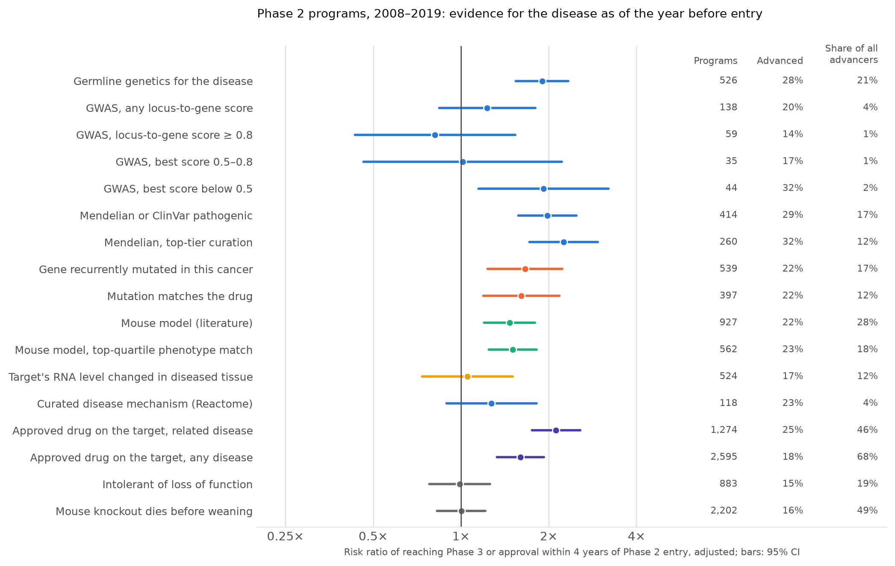

# Appendix detail

<!-- Rendered by `python -m report` into REPORT_APPENDIX.md, the doc's "Appendix detail" tab. -->

## Tables behind the figures

The numbers each figure in the main tab draws, with the columns the figures leave out.

### Phase transitions

| Transition | All programs (95% CI) | Developed in the US (95% CI) | BIO 2011–2020 |
| :---- | :---- | :---- | :---- |
| Phase 1 → Phase 2 | 54.7% (52.8–56.7), n=6,262 | 56.7% (54.1–59.4), n=3,967 | 52.0% |
| Phase 2 → Phase 3 | 29.3% (27.9–30.7), n=6,038 | 32.1% (30.3–33.9), n=3,923 | 28.9% |
| Phase 3 → Approval | 39.2% (36.2–42.1), n=1,986 | 53.3% (50.3–56.4), n=1,377 | 52.4% |
| **Phase 1 → Approval (LOA)** | **6.3%** (5.6–7.0) | **9.7%** (8.7–10.9) | **7.9%** (novel drugs 6.8%) |

### Why programs stop

Cause of each Phase 2 and 3 stop as registered and after tracing.

| Cause of the stop | As registered | After tracing: sourced | After tracing: sourced or likely |
| :---- | :---- | :---- | :---- |
| Efficacy or exposure (PK, dose, formulation) | 29% (1,590) | 39% (2,157) | 44% (2,398) |
| Safety | 3% (160) | 4% (238) | 5% (247) |
| Sponsor decision (portfolio, commercial, partner, acquisition, funding or closure) | 5% (257) | 12% (672) | 20% (1,123) |
| Operational (enrollment, sites, supply, regulatory) | 5% (273) | 6% (310) | 6% (331) |
| Positive readout, not yet advanced | 12% (640) | 21% (1,145) | 22% (1,178) |
| Unknown | 47% (2,559) | 15% (812) | 1% (51) |
| Did not actually stop | 0% (0) | 3% (145) | 3% (151) |

### Why efficacy failed

Efficacy and exposure stops by what the evidence shows about target engagement, by phase.

| What the evidence shows | Phase 2 | Phase 3 | Phase 2 and 3 | Outside oncology |
| :---- | :---- | :---- | :---- | :---- |
| Not engaged: exposure or engagement too low, or another drug on the target worked | 11% (182) | 11% (50) | 11% (232) | 10% (155) |
| Engaged, no benefit: target or mechanism wrong for the disease as tested | 45% (747) | 49% (231) | 46% (978) | 44% (694) |
| Trial design, population or endpoint, mechanism not in question | 6% (98) | 10% (47) | 7% (145) | 8% (125) |
| On-target toxicity offset efficacy | 1% (10) | 0% (1) | 1% (11) | 0% (2) |
| No engagement data: no human evidence of engagement either way | 37% (607) | 31% (147) | 36% (754) | 38% (602) |
| **Not engaged, of failures whose mechanism was tested** | **20%** (17–23) | **18%** (13–23) | **19%** (17–22) | **18%** (15–21) |
| Programs (entities) | 1,644 (1,282) | 476 (423) | 2,120 (1,591) | 1,578 (1,257) |

### By disease area and modality

| Disease area | All programs, LOA (95% CI) | Entities | Developed in the US, LOA (95% CI) | BIO 2011–2020 |
| :---- | :---- | :---- | :---- | :---- |
| Hematology | 19.3% (13.0–25.7) | 229 | 24.7% (16.6–34.0) | 23.9% |
| Oncology | 11.7% (9.3–14.2) | 1,808 | 13.9% (10.9–17.0) | 5.3% |
| Metabolic | 9.7% (6.3–13.8) | 281 | 16.7% (10.9–24.2) | 15.5% |
| Infectious disease | 9.0% (6.6–11.4) | 654 | 17.5% (13.3–21.9) | 13.2% |
| Allergy | 9.0% (4.1–15.7) | 128 | 16.8% (5.4–29.0) | 10.3% |
| Autoimmune | 8.3% (5.7–11.1) | 513 | 10.8% (7.5–14.5) | 10.7% |
| Endocrine | 7.3% (4.5–10.8) | 325 | 14.0% (8.8–19.9) | 6.6% |
| Neurology | 7.2% (5.5–9.1) | 756 | 10.9% (8.4–13.7) | 5.9% |
| Psychiatry | 7.0% (4.3–10.2) | 311 | 9.5% (5.6–13.7) | 7.3% |
| Respiratory | 5.7% (3.4–8.3) | 351 | 10.1% (5.9–14.4) | 7.5% |
| Ophthalmology | 5.6% (3.2–8.1) | 322 | 6.5% (3.8–9.7) | 11.9% |
| Other | 4.3% (3.0–5.8) | 738 | 8.7% (6.1–11.4) | 13.0% |
| Cardiovascular | 3.6% (1.8–5.5) | 316 | 6.0% (3.1–9.8) | 4.8% |
| Gastroenterology | 3.0% (1.4–5.0) | 326 | 7.5% (3.8–11.8) | 8.3% |
| Urology | 2.5% (0.4–5.6) | 78 | – | 3.6% |

| Modality | All programs, LOA (95% CI) | Entities | Developed in the US, LOA (95% CI) | BIO 2011–2020 |
| :---- | :---- | :---- | :---- | :---- |
| Monoclonal antibody | 14.1% (10.6–18.1) | 838 | 16.2% (11.8–20.9) | 12.1% |
| Antibody–drug conjugate | 11.7% (5.5–18.8) | 148 | 11.8% (5.2–19.4) | 10.8% |
| Protein | 6.5% (4.4–8.8) | 468 | 9.3% (6.2–12.8) | 9.4% |
| Small molecule | 6.1% (5.3–7.0) | 4,137 | 9.4% (8.2–10.6) | 7.5% |
| Gene therapy | 5.9% (2.1–11.0) | 143 | 7.5% (2.9–13.4) | 10.0% |
| Peptide | 4.3% (2.1–6.8) | 276 | 7.1% (3.7–11.6) | 8.0% |
| Antisense oligonucleotide | 3.7% (0.9–8.2) | 91 | 5.1% (1.4–11.8) | 5.2% |
| Other cell therapy | 1.2% (0.4–2.5) | 269 | 2.9% (0.9–6.3) | – |
| Microbiome or live biotherapeutic | 0.4% (0.0–2.9) | 43 | – | – |
| Other | 0.3% (0.1–0.6) | 276 | 0.9% (0.0–2.8) | – |

### Relative success

| Evidence line | Programs with it | LOA with / without | Relative success (95% CI) |
| :---- | :---- | :---- | :---- |
| Rare-variant or Mendelian genetics | 739 | 24.2% / 8.8% | 2.75 (2.02–3.65) |
| Any human genetics | 932 | 22.8% / 8.6% | 2.65 (1.95–3.48) |
| Somatic cancer driver | 1,180 | 21.1% / 9.0% | 2.35 (1.62–3.19) |
| Disease pathway (Reactome) | 191 | 19.2% / 9.8% | 1.96 (1.09–3.00) |
| GWAS | 258 | 17.2% / 9.8% | 1.75 (1.11–2.55) |
| Mouse model | 1,665 | 13.1% / 9.2% | 1.42 (1.08–1.88) |
| Expressed differently in the disease | 1,046 | 10.6% / 10.0% | 1.07 (0.69–1.51) |
| **Target liabilities** (not specific to the disease) |  |  |  |
| Intolerant of loss of function | 1,817 | 8.7% / 10.4% | 0.83 (0.57–1.22) |
| **Drug pharmacology** (assays of the drug itself, not evidence for the disease) |  |  |  |
| Very potent at the target (10 nM or better) | 1,204 | 12.9% / 9.6% | 1.34 (0.92–1.90) |
| At least 100-fold selective over measured off-targets | 320 | 13.2% / 9.9% | 1.33 (0.66–2.25) |
| Potent at the target (100 nM or better) | 1,651 | 11.0% / 9.8% | 1.12 (0.80–1.55) |
| Potency at the target measured | 1,973 | 9.9% / 10.0% | 0.99 (0.74–1.33) |
| Functional potency measured in cells | 455 | 7.4% / 10.2% | 0.73 (0.44–1.12) |

### Genetic dose–response

| Genetic association score before entry (Open Targets, 0–1) | Programs | Targets | LOA (95% CI) |
| :---- | :---- | :---- | :---- |
| 0 (no genetic support) | 7,639 | 1,262 | 8.6% (7.0–10.7) |
| up to 0.61 (lowest third) | 382 | 220 | 16.6% (10.7–22.8) |
| 0.61–0.92 (middle third) | 297 | 144 | 22.4% (14.8–30.5) |
| above 0.92 (highest third) | 270 | 138 | 30.5% (24.1–37.0) |

### Relative success by disease area

| Evidence line | Oncology | Immunology and inflammation | Other | Neuroscience | Cardiometabolic and endocrine | Hematology | Differs between groups, Phase 2 (p) |
| :---- | :---- | :---- | :---- | :---- | :---- | :---- | :---- |
| Any human genetics | 1.96 (1.03–3.46), n=328 | 1.55 (0.71–2.60), n=139 | –, n=93 | 3.13 (1.66–5.27), n=135 | 3.31 (2.01–5.74), n=159 | –, n=78 | 0.53 (6 groups) |
| GWAS | –, n=67 | –, n=80 | –, n=48 | –, n=28 | –, n=35 | –, n=0 | 0.76 (3 groups) |
| Rare-variant or Mendelian genetics | 2.13 (1.07–3.74), n=284 | –, n=62 | –, n=54 | 3.03 (1.49–5.14), n=121 | 3.30 (1.95–5.59), n=140 | –, n=78 | 0.74 (6 groups) |
| Somatic cancer driver | 2.02 (1.15–3.82), n=1,161 | –, n=4 | –, n=5 | –, n=1 | –, n=7 | –, n=2 | – |
| Mouse model | 0.97 (0.53–1.65), n=470 | 1.63 (0.92–2.68), n=234 | 1.56 (0.69–2.89), n=178 | 1.78 (1.02–2.88), n=273 | 1.48 (0.92–2.51), n=408 | 1.38 (0.76–3.27), n=102 | 0.45 (6 groups) |
| Expressed differently in the disease | 1.03 (0.61–1.72), n=766 | 0.37 (0.06–0.77), n=169 | –, n=30 | –, n=71 | –, n=10 | –, n=0 | 0.01 (3 groups) |
| Potent at the target (100 nM or better) | 0.98 (0.51–1.72), n=855 | 1.49 (0.77–2.49), n=194 | 1.78 (0.92–3.13), n=211 | 0.78 (0.40–1.32), n=236 | 1.28 (0.61–2.24), n=139 | –, n=16 | 0.34 (5 groups) |

### What each line adds once the others are known

| Evidence | Phase 1 → 2 | Phase 2 → 3 | Phase 3 → approval |
| :---- | :---- | :---- | :---- |
| GWAS | 1.05 (0.94–1.17) | 1.09 (0.84–1.41) | 1.13 (0.83–1.55) |
| Rare-variant or Mendelian genetics | 1.03 (0.94–1.13) | 1.51 (1.29–1.77) | 1.43 (1.17–1.74) |
| Somatic cancer driver | 1.12 (1.00–1.24) | 1.31 (1.04–1.65) | 1.09 (0.87–1.37) |
| Mouse model | 0.98 (0.92–1.04) | 1.13 (0.99–1.28) | 1.07 (0.90–1.27) |
| Expressed differently in the disease | 0.95 (0.87–1.03) | 0.85 (0.69–1.05) | 0.83 (0.65–1.05) |
| Disease pathway (Reactome) | 1.09 (0.98–1.21) | 0.81 (0.59–1.11) | 1.05 (0.82–1.35) |
| **Target liabilities** (not specific to the disease) |  |  |  |
| Intolerant of loss of function | 0.90 (0.82–0.99) | 1.03 (0.87–1.22) | 0.94 (0.75–1.17) |
| **Drug pharmacology** (assays of the drug itself, not evidence for the disease) |  |  |  |
| Potency at the target measured | 0.81 (0.64–1.02) | 0.90 (0.68–1.18) | 1.15 (0.81–1.63) |
| Potent at the target (100 nM or better) | 1.15 (0.90–1.47) | 1.23 (0.90–1.67) | 1.13 (0.80–1.60) |
| Functional potency measured in cells | 0.85 (0.65–1.10) | 0.88 (0.70–1.12) | 0.96 (0.72–1.28) |
| At least 100-fold selective over measured off-targets | 1.10 (0.89–1.36) | 1.15 (0.85–1.57) | 1.11 (0.84–1.48) |

### Does the evidence predict which programs reach approval?

| Validation | Features | AUC (95% CI) | PR-AUC (base rate) | Programs (approved) |
| :---- | :---- | :---- | :---- | :---- |
| Held-out target sets | Area, modality, novelty, year | 0.585 (0.524–0.646) | 0.112 (0.059) | 2,990 (175) |
| Temporal (later entrants held out) | Area, modality, novelty, year | 0.626 (0.549–0.709) | 0.122 (0.064) | 1,529 (98) |
| Held-out target sets | … plus all evidence lines | 0.622 (0.572–0.676) | 0.117 (0.059) | 2,990 (175) |
| Temporal (later entrants held out) | … plus all evidence lines | 0.640 (0.574–0.724) | 0.127 (0.064) | 1,529 (98) |
| Held-out target sets | Evidence lines only | 0.573 (0.489–0.651) | 0.089 (0.059) | 2,990 (175) |
| Temporal (later entrants held out) | Evidence lines only | 0.618 (0.549–0.691) | 0.111 (0.064) | 1,529 (98) |

Change in held-out AUC when each line is removed from the full model:

| Evidence removed | AUC change (95% CI) |
| :---- | :---- |
| Any human genetics | -0.029 (-0.049 to -0.005) |
| Rare-variant or Mendelian genetics | -0.029 (-0.051 to -0.005) |
| Somatic cancer driver | -0.003 (-0.031 to +0.027) |
| Expressed differently in the disease | -0.002 (-0.021 to +0.026) |
| Intolerant of loss of function | -0.001 (-0.010 to +0.009) |
| Mouse model | -0.000 (-0.005 to +0.005) |

### Confirmatory hypotheses

| Hypothesis | Measure | Estimate (95% CI) | p | Holm p | Result |
| :---- | :---- | :---- | :---- | :---- | :---- |
| Outside oncology: genetics for the disease vs no germline genetics on the target, advancing within 4 years of Phase 2 | risk ratio | 1.52 (1.06–2.18) | 0.021 | 0.107 | not supported |
| Same target in different diseases: genetics for the disease vs not (conditional logit) | odds ratio | 3.02 (1.99–4.58) | < 0.001 | < 0.001 | supported |
| Direction of genetic effect vs drug action (Open Targets direction fields): discordant < undirected < concordant | risk ratio per step | 1.16 (0.85–1.59) | 0.359 | 1.000 | not supported |
| Trials outside oncology: how the effect of genetics on missing the primary endpoint changes per step from proximal to distal endpoints (registry-posted results, FDAAA era) | ratio of risk ratios | 1.12 (0.84–1.49) | 0.458 | 1.000 | not supported |
| Genetics for the disease lowers efficacy failure more than business or operational failure (Phases 2 and 3) | ratio of risk ratios | 1.21 (0.78–1.89) | 0.398 | 1.000 | not supported |
| Outside oncology, target liability raises safety failure, and more than efficacy failure (Phases 1–3; intersection-union test) | risk ratio, safety failure | 1.20 (0.76–1.88) | 0.443 | 1.000 | not supported |
| Oncology: a somatic driver whose direction matches the drug, advancing within 4 years of Phase 2 | risk ratio | 1.54 (1.11–2.14) | 0.010 | 0.062 | not supported |

### Which evidence translates: the registered screen

Every rule the plan registered, each against programs without it, before the rules were grouped by kind.



| Evidence for the disease, known before Phase 2 | Programs (targets) | Advanced: with / without | Share of all that advanced | Risk ratio, all (95% CI) | Risk ratio, non-oncology | Risk ratio, oncology |
| :---- | :---- | :---- | :---- | :---- | :---- | :---- |
| Germline genetics for the disease | 526 (238) | 28% / 14% | 21% | 1.90 (1.54–2.33) | 1.46 (1.09–1.95) | 2.29 (1.64–3.18) |
| GWAS, any locus-to-gene score | 138 (75) | 20% / 16% | 4% | 1.23 (0.84–1.79) | 1.29 (0.78–2.15) | 1.58 (0.94–2.65) |
| GWAS, locus-to-gene score ≥ 0.8 | 59 (37) | 14% / 16% | 1% | 0.81 (0.43–1.53) | 0.82 (0.36–1.85) | – |
| GWAS, best score 0.5–0.8 | 35 (20) | 17% / 16% | 1% | 1.01 (0.46–2.22) | – | – |
| GWAS, best score below 0.5 | 44 (28) | 32% / 16% | 2% | 1.91 (1.14–3.18) | 2.09 (1.17–3.73) | – |
| Mendelian or ClinVar pathogenic | 414 (184) | 29% / 14% | 17% | 1.98 (1.57–2.49) | 1.50 (1.08–2.09) | 2.20 (1.54–3.14) |
| Mendelian, top-tier curation | 260 (121) | 32% / 15% | 12% | 2.25 (1.72–2.94) | 1.57 (1.07–2.30) | 3.09 (2.16–4.42) |
| Somatic cancer driver | 539 (132) | 22% / 15% | 17% | 1.66 (1.23–2.22) | – | 1.61 (1.16–2.24) |
| Somatic driver, direction matches the drug | 397 (91) | 22% / 15% | 12% | 1.61 (1.19–2.18) | – | 1.54 (1.11–2.14) |
| Mouse model (literature) | 928 (422) | 22% / 14% | 28% | 1.46 (1.20–1.79) | 1.48 (1.20–1.83) | 1.30 (0.80–2.10) |
| Mouse model, top-quartile phenotype match | 563 (277) | 23% / 15% | 18% | 1.50 (1.24–1.81) | 1.56 (1.23–1.98) | 1.23 (0.83–1.83) |
| Expressed differently in the disease | 524 (262) | 17% / 16% | 12% | 1.05 (0.73–1.50) | 0.57 (0.32–1.01) | 1.23 (0.82–1.84) |
| Disease pathway (Reactome) | 118 (42) | 23% / 16% | 4% | 1.27 (0.89–1.82) | – | – |
| **Clinical precedent** |  |  |  |  |  |  |
| Approved drug on the target, related disease | 1,270 (365) | 26% / 12% | 46% | 2.12 (1.76–2.57) | 1.94 (1.54–2.43) | 2.47 (1.58–3.86) |
| Approved drug on the target, any disease | 2,588 (565) | 19% / 12% | 67% | 1.60 (1.33–1.92) | 1.51 (1.21–1.90) | 1.71 (1.23–2.38) |
| **Target liabilities** (not specific to the disease) |  |  |  |  |  |  |
| Essential in most cell lines | 0 (0) | – / 16% | 0% | – | – | – |
| Intolerant of loss of function | 885 (220) | 15% / 16% | 19% | 1.00 (0.79–1.26) | 1.19 (0.92–1.53) | 0.81 (0.54–1.22) |
| Mouse knockout dies before weaning | 2,204 (543) | 16% / 16% | 49% | 1.00 (0.83–1.22) | 0.88 (0.72–1.08) | 1.13 (0.76–1.66) |

### By endpoint

| Class of the governing primary endpoint | Trials | Missed primary endpoint | Trials with genetics for the disease | Missed: with / without genetics | Risk ratio of a miss, all readable trials (95% CI) | Risk ratio, registry-posted results (FDAAA era) |
| :---- | :---- | :---- | :---- | :---- | :---- | :---- |
| Target engagement | 62 | 29% | 21 | 33% / 27% | 0.99 (0.39–2.52) | – |
| Exploratory biomarker | 261 | 69% | 24 | 79% / 68% | 1.16 (0.88–1.52) | – |
| Regulatory surrogate (LDL-C, HbA1c, viral load…) | 1,369 | 22% | 212 | 17% / 23% | 1.06 (0.71–1.60) | 0.57 (0.27–1.21) |
| Objective physiology (6MWD, visual acuity, weight…) | 451 | 53% | 80 | 45% / 55% | 0.98 (0.69–1.39) | 1.06 (0.75–1.49) |
| Clinician-rated scale or responder index | 1,309 | 55% | 170 | 47% / 56% | 0.83 (0.66–1.03) | 0.87 (0.69–1.11) |
| Patient-reported outcome | 664 | 51% | 7 | 57% / 51% | – | – |
| Disease events (relapses, exacerbations…) | 339 | 42% | 51 | 39% / 42% | 0.87 (0.56–1.35) | – |
| Hard outcome (death, MI, stroke…) | 161 | 53% | 11 | 55% / 53% | – | – |
| Tumour response | 153 | 63% | 33 | 61% / 63% | 1.02 (0.72–1.44) | – |
| Progression-free survival | 535 | 59% | 104 | 52% / 61% | 1.04 (0.86–1.25) | 1.04 (0.76–1.42) |
| Overall survival | 243 | 69% | 26 | 54% / 71% | 0.74 (0.52–1.05) | – |

### Which kinds of evidence predict, and whether being more specific helps

| Evidence before Phase 2 | Applies to | With it (targets) | Advanced: with / without | Adjusted risk ratio (95% CI) | Holm-corrected p |
| :---- | :---- | :---- | :---- | :---- | :---- |
| Germline genetics for the disease | All | 526 (238) | 28% / 14% | 1.90 (1.54–2.33) | < 0.001 |
| Animal model of the disease | All | 934 (427) | 22% / 14% | 1.46 (1.20–1.78) | < 0.001 |
| Somatic driver for the tumour | Oncology | 533 (131) | 22% / 13% | 1.61 (1.16–2.24) | 0.019 |
| CRISPR screen in cells | All | 0 (0) | – / 16% | too few programs (0) to test | – |
| Expressed differently in the disease | All | 524 (262) | 17% / 16% | 1.05 (0.73–1.50) | 1.000 |
| Disease pathway (Reactome) | All | 118 (42) | 23% / 16% | 1.27 (0.89–1.82) | 0.540 |
| Target liability | All | 2,358 (583) | 16% / 16% | 1.01 (0.83–1.23) | 1.000 |
| **Benchmark** (clinical precedent, not preclinical evidence) |  |  |  |  |  |
| Approved drug on the target, related disease | All | 1,270 (365) | 26% / 12% | 2.12 (1.76–2.57) | – |

| More specific version | Within programs with | Programs | Advanced: with / rest of the type | Adjusted risk ratio (95% CI) | Holm-corrected p |
| :---- | :---- | :---- | :---- | :---- | :---- |
| GWAS with locus-to-gene ≥ 0.8 | Germline genetics for the disease | 59 of 526 | 14% / 30% | 0.54 (0.28–1.05) | 0.608 |
| Mendelian evidence in a non-hereditary disease | Germline genetics for the disease | 116 of 200 | 26% / 20% | 0.94 (0.48–1.82) | 1.000 |
| GWAS and rare-variant evidence together | Germline genetics for the disease | 26 of 526 | 8% / 29% | 0.26 (0.07–0.91) | 0.353 |
| Drug raises function or replaces the gene, hereditary disease | Germline genetics for the disease | 110 of 166 | 32% / 20% | 1.82 (0.84–3.93) | 1.000 |
| Genetics points the same way as the drug (added after the plan) | Germline genetics for the disease | 265 of 526 | 29% / 28% | 1.12 (0.77–1.63) | 1.000 |
| Protective loss of function + drug that lowers function (added after the plan) | Germline genetics for the disease | 30 of 526 | 13% / 29% | too few to test | – |
| Close phenotype match (top quartile) | Animal model of the disease | 564 of 934 | 23% / 19% | 1.16 (0.81–1.68) | 1.000 |
| Mouse model points the same way as the drug (added after the plan) | Animal model of the disease | 328 of 934 | 23% / 20% | 1.10 (0.81–1.48) | 1.000 |
| Driver matches the drug (activated oncogene + inhibitor) | Somatic driver for the tumour | 385 of 533 | 23% / 21% | 1.00 (0.63–1.59) | 1.000 |
| Expression up + drug that lowers function | Expressed differently in the disease | 247 of 524 | 15% / 18% | 0.94 (0.53–1.68) | 1.000 |
| Liability + drug that lowers function | Target liability | 1,717 of 2,358 | 15% / 17% | 1.03 (0.79–1.34) | 1.000 |

## Sources in detail

Each entry gives who compiles the source and from what, what this analysis takes from it, the shape of the raw response, and a real record from the cached download, trimmed to the fields used.

### ClinicalTrials.gov API v2

*Snapshot 2026-11-02, 227,130 studies · `GET https://clinicaltrials.gov/api/v2/studies?filter.advanced=AREA[StudyType]INTERVENTIONAL AND AREA[InterventionType](DRUG OR BIOLOGICAL OR GENETIC OR COMBINATION_PRODUCT)&pageSize=1000` paged by `pageToken`*

**Compiled by.** The National Library of Medicine runs the registry. Sponsors enter the protocol record and the results themselves, as FDAAA 801 requires for applicable trials. NLM reviews entries for quality but does not check them against source records.
**We use.** From the protocol section we keep status, dates, the why-stopped text, phases, sponsor and its class, design, conditions, interventions, arms, references, countries, brief summary and primary outcomes. From the results section, posted for 53,902 studies, we keep every primary outcome's values per group and every statistical analysis, plus deaths and serious adverse events per arm.
**Shape.** `{totalCount, nextPageToken, studies: [{protocolSection: {statusModule, sponsorCollaboratorsModule, designModule, armsInterventionsModule, conditionsModule, outcomesModule, referencesModule, …}, resultsSection: {participantFlowModule, baselineCharacteristicsModule, outcomeMeasuresModule, adverseEventsModule}, hasResults}]}`

```json
{"nctId": "NCT03548935", "overallStatus": "COMPLETED", "phases": ["PHASE3"],
 "leadSponsor": {"name": "Novo Nordisk A/S", "class": "INDUSTRY"},
 "startDateStruct": {"date": "2018-06-04"}, "enrollmentInfo": {"count": 1961},
 "primaryOutcomes": [{"measure": "Change in Body Weight (%)", "timeFrame": "…week 68"}],
 "outcomeMeasures[0].analyses[0]": {"pValue": "<.0001", "statisticalMethod": "ANCOVA",
   "paramType": "Treatment difference", "paramValue": "-12.44", "ciLowerLimit": "-13.37", "ciUpperLimit": "-11.51"},
 "eventGroups[0]": {"title": "Sema 2.4 mg", "deathsNumAffected": 1, "deathsNumAtRisk": 1306, "seriousNumAffected": 128}}
```

### PubMed E-utilities

*Queried at run time; each run is recorded with its date and a hash of what it returned · `esearch.fcgi?db=pubmed&term=NCT…[si]`, then `efetch.fcgi?retmode=xml`*

**Compiled by.** NCBI indexes citations from publishers and MEDLINE. A trial registration number named in an article is recorded in its data-bank list and is searchable as a secondary identifier.
**We use.** We look up only completed industry Phase 2/3 trials, started from 2008, that posted no results. A paper links to a trial when the registry lists it as a RESULT or DERIVED reference, or when PubMed lists the NCT number. This links 2,284 trials. For each paper we keep title, first author, journal, year, DOI and abstract, and the abstracts feed the outcome classifier.
**Shape.** `<PubmedArticle><MedlineCitation><PMID/><Article><Journal/><ArticleTitle/><Abstract/><DataBankList><DataBank><AccessionNumber/></DataBank></DataBankList></Article></MedlineCitation><PubmedData><ArticleIdList><ArticleId IdType="doi"/></ArticleIdList></PubmedData></PubmedArticle>`

```text
NCT03036488 (KEYNOTE-522; no posted results) -> PMID 32101663, linked by both routes
  N Engl J Med 2020, "Pembrolizumab for Early Triple-Negative Breast Cancer", Schmid P et al.
  DataBank ClinicalTrials.gov / AccessionNumber NCT03036488, doi 10.1056/NEJMoa1910549
```

### Drugs@FDA data files

*Data to 2026-10-28 · `GET https://www.fda.gov/media/89850/download`, a zip of tab-separated tables*

**Compiled by.** FDA's drug center (CDER) publishes these files from its own application records. They cover drugs and therapeutic biologics, not the vaccines, blood products and cell or gene therapies that CBER regulates.
**We use.** NDA and BLA applications: sponsor, products and active ingredients, every original and supplement submission with its class, status, date and review priority, and the links to approval letters. That is 6,394 applications.
**Shape.** `Applications.txt` (ApplNo, ApplType, SponsorName), `Products.txt`, `Submissions.txt` (ApplNo, SubmissionClassCodeID, SubmissionType, SubmissionNo, SubmissionStatus, SubmissionStatusDate, ReviewPriority), `ApplicationDocs.txt` (type 1 = letter, URL, date).

```text
Applications     125514  BLA  MERCK SHARP DOHME
Products         125514  001  SOLUTION;INTRAVENOUS  100MG/4ML  KEYTRUDA  PEMBROLIZUMAB
Submissions      125514  class 2 (EFFICACY)  SUPPL 89  AP  2021-07-26  STANDARD
ApplicationDocs  125514  SUPPL 89  letter  …/appletter/2021/125514Orig1s089s114ltr_.pdf
```

### FDA approval letters (CDER)

*Actions 2008 to 2026-10-28 · PDFs at `https://www.accessdata.fda.gov/drugsatfda_docs/appletter/<year>/<ApplNo>…ltr.pdf`, from the Drugs@FDA links*

**Compiled by.** The review division sends the letter to the sponsor when it acts, and FDA posts it. It names the approved submission and, for efficacy supplements, usually the new use it provides for.
**We use.** We fetch letters for every approved original application and every efficacy supplement. Text comes from the PDF's text layer, or from OCR when that layer is empty or garbled. An LLM records each approved use from the letter: disease, verbatim indication, qualifiers, type of change and accelerated approval.

```text
BLA 125514/S-089 + S-114 (Keytruda, 2021-07-26):
"(S-089) provides for a new indication for the treatment of patients with high-risk, early-stage
 triple negative breast cancer, in combination with chemotherapy as neoadjuvant treatment, then as
 a single agent as adjuvant treatment after surgery…"
-> use: triple-negative breast cancer · new population · not accelerated
-> use (S-114): metastatic TNBC, PD-L1 CPS ≥10 · conversion of the 2020 accelerated approval to full
```

### openFDA drug labels

*Export 2026-10-28, 262,903 labels · `GET https://api.fda.gov/download.json` lists the bulk files, e.g. `https://download.open.fda.gov/drug/label/drug-label-0001-of-0014.json.zip`*

**Compiled by.** Manufacturers submit Structured Product Labeling to FDA. openFDA republishes it in bulk with harmonised identifiers and notes that the data are not validated.
**We use.** We keep the current label of each NDA or BLA product, 5,102 in all, with its application numbers, names, UNII and the full Indications and Usage text. The approval classifier reads that text as evidence of approved uses, including uses approved before 2008.
**Shape.** `{meta, results: [{set_id, id, version, effective_time, indications_and_usage: [str], …, openfda: {application_number[], brand_name[], generic_name[], substance_name[], unii[]}}]}`

```json
{"set_id": "9333c79b-d487-4538-a9f0-71b91a02b287", "effective_time": "20260710",
 "openfda": {"application_number": ["BLA125514"], "brand_name": ["KEYTRUDA"], "unii": ["DPT0O3T46P"]},
 "indications_and_usage": ["1 INDICATIONS AND USAGE KEYTRUDA is a programmed death receptor-1 (PD-1)-blocking
   antibody indicated: Melanoma for the treatment of patients with unresectable or metastatic melanoma. …"]}
```

### CBER biologics approvals

*Actions 2015-01-09 to 2025-12-19, 324 records on 177 applications · yearly pages `https://www.fda.gov/vaccines-blood-biologics/development-approval-process-cber/<year>-biological-license-application-approvals`, live from 2023 and from the Wayback Machine before; product pages; letter PDFs at `https://www.fda.gov/media/<id>/download`*

**Compiled by.** FDA's biologics center posts a yearly table of original licence approvals and noteworthy supplements, and a page per product linking its letters. None of these products are in Drugs@FDA.
**We use.** We keep original licences and supplements that add or change an indication, population, dose or formulation, with each letter's text. 53 letters came from Wayback captures. For the 10 records without a letter, the yearly-table entry stands in.

```json
{"appl_no": "125646", "submission_type": "ORIG", "approval_date": "2017-08-30",
 "product_brand": "KYMRIAH", "proper_name": "tisagenlecleucel", "product_class": "cell_therapy",
 "url": "https://www.fda.gov/media/106989/download", "pdf_source": "fda.gov",
 "yearly_listing_text": "KYMRIAH Tisagenlecleucel | For the treatment of patients up to 25 years of age with B-cell precursor ALL …"}
```

### FDA Global Substance Registration System (UNII)

*2026-08-04, 171,912 substances and 1,047,975 names · `https://precision.fda.gov/uniisearch/archive/2026-08-04/UNII_Data_20260804.zip`, plus the matching names file*

**Compiled by.** FDA assigns each Unique Ingredient Identifier from a substance's structure or defining information. It collects the substance's names from INN, USAN, JAN, brands and sponsor codes, each tagged with its type.
**We use.** Substances, with their INN, RxNorm and PubChem cross-references, and every name in normalised form. These resolve trial intervention names to one molecular entity and merge entities that are the same substance.
**Shape.** Records: 25 tab-separated columns, including UNII, DISPLAY_NAME, RXCUI, PUBCHEM, INN_ID, INCHIKEY and SUBSTANCE_TYPE. Names: NAME, TYPE (brand, code, common, official or systematic), UNII.

```text
53AXN4NNHX  SEMAGLUTIDE  RXCUI 1991302  PUBCHEM 56843331  INN_ID 9113  SUBSTANCE_TYPE protein
  names: NN9535 (code) · NNC-0113-0217 (code) · OZEMPIC (brand) · WEGOVY (brand) · SEMAGLUTIDE [JAN] (common)
```

### MONDO disease ontology

*2026-10-06 · `https://github.com/monarch-initiative/mondo/releases/latest/download/mondo.obo`*

**Compiled by.** The Monarch Initiative merges disease terms from OMIM, Orphanet, DOID, NCIT, EFO and others into one hierarchy. Each cross-reference is tagged as an exact equivalence or a looser relation.
**We use.** We keep terms, exact synonyms, obsolete flags, the is-a hierarchy with its full ancestor closure, and the cross-references with their equivalence flag. MONDO is the target vocabulary for trial conditions and for Open Targets diseases. Its hierarchy defines disease similarity: subtypes, and Lin ≥ 0.8.

```text
id: MONDO:0005439
name: familial hypercholesterolemia
synonym: "hyperlipoproteinemia type II" EXACT []
xref: EFO:0004911 {source="MONDO:equivalentTo"}      -> equivalent
xref: ICD9:V19.8 {source="MONDO:relatedTo"}          -> not equivalent
is_a: MONDO:0001336 ! familial hyperlipidemia
```

### EFO

*Reaches the analysis only as Open Targets disease identifiers*

**Compiled by.** EMBL-EBI maintains EFO for Open Targets, the GWAS Catalog and Expression Atlas. It imports disease classes from MONDO and other ontologies and adds terms of its own.
**We use.** No EFO file. Open Targets keys 9,257 of its diseases by EFO identifiers. Each is mapped to MONDO through the disease's own MONDO cross-reference, then MONDO's declared equivalence to the EFO term. Failing both, it maps through a DOID, Orphanet, NCIT or MeSH cross-reference that points to a single MONDO term.

```text
EFO_0000768 idiopathic pulmonary fibrosis: no MONDO xref, and no MONDO term lists EFO:0000768
  -> DOID:0050156 and Orphanet:2032 are both equivalent to MONDO:0800504
```

### Mammalian Phenotype ontology

*2026-09-23 · `http://purl.obolibrary.org/obo/mp.obo`*

**Compiled by.** Mouse Genome Informatics at the Jackson Laboratory maintains it. MGI and IMPC curators use it to annotate phenotypes of mutant mice.
**We use.** The hierarchy only. A target counts as "knockout lethal before weaning" when any of its Open Targets mouse phenotypes is MP:0010770 *preweaning lethality* or a descendant. That flags 688 genes.

```text
id: MP:0011100
name: preweaning lethality, complete penetrance
is_a: MP:0010770 ! preweaning lethality
```

### Gene symbols and identifiers

*Project catalogue, resolved through HGNC 2026-10-16 · `https://storage.googleapis.com/public-download-files/hgnc/tsv/tsv/hgnc_complete_set.txt`*

**Compiled by.** HGNC approves one symbol per human gene and records each gene's previous symbols and aliases. The project's own catalogue of 26,957 human proteins adds Ensembl identifiers, Pharos development level and family, and RefSeq summaries; some of its symbols predate HGNC renames.
**We use.** A target the LLM names is accepted when the symbol is a catalogue protein, or an HGNC approved, previous or alias symbol of one (an alias two genes share is not used). Ensembl identifiers join targets to Open Targets, gnomAD and DepMap.
**Shape.** Tab-separated, one approved gene per row: `hgnc_id, symbol, name, locus_group, alias_symbol, prev_symbol, entrez_id, ensembl_gene_id, uniprot_ids, …`, with lists separated by `|`.

```text
HGNC:11701  CRIPTO  cripto, EGF-CFC family member  protein-coding gene  prev_symbol TDGF1  ensembl ENSG00000241186
TDGF1 (previous) -> CRIPTO · CTGF (previous) -> CCN2 · CD20 (alias) -> MS4A1 · TIM3 (alias) -> HAVCR2
```

### ChEMBL mechanisms of action

*ChEMBL 37 (2026-05-01), 7,561 mechanisms · `GET https://www.ebi.ac.uk/chembl/api/data/mechanism.json?limit=1000&offset=…`, then `target.json` and `molecule.json` for the ids they name*

**Compiled by.** EMBL-EBI curators assign each approved or clinical-stage drug its molecular targets and action type, with references from labels and the literature.
**We use.** Only as hints. When the LLM assigns an entity's targets, it sees every mechanism of the parent molecule of each of its ChEMBL ids, as "SYMBOL: action" for each human gene of the target; its own answer is what we store. A target's genes are its UniProt components mapped to HGNC, so a complex or receptor family keeps all of them (1,257 mechanisms name more than one gene); mechanisms with no human gene, such as antibacterials, are shown as text.
**Shape.** `{mechanisms: [{mec_id, molecule_chembl_id, parent_molecule_chembl_id, target_chembl_id, action_type, mechanism_of_action, …}], page_meta: {next, …}}`; a target's `target_components[{accession}]` give its genes.

```json
{"mec_id": 8862, "molecule_chembl_id": "CHEMBL4297839", "target_chembl_id": "CHEMBL4383", "action_type": "AGONIST",
 "mechanism_of_action": "Gastric inhibitory polypeptide receptor agonist"}
{"mec_id": 8994, "molecule_chembl_id": "CHEMBL4297839", "target_chembl_id": "CHEMBL1784", "action_type": "AGONIST",
 "mechanism_of_action": "Glucagon-like peptide 1 receptor agonist"}
```

Tirzepatide's hints: GIPR: agonist, GLP1R: agonist.

### ChEMBL bioactivities

*ChEMBL 37 (2026-05-01), 137,580 measurements of 3,460 of 7,459 parent molecules · the release's MySQL dump, `https://ftp.ebi.ac.uk/pub/databases/chembl/ChEMBLdb/releases/chembl_37/chembl_37_mysql.tar.gz`, tables `activities`, `assays`, `docs`, `target_dictionary`, `target_components`, `component_sequences`, `molecule_dictionary` and `molecule_hierarchy`*

**Compiled by.** EMBL-EBI curators extract bioactivity measurements from medicinal chemistry journals and patents, and research groups and companies deposit screening datasets directly. Each measurement is tied to an assay (its type, binding or functional, and its format, such as cell-based or purified protein), a target and the document that reported it. ChEMBL converts half-maximal concentrations and affinity constants to pChEMBL, the negative log of the molar value, flags values it judges doubtful and marks values that repeat an earlier paper's.
**We use.** Every measurement with a pChEMBL value against a human target, for every form of each ChEMBL parent molecule matched to an entity with a development program (the routes are in the evidence methods): 137,580 after dropping 23,613 repeat citations and 0 flagged as doubtful (ChEMBL gives a pChEMBL value only to measurements it has not flagged), on 3,646 targets from 16,138 documents. Each document's year (a paper's publication year, a patent's year, a dataset's deposition year) dates its measurements. A target's genes are its UniProt components mapped to HGNC, as for mechanisms.
**Shape.** A MySQL dump with many rows per `INSERT`: `activities(activity_id, assay_id, doc_id, molregno, standard_type, pchembl_value, data_validity_comment, potential_duplicate, …)`, `assays(assay_id, chembl_id, assay_type, bao_format, tid, …)`, `docs(doc_id, chembl_id, year, journal, src_id, …)`.

```
INSERT INTO `activities` VALUES (…,'IC50',…,NULL,0,7.40,…)   imatinib, Abl kinase, binding assay, protein format
docs: CHEMBL1144977  Bioorg Med Chem Lett  2003
```

### gnomAD constraint

*v4.1 · loaded by earlier project code*

**Compiled by.** The Broad Institute's gnomAD compares each gene's observed loss-of-function variants, in exomes and genomes from about 800,000 people, with the number a mutation model expects. LOEUF is the upper bound of the 90% interval of observed over expected, and a low value means the gene does not tolerate loss of function.
**We use.** A target is LoF-intolerant when its LOEUF is below 0.35. That flags 1,385 of 18,164 genes. The value is today's, not the value at phase entry.

```text
PCSK9   pLI 1.1e-20  LOEUF 1.25    missense z 0.59
POLR2A  pLI 1.0      LOEUF 0.161   missense z 9.21
```

### DepMap gene essentiality

*DepMap Public 19Q4, 20Q4, 21Q4, 22Q4, 23Q4 and 24Q4 · the common-essential file of each release's figshare record (`Achilles_common_essentials.csv` through 20Q4, `CRISPR_common_essentials.csv` in 21Q4, `CRISPRInferredCommonEssentials.csv` from 22Q4), e.g. `https://api.figshare.com/v2/articles/27993248/files`*

**Compiled by.** The Broad Institute's Cancer Dependency Map knocks out every gene by CRISPR in about a thousand cancer cell lines, and Chronos estimates each gene's effect on growth. DepMap's inferred common-essential list holds the genes whose knockout ranks among the most depleting in most lines.
**We use.** The list from the last release of each year, 2019 to 2024 (2,149 genes in 19Q4, 1,523 in 24Q4), keyed by Entrez id and mapped to Ensembl through HGNC. A target is flagged essential in most cell lines when it is on the latest list from before the program entered the phase. DepMap first published the list in 19Q2, so no list covers an earlier year. Through 20Q4 the list comes from the Broad's Achilles screens alone; from 21Q4 it combines them with the Sanger Project Score screens.
**Shape.** One column, `Essentials`, each row `SYMBOL (Entrez id)`.

```text
Essentials
AAMP (14)
AARS1 (16)
POLR2B (5431)
```

### Open Targets Platform: associations

*26.09 · `https://ftp.ebi.ac.uk/pub/databases/opentargets/platform/26.09/output/association_by_datasource_direct/*.parquet` and `…/disease/`*

**Compiled by.** EMBL-EBI, the Wellcome Sanger Institute and partners run Open Targets. It maps evidence from about 20 resources to Ensembl genes and to disease terms (MONDO, EFO, HP, Orphanet) and scores each item from 0 to 1. Per target, disease and datasource, it combines the items into one association score with a weighted harmonic sum. A "direct" association counts only evidence annotated to that exact disease, not to its subtypes. Each association carries a yearly series of its cumulative score.
**We use.** Direct associations from the 17 datasources below, for targets of drugs in industry programs. We keep the score, the evidence count and the yearly series, so evidence is taken as of the year before phase entry. The yearly series leaves out undated evidence.
**Shape.** `targetId, diseaseId, aggregationValue (datasource), associationScore, evidenceCount, timeseries[{year, associationScore, yearlyEvidenceCount}]`; diseases: `id, name, dbXRefs[], therapeuticAreas[]`.

```json
{"targetId": "ENSG00000169174", "diseaseId": "MONDO_0005439", "aggregationValue": "eva",
 "associationScore": 0.875, "evidenceCount": 829,
 "timeseries": [{"year": 2018, "associationScore": 0.0}, {"year": 2019, "associationScore": 0.704},
                {"year": 2021, "associationScore": 0.800}, {"year": 2026, "associationScore": 0.875},
                {"year": null, "associationScore": 0.875}]}
```

PCSK9 · familial hypercholesterolemia, ClinVar evidence.

### Open Targets Platform: evidence

*26.09 · `…/output/evidence_<datasource>/*.parquet` and `…/mouse_phenotype/`*

**Compiled by.** One row per supporting item: a variant, study, curated assertion, mouse model, expression contrast or reaction. Each row has a 0–1 score and the upstream statistic. Where the source allows, it also has a date, a confidence grade, and the direction of effect on the target (loss or gain of function) and on the trait (risk or protection).
**We use.** Every row for program targets. The Phase 2 analysis groups them into families and strength tiers, such as locus-to-gene ≥ 0.8, burden p < 2.5e-6, ClinGen definitive or strong, and PanelApp green. Mouse phenotypes give the knockout-lethality flag.
**Shape.** `id, targetId, diseaseId, datasourceId, score, resourceScore, confidence, publicationDate, directionOnTarget, directionOnTrait, variantFunctionalConsequenceId, literature[]`, plus source-specific fields such as `studyLocusId`, `beta`, `pValueMantissa`/`pValueExponent`, `clinicalSignificances`, `biologicalModelAllelicComposition`, `log2FoldChangeValue`.

```json
{"datasourceId": "gene_burden", "targetId": "ENSG00000169174", "diseaseId": "EFO_0022275",
 "projectId": "AstraZeneca PheWAS Portal", "cohortId": "UK Biobank 470k", "statisticalMethod": "flexdmg",
 "studyCasesWithQualifyingVariants": 584, "beta": -0.527, "pValueMantissa": 2.107, "pValueExponent": -40,
 "score": 1.0, "directionOnTarget": "LoF", "directionOnTrait": "protect", "publicationDate": "2021-08-10"}
```

PCSK9 loss of function lowers free cholesterol in very small VLDL.

| Datasource | Upstream and how Open Targets builds it | A row asserts | Example (target · disease · value) |
| :---- | :---- | :---- | :---- |
| GWAS credible sets | GWAS Catalog and summary statistics, fine-mapped; genes assigned by the locus-to-gene model | A fine-mapped locus implicates the gene; score = locus-to-gene | PCSK9 · LDL cholesterol · 0.987 |
| Gene burden | Rare-variant burden tests in exome cohorts (AstraZeneca PheWAS, Genebass, Regeneron, FinnGen and others) | Qualifying variants associate with the trait; effect, p, direction | PCSK9 · VLDL free cholesterol · β −0.53, p 2e-40, LoF protective |
| ClinVar (EVA) | ClinVar germline submissions via EMBL-EBI | A variant is classified for the disease; review status as confidence | PCSK9 · hypercholesterolemia AD3 · pathogenic, multiple submitters |
| Genomics England PanelApp | Diagnostic gene panels | Gene is on the disease's panel; green (diagnostic grade) or amber | PCSK9 · familial hypercholesterolaemia panel · green |
| Orphanet | Expert-curated gene–rare disease links | Gene causes or is associated with the disease | PCSK9 · homozygous FH · assessed |
| Gene2Phenotype | EMBL-EBI curated panels | Gene–disease link with allelic requirement; definitive to limited | LDLR · hypercholesterolemia · definitive, monoallelic |
| ClinGen | Gene–disease validity expert panels | Validity classification, definitive to refuted | PCSK9 · hypercholesterolemia AD3 · definitive (2018) |
| UniProt literature | UniProtKB disease annotations, from OMIM and the literature | Gene is involved in the disease | PCSK9 · hypercholesterolemia AD3 · high, 5 papers |
| UniProt variants | UniProtKB curated disease variants | A specific variant causes the disease | LDLR · FH type 1 · rs879254753 |
| Cancer Gene Census | COSMIC census drivers with per-tumour mutation counts | Gene drives the tumour type; oncogene (GoF) or suppressor (LoF) | EGFR · ovarian adenocarcinoma · GoF, 24/54 samples |
| IntOGen | Driver discovery over tumour cohorts (TCGA, PCAWG) | Gene is a significant driver in the cohort | EGFR · lung adenocarcinoma · p 2e-48, 7 methods |
| ClinVar somatic | ClinVar somatic submissions | A somatic variant is classified for the disease | LDLR · FH type 1 · pathogenic, expert panel |
| IMPC | IMPC and MGI mouse models, matched to diseases by PhenoDigm phenotype similarity | The mutant's phenotypes resemble the disease's | PCSK9 · hyperlipoproteinemia V · knockout, PhenoDigm 95 |
| Expression Atlas | Disease-versus-normal differential expression experiments | Gene is differentially expressed in the disease | PCSK9 · psoriasis · log2FC +2.5 |
| Reactome | Curated disease reactions | A variant perturbs a reaction in a disease pathway | CFTR · cystic fibrosis · F508del binds ERAD machinery |
| CRISPR | Project Score knockout fitness screens in cancer lines (Behan et al. 2019; re-analysed by Pacini et al. 2024, which Open Targets now dates every row by) | Gene is a fitness dependency in that cancer type | KRAS · plasma cell myeloma · priority 78 |
| CRISPR screens | CRISPRbrain screens in iPSC-derived neurons | Perturbing the gene shifts a screen phenotype | LDLR · neurodegeneration · log2FC −5.8 |
| Mouse phenotypes | IMPC and MGI phenotype annotations (MP terms), not linked to a disease | A mutant allele shows the phenotype | PCSK9 · decreased circulating LDL cholesterol |

We leave out three datasources. Clinical precedence and cancer biomarkers come from drugs' clinical records, so they would leak the outcome. Europe PMC counts literature co-mentions of gene and disease, which is attention, not evidence. For PCSK9 and familial hypercholesterolemia, clinical precedence alone scores 0.97.

